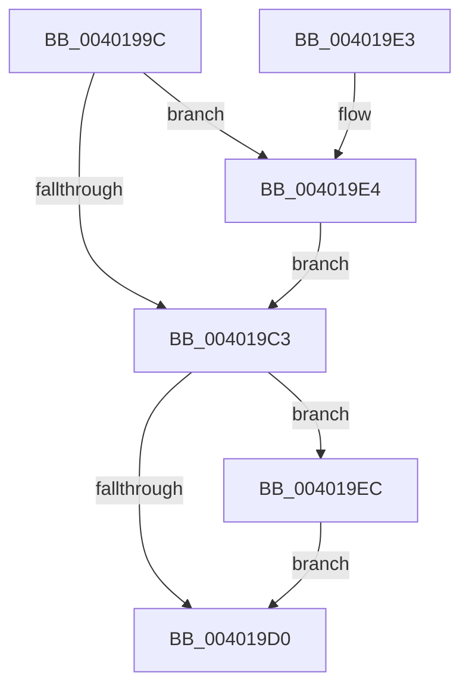

# MiRestrictRangeToNode

- RVA: `0x0040199C`–`0x00401A0B` (길이 `111` bytes)
- VA: `0x000000014040199C`
- 실행 섹션: `.text`
- PDB 이름 있음: `예`; PDB Function 태그: `아니요`
- unwind 정보 RVA: `0x0009A534`
- 디코드: `33`개 명령, `111/111` bytes 표시
- 미해석 바이트: `0` (있으면 어셈블리에 `.byte`로 보존)

> 이 문서는 커널 이미지의 기계어와 PDB 기호를 분석해 생성했습니다. 4번과 5번은 함수 원형과 자료형을 바이너리 사용 방식에서 추정한 C 해석이며 원본 소스 복구 결과는 아닙니다.

## 1. Dependencies

- 직접 호출 지점: **2**; 고유 호출 대상: **2**
- 직접 호출자로 확인된 함수: **12**
- RIP 상대 이미지 참조: **1**

### Outgoing calls
- `0x004019B1` → [MiSearchNumaNodeTable](MiSearchNumaNodeTable_function_00401A20.md) (function, `0x00401A20`)
- `0x004019EF` → [MiSearchChannelTable](../33/MiSearchChannelTable_function_0033BE24.md) (function, `0x0033BE24`)

### Direct callers
- [MiInitializeDynamicPfns](../67/MiInitializeDynamicPfns_function_00672BD0.md) at `0x00672D90`
- [MiHotRemoveHugeRange](../67/MiHotRemoveHugeRange_function_00675DD0.md) at `0x00675E36`
- [MiUpdatePartitionChildPageCounts](../69/MiUpdatePartitionChildPageCounts_function_006921D4.md) at `0x0069222E`
- [MiAddPhysicalMemoryChunks](../../page/7F/MiAddPhysicalMemoryChunks_function_007F98D4.md) at `0x007F99E6`
- [MiDescribePageRun](../../page/7F/MiDescribePageRun_function_007FA38C.md) at `0x007FA3BA`
- [MiZeroHotAddMemory](../../page/7F/MiZeroHotAddMemory_function_007FB324.md) at `0x007FB3A4`
- [MiCreateDescriptorPfns](../../init/C6/MiCreateDescriptorPfns_function_00C61D74.md) at `0x00C61E55`
- [MiRemoveLargeFreeLoaderDescriptors](../../init/C6/MiRemoveLargeFreeLoaderDescriptors_function_00C6283C.md) at `0x00C6298A`
- [MxComputeFreeNodeDescriptorRequirements](../../init/C6/MxComputeFreeNodeDescriptorRequirements_function_00C62F78.md) at `0x00C63022`
- [MxInitializeFreeNodeDescriptors](../../init/C6/MxInitializeFreeNodeDescriptors_function_00C6398C.md) at `0x00C639C9`
- [MxInsertFreePages](../../init/C6/MxInsertFreePages_function_00C63AD0.md) at `0x00C63B76`
- [MxMapPfnRange](../../init/C6/MxMapPfnRange_function_00C63CC8.md) at `0x00C63DBB`

### Static image references
- `0x004019C3` → RVA `0x00E2DC28` (`.data`; read)

## 2. Other-region calls and transfers

- 다른 실행 섹션으로 향하는 call: **0**
- 별도 외부 분기/꼬리 이동을 확인하지 못했습니다.

## 3. Assembly (complete function range)

```asm
0040199C  48 89 5C 24 08                  mov qword ptr [rsp + 8], rbx
004019A1  48 89 74 24 10                  mov qword ptr [rsp + 0x10], rsi
004019A6  57                              push rdi
004019A7  48 83 EC 20                     sub rsp, 0x20
004019AB  48 8B DA                        mov rbx, rdx
004019AE  48 8B F9                        mov rdi, rcx
004019B1  E8 6A 00 00 00                  call 0x140401a20
004019B6  48 8B 48 10                     mov rcx, qword ptr [rax + 0x10]
004019BA  48 8D 04 1F                     lea rax, [rdi + rbx]
004019BE  48 3B C1                        cmp rax, rcx
004019C1  77 21                           ja 0x1404019e4
004019C3  48 83 3D 5D C2 A2 00 00         cmp qword ptr [rip + 0xa2c25d], 0
004019CB  48 8B F3                        mov rsi, rbx
004019CE  75 1C                           jne 0x1404019ec
004019D0  48 8B 74 24 38                  mov rsi, qword ptr [rsp + 0x38]
004019D5  48 8B C3                        mov rax, rbx
004019D8  48 8B 5C 24 30                  mov rbx, qword ptr [rsp + 0x30]
004019DD  48 83 C4 20                     add rsp, 0x20
004019E1  5F                              pop rdi
004019E2  C3                              ret
004019E3  CC                              int3
004019E4  48 8B D9                        mov rbx, rcx
004019E7  48 2B DF                        sub rbx, rdi
004019EA  EB D7                           jmp 0x1404019c3
004019EC  48 8B CF                        mov rcx, rdi
004019EF  E8 30 A4 F3 FF                  call 0x14033be24
004019F4  48 8B 48 10                     mov rcx, qword ptr [rax + 0x10]
004019F8  48 8D 04 1F                     lea rax, [rdi + rbx]
004019FC  48 8B D9                        mov rbx, rcx
004019FF  48 2B DF                        sub rbx, rdi
00401A02  48 3B C1                        cmp rax, rcx
00401A05  48 0F 46 DE                     cmovbe rbx, rsi
00401A09  EB C5                           jmp 0x1404019d0
```

## 4. C-style interpretation (structured pseudocode)

```c
__int64 __fastcall MiRestrictRangeToNode(__int64 a1, __int64 a2)
{
    __int64 result;
    __int64 v_rbx;
    __int64 v_rsp;
    unsigned __int64 v_stack_p10;
    unsigned __int64 v_stack_p8;

    v_stack_p8 = v_rbx;
    v_stack_p10 = v_rsi;
    v_rsp = (v_rsp) - (32);
    result = MiSearchNumaNodeTable(a1, a2, a3, a4);
    if ((a1 + a2 * 1) > (*(unsigned __int64 *)(result + 16))) goto loc_004019E4;
loc_004019C3:
    if ((*(unsigned __int64 *)(v_rip + 10666589)) != 0) goto loc_004019EC;
loc_004019D0:
    v_rsp = (v_rsp) + (32);
    return a2;
loc_004019E4:
    v_rbx = (*(unsigned __int64 *)(result + 16)) - (a1);
    goto loc_004019C3;
loc_004019EC:
    result = MiSearchChannelTable(a1, a2, a3, a4);
    v_rbx = (*(unsigned __int64 *)(result + 16)) - (a1);
    if ((a1 + v_rbx * 1) <= (*(unsigned __int64 *)(result + 16))) { v_rbx = v_stack_p10; }
    goto loc_004019D0;
}
```

## 5. (Beta) C Style

```c
int64_t MiRestrictRangeToNode(void *Arg1, int64_t Arg2)
{
    uint8_t *arg1 = (uint8_t *)Arg1;

    int64_t result;
    int64_t local_rbx;
    int64_t local_rsp;
    uint64_t v_stack_p10;
    uint64_t v_stack_p8;

    v_stack_p8 = local_rbx;
    v_stack_p10 = local_rsi;
    local_rsp = (local_rsp) - (32);
    result = MiSearchNumaNodeTable(Arg1, Arg2, a3, a4);
    if ((Arg1 + Arg2 * 1) > (*(uint64_t *)(result + 0x10))) goto loc_004019E4;
loc_004019C3:
    if ((*(uint64_t *)(v_rip + 0xA2C25D)) != 0) goto loc_004019EC;
loc_004019D0:
    local_rsp = (local_rsp) + (32);
    return Arg2;
loc_004019E4:
    local_rbx = (*(uint64_t *)(result + 0x10)) - (Arg1);
    goto loc_004019C3;
loc_004019EC:
    result = MiSearchChannelTable(Arg1, Arg2, a3, a4);
    local_rbx = (*(uint64_t *)(result + 0x10)) - (Arg1);
    if ((Arg1 + local_rbx * 1) <= (*(uint64_t *)(result + 0x10))) { local_rbx = v_stack_p10; }
    goto loc_004019D0;
}
```

### 관측된 메모리 오프셋

구조체 형식이 확인되지 않은 접근은 인자 기준의 오프셋으로만 기록했습니다.

| 기준 인자 | 오프셋 표현 | 폭 (bit) | 접근 |
|---|---:|---:|---|
| `Arg1` | `+ 0x0 + rbx*1` | `64` | `R` |

## 6. Execution-region graph

[열기: 2D/3D 그래프와 함수 탐색 컨트롤 패널](../../../control-panel.html?section=text&rva=0x0040199C&view=graph)

- 2D 그래프는 위에서 아래로 흐르고, 3D 그래프는 빈 공간을 드래그해 회전합니다. Shift+드래그는 이동, 휠은 확대·축소, 함수 노드 선택은 대상 보고서 이동입니다.

### Static fallback


