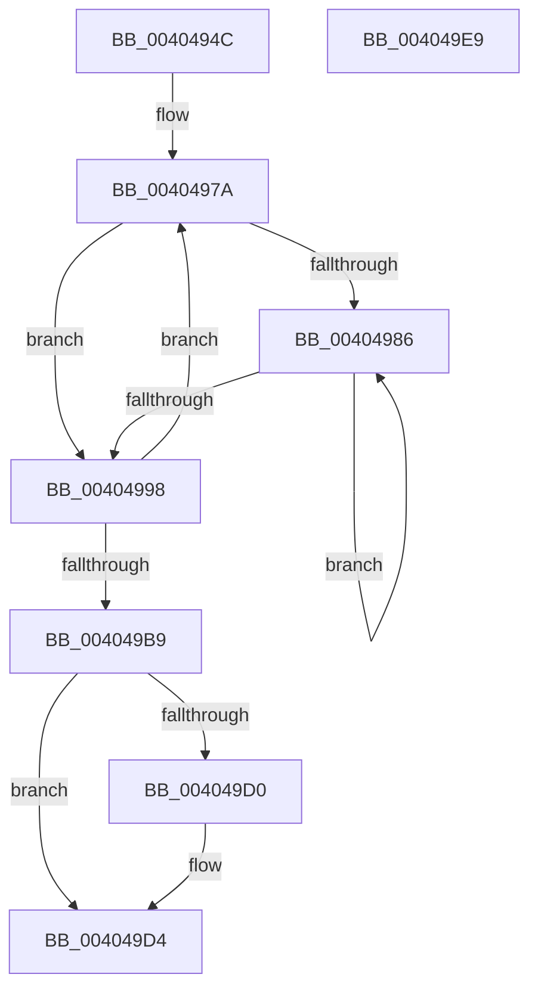

# MiRetardMdl

- RVA: `0x0040494C`–`0x004049EA` (길이 `158` bytes)
- VA: `0x000000014040494C`
- 실행 섹션: `.text`
- PDB 이름 있음: `예`; PDB Function 태그: `아니요`
- unwind 정보 RVA: `0x00071750`
- 디코드: `46`개 명령, `158/158` bytes 표시
- 미해석 바이트: `0` (있으면 어셈블리에 `.byte`로 보존)

> 이 문서는 커널 이미지의 기계어와 PDB 기호를 분석해 생성했습니다. 4번과 5번은 함수 원형과 자료형을 바이너리 사용 방식에서 추정한 C 해석이며 원본 소스 복구 결과는 아닙니다.

## 1. Dependencies

- 직접 호출 지점: **0**; 고유 호출 대상: **0**
- 직접 호출자로 확인된 함수: **9**
- RIP 상대 이미지 참조: **0**

### Outgoing calls
- 직접 디코드된 call 명령이 없습니다.

### Direct callers
- [MiFlushComplete](../29/MiFlushComplete_function_002980A0.md) at `0x00298168`
- [MmUnlockPages](../29/MmUnlockPages_function_0029EEE0.md) at `0x0029F177`
- [MiZeroPageWrite](../29/MiZeroPageWrite_function_0029F280.md) at `0x0029F50E`
- [MiPfCompleteCoalescedIo](../36/MiPfCompleteCoalescedIo_function_0036C344.md) at `0x0036C47B`
- [MiWaitForInPageComplete](../38/MiWaitForInPageComplete_function_00380AB8.md) at `0x00380DC5`
- [MmUnmapReservedMapping](../3E/MmUnmapReservedMapping_function_003E7BE0.md) at `0x003E7D6B`
- [MiFreePagesFromMdl](../3F/MiFreePagesFromMdl_function_003F8300.md) at `0x003F8390`
- [MiUnlockFlushMdl](MiUnlockFlushMdl_function_00404874.md) at `0x00404899`
- [MiWriteComplete](MiWriteComplete_function_004069B0.md) at `0x00406E35`

### Static image references
- 디코드된 RIP-relative 메모리 참조가 없습니다.

## 2. Other-region calls and transfers

- 다른 실행 섹션으로 향하는 call: **0**
- 별도 외부 분기/꼬리 이동을 확인하지 못했습니다.

## 3. Assembly (complete function range)

```asm
0040494C  48 89 5C 24 08                  mov qword ptr [rsp + 8], rbx
00404951  8B 51 2C                        mov edx, dword ptr [rcx + 0x2c]
00404954  4C 8D 51 30                     lea r10, [rcx + 0x30]
00404958  03 51 20                        add edx, dword ptr [rcx + 0x20]
0040495B  4C 8B C1                        mov r8, rcx
0040495E  8B 41 28                        mov eax, dword ptr [rcx + 0x28]
00404961  81 E2 FF 0F 00 00               and edx, 0xfff
00404967  48 05 FF 0F 00 00               add rax, 0xfff
0040496D  48 03 D0                        add rdx, rax
00404970  48 C1 EA 0C                     shr rdx, 0xc
00404974  4D 8D 0C D2                     lea r9, [r10 + rdx*8]
00404978  33 D2                           xor edx, edx
0040497A  4D 8B 19                        mov r11, qword ptr [r9]
0040497D  49 8D 59 08                     lea rbx, [r9 + 8]
00404981  4D 3B CA                        cmp r9, r10
00404984  74 12                           je 0x140404998
00404986  49 8D 49 F8                     lea rcx, [r9 - 8]
0040498A  48 8B 01                        mov rax, qword ptr [rcx]
0040498D  49 89 01                        mov qword ptr [r9], rax
00404990  4C 8B C9                        mov r9, rcx
00404993  49 3B CA                        cmp rcx, r10
00404996  75 EE                           jne 0x140404986
00404998  49 8B C3                        mov rax, r11
0040499B  48 B9 FF FF FF FF FF FF FF 7F   movabs rcx, 0x7fffffffffffffff
004049A5  48 23 C1                        and rax, rcx
004049A8  49 83 C2 08                     add r10, 8
004049AC  FF C2                           inc edx
004049AE  49 89 01                        mov qword ptr [r9], rax
004049B1  4C 8B CB                        mov r9, rbx
004049B4  4D 85 DB                        test r11, r11
004049B7  79 C1                           jns 0x14040497a
004049B9  41 0F B7 48 0A                  movzx ecx, word ptr [r8 + 0xa]
004049BE  C1 E2 0C                        shl edx, 0xc
004049C1  41 01 50 28                     add dword ptr [r8 + 0x28], edx
004049C5  8B C2                           mov eax, edx
004049C7  49 29 40 20                     sub qword ptr [r8 + 0x20], rax
004049CB  F6 C1 01                        test cl, 1
004049CE  74 04                           je 0x1404049d4
004049D0  49 29 40 18                     sub qword ptr [r8 + 0x18], rax
004049D4  48 8B 5C 24 08                  mov rbx, qword ptr [rsp + 8]
004049D9  B8 FF FD FF FF                  mov eax, 0xfffffdff
004049DE  66 23 C8                        and cx, ax
004049E1  8B C2                           mov eax, edx
004049E3  66 41 89 48 0A                  mov word ptr [r8 + 0xa], cx
004049E8  C3                              ret
004049E9  CC                              int3
```

## 4. C-style interpretation (structured pseudocode)

```c
__int64 __fastcall MiRetardMdl(__int64 a1)
{
    __int64 result;
    __int64 v_r10;
    unsigned __int64 v_stack_p8;

    v_stack_p8 = v_rbx;
    a2 = (unsigned int)(((unsigned int)(*(unsigned int *)(a1 + 44))) + (*(unsigned int *)(a1 + 32)));
    a2 = (unsigned int)((a2) & (0xFFFULL));
    result = ((unsigned int)(*(unsigned int *)(a1 + 40))) + (0xFFFULL);
    a2 = (a2) + (result);
    a2 = (a2) >> (12);
    a2 = 0;
loc_0040497A:
    if ((a1 + 48 + a2 * 8) == (a1 + 48)) goto loc_00404998;
loc_00404986:
    *(unsigned __int64 *)(a1 + 48 + a2 * 8) = *(unsigned __int64 *)(a1 + 48 + a2 * 8 - 8);
    if ((a1 + 48 + a2 * 8 - 8) != (a1 + 48)) goto loc_00404986;
loc_00404998:
    result = (*(unsigned __int64 *)(a1 + 48 + a2 * 8)) & (a1 + 48 + a2 * 8 - 8);
    v_r10 = (a1 + 48) + (8);
    a2 = (unsigned int)((a2) + 1);
    *(unsigned __int64 *)(a1 + 48 + a2 * 8 - 8) = result;
    if (!sign_flag) goto loc_0040497A;
    a2 = (unsigned int)((a2) << (12));
    if ((((unsigned __int8)(*(unsigned __int16 *)(a1 + 10))) & (1)) != 0) {
    }
    a1 = (unsigned __int16)((*(unsigned __int16 *)(a1 + 10)) & ((unsigned __int16)((unsigned int)(0xFFFFFDFFULL))));
    *(unsigned __int16 *)(a1 + 10) = (unsigned __int16)(a1);
    return (unsigned int)((unsigned int)(a2));
}
```

## 5. (Beta) C Style

```c
int64_t MiRetardMdl(void *Arg1)
{
    uint8_t *arg1 = (uint8_t *)Arg1;

    int64_t result;
    int64_t local_r10;
    uint64_t v_stack_p8;

    v_stack_p8 = local_rbx;
    a2 = (uint32_t)(((uint32_t)(*(uint32_t *)(arg1 + 0x2C))) + (*(uint32_t *)(arg1 + 0x20)));
    a2 = (uint32_t)((a2) & (0xFFFULL));
    result = ((uint32_t)(*(uint32_t *)(arg1 + 0x28))) + (0xFFFULL);
    a2 = (a2) + (result);
    a2 = (a2) >> (12);
    a2 = 0;
loc_0040497A:
    if ((Arg1 + 48 + a2 * 8) == (Arg1 + 48)) goto loc_00404998;
loc_00404986:
    *(uint64_t *)(arg1 + 0x30 + a2 * 8) = *(uint64_t *)(arg1 + 0x30 + a2 * 8 - 0x8);
    if ((Arg1 + 48 + a2 * 8 - 8) != (Arg1 + 48)) goto loc_00404986;
loc_00404998:
    result = (*(uint64_t *)(arg1 + 0x30 + a2 * 8)) & (Arg1 + 48 + a2 * 8 - 8);
    local_r10 = (Arg1 + 48) + (8);
    a2 = (uint32_t)((a2) + 1);
    *(uint64_t *)(arg1 + 0x30 + a2 * 8 - 0x8) = result;
    if (!sign_flag) goto loc_0040497A;
    a2 = (uint32_t)((a2) << (12));
    if ((((uint8_t)(*(uint16_t *)(arg1 + 0xA))) & (1)) != 0) {
    }
    Arg1 = (uint16_t)((*(uint16_t *)(arg1 + 0xA)) & ((uint16_t)((uint32_t)(0xFFFFFDFFULL))));
    *(uint16_t *)(arg1 + 0xA) = (uint16_t)(Arg1);
    return (uint32_t)((uint32_t)(a2));
}
```

### 관측된 메모리 오프셋

구조체 형식이 확인되지 않은 접근은 인자 기준의 오프셋으로만 기록했습니다.

| 기준 인자 | 오프셋 표현 | 폭 (bit) | 접근 |
|---|---:|---:|---|
| `Arg1` | `+ 0x0` | `64` | `R` |
| `Arg1` | `+ 0x0 + rdx*8` | `64` | `R` |
| `Arg1` | `+ 0x8` | `64` | `R` |
| `Arg1` | `+ 0xA` | `16` | `R` |
| `Arg1` | `+ 0xA` | `16` | `W` |
| `Arg1` | `+ 0x18` | `64` | `R/W` |
| `Arg1` | `+ 0x20` | `32` | `R` |
| `Arg1` | `+ 0x20` | `64` | `R/W` |
| `Arg1` | `+ 0x28` | `32` | `R` |
| `Arg1` | `+ 0x28` | `32` | `R/W` |
| `Arg1` | `+ 0x2C` | `32` | `R` |
| `Arg1` | `+ 0x30` | `64` | `R` |

## 6. Execution-region graph

[열기: 2D/3D 그래프와 함수 탐색 컨트롤 패널](../../../control-panel.html?section=text&rva=0x0040494C&view=graph)

- 2D 그래프는 위에서 아래로 흐르고, 3D 그래프는 빈 공간을 드래그해 회전합니다. Shift+드래그는 이동, 휠은 확대·축소, 함수 노드 선택은 대상 보고서 이동입니다.

### Static fallback


