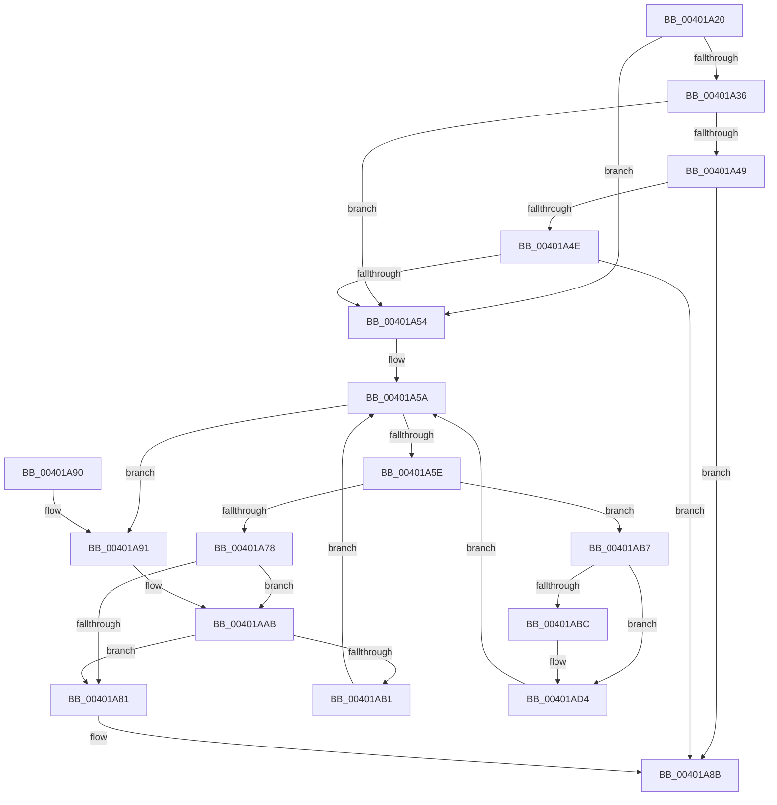

# MiSearchNumaNodeTable

- RVA: `0x00401A20`–`0x00401ADA` (길이 `186` bytes)
- VA: `0x0000000140401A20`
- 실행 섹션: `.text`
- PDB 이름 있음: `예`; PDB Function 태그: `아니요`
- unwind 정보 RVA: `0x0009A548`
- 디코드: `53`개 명령, `186/186` bytes 표시
- 미해석 바이트: `0` (있으면 어셈블리에 `.byte`로 보존)

> 이 문서는 커널 이미지의 기계어와 PDB 기호를 분석해 생성했습니다. 4번과 5번은 함수 원형과 자료형을 바이너리 사용 방식에서 추정한 C 해석이며 원본 소스 복구 결과는 아닙니다.

## 1. Dependencies

- 직접 호출 지점: **2**; 고유 호출 대상: **1**
- 직접 호출자로 확인된 함수: **1**
- RIP 상대 이미지 참조: **4**

### Outgoing calls
- `0x00401AA5` → [KeBugCheckEx](../4F/KeBugCheckEx_function_004FD660.md) (function, `0x004FD660`)
- `0x00401ACE` → [KeBugCheckEx](../4F/KeBugCheckEx_function_004FD660.md) (function, `0x004FD660`)

### Direct callers
- [MiRestrictRangeToNode](MiRestrictRangeToNode_function_0040199C.md) at `0x004019B1`

### Static image references
- `0x00401A24` → RVA `0x00E2DBC0` (`.data`; read)
- `0x00401A2B` → RVA `0x00E2DBC4` (`.data`; read)
- `0x00401A3D` → RVA `0x00E2DC20` (`.data`; read)
- `0x00401A81` → RVA `0x00E2DBC0` (`.data`; write)

## 2. Other-region calls and transfers

- 다른 실행 섹션으로 향하는 call: **0**
- 별도 외부 분기/꼬리 이동을 확인하지 못했습니다.

## 3. Assembly (complete function range)

```asm
00401A20  48 83 EC 38                     sub rsp, 0x38
00401A24  4C 63 05 95 C1 A2 00            movsxd r8, dword ptr [rip + 0xa2c195]
00401A2B  8B 15 93 C1 A2 00               mov edx, dword ptr [rip + 0xa2c193]
00401A31  44 3B C2                        cmp r8d, edx
00401A34  77 1E                           ja 0x140401a54
00401A36  49 8B C0                        mov rax, r8
00401A39  48 C1 E0 04                     shl rax, 4
00401A3D  48 03 05 DC C1 A2 00            add rax, qword ptr [rip + 0xa2c1dc]
00401A44  48 3B 08                        cmp rcx, qword ptr [rax]
00401A47  72 0B                           jb 0x140401a54
00401A49  44 3B C2                        cmp r8d, edx
00401A4C  74 3D                           je 0x140401a8b
00401A4E  48 3B 48 10                     cmp rcx, qword ptr [rax + 0x10]
00401A52  72 37                           jb 0x140401a8b
00401A54  45 33 D2                        xor r10d, r10d
00401A57  41 8B C2                        mov eax, r10d
00401A5A  3B D0                           cmp edx, eax
00401A5C  7C 33                           jl 0x140401a91
00401A5E  44 8D 04 10                     lea r8d, [rax + rdx]
00401A62  41 D1 F8                        sar r8d, 1
00401A65  4D 63 C8                        movsxd r9, r8d
00401A68  49 C1 E1 04                     shl r9, 4
00401A6C  4C 03 0D AD C1 A2 00            add r9, qword ptr [rip + 0xa2c1ad]
00401A73  49 3B 09                        cmp rcx, qword ptr [r9]
00401A76  72 3F                           jb 0x140401ab7
00401A78  44 3B 05 45 C1 A2 00            cmp r8d, dword ptr [rip + 0xa2c145]
00401A7F  75 2A                           jne 0x140401aab
00401A81  44 89 05 38 C1 A2 00            mov dword ptr [rip + 0xa2c138], r8d
00401A88  49 8B C1                        mov rax, r9
00401A8B  48 83 C4 38                     add rsp, 0x38
00401A8F  C3                              ret
00401A90  CC                              int3
00401A91  45 33 C9                        xor r9d, r9d
00401A94  4C 89 54 24 20                  mov qword ptr [rsp + 0x20], r10
00401A99  4C 8B C1                        mov r8, rcx
00401A9C  BA 80 51 00 00                  mov edx, 0x5180
00401AA1  41 8D 49 1A                     lea ecx, [r9 + 0x1a]
00401AA5  E8 B6 BB 0F 00                  call 0x1404fd660
00401AAA  CC                              int3
00401AAB  49 3B 49 10                     cmp rcx, qword ptr [r9 + 0x10]
00401AAF  72 D0                           jb 0x140401a81
00401AB1  41 8D 40 01                     lea eax, [r8 + 1]
00401AB5  EB A3                           jmp 0x140401a5a
00401AB7  45 85 C0                        test r8d, r8d
00401ABA  75 18                           jne 0x140401ad4
00401ABC  4C 8B C1                        mov r8, rcx
00401ABF  4C 89 54 24 20                  mov qword ptr [rsp + 0x20], r10
00401AC4  B9 1A 00 00 00                  mov ecx, 0x1a
00401AC9  BA 80 51 00 00                  mov edx, 0x5180
00401ACE  E8 8D BB 0F 00                  call 0x1404fd660
00401AD3  CC                              int3
00401AD4  41 8D 50 FF                     lea edx, [r8 - 1]
00401AD8  EB 80                           jmp 0x140401a5a
```

## 4. C-style interpretation (structured pseudocode)

```c
__int64 __fastcall MiSearchNumaNodeTable(__int64 a1)
{
    __int64 result;
    __int64 v_r10;
    __int64 v_rsp;
    unsigned __int64 v_stack_p20;

    v_rsp = (v_rsp) - (56);
    if (((unsigned int)((int)(*(unsigned int *)(v_rip + 10666389)))) > ((unsigned int)((unsigned int)(*(unsigned int *)(v_rip + 10666387))))) goto loc_00401A54;
    result = ((int)(*(unsigned int *)(v_rip + 10666389))) << (4);
    result = (result) + (*(unsigned __int64 *)(v_rip + 10666460));
    if (a1 < (*(unsigned __int64 *)(result))) goto loc_00401A54;
    if (((unsigned int)((int)(*(unsigned int *)(v_rip + 10666389)))) == ((unsigned int)((unsigned int)(*(unsigned int *)(v_rip + 10666387))))) goto loc_00401A8B;
    if (a1 < (*(unsigned __int64 *)(result + 16))) goto loc_00401A8B;
loc_00401A54:
    v_r10 = 0;
loc_00401A5A:
    if (((unsigned int)((unsigned int)(*(unsigned int *)(v_rip + 10666387)))) < 0) goto loc_00401A91;
    a3 = (unsigned int)((0 + (unsigned int)(*(unsigned int *)(v_rip + 10666387)) * 1) >> (1));
    a4 = ((int)((unsigned int)(a3))) << (4);
    a4 = (a4) + (*(unsigned __int64 *)(v_rip + 10666413));
    if (a1 < (*(unsigned __int64 *)(a4))) goto loc_00401AB7;
    if (((unsigned int)(a3)) != (*(unsigned int *)(v_rip + 10666309))) goto loc_00401AAB;
loc_00401A81:
    *(unsigned int *)(v_rip + 10666296) = (unsigned int)(a3);
loc_00401A8B:
    v_rsp = (v_rsp) + (56);
    return a4;
loc_00401A91:
    a4 = 0;
    v_stack_p20 = 0;
    result = KeBugCheckEx(a4 + 26, (unsigned int)(0x5180ULL), a1, a4);
loc_00401AAB:
    if ((a4 + 26) < (*(unsigned __int64 *)(a4 + 16))) goto loc_00401A81;
    goto loc_00401A5A;
loc_00401AB7:
    result = a1 + 1;
    if ((unsigned int)(a1) == 0) {
        a3 = a4 + 26;
        v_stack_p20 = 0;
        a1 = 26;
        a2 = 0x5180ULL;
        result = KeBugCheckEx(a1, a2, a3, a4);
    }
    goto loc_00401A5A;
}
```

## 5. (Beta) C Style

```c
int64_t MiSearchNumaNodeTable(int64_t Arg1)
{
    int64_t result;
    int64_t local_r10;
    int64_t local_rsp;
    uint64_t v_stack_p20;

    local_rsp = (local_rsp) - (56);
    if (((uint32_t)((int32_t)(*(uint32_t *)(v_rip + 0xA2C195)))) > ((uint32_t)((uint32_t)(*(uint32_t *)(v_rip + 0xA2C193))))) goto loc_00401A54;
    result = ((int32_t)(*(uint32_t *)(v_rip + 0xA2C195))) << (4);
    result = (result) + (*(uint64_t *)(v_rip + 0xA2C1DC));
    if (Arg1 < (*(uint64_t *)(result))) goto loc_00401A54;
    if (((uint32_t)((int32_t)(*(uint32_t *)(v_rip + 0xA2C195)))) == ((uint32_t)((uint32_t)(*(uint32_t *)(v_rip + 0xA2C193))))) goto loc_00401A8B;
    if (Arg1 < (*(uint64_t *)(result + 0x10))) goto loc_00401A8B;
loc_00401A54:
    local_r10 = 0;
loc_00401A5A:
    if (((uint32_t)((uint32_t)(*(uint32_t *)(v_rip + 0xA2C193)))) < 0) goto loc_00401A91;
    a3 = (uint32_t)((0 + (uint32_t)(*(uint32_t *)(v_rip + 0xA2C193)) * 1) >> (1));
    a4 = ((int32_t)((uint32_t)(a3))) << (4);
    a4 = (a4) + (*(uint64_t *)(v_rip + 0xA2C1AD));
    if (Arg1 < (*(uint64_t *)(a4))) goto loc_00401AB7;
    if (((uint32_t)(a3)) != (*(uint32_t *)(v_rip + 0xA2C145))) goto loc_00401AAB;
loc_00401A81:
    *(uint32_t *)(v_rip + 0xA2C138) = (uint32_t)(a3);
loc_00401A8B:
    local_rsp = (local_rsp) + (56);
    return a4;
loc_00401A91:
    a4 = 0;
    v_stack_p20 = 0;
    result = KeBugCheckEx(a4 + 26, (uint32_t)(0x5180ULL), Arg1, a4);
loc_00401AAB:
    if ((a4 + 26) < (*(uint64_t *)(a4 + 0x10))) goto loc_00401A81;
    goto loc_00401A5A;
loc_00401AB7:
    result = Arg1 + 1;
    if ((uint32_t)(Arg1) == 0) {
        a3 = a4 + 26;
        v_stack_p20 = 0;
        Arg1 = 26;
        a2 = 0x5180ULL;
        result = KeBugCheckEx(Arg1, a2, a3, a4);
    }
    goto loc_00401A5A;
}
```

## 6. Execution-region graph

[열기: 2D/3D 그래프와 함수 탐색 컨트롤 패널](../../../control-panel.html?section=text&rva=0x00401A20&view=graph)

- 2D 그래프는 위에서 아래로 흐르고, 3D 그래프는 빈 공간을 드래그해 회전합니다. Shift+드래그는 이동, 휠은 확대·축소, 함수 노드 선택은 대상 보고서 이동입니다.

### Static fallback


