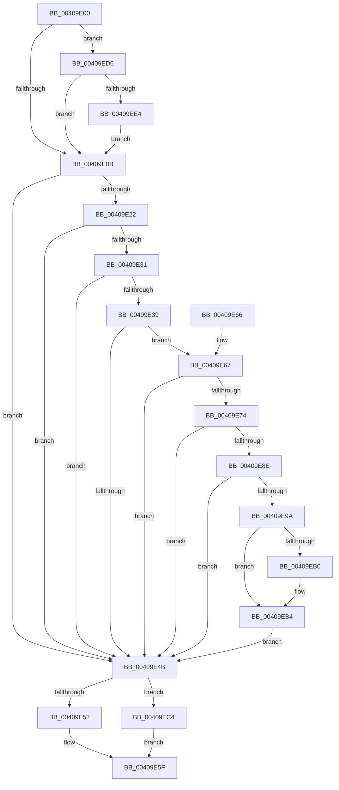

# MiSetActivePfnHeat

- RVA: `0x00409E00`–`0x00409EF0` (길이 `240` bytes)
- VA: `0x0000000140409E00`
- 실행 섹션: `.text`
- PDB 이름 있음: `예`; PDB Function 태그: `아니요`
- unwind 정보 RVA: `0x000DB714`
- 디코드: `62`개 명령, `240/240` bytes 표시
- 미해석 바이트: `0` (있으면 어셈블리에 `.byte`로 보존)

> 이 문서는 커널 이미지의 기계어와 PDB 기호를 분석해 생성했습니다. 4번과 5번은 함수 원형과 자료형을 바이너리 사용 방식에서 추정한 C 해석이며 원본 소스 복구 결과는 아닙니다.

## 1. Dependencies

- 직접 호출 지점: **0**; 고유 호출 대상: **0**
- 직접 호출자로 확인된 함수: **4**
- RIP 상대 이미지 참조: **2**

### Outgoing calls
- 직접 디코드된 call 명령이 없습니다.

### Direct callers
- [MmSetPfnListInfo](../31/MmSetPfnListInfo_function_0031D61C.md) at `0x0031D90A`
- [MiUpdatePfnForPrefetchByPte](../32/MiUpdatePfnForPrefetchByPte_function_00321210.md) at `0x003215D9`
- [MiWalkEntireImage](../36/MiWalkEntireImage_function_00365D70.md) at `0x0036661C`
- [MiMakeTransitionHeatBatch](MiMakeTransitionHeatBatch_function_00409A94.md) at `0x00409AC5`
- [MiMakeTransitionHeatBatch](MiMakeTransitionHeatBatch_function_00409A94.md) at `0x00409D73`
- [MiMakeTransitionHeatBatch](MiMakeTransitionHeatBatch_function_00409A94.md) at `0x00409DCF`

### Static image references
- `0x00409E67` → RVA `0x00FC6A88` (`ALMOSTRO`; read)
- `0x00409EE4` → RVA `0x00E35D54` (`.data`; read/write)

## 2. Other-region calls and transfers

- 다른 실행 섹션으로 향하는 call: **0**
- 별도 외부 분기/꼬리 이동을 확인하지 못했습니다.

## 3. Assembly (complete function range)

```asm
00409E00  44 8B D2                        mov r10d, edx
00409E03  85 D2                           test edx, edx
00409E05  0F 85 CB 00 00 00               jne 0x140409ed6
00409E0B  4C 8D 41 10                     lea r8, [rcx + 0x10]
00409E0F  48 8B 49 10                     mov rcx, qword ptr [rcx + 0x10]
00409E13  48 B8 00 D0 BE 7D FB F6 FF FF   movabs rax, 0xfffff6fb7dbed000
00409E1D  4C 3B C0                        cmp r8, rax
00409E20  72 29                           jb 0x140409e4b
00409E22  48 B8 F8 D7 BE 7D FB F6 FF FF   movabs rax, 0xfffff6fb7dbed7f8
00409E2C  4C 3B C0                        cmp r8, rax
00409E2F  77 1A                           ja 0x140409e4b
00409E31  48 8B C1                        mov rax, rcx
00409E34  F6 C1 01                        test cl, 1
00409E37  74 12                           je 0x140409e4b
00409E39  F6 C1 42                        test cl, 0x42
00409E3C  41 0F 95 C1                     setne r9b
00409E40  F6 C1 20                        test cl, 0x20
00409E43  0F 95 C2                        setne dl
00409E46  44 84 CA                        test dl, r9b
00409E49  74 1C                           je 0x140409e67
00409E4B  48 0F BA E1 0A                  bt rcx, 0xa
00409E50  72 72                           jb 0x140409ec4
00409E52  41 F7 DA                        neg r10d
00409E55  48 1B C0                        sbb rax, rax
00409E58  83 E0 08                        and eax, 8
00409E5B  48 83 E1 F7                     and rcx, 0xfffffffffffffff7
00409E5F  48 0B C1                        or rax, rcx
00409E62  49 89 00                        mov qword ptr [r8], rax
00409E65  C3                              ret
00409E66  CC                              int3
00409E67  48 F7 05 16 CC BB 00 00 00 60 00  test qword ptr [rip + 0xbbcc16], 0x600000
00409E72  74 D7                           je 0x140409e4b
00409E74  65 48 8B 14 25 88 01 00 00      mov rdx, qword ptr gs:[0x188]
00409E7D  4C 8B 8A B8 00 00 00            mov r9, qword ptr [rdx + 0xb8]
00409E84  41 80 B9 60 01 00 00 01         cmp byte ptr [r9 + 0x160], 1
00409E8C  74 BD                           je 0x140409e4b
00409E8E  4D 8B 99 08 05 00 00            mov r11, qword ptr [r9 + 0x508]
00409E95  4D 85 DB                        test r11, r11
00409E98  74 B1                           je 0x140409e4b
00409E9A  49 8B D0                        mov rdx, r8
00409E9D  48 C1 EA 03                     shr rdx, 3
00409EA1  81 E2 FF 01 00 00               and edx, 0x1ff
00409EA7  49 8B 14 D3                     mov rdx, qword ptr [r11 + rdx*8]
00409EAB  F6 C2 20                        test dl, 0x20
00409EAE  74 04                           je 0x140409eb4
00409EB0  48 83 C8 20                     or rax, 0x20
00409EB4  48 8B C8                        mov rcx, rax
00409EB7  48 83 C9 42                     or rcx, 0x42
00409EBB  F6 C2 42                        test dl, 0x42
00409EBE  48 0F 44 C8                     cmove rcx, rax
00409EC2  EB 87                           jmp 0x140409e4b
00409EC4  41 F7 DA                        neg r10d
00409EC7  48 1B C0                        sbb rax, rax
00409ECA  25 00 08 00 00                  and eax, 0x800
00409ECF  48 0F BA F1 0B                  btr rcx, 0xb
00409ED4  EB 89                           jmp 0x140409e5f
00409ED6  0F B6 41 22                     movzx eax, byte ptr [rcx + 0x22]
00409EDA  24 07                           and al, 7
00409EDC  3C 06                           cmp al, 6
00409EDE  0F 84 27 FF FF FF               je 0x140409e0b
00409EE4  F0 FF 05 69 BE A2 00            lock inc dword ptr [rip + 0xa2be69]
00409EEB  E9 1B FF FF FF                  jmp 0x140409e0b
```

## 4. C-style interpretation (structured pseudocode)

```c
__int64 __fastcall MiSetActivePfnHeat(__int64 a1, int a2)
{
    __int64 result;
    __int64 v_r10;

    if (a2 != 0) goto loc_00409ED6;
loc_00409E0B:
    if ((a1 + 16) < result) goto loc_00409E4B;
    if ((a1 + 16) > result) goto loc_00409E4B;
    if ((((unsigned __int8)(*(unsigned __int64 *)(a1 + 16))) & (1)) == 0) goto loc_00409E4B;
    a4 = ((((unsigned __int8)(*(unsigned __int64 *)(a1 + 16))) & (66)) != 0) ? 1 : 0;
    a2 = ((((unsigned __int8)(*(unsigned __int64 *)(a1 + 16))) & (32)) != 0) ? 1 : 0;
    if ((((unsigned __int8)(a2)) & ((unsigned __int8)(a4))) == 0) goto loc_00409E67;
loc_00409E4B:
    if (condition_is_below) goto loc_00409EC4;
    v_r10 = (unsigned int)(-((unsigned int)(a2)));
    result = (unsigned int)((*(unsigned __int64 *)(a1 + 16)) & (8));
    a1 = (*(unsigned __int64 *)(a1 + 16)) & (-9);
loc_00409E5F:
    result = (result) | (a1);
    *(unsigned __int64 *)(a1 + 16) = result;
    return result;
loc_00409E67:
    if (((*(unsigned __int64 *)(v_rip + 12307478)) & (0x600000ULL)) == 0) goto loc_00409E4B;
    if ((*(unsigned __int8 *)(*(unsigned __int64 *)(*(unsigned __int64 *)(gs_base + (0 + 392)) + 184) + 352)) == 1) goto loc_00409E4B;
    if (*(unsigned __int64 *)(*(unsigned __int64 *)(*(unsigned __int64 *)(gs_base + (0 + 392)) + 184) + 1288) == 0) goto loc_00409E4B;
    a2 = (a1 + 16) >> (3);
    a2 = (unsigned int)((a2) & (511));
    if ((((unsigned __int8)(*(unsigned __int64 *)(*(unsigned __int64 *)(*(unsigned __int64 *)(*(unsigned __int64 *)(gs_base + (0 + 392)) + 184) + 1288) + a2 * 8))) & (32)) != 0) {
        result = (result) | (32);
    }
    a1 = (result) | (66);
    if ((((unsigned __int8)(*(unsigned __int64 *)(*(unsigned __int64 *)(*(unsigned __int64 *)(*(unsigned __int64 *)(gs_base + (0 + 392)) + 184) + 1288) + a2 * 8))) & (66)) == 0) { a1 = result; }
    goto loc_00409E4B;
loc_00409EC4:
    v_r10 = (unsigned int)(-(v_r10));
    result = (unsigned int)((result) & (0x800ULL));
    goto loc_00409E5F;
loc_00409ED6:
    result = (unsigned __int8)((*(unsigned __int8 *)(a1 + 34)) & (7));
    if (((unsigned __int8)(result)) == 6) goto loc_00409E0B;
    goto loc_00409E0B;
}
```

## 5. (Beta) C Style

```c
int64_t MiSetActivePfnHeat(void *Arg1, int32_t Arg2)
{
    uint8_t *arg1 = (uint8_t *)Arg1;

    int64_t result;
    int64_t local_r10;

    if (Arg2 != 0) goto loc_00409ED6;
loc_00409E0B:
    if ((Arg1 + 16) < result) goto loc_00409E4B;
    if ((Arg1 + 16) > result) goto loc_00409E4B;
    if ((((uint8_t)(*(uint64_t *)(arg1 + 0x10))) & (1)) == 0) goto loc_00409E4B;
    a4 = ((((uint8_t)(*(uint64_t *)(arg1 + 0x10))) & (66)) != 0) ? 1 : 0;
    Arg2 = ((((uint8_t)(*(uint64_t *)(arg1 + 0x10))) & (32)) != 0) ? 1 : 0;
    if ((((uint8_t)(Arg2)) & ((uint8_t)(a4))) == 0) goto loc_00409E67;
loc_00409E4B:
    if (condition_is_below) goto loc_00409EC4;
    local_r10 = (uint32_t)(-((uint32_t)(Arg2)));
    result = (uint32_t)((*(uint64_t *)(arg1 + 0x10)) & (8));
    Arg1 = (*(uint64_t *)(arg1 + 0x10)) & (-9);
loc_00409E5F:
    result = (result) | (Arg1);
    *(uint64_t *)(arg1 + 0x10) = result;
    return result;
loc_00409E67:
    if (((*(uint64_t *)(v_rip + 0xBBCC16)) & (0x600000ULL)) == 0) goto loc_00409E4B;
    if ((*(uint8_t *)(*(uint64_t *)(*(uint64_t *)(gs_base + (0 + 0x188)) + 0xB8) + 0x160)) == 1) goto loc_00409E4B;
    if (*(uint64_t *)(*(uint64_t *)(*(uint64_t *)(gs_base + (0 + 0x188)) + 0xB8) + 0x508) == 0) goto loc_00409E4B;
    Arg2 = (Arg1 + 16) >> (3);
    Arg2 = (uint32_t)((Arg2) & (511));
    if ((((uint8_t)(*(uint64_t *)(*(uint64_t *)(*(uint64_t *)(*(uint64_t *)(gs_base + (0 + 0x188)) + 0xB8) + 0x508) + Arg2 * 8))) & (32)) != 0) {
        result = (result) | (32);
    }
    Arg1 = (result) | (66);
    if ((((uint8_t)(*(uint64_t *)(*(uint64_t *)(*(uint64_t *)(*(uint64_t *)(gs_base + (0 + 0x188)) + 0xB8) + 0x508) + Arg2 * 8))) & (66)) == 0) { Arg1 = result; }
    goto loc_00409E4B;
loc_00409EC4:
    local_r10 = (uint32_t)(-(local_r10));
    result = (uint32_t)((result) & (0x800ULL));
    goto loc_00409E5F;
loc_00409ED6:
    result = (uint8_t)((*(uint8_t *)(arg1 + 0x22)) & (7));
    if (((uint8_t)(result)) == 6) goto loc_00409E0B;
    goto loc_00409E0B;
}
```

### 관측된 메모리 오프셋

구조체 형식이 확인되지 않은 접근은 인자 기준의 오프셋으로만 기록했습니다.

| 기준 인자 | 오프셋 표현 | 폭 (bit) | 접근 |
|---|---:|---:|---|
| `Arg1` | `+ 0x10` | `64` | `R` |
| `Arg1` | `+ 0x22` | `8` | `R` |

## 6. Execution-region graph

[열기: 2D/3D 그래프와 함수 탐색 컨트롤 패널](../../../control-panel.html?section=text&rva=0x00409E00&view=graph)

- 2D 그래프는 위에서 아래로 흐르고, 3D 그래프는 빈 공간을 드래그해 회전합니다. Shift+드래그는 이동, 휠은 확대·축소, 함수 노드 선택은 대상 보고서 이동입니다.

### Static fallback


