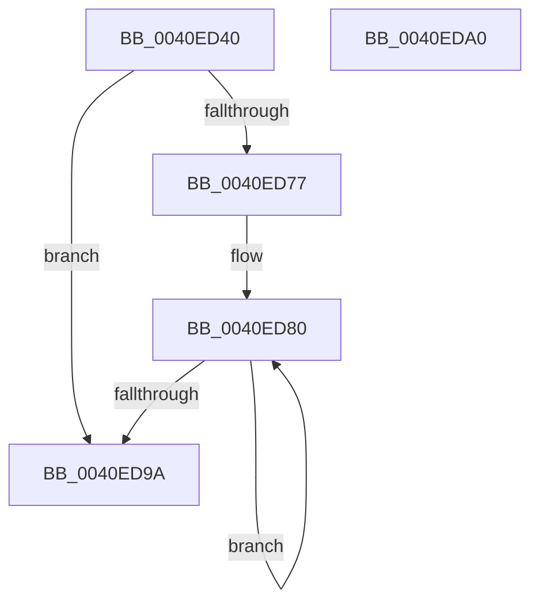

# MiSetPfnNodeFlinkHigh

- RVA: `0x0040ED40`–`0x0040EDA1` (길이 `97` bytes)
- VA: `0x000000014040ED40`
- 실행 섹션: `.text`
- PDB 이름 있음: `예`; PDB Function 태그: `아니요`
- unwind 정보 RVA: `0x00071750`
- 디코드: `26`개 명령, `97/97` bytes 표시
- 미해석 바이트: `0` (있으면 어셈블리에 `.byte`로 보존)

> 이 문서는 커널 이미지의 기계어와 PDB 기호를 분석해 생성했습니다. 4번과 5번은 함수 원형과 자료형을 바이너리 사용 방식에서 추정한 C 해석이며 원본 소스 복구 결과는 아닙니다.

## 1. Dependencies

- 직접 호출 지점: **0**; 고유 호출 대상: **0**
- 직접 호출자로 확인된 함수: **1**
- RIP 상대 이미지 참조: **0**

### Outgoing calls
- 직접 디코드된 call 명령이 없습니다.

### Direct callers
- [sub_0033C441](../33/Unknown_function_0033C441.md) at `0x0033C4A6`
- [sub_0033C441](../33/Unknown_function_0033C441.md) at `0x0033C4C7`

### Static image references
- 디코드된 RIP-relative 메모리 참조가 없습니다.

## 2. Other-region calls and transfers

- 다른 실행 섹션으로 향하는 call: **0**
- 별도 외부 분기/꼬리 이동을 확인하지 못했습니다.

## 3. Assembly (complete function range)

```asm
0040ED40  48 89 5C 24 08                  mov qword ptr [rsp + 8], rbx
0040ED45  4C 8B 49 28                     mov r9, qword ptr [rcx + 0x28]
0040ED49  4C 8B D2                        mov r10, rdx
0040ED4C  49 C1 E2 37                     shl r10, 0x37
0040ED50  48 BB FF FF FF FF FF FF 7F F0   movabs rbx, 0xf07fffffffffffff
0040ED5A  4D 8B C2                        mov r8, r10
0040ED5D  4C 8B D9                        mov r11, rcx
0040ED60  4D 33 C1                        xor r8, r9
0040ED63  49 8B C1                        mov rax, r9
0040ED66  4C 23 C3                        and r8, rbx
0040ED69  4D 33 C2                        xor r8, r10
0040ED6C  F0 4C 0F B1 41 28               lock cmpxchg qword ptr [rcx + 0x28], r8
0040ED72  4C 3B C8                        cmp r9, rax
0040ED75  74 23                           je 0x14040ed9a
0040ED77  66 0F 1F 84 00 00 00 00 00      nop word ptr [rax + rax]
0040ED80  49 8B CA                        mov rcx, r10
0040ED83  48 8B D0                        mov rdx, rax
0040ED86  48 33 C8                        xor rcx, rax
0040ED89  48 23 CB                        and rcx, rbx
0040ED8C  49 33 CA                        xor rcx, r10
0040ED8F  F0 49 0F B1 4B 28               lock cmpxchg qword ptr [r11 + 0x28], rcx
0040ED95  48 3B D0                        cmp rdx, rax
0040ED98  75 E6                           jne 0x14040ed80
0040ED9A  48 8B 5C 24 08                  mov rbx, qword ptr [rsp + 8]
0040ED9F  C3                              ret
0040EDA0  CC                              int3
```

## 4. C-style interpretation (structured pseudocode)

```c
__int64 __fastcall MiSetPfnNodeFlinkHigh(__int64 a1, __int64 a2)
{
    __int64 v_r10;
    unsigned __int64 v_stack_p8;

    v_stack_p8 = v_rbx;
    v_r10 = (a2) << (55);
    a3 = (v_r10) ^ (*(unsigned __int64 *)(a1 + 40));
    a3 = (a3) & (v_rbx);
    a3 = (a3) ^ (v_r10);
    if ((*(unsigned __int64 *)(a1 + 40)) == (*(unsigned __int64 *)(a1 + 40))) goto loc_0040ED9A;
loc_0040ED80:
    a1 = (v_r10) ^ (*(unsigned __int64 *)(a1 + 40));
    a1 = (a1) & (v_rbx);
    a1 = (a1) ^ (v_r10);
    if ((*(unsigned __int64 *)(a1 + 40)) != (*(unsigned __int64 *)(a1 + 40))) goto loc_0040ED80;
loc_0040ED9A:
    return *(unsigned __int64 *)(a1 + 40);
}
```

## 5. (Beta) C Style

```c
int64_t MiSetPfnNodeFlinkHigh(void *Arg1, int64_t Arg2)
{
    uint8_t *arg1 = (uint8_t *)Arg1;

    int64_t local_r10;
    uint64_t v_stack_p8;

    v_stack_p8 = local_rbx;
    local_r10 = (Arg2) << (55);
    a3 = (local_r10) ^ (*(uint64_t *)(arg1 + 0x28));
    a3 = (a3) & (local_rbx);
    a3 = (a3) ^ (local_r10);
    if ((*(uint64_t *)(arg1 + 0x28)) == (*(uint64_t *)(arg1 + 0x28))) goto loc_0040ED9A;
loc_0040ED80:
    Arg1 = (local_r10) ^ (*(uint64_t *)(arg1 + 0x28));
    Arg1 = (Arg1) & (local_rbx);
    Arg1 = (Arg1) ^ (local_r10);
    if ((*(uint64_t *)(arg1 + 0x28)) != (*(uint64_t *)(arg1 + 0x28))) goto loc_0040ED80;
loc_0040ED9A:
    return *(uint64_t *)(arg1 + 0x28);
}
```

### 관측된 메모리 오프셋

구조체 형식이 확인되지 않은 접근은 인자 기준의 오프셋으로만 기록했습니다.

| 기준 인자 | 오프셋 표현 | 폭 (bit) | 접근 |
|---|---:|---:|---|
| `Arg1` | `+ 0x28` | `64` | `R` |

## 6. Execution-region graph

[열기: 2D/3D 그래프와 함수 탐색 컨트롤 패널](../../../control-panel.html?section=text&rva=0x0040ED40&view=graph)

- 2D 그래프는 위에서 아래로 흐르고, 3D 그래프는 빈 공간을 드래그해 회전합니다. Shift+드래그는 이동, 휠은 확대·축소, 함수 노드 선택은 대상 보고서 이동입니다.

### Static fallback


