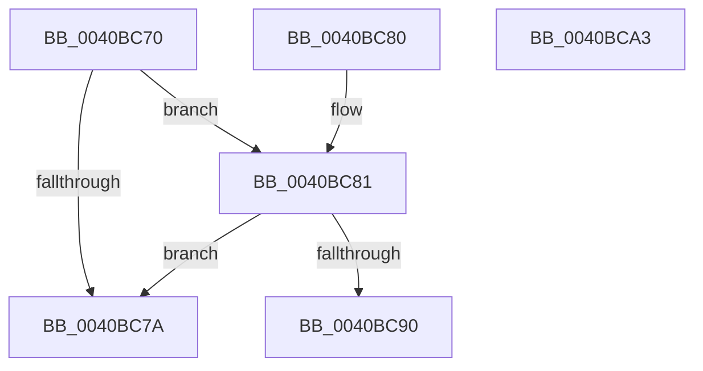

# MiShouldLockPteDirectly

- RVA: `0x0040BC70`–`0x0040BCA4` (길이 `52` bytes)
- VA: `0x000000014040BC70`
- 실행 섹션: `.text`
- PDB 이름 있음: `예`; PDB Function 태그: `아니요`
- unwind 정보 RVA: `0x000DB714`
- 디코드: `15`개 명령, `52/52` bytes 표시
- 미해석 바이트: `0` (있으면 어셈블리에 `.byte`로 보존)

> 이 문서는 커널 이미지의 기계어와 PDB 기호를 분석해 생성했습니다. 4번과 5번은 함수 원형과 자료형을 바이너리 사용 방식에서 추정한 C 해석이며 원본 소스 복구 결과는 아닙니다.

## 1. Dependencies

- 직접 호출 지점: **0**; 고유 호출 대상: **0**
- 직접 호출자로 확인된 함수: **1**
- RIP 상대 이미지 참조: **0**

### Outgoing calls
- 직접 디코드된 call 명령이 없습니다.

### Direct callers
- [MiUnlockNestedPageTableWritePte](../23/MiUnlockNestedPageTableWritePte_function_0023F4E4.md) at `0x0023F544`

### Static image references
- 디코드된 RIP-relative 메모리 참조가 없습니다.

## 2. Other-region calls and transfers

- 다른 실행 섹션으로 향하는 call: **0**
- 별도 외부 분기/꼬리 이동을 확인하지 못했습니다.

## 3. Assembly (complete function range)

```asm
0040BC70  8B 81 B8 00 00 00               mov eax, dword ptr [rcx + 0xb8]
0040BC76  A8 0F                           test al, 0xf
0040BC78  75 07                           jne 0x14040bc81
0040BC7A  B8 01 00 00 00                  mov eax, 1
0040BC7F  C3                              ret
0040BC80  CC                              int3
0040BC81  48 B8 00 D0 BE 7D FB F6 FF FF   movabs rax, 0xfffff6fb7dbed000
0040BC8B  48 3B D0                        cmp rdx, rax
0040BC8E  72 EA                           jb 0x14040bc7a
0040BC90  48 B9 FF DF BE 7D FB F6 FF FF   movabs rcx, 0xfffff6fb7dbedfff
0040BC9A  33 C0                           xor eax, eax
0040BC9C  48 3B D1                        cmp rdx, rcx
0040BC9F  0F 97 C0                        seta al
0040BCA2  C3                              ret
0040BCA3  CC                              int3
```

## 4. C-style interpretation (structured pseudocode)

```c
__int64 __fastcall MiShouldLockPteDirectly(__int64 a1, __int64 a2)
{
    __int64 result;

    if ((((unsigned __int8)((unsigned int)(*(unsigned int *)(a1 + 184)))) & (15)) != 0) goto loc_0040BC81;
loc_0040BC7A:
    return 1;
loc_0040BC81:
    if (a2 < 1) goto loc_0040BC7A;
    result = 0;
    result = (a2 > a1) ? 1 : 0;
    return result;
}
```

## 5. (Beta) C Style

```c
int64_t MiShouldLockPteDirectly(void *Arg1, int64_t Arg2)
{
    uint8_t *arg1 = (uint8_t *)Arg1;

    int64_t result;

    if ((((uint8_t)((uint32_t)(*(uint32_t *)(arg1 + 0xB8)))) & (15)) != 0) goto loc_0040BC81;
loc_0040BC7A:
    return 1;
loc_0040BC81:
    if (Arg2 < 1) goto loc_0040BC7A;
    result = 0;
    result = (Arg2 > Arg1) ? 1 : 0;
    return result;
}
```

### 관측된 메모리 오프셋

구조체 형식이 확인되지 않은 접근은 인자 기준의 오프셋으로만 기록했습니다.

| 기준 인자 | 오프셋 표현 | 폭 (bit) | 접근 |
|---|---:|---:|---|
| `Arg1` | `+ 0xB8` | `32` | `R` |

## 6. Execution-region graph

[열기: 2D/3D 그래프와 함수 탐색 컨트롤 패널](../../../control-panel.html?section=text&rva=0x0040BC70&view=graph)

- 2D 그래프는 위에서 아래로 흐르고, 3D 그래프는 빈 공간을 드래그해 회전합니다. Shift+드래그는 이동, 휠은 확대·축소, 함수 노드 선택은 대상 보고서 이동입니다.

### Static fallback


