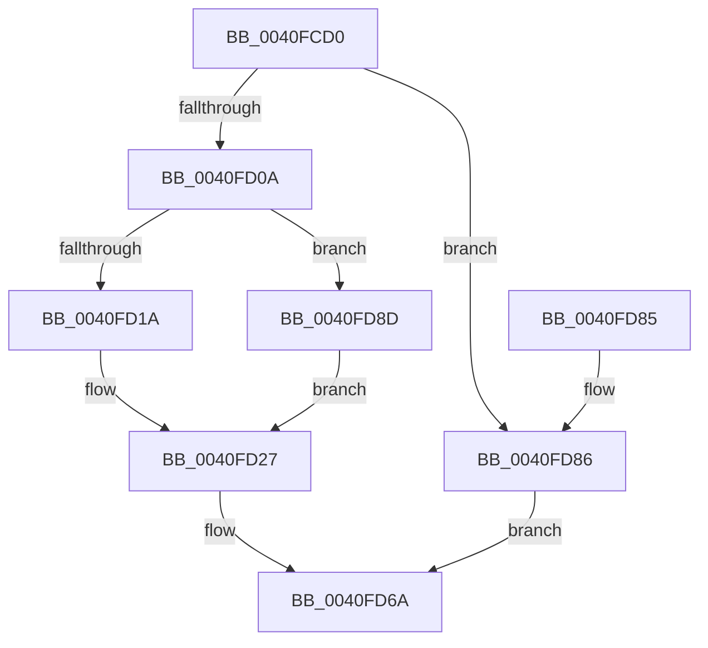

# MiTrimWorkingSetVpabCallback

- RVA: `0x0040FCD0`–`0x0040FD99` (길이 `201` bytes)
- VA: `0x000000014040FCD0`
- 실행 섹션: `.text`
- PDB 이름 있음: `예`; PDB Function 태그: `아니요`
- unwind 정보 RVA: `0x0009BBC0`
- 디코드: `54`개 명령, `201/201` bytes 표시
- 미해석 바이트: `0` (있으면 어셈블리에 `.byte`로 보존)

> 이 문서는 커널 이미지의 기계어와 PDB 기호를 분석해 생성했습니다. 4번과 5번은 함수 원형과 자료형을 바이너리 사용 방식에서 추정한 C 해석이며 원본 소스 복구 결과는 아닙니다.

## 1. Dependencies

- 직접 호출 지점: **3**; 고유 호출 대상: **3**
- 직접 호출자로 확인된 함수: **0**
- RIP 상대 이미지 참조: **0**

### Outgoing calls
- `0x0040FD01` → [MiTrimmedEnough](MiTrimmedEnough_function_0040FDA0.md) (function, `0x0040FDA0`)
- `0x0040FD0D` → [MI_READ_PTE_LOCK_FREE](../28/MI_READ_PTE_LOCK_FREE_function_002828A0.md) (function, `0x002828A0`)
- `0x0040FD65` → [MiTrimPteWorker](../29/MiTrimPteWorker_function_00292E2C.md) (function, `0x00292E2C`)

### Direct callers
- 이 함수 시작 RVA로 연결되는 직접 call은 확인되지 않았습니다. 간접 호출은 완전히 역산할 수 없습니다.

### Static image references
- 디코드된 RIP-relative 메모리 참조가 없습니다.

## 2. Other-region calls and transfers

- 다른 실행 섹션으로 향하는 call: **0**
- 별도 외부 분기/꼬리 이동을 확인하지 못했습니다.

## 3. Assembly (complete function range)

```asm
0040FCD0  48 8B C4                        mov rax, rsp
0040FCD3  48 89 58 08                     mov qword ptr [rax + 8], rbx
0040FCD7  48 89 68 10                     mov qword ptr [rax + 0x10], rbp
0040FCDB  48 89 70 18                     mov qword ptr [rax + 0x18], rsi
0040FCDF  48 89 78 20                     mov qword ptr [rax + 0x20], rdi
0040FCE3  41 56                           push r14
0040FCE5  48 83 EC 40                     sub rsp, 0x40
0040FCE9  48 8B 6C 24 70                  mov rbp, qword ptr [rsp + 0x70]
0040FCEE  48 8B F1                        mov rsi, rcx
0040FCF1  48 8B 49 20                     mov rcx, qword ptr [rcx + 0x20]
0040FCF5  48 8B FA                        mov rdi, rdx
0040FCF8  48 8B D5                        mov rdx, rbp
0040FCFB  4D 8B F1                        mov r14, r9
0040FCFE  49 8B D8                        mov rbx, r8
0040FD01  E8 9A 00 00 00                  call 0x14040fda0
0040FD06  85 C0                           test eax, eax
0040FD08  75 7C                           jne 0x14040fd86
0040FD0A  48 8B CB                        mov rcx, rbx
0040FD0D  E8 8E 2B E7 FF                  call 0x1402828a0
0040FD12  48 8B 0F                        mov rcx, qword ptr [rdi]
0040FD15  F6 C1 02                        test cl, 2
0040FD18  75 73                           jne 0x14040fd8d
0040FD1A  BA 01 00 00 00                  mov edx, 1
0040FD1F  84 CA                           test dl, cl
0040FD21  8D 4A FF                        lea ecx, [rdx - 1]
0040FD24  0F 45 CA                        cmovne ecx, edx
0040FD27  48 C1 E8 0C                     shr rax, 0xc
0040FD2B  48 BA FF FF FF FF FF 00 00 00   movabs rdx, 0xffffffffff
0040FD35  48 23 C2                        and rax, rdx
0040FD38  4C 8D 0C 40                     lea r9, [rax + rax*2]
0040FD3C  49 C1 E1 04                     shl r9, 4
0040FD40  48 B8 00 00 00 00 00 DE FF FF   movabs rax, 0xffffde0000000000
0040FD4A  48 83 64 24 30 00               and qword ptr [rsp + 0x30], 0
0040FD50  4C 03 C8                        add r9, rax
0040FD53  89 4C 24 28                     mov dword ptr [rsp + 0x28], ecx
0040FD57  4D 8B C6                        mov r8, r14
0040FD5A  48 8B CE                        mov rcx, rsi
0040FD5D  48 89 6C 24 20                  mov qword ptr [rsp + 0x20], rbp
0040FD62  48 8B D3                        mov rdx, rbx
0040FD65  E8 C2 30 E8 FF                  call 0x140292e2c
0040FD6A  48 8B 5C 24 50                  mov rbx, qword ptr [rsp + 0x50]
0040FD6F  48 8B 6C 24 58                  mov rbp, qword ptr [rsp + 0x58]
0040FD74  48 8B 74 24 60                  mov rsi, qword ptr [rsp + 0x60]
0040FD79  48 8B 7C 24 68                  mov rdi, qword ptr [rsp + 0x68]
0040FD7E  48 83 C4 40                     add rsp, 0x40
0040FD82  41 5E                           pop r14
0040FD84  C3                              ret
0040FD85  CC                              int3
0040FD86  B8 01 00 00 00                  mov eax, 1
0040FD8B  EB DD                           jmp 0x14040fd6a
0040FD8D  48 8B C8                        mov rcx, rax
0040FD90  48 C1 E9 05                     shr rcx, 5
0040FD94  83 E1 01                        and ecx, 1
0040FD97  EB 8E                           jmp 0x14040fd27
```

## 4. C-style interpretation (structured pseudocode)

```c
__int64 __fastcall MiTrimWorkingSetVpabCallback(__int64 a1, __int64 a2, __int64 a3, __int64 a4, __int64 a5)
{
    __int64 result;
    __int64 v_rsp;
    unsigned __int64 v_stack_m18;
    unsigned int v_stack_m20;
    unsigned __int64 v_stack_m28;
    unsigned __int64 v_stack_p10;
    unsigned __int64 v_stack_p18;
    unsigned __int64 v_stack_p20;
    unsigned __int64 v_stack_p8;

    *(unsigned __int64 *)(v_rsp + 8) = v_rbx;
    *(unsigned __int64 *)(v_rsp + 16) = v_rbp;
    *(unsigned __int64 *)(v_rsp + 24) = v_rsi;
    *(unsigned __int64 *)(v_rsp + 32) = v_rdi;
    v_rsp = (v_rsp) - (64);
    result = MiTrimmedEnough(*(unsigned __int64 *)(a1 + 32), a5, a3, a4);
    if ((unsigned int)(result) != 0) goto loc_0040FD86;
    result = MI_READ_PTE_LOCK_FREE(a3, a5, a3, a4);
    if ((((unsigned __int8)(*(unsigned __int64 *)(a2))) & (2)) != 0) goto loc_0040FD8D;
    a1 = 1 - 1;
    if (((1) & ((unsigned __int8)(*(unsigned __int64 *)(a2)))) != 0) { a1 = 1; }
loc_0040FD27:
    result = (result) >> (12);
    result = (result) & (1);
    a4 = (result + result * 2) << (4);
    a4 = (a4) + (result);
    v_stack_m20 = (unsigned int)(a1);
    v_stack_m28 = a5;
    result = MiTrimPteWorker(a1, a3, a4, a4);
loc_0040FD6A:
    v_rsp = (v_rsp) + (64);
    return result;
loc_0040FD86:
    goto loc_0040FD6A;
loc_0040FD8D:
    a1 = (1) >> (5);
    a1 = (unsigned int)((a1) & (1));
    goto loc_0040FD27;
}
```

## 5. (Beta) C Style

```c
int64_t MiTrimWorkingSetVpabCallback(void *Arg1, void *Arg2, int64_t Arg3, int64_t Arg4, int64_t Arg5)
{
    uint8_t *arg1 = (uint8_t *)Arg1;
    uint8_t *arg2 = (uint8_t *)Arg2;

    int64_t result;
    int64_t local_rsp;
    uint64_t v_stack_m18;
    uint32_t v_stack_m20;
    uint64_t v_stack_m28;
    uint64_t v_stack_p10;
    uint64_t v_stack_p18;
    uint64_t v_stack_p20;
    uint64_t v_stack_p8;

    *(uint64_t *)(local_rsp + 0x8) = local_rbx;
    *(uint64_t *)(local_rsp + 0x10) = local_rbp;
    *(uint64_t *)(local_rsp + 0x18) = local_rsi;
    *(uint64_t *)(local_rsp + 0x20) = local_rdi;
    local_rsp = (local_rsp) - (64);
    result = MiTrimmedEnough(*(uint64_t *)(arg1 + 0x20), Arg5, Arg3, Arg4);
    if ((uint32_t)(result) != 0) goto loc_0040FD86;
    result = MI_READ_PTE_LOCK_FREE(Arg3, Arg5, Arg3, Arg4);
    if ((((uint8_t)(*(uint64_t *)(arg2))) & (2)) != 0) goto loc_0040FD8D;
    Arg1 = 1 - 1;
    if (((1) & ((uint8_t)(*(uint64_t *)(arg2)))) != 0) { Arg1 = 1; }
loc_0040FD27:
    result = (result) >> (12);
    result = (result) & (1);
    Arg4 = (result + result * 2) << (4);
    Arg4 = (Arg4) + (result);
    v_stack_m20 = (uint32_t)(Arg1);
    v_stack_m28 = Arg5;
    result = MiTrimPteWorker(Arg1, Arg3, Arg4, Arg4);
loc_0040FD6A:
    local_rsp = (local_rsp) + (64);
    return result;
loc_0040FD86:
    goto loc_0040FD6A;
loc_0040FD8D:
    Arg1 = (1) >> (5);
    Arg1 = (uint32_t)((Arg1) & (1));
    goto loc_0040FD27;
}
```

### 관측된 메모리 오프셋

구조체 형식이 확인되지 않은 접근은 인자 기준의 오프셋으로만 기록했습니다.

| 기준 인자 | 오프셋 표현 | 폭 (bit) | 접근 |
|---|---:|---:|---|
| `Arg1` | `+ 0x20` | `64` | `R` |
| `Arg2` | `+ 0x0` | `64` | `R` |

## 6. Execution-region graph

[열기: 2D/3D 그래프와 함수 탐색 컨트롤 패널](../../../control-panel.html?section=text&rva=0x0040FCD0&view=graph)

- 2D 그래프는 위에서 아래로 흐르고, 3D 그래프는 빈 공간을 드래그해 회전합니다. Shift+드래그는 이동, 휠은 확대·축소, 함수 노드 선택은 대상 보고서 이동입니다.

### Static fallback


