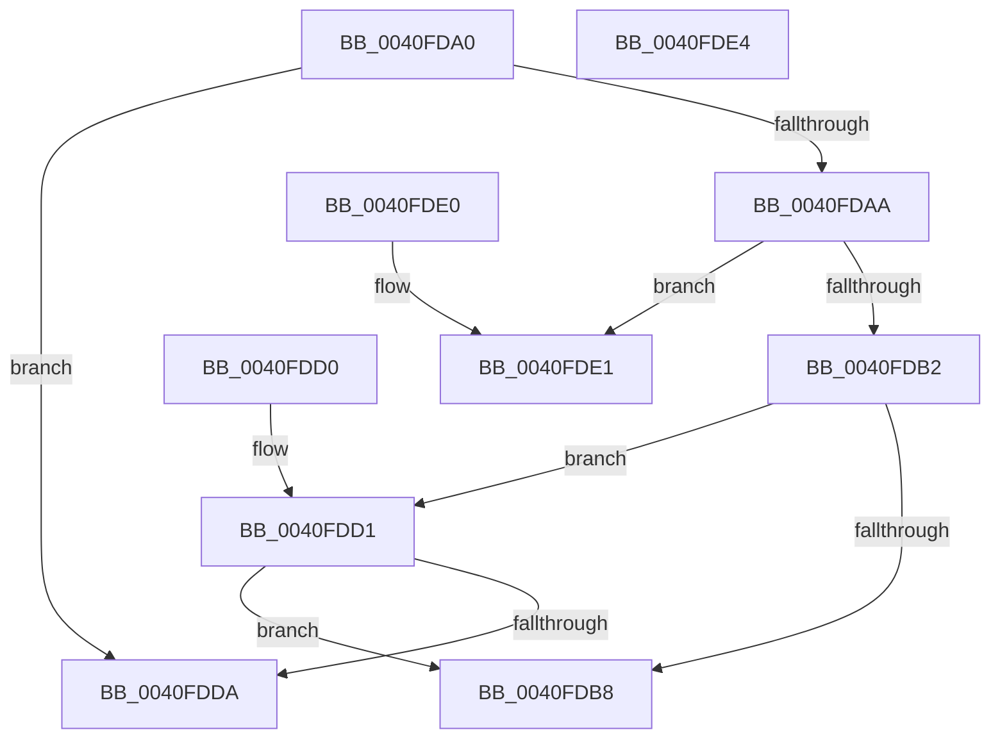

# MiTrimmedEnough

- RVA: `0x0040FDA0`–`0x0040FDE5` (길이 `69` bytes)
- VA: `0x000000014040FDA0`
- 실행 섹션: `.text`
- PDB 이름 있음: `예`; PDB Function 태그: `아니요`
- unwind 정보 RVA: `0x000DB714`
- 디코드: `24`개 명령, `69/69` bytes 표시
- 미해석 바이트: `0` (있으면 어셈블리에 `.byte`로 보존)

> 이 문서는 커널 이미지의 기계어와 PDB 기호를 분석해 생성했습니다. 4번과 5번은 함수 원형과 자료형을 바이너리 사용 방식에서 추정한 C 해석이며 원본 소스 복구 결과는 아닙니다.

## 1. Dependencies

- 직접 호출 지점: **0**; 고유 호출 대상: **0**
- 직접 호출자로 확인된 함수: **2**
- RIP 상대 이미지 참조: **0**

### Outgoing calls
- 직접 디코드된 call 명령이 없습니다.

### Direct callers
- [MiTrimWorkingSetTail](../2A/MiTrimWorkingSetTail_function_002AD970.md) at `0x002AD9C0`
- [MiTrimWorkingSetVpabCallback](MiTrimWorkingSetVpabCallback_function_0040FCD0.md) at `0x0040FD01`

### Static image references
- 디코드된 RIP-relative 메모리 참조가 없습니다.

## 2. Other-region calls and transfers

- 다른 실행 섹션으로 향하는 call: **0**
- 별도 외부 분기/꼬리 이동을 확인하지 못했습니다.

## 3. Assembly (complete function range)

```asm
0040FDA0  4C 8B 42 10                     mov r8, qword ptr [rdx + 0x10]
0040FDA4  4C 3B 42 08                     cmp r8, qword ptr [rdx + 8]
0040FDA8  74 30                           je 0x14040fdda
0040FDAA  8B 02                           mov eax, dword ptr [rdx]
0040FDAC  0F BA E0 0E                     bt eax, 0xe
0040FDB0  73 2F                           jae 0x14040fde1
0040FDB2  0F BA E0 0F                     bt eax, 0xf
0040FDB6  72 19                           jb 0x14040fdd1
0040FDB8  4C 8B 81 90 00 00 00            mov r8, qword ptr [rcx + 0x90]
0040FDBF  33 C0                           xor eax, eax
0040FDC1  48 8B 4A 38                     mov rcx, qword ptr [rdx + 0x38]
0040FDC5  48 2B 4A 08                     sub rcx, qword ptr [rdx + 8]
0040FDC9  4C 3B C1                        cmp r8, rcx
0040FDCC  0F 96 C0                        setbe al
0040FDCF  C3                              ret
0040FDD0  CC                              int3
0040FDD1  49 81 F8 00 01 00 00            cmp r8, 0x100
0040FDD8  72 DE                           jb 0x14040fdb8
0040FDDA  B8 01 00 00 00                  mov eax, 1
0040FDDF  C3                              ret
0040FDE0  CC                              int3
0040FDE1  33 C0                           xor eax, eax
0040FDE3  C3                              ret
0040FDE4  CC                              int3
```

## 4. C-style interpretation (structured pseudocode)

```c
__int64 __fastcall MiTrimmedEnough(__int64 a1, __int64 a2)
{
    __int64 result;

    if ((*(unsigned __int64 *)(a2 + 16)) == (*(unsigned __int64 *)(a2 + 8))) goto loc_0040FDDA;
    if ((*(unsigned __int64 *)(a2 + 16)) >= (*(unsigned __int64 *)(a2 + 8))) goto loc_0040FDE1;
    if ((*(unsigned __int64 *)(a2 + 16)) < (*(unsigned __int64 *)(a2 + 8))) goto loc_0040FDD1;
loc_0040FDB8:
    result = 0;
    a1 = (*(unsigned __int64 *)(a2 + 56)) - (*(unsigned __int64 *)(a2 + 8));
    result = ((*(unsigned __int64 *)(a1 + 144)) <= a1) ? 1 : 0;
    return result;
loc_0040FDD1:
    if ((*(unsigned __int64 *)(a1 + 144)) < 256) goto loc_0040FDB8;
loc_0040FDDA:
    return 1;
loc_0040FDE1:
    result = 0;
    return result;
}
```

## 5. (Beta) C Style

```c
int64_t MiTrimmedEnough(void *Arg1, void *Arg2)
{
    uint8_t *arg1 = (uint8_t *)Arg1;
    uint8_t *arg2 = (uint8_t *)Arg2;

    int64_t result;

    if ((*(uint64_t *)(arg2 + 0x10)) == (*(uint64_t *)(arg2 + 0x8))) goto loc_0040FDDA;
    if ((*(uint64_t *)(arg2 + 0x10)) >= (*(uint64_t *)(arg2 + 0x8))) goto loc_0040FDE1;
    if ((*(uint64_t *)(arg2 + 0x10)) < (*(uint64_t *)(arg2 + 0x8))) goto loc_0040FDD1;
loc_0040FDB8:
    result = 0;
    Arg1 = (*(uint64_t *)(arg2 + 0x38)) - (*(uint64_t *)(arg2 + 0x8));
    result = ((*(uint64_t *)(arg1 + 0x90)) <= Arg1) ? 1 : 0;
    return result;
loc_0040FDD1:
    if ((*(uint64_t *)(arg1 + 0x90)) < 256) goto loc_0040FDB8;
loc_0040FDDA:
    return 1;
loc_0040FDE1:
    result = 0;
    return result;
}
```

### 관측된 메모리 오프셋

구조체 형식이 확인되지 않은 접근은 인자 기준의 오프셋으로만 기록했습니다.

| 기준 인자 | 오프셋 표현 | 폭 (bit) | 접근 |
|---|---:|---:|---|
| `Arg1` | `+ 0x90` | `64` | `R` |
| `Arg2` | `+ 0x0` | `32` | `R` |
| `Arg2` | `+ 0x8` | `64` | `R` |
| `Arg2` | `+ 0x10` | `64` | `R` |
| `Arg2` | `+ 0x38` | `64` | `R` |

## 6. Execution-region graph

[열기: 2D/3D 그래프와 함수 탐색 컨트롤 패널](../../../control-panel.html?section=text&rva=0x0040FDA0&view=graph)

- 2D 그래프는 위에서 아래로 흐르고, 3D 그래프는 빈 공간을 드래그해 회전합니다. Shift+드래그는 이동, 휠은 확대·축소, 함수 노드 선택은 대상 보고서 이동입니다.

### Static fallback


