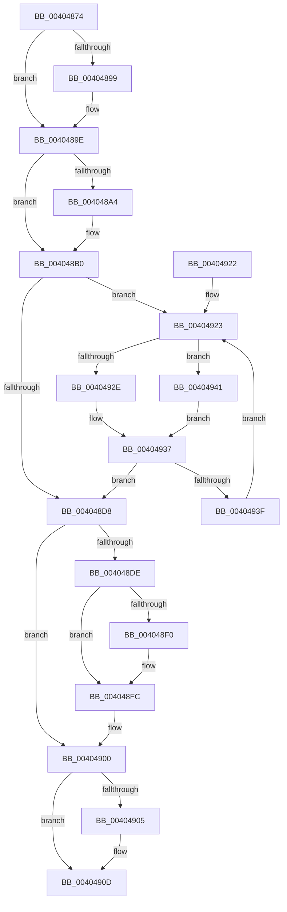

# MiUnlockFlushMdl

- RVA: `0x00404874`–`0x00404946` (길이 `210` bytes)
- VA: `0x0000000140404874`
- 실행 섹션: `.text`
- PDB 이름 있음: `예`; PDB Function 태그: `아니요`
- unwind 정보 RVA: `0x0007AE84`
- 디코드: `62`개 명령, `210/210` bytes 표시
- 미해석 바이트: `0` (있으면 어셈블리에 `.byte`로 보존)

> 이 문서는 커널 이미지의 기계어와 PDB 기호를 분석해 생성했습니다. 4번과 5번은 함수 원형과 자료형을 바이너리 사용 방식에서 추정한 C 해석이며 원본 소스 복구 결과는 아닙니다.

## 1. Dependencies

- 직접 호출 지점: **7**; 고유 호출 대상: **7**
- 직접 호출자로 확인된 함수: **1**
- RIP 상대 이미지 참조: **1**

### Outgoing calls
- `0x00404899` → [MiRetardMdl](MiRetardMdl_function_0040494C.md) (function, `0x0040494C`)
- `0x004048AB` → [MmUnmapLockedPages](../24/MmUnmapLockedPages_function_00246E60.md) (function, `0x00246E60`)
- `0x004048B6` → [MiUnlockMdlWritePages](../24/MiUnlockMdlWritePages_function_0024A7C0.md) (function, `0x0024A7C0`)
- `0x004048BF` → [ExAcquireSpinLockExclusive](../24/ExAcquireSpinLockExclusive_function_00248690.md) (function, `0x00248690`)
- `0x004048E2` → [ExReleaseSpinLockExclusiveFromDpcLevel](../24/ExReleaseSpinLockExclusiveFromDpcLevel_function_002497E0.md) (function, `0x002497E0`)
- `0x004048F7` → [KiLowerIrqlProcessIrqlFlags](../4F/KiLowerIrqlProcessIrqlFlags_function_004F5698.md) (function, `0x004F5698`)
- `0x00404908` → [MiReleaseControlAreaWaiters](../28/MiReleaseControlAreaWaiters_function_002865F0.md) (function, `0x002865F0`)

### Direct callers
- [MiFlushSection](MiFlushSection_function_004036B0.md) at `0x00403CFB`

### Static image references
- `0x004048E7` → RVA `0x00FC6D20` (`ALMOSTRO`; read)

## 2. Other-region calls and transfers

- 다른 실행 섹션으로 향하는 call: **0**
- 별도 외부 분기/꼬리 이동을 확인하지 못했습니다.

## 3. Assembly (complete function range)

```asm
00404874  48 89 5C 24 08                  mov qword ptr [rsp + 8], rbx
00404879  48 89 6C 24 10                  mov qword ptr [rsp + 0x10], rbp
0040487E  48 89 74 24 18                  mov qword ptr [rsp + 0x18], rsi
00404883  57                              push rdi
00404884  48 83 EC 20                     sub rsp, 0x20
00404888  66 0F BA 61 0A 09               bt word ptr [rcx + 0xa], 9
0040488E  49 8B F8                        mov rdi, r8
00404891  48 8B F2                        mov rsi, rdx
00404894  48 8B D9                        mov rbx, rcx
00404897  73 05                           jae 0x14040489e
00404899  E8 AE 00 00 00                  call 0x14040494c
0040489E  F6 43 0A 01                     test byte ptr [rbx + 0xa], 1
004048A2  74 0C                           je 0x1404048b0
004048A4  48 8B 4B 18                     mov rcx, qword ptr [rbx + 0x18]
004048A8  48 8B D3                        mov rdx, rbx
004048AB  E8 B0 25 E4 FF                  call 0x140246e60
004048B0  48 8B D7                        mov rdx, rdi
004048B3  48 8B CB                        mov rcx, rbx
004048B6  E8 05 5F E4 FF                  call 0x14024a7c0
004048BB  48 8D 4E 48                     lea rcx, [rsi + 0x48]
004048BF  E8 CC 3D E4 FF                  call 0x140248690
004048C4  FF 4E 4C                        dec dword ptr [rsi + 0x4c]
004048C7  33 DB                           xor ebx, ebx
004048C9  0F B6 F8                        movzx edi, al
004048CC  48 8D 46 50                     lea rax, [rsi + 0x50]
004048D0  48 8B 10                        mov rdx, qword ptr [rax]
004048D3  48 85 D2                        test rdx, rdx
004048D6  75 4B                           jne 0x140404923
004048D8  40 80 FF 11                     cmp dil, 0x11
004048DC  74 22                           je 0x140404900
004048DE  48 8D 4E 48                     lea rcx, [rsi + 0x48]
004048E2  E8 F9 4E E4 FF                  call 0x1402497e0
004048E7  83 3D 32 24 BC 00 00            cmp dword ptr [rip + 0xbc2432], 0
004048EE  74 0C                           je 0x1404048fc
004048F0  44 0F 20 C1                     mov rcx, cr8
004048F4  40 8A D7                        mov dl, dil
004048F7  E8 9C 0D 0F 00                  call 0x1404f5698
004048FC  44 0F 22 C7                     mov cr8, rdi
00404900  48 85 DB                        test rbx, rbx
00404903  74 08                           je 0x14040490d
00404905  48 8B CB                        mov rcx, rbx
00404908  E8 E3 1C E8 FF                  call 0x1402865f0
0040490D  48 8B 5C 24 30                  mov rbx, qword ptr [rsp + 0x30]
00404912  48 8B 6C 24 38                  mov rbp, qword ptr [rsp + 0x38]
00404917  48 8B 74 24 40                  mov rsi, qword ptr [rsp + 0x40]
0040491C  48 83 C4 20                     add rsp, 0x20
00404920  5F                              pop rdi
00404921  C3                              ret
00404922  CC                              int3
00404923  8B 4A 08                        mov ecx, dword ptr [rdx + 8]
00404926  4C 8B 02                        mov r8, qword ptr [rdx]
00404929  F6 C1 08                        test cl, 8
0040492C  74 13                           je 0x140404941
0040492E  48 89 1A                        mov qword ptr [rdx], rbx
00404931  48 8B DA                        mov rbx, rdx
00404934  4C 89 00                        mov qword ptr [rax], r8
00404937  49 8B D0                        mov rdx, r8
0040493A  4D 85 C0                        test r8, r8
0040493D  74 99                           je 0x1404048d8
0040493F  EB E2                           jmp 0x140404923
00404941  48 8B C2                        mov rax, rdx
00404944  EB F1                           jmp 0x140404937
```

## 4. C-style interpretation (structured pseudocode)

```c
__int64 __fastcall MiUnlockFlushMdl(__int64 a1, __int64 a2, __int64 a3)
{
    __int64 result;
    __int64 v_rbx;
    __int64 v_rsp;
    unsigned __int64 v_stack_p10;
    unsigned __int64 v_stack_p18;
    unsigned __int64 v_stack_p8;

    v_stack_p8 = v_rbx;
    v_stack_p10 = v_rbp;
    v_stack_p18 = v_rsi;
    v_rsp = (v_rsp) - (32);
    if (!(condition_is_above_or_equal)) {
        result = MiRetardMdl(a1, a2, a3, a4);
    }
    if (((*(unsigned __int8 *)(a1 + 10)) & (1)) != 0) {
        a1 = *(unsigned __int64 *)(a1 + 24);
        a2 = a1;
        result = MmUnmapLockedPages(a1, a2, a3, a4);
    }
    result = MiUnlockMdlWritePages(a1, a3, a3, a4);
    result = ExAcquireSpinLockExclusive(a2 + 72, a3, a3, a4);
    v_rbx = 0;
    if (*(unsigned __int64 *)(a2 + 80) != 0) goto loc_00404923;
loc_004048D8:
    if (((unsigned __int8)((unsigned __int8)(result))) == 17) goto loc_00404900;
    result = ExReleaseSpinLockExclusiveFromDpcLevel(a2 + 72, *(unsigned __int64 *)(a2 + 80), a3, a4);
    if ((*(unsigned int *)(v_rip + 12330034)) != 0) {
        a1 = v_cr8;
        a2 = (unsigned __int8)((unsigned __int8)(result));
        result = KiLowerIrqlProcessIrqlFlags(a1, a2, a3, a4);
    }
loc_00404900:
    if (0 != 0) {
        a1 = 0;
        result = MiReleaseControlAreaWaiters(a1, a2, a3, a4);
    }
    v_rsp = (v_rsp) + (32);
    return result;
loc_00404923:
    if ((((unsigned __int8)((unsigned int)(*(unsigned int *)(a2 + 8)))) & (8)) == 0) goto loc_00404941;
    *(unsigned __int64 *)(a2) = v_stack_p8;
    *(unsigned __int64 *)(result) = *(unsigned __int64 *)(a2);
loc_00404937:
    if (*(unsigned __int64 *)(a2) == 0) goto loc_004048D8;
    goto loc_00404923;
loc_00404941:
    goto loc_00404937;
}
```

## 5. (Beta) C Style

```c
int64_t MiUnlockFlushMdl(void *Arg1, void *Arg2, int64_t Arg3)
{
    uint8_t *arg1 = (uint8_t *)Arg1;
    uint8_t *arg2 = (uint8_t *)Arg2;

    int64_t result;
    int64_t local_rbx;
    int64_t local_rsp;
    uint64_t v_stack_p10;
    uint64_t v_stack_p18;
    uint64_t v_stack_p8;

    v_stack_p8 = local_rbx;
    v_stack_p10 = local_rbp;
    v_stack_p18 = local_rsi;
    local_rsp = (local_rsp) - (32);
    if (!(condition_is_above_or_equal)) {
        result = MiRetardMdl(Arg1, Arg2, Arg3, a4);
    }
    if (((*(uint8_t *)(arg1 + 0xA)) & (1)) != 0) {
        Arg1 = *(uint64_t *)(arg1 + 0x18);
        Arg2 = Arg1;
        result = MmUnmapLockedPages(Arg1, Arg2, Arg3, a4);
    }
    result = MiUnlockMdlWritePages(Arg1, Arg3, Arg3, a4);
    result = ExAcquireSpinLockExclusive(Arg2 + 72, Arg3, Arg3, a4);
    local_rbx = 0;
    if (*(uint64_t *)(arg2 + 0x50) != 0) goto loc_00404923;
loc_004048D8:
    if (((uint8_t)((uint8_t)(result))) == 17) goto loc_00404900;
    result = ExReleaseSpinLockExclusiveFromDpcLevel(Arg2 + 72, *(uint64_t *)(arg2 + 0x50), Arg3, a4);
    if ((*(uint32_t *)(v_rip + 0xBC2432)) != 0) {
        Arg1 = v_cr8;
        Arg2 = (uint8_t)((uint8_t)(result));
        result = KiLowerIrqlProcessIrqlFlags(Arg1, Arg2, Arg3, a4);
    }
loc_00404900:
    if (0 != 0) {
        Arg1 = 0;
        result = MiReleaseControlAreaWaiters(Arg1, Arg2, Arg3, a4);
    }
    local_rsp = (local_rsp) + (32);
    return result;
loc_00404923:
    if ((((uint8_t)((uint32_t)(*(uint32_t *)(arg2 + 0x8)))) & (8)) == 0) goto loc_00404941;
    *(uint64_t *)(arg2) = v_stack_p8;
    *(uint64_t *)(result) = *(uint64_t *)(arg2);
loc_00404937:
    if (*(uint64_t *)(arg2) == 0) goto loc_004048D8;
    goto loc_00404923;
loc_00404941:
    goto loc_00404937;
}
```

### 관측된 메모리 오프셋

구조체 형식이 확인되지 않은 접근은 인자 기준의 오프셋으로만 기록했습니다.

| 기준 인자 | 오프셋 표현 | 폭 (bit) | 접근 |
|---|---:|---:|---|
| `Arg1` | `+ 0xA` | `8` | `R` |
| `Arg1` | `+ 0xA` | `16` | `R` |
| `Arg1` | `+ 0x18` | `64` | `R` |
| `Arg2` | `+ 0x0` | `64` | `R` |
| `Arg2` | `+ 0x48` | `64` | `R` |
| `Arg2` | `+ 0x4C` | `32` | `R/W` |
| `Arg2` | `+ 0x50` | `64` | `R` |

## 6. Execution-region graph

[열기: 2D/3D 그래프와 함수 탐색 컨트롤 패널](../../../control-panel.html?section=text&rva=0x00404874&view=graph)

- 2D 그래프는 위에서 아래로 흐르고, 3D 그래프는 빈 공간을 드래그해 회전합니다. Shift+드래그는 이동, 휠은 확대·축소, 함수 노드 선택은 대상 보고서 이동입니다.

### Static fallback


