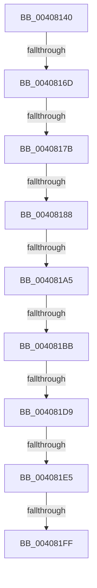

# MiUnlockPageTableCharges

- RVA: `0x00408140`–`0x00408216` (길이 `214` bytes)
- VA: `0x0000000140408140`
- 실행 섹션: `.text`
- PDB 이름 있음: `예`; PDB Function 태그: `아니요`
- unwind 정보 RVA: `0x0009AA08`
- 디코드: `51`개 명령, `214/214` bytes 표시
- 미해석 바이트: `0` (있으면 어셈블리에 `.byte`로 보존)

> 이 문서는 커널 이미지의 기계어와 PDB 기호를 분석해 생성했습니다. 4번과 5번은 함수 원형과 자료형을 바이너리 사용 방식에서 추정한 C 해석이며 원본 소스 복구 결과는 아닙니다.

## 1. Dependencies

- 직접 호출 지점: **0**; 고유 호출 대상: **0**
- 직접 호출자로 확인된 함수: **8**
- RIP 상대 이미지 참조: **0**

### Outgoing calls
- 직접 디코드된 call 명령이 없습니다.

### Direct callers
- [MiDemoteCombinedPte](../22/MiDemoteCombinedPte_function_0022ABAC.md) at `0x0022AFDE`
- [MiProbeUnlockPage](../24/MiProbeUnlockPage_function_00243860.md) at `0x00243ABB`
- [MmUnlockPages](../29/MmUnlockPages_function_0029EEE0.md) at `0x0029F0F5`
- [MiCopyOnWrite](../36/MiCopyOnWrite_function_00362A0C.md) at `0x00363345`
- [MiUnlockPageTableRange](MiUnlockPageTableRange_function_00407E44.md) at `0x00407F05`
- [MiUnlockWsle](MiUnlockWsle_function_00407F84.md) at `0x00408056`
- [MiUnlockWsle](MiUnlockWsle_function_00407F84.md) at `0x00408076`
- [NtLockVirtualMemory](NtLockVirtualMemory_function_004088A0.md) at `0x00409237`
- [NtLockVirtualMemory](NtLockVirtualMemory_function_004088A0.md) at `0x00409248`
- [NtLockVirtualMemory](NtLockVirtualMemory_function_004088A0.md) at `0x0040926A`
- [NtLockVirtualMemory](NtLockVirtualMemory_function_004088A0.md) at `0x0040929B`
- [NtLockVirtualMemory](NtLockVirtualMemory_function_004088A0.md) at `0x004092D6`
- [MiUnlockPhysicalPageByVa](../67/MiUnlockPhysicalPageByVa_function_00673EB0.md) at `0x006740AE`

### Static image references
- 디코드된 RIP-relative 메모리 참조가 없습니다.

## 2. Other-region calls and transfers

- 다른 실행 섹션으로 향하는 call: **0**
- call이 아닌 외부 분기/꼬리 이동: **9**
  - `0x00408167` → [sub_004084D6](Unknown_function_004084D6.md) (`tail-transfer`)
  - `0x00408175` → [sub_004083CF + 0x3](Unknown_function_004083CF.md) (`tail-transfer`)
  - `0x00408182` → [sub_004083CF + 0x3](Unknown_function_004083CF.md) (`tail-transfer`)
  - `0x0040819F` → [sub_004083CF](Unknown_function_004083CF.md) (`tail-transfer`)
  - `0x004081B5` → [sub_004083CF](Unknown_function_004083CF.md) (`tail-transfer`)
  - `0x004081D3` → [sub_004083CF](Unknown_function_004083CF.md) (`tail-transfer`)
  - `0x004081DF` → [sub_004083CF](Unknown_function_004083CF.md) (`tail-transfer`)
  - `0x004081F9` → [sub_00408324 + 0x1](Unknown_function_00408324.md) (`tail-transfer`)
  - `0x00408210` → [sub_00408324 + 0x1](Unknown_function_00408324.md) (`tail-transfer`)

## 3. Assembly (complete function range)

```asm
00408140  40 53                           push rbx
00408142  56                              push rsi
00408143  41 54                           push r12
00408145  41 55                           push r13
00408147  48 83 EC 38                     sub rsp, 0x38
0040814B  33 F6                           xor esi, esi
0040814D  48 8B D9                        mov rbx, rcx
00408150  49 BD FF FF FF FF FF FF FF 3F   movabs r13, 0x3fffffffffffffff
0040815A  49 BA 00 00 00 00 00 00 00 80   movabs r10, 0x8000000000000000
00408164  83 FA 02                        cmp edx, 2
00408167  0F 85 69 03 00 00               jne 0x1404084d6
0040816D  0F B6 41 22                     movzx eax, byte ptr [rcx + 0x22]
00408171  24 07                           and al, 7
00408173  3C 06                           cmp al, 6
00408175  0F 85 57 02 00 00               jne 0x1404083d2
0040817B  48 8B 41 18                     mov rax, qword ptr [rcx + 0x18]
0040817F  49 85 C5                        test r13, rax
00408182  0F 84 4A 02 00 00               je 0x1404083d2
00408188  48 8B 49 08                     mov rcx, qword ptr [rcx + 8]
0040818C  49 0B CA                        or rcx, r10
0040818F  48 BA 00 00 00 00 80 F6 FF FF   movabs rdx, 0xfffff68000000000
00408199  48 8B C2                        mov rax, rdx
0040819C  48 3B C8                        cmp rcx, rax
0040819F  0F 82 2A 02 00 00               jb 0x1404083cf
004081A5  49 B8 FF FF FF FF FF F6 FF FF   movabs r8, 0xfffff6ffffffffff
004081AF  49 8B C0                        mov rax, r8
004081B2  48 3B C8                        cmp rcx, rax
004081B5  0F 87 14 02 00 00               ja 0x1404083cf
004081BB  48 C1 E1 19                     shl rcx, 0x19
004081BF  48 8B C2                        mov rax, rdx
004081C2  48 C1 E0 19                     shl rax, 0x19
004081C6  48 2B C8                        sub rcx, rax
004081C9  48 C1 F9 10                     sar rcx, 0x10
004081CD  48 8B C2                        mov rax, rdx
004081D0  48 3B C8                        cmp rcx, rax
004081D3  0F 82 F6 01 00 00               jb 0x1404083cf
004081D9  49 8B C0                        mov rax, r8
004081DC  48 3B C8                        cmp rcx, rax
004081DF  0F 87 EA 01 00 00               ja 0x1404083cf
004081E5  8D 56 01                        lea edx, [rsi + 1]
004081E8  48 8B CB                        mov rcx, rbx
004081EB  B8 18 00 00 00                  mov eax, 0x18
004081F0  48 03 C8                        add rcx, rax
004081F3  44 8D 60 EB                     lea r12d, [rax - 0x15]
004081F7  85 D2                           test edx, edx
004081F9  0F 84 26 01 00 00               je 0x140408325
004081FF  48 8B 43 18                     mov rax, qword ptr [rbx + 0x18]
00408203  48 8D 4B 18                     lea rcx, [rbx + 0x18]
00408207  49 23 C5                        and rax, r13
0040820A  48 3D 00 00 01 00               cmp rax, 0x10000
00408210  0F 82 0F 01 00 00               jb 0x140408325
```

## 4. C-style interpretation (structured pseudocode)

```c
__int64 __fastcall MiUnlockPageTableCharges(__int64 a1, int a2)
{
    __int64 result;
    __int64 v_rsi;
    __int64 v_rsp;

    v_rsp = (v_rsp) - (56);
    v_rsi = 0;
    result = (unsigned __int8)((*(unsigned __int8 *)(a1 + 34)) & (7));
    a1 = (*(unsigned __int64 *)(a1 + 8)) | (v_r10);
    a1 = (a1) << (25);
    result = (a2) << (25);
    a1 = (a1) - (result);
    a1 = (a1) >> (16);
    a1 = (a1) + (24);
    result = (*(unsigned __int64 *)(a1 + 24)) & (v_r13);
}
```

## 5. (Beta) C Style

```c
int64_t MiUnlockPageTableCharges(void *Arg1, int32_t Arg2)
{
    uint8_t *arg1 = (uint8_t *)Arg1;

    int64_t result;
    int64_t local_rsi;
    int64_t local_rsp;

    local_rsp = (local_rsp) - (56);
    local_rsi = 0;
    result = (uint8_t)((*(uint8_t *)(arg1 + 0x22)) & (7));
    Arg1 = (*(uint64_t *)(arg1 + 0x8)) | (local_r10);
    Arg1 = (Arg1) << (25);
    result = (Arg2) << (25);
    Arg1 = (Arg1) - (result);
    Arg1 = (Arg1) >> (16);
    Arg1 = (Arg1) + (24);
    result = (*(uint64_t *)(arg1 + 0x18)) & (local_r13);
}
```

### 관측된 메모리 오프셋

구조체 형식이 확인되지 않은 접근은 인자 기준의 오프셋으로만 기록했습니다.

| 기준 인자 | 오프셋 표현 | 폭 (bit) | 접근 |
|---|---:|---:|---|
| `Arg1` | `+ 0x8` | `64` | `R` |
| `Arg1` | `+ 0x18` | `64` | `R` |
| `Arg1` | `+ 0x22` | `8` | `R` |

## 6. Execution-region graph

[열기: 2D/3D 그래프와 함수 탐색 컨트롤 패널](../../../control-panel.html?section=text&rva=0x00408140&view=graph)

- 2D 그래프는 위에서 아래로 흐르고, 3D 그래프는 빈 공간을 드래그해 회전합니다. Shift+드래그는 이동, 휠은 확대·축소, 함수 노드 선택은 대상 보고서 이동입니다.

### Static fallback


