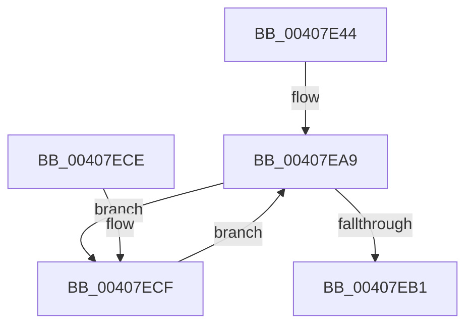

# MiUnlockPageTableRange

- RVA: `0x00407E44`–`0x00407F1B` (길이 `215` bytes)
- VA: `0x0000000140407E44`
- 실행 섹션: `.text`
- PDB 이름 있음: `예`; PDB Function 태그: `아니요`
- unwind 정보 RVA: `0x00066C70`
- 디코드: `52`개 명령, `215/215` bytes 표시
- 미해석 바이트: `0` (있으면 어셈블리에 `.byte`로 보존)

> 이 문서는 커널 이미지의 기계어와 PDB 기호를 분석해 생성했습니다. 4번과 5번은 함수 원형과 자료형을 바이너리 사용 방식에서 추정한 C 해석이며 원본 소스 복구 결과는 아닙니다.

## 1. Dependencies

- 직접 호출 지점: **5**; 고유 호출 대상: **5**
- 직접 호출자로 확인된 함수: **2**
- RIP 상대 이미지 참조: **0**

### Outgoing calls
- `0x00407EA1` → [MiLockWorkingSetShared](../27/MiLockWorkingSetShared_function_0027CBF0.md) (function, `0x0027CBF0`)
- `0x00407EB4` → [MiUnlockWorkingSetShared](../27/MiUnlockWorkingSetShared_function_0027D690.md) (function, `0x0027D690`)
- `0x00407ED2` → [MiLockNestedPageTable](../23/MiLockNestedPageTable_function_0023E890.md) (function, `0x0023E890`)
- `0x00407F05` → [MiUnlockPageTableCharges](MiUnlockPageTableCharges_function_00408140.md) (function, `0x00408140`)
- `0x00407F10` → [MiUnlockPageTable](../21/MiUnlockPageTable_function_00216EC0.md) (function, `0x00216EC0`)

### Direct callers
- [MiLockPageTableRange](../49/MiLockPageTableRange_function_0049A850.md) at `0x0049A9C0`
- [MmStoreFreeVirtualMemory](../../page/A7/MmStoreFreeVirtualMemory_function_00A767A8.md) at `0x00A767FA`

### Static image references
- 디코드된 RIP-relative 메모리 참조가 없습니다.

## 2. Other-region calls and transfers

- 다른 실행 섹션으로 향하는 call: **0**
- 별도 외부 분기/꼬리 이동을 확인하지 못했습니다.

## 3. Assembly (complete function range)

```asm
00407E44  48 89 5C 24 08                  mov qword ptr [rsp + 8], rbx
00407E49  48 89 6C 24 10                  mov qword ptr [rsp + 0x10], rbp
00407E4E  48 89 74 24 18                  mov qword ptr [rsp + 0x18], rsi
00407E53  57                              push rdi
00407E54  48 83 EC 20                     sub rsp, 0x20
00407E58  65 48 8B 04 25 88 01 00 00      mov rax, qword ptr gs:[0x188]
00407E61  48 8B D9                        mov rbx, rcx
00407E64  48 8B F2                        mov rsi, rdx
00407E67  48 C1 EB 12                     shr rbx, 0x12
00407E6B  BA F8 FF FF 3F                  mov edx, 0x3ffffff8
00407E70  48 B9 00 00 00 40 FB F6 FF FF   movabs rcx, 0xfffff6fb40000000
00407E7A  48 23 DA                        and rbx, rdx
00407E7D  48 8B B8 B8 00 00 00            mov rdi, qword ptr [rax + 0xb8]
00407E84  48 81 C7 00 04 00 00            add rdi, 0x400
00407E8B  48 8B C1                        mov rax, rcx
00407E8E  48 C1 EE 12                     shr rsi, 0x12
00407E92  48 03 D8                        add rbx, rax
00407E95  48 23 F2                        and rsi, rdx
00407E98  48 8B C1                        mov rax, rcx
00407E9B  48 03 F0                        add rsi, rax
00407E9E  48 8B CF                        mov rcx, rdi
00407EA1  E8 4A 4D E7 FF                  call 0x14027cbf0
00407EA6  40 8A E8                        mov bpl, al
00407EA9  48 8B CF                        mov rcx, rdi
00407EAC  48 3B DE                        cmp rbx, rsi
00407EAF  76 1E                           jbe 0x140407ecf
00407EB1  40 8A D5                        mov dl, bpl
00407EB4  E8 D7 57 E7 FF                  call 0x14027d690
00407EB9  48 8B 5C 24 30                  mov rbx, qword ptr [rsp + 0x30]
00407EBE  48 8B 6C 24 38                  mov rbp, qword ptr [rsp + 0x38]
00407EC3  48 8B 74 24 40                  mov rsi, qword ptr [rsp + 0x40]
00407EC8  48 83 C4 20                     add rsp, 0x20
00407ECC  5F                              pop rdi
00407ECD  C3                              ret
00407ECE  CC                              int3
00407ECF  48 8B D3                        mov rdx, rbx
00407ED2  E8 B9 69 E3 FF                  call 0x14023e890
00407ED7  48 8B 0B                        mov rcx, qword ptr [rbx]
00407EDA  48 B8 FF FF FF FF FF 00 00 00   movabs rax, 0xffffffffff
00407EE4  48 C1 E9 0C                     shr rcx, 0xc
00407EE8  48 23 C8                        and rcx, rax
00407EEB  48 8D 0C 49                     lea rcx, [rcx + rcx*2]
00407EEF  48 C1 E1 04                     shl rcx, 4
00407EF3  48 B8 00 00 00 00 00 DE FF FF   movabs rax, 0xffffde0000000000
00407EFD  48 03 C8                        add rcx, rax
00407F00  BA 02 00 00 00                  mov edx, 2
00407F05  E8 36 02 00 00                  call 0x140408140
00407F0A  48 8B D3                        mov rdx, rbx
00407F0D  48 8B CF                        mov rcx, rdi
00407F10  E8 AB EF E0 FF                  call 0x140216ec0
00407F15  48 83 C3 08                     add rbx, 8
00407F19  EB 8E                           jmp 0x140407ea9
```

## 4. C-style interpretation (structured pseudocode)

```c
__int64 __fastcall MiUnlockPageTableRange(__int64 a1, __int64 a2)
{
    __int64 result;
    __int64 v_rbx;
    __int64 v_rdi;
    __int64 v_rsi;
    __int64 v_rsp;
    unsigned __int64 v_stack_p10;
    unsigned __int64 v_stack_p18;
    unsigned __int64 v_stack_p8;

    v_stack_p8 = v_rbx;
    v_stack_p10 = v_rbp;
    v_stack_p18 = v_rsi;
    v_rsp = (v_rsp) - (32);
    v_rbx = (a1) >> (18);
    v_rbx = (v_rbx) & ((unsigned int)(0x3FFFFFF8ULL));
    v_rdi = (*(unsigned __int64 *)(*(unsigned __int64 *)(gs_base + (0 + 392)) + 184)) + (0x400ULL);
    v_rsi = (a2) >> (18);
    v_rbx = (v_rbx) + (a1);
    v_rsi = (v_rsi) & ((unsigned int)(0x3FFFFFF8ULL));
    v_rsi = (v_rsi) + (a1);
    result = MiLockWorkingSetShared(v_rdi, (unsigned int)(0x3FFFFFF8ULL), a3, a4);
loc_00407EA9:
    if (v_rbx <= v_rsi) goto loc_00407ECF;
    result = MiUnlockWorkingSetShared(v_rdi, (unsigned __int8)((unsigned __int8)(result)), a3, a4);
    v_rsp = (v_rsp) + (32);
    return result;
loc_00407ECF:
    result = MiLockNestedPageTable(v_rdi, v_stack_p8, a3, a4);
    a1 = (*(unsigned __int64 *)(v_stack_p8)) >> (12);
    a1 = (a1) & (result);
    a1 = (a1 + a1 * 2) << (4);
    a1 = (a1) + (result);
    result = MiUnlockPageTableCharges(a1, 2, a3, a4);
    result = MiUnlockPageTable(v_rdi, v_stack_p8, a3, a4);
    v_rbx = (v_stack_p8) + (8);
    goto loc_00407EA9;
}
```

## 5. (Beta) C Style

```c
int64_t MiUnlockPageTableRange(int64_t Arg1, int64_t Arg2)
{
    int64_t result;
    int64_t local_rbx;
    int64_t local_rdi;
    int64_t local_rsi;
    int64_t local_rsp;
    uint64_t v_stack_p10;
    uint64_t v_stack_p18;
    uint64_t v_stack_p8;

    v_stack_p8 = local_rbx;
    v_stack_p10 = local_rbp;
    v_stack_p18 = local_rsi;
    local_rsp = (local_rsp) - (32);
    local_rbx = (Arg1) >> (18);
    local_rbx = (local_rbx) & ((uint32_t)(0x3FFFFFF8ULL));
    local_rdi = (*(uint64_t *)(*(uint64_t *)(gs_base + (0 + 0x188)) + 0xB8)) + (0x400ULL);
    local_rsi = (Arg2) >> (18);
    local_rbx = (local_rbx) + (Arg1);
    local_rsi = (local_rsi) & ((uint32_t)(0x3FFFFFF8ULL));
    local_rsi = (local_rsi) + (Arg1);
    result = MiLockWorkingSetShared(local_rdi, (uint32_t)(0x3FFFFFF8ULL), a3, a4);
loc_00407EA9:
    if (local_rbx <= local_rsi) goto loc_00407ECF;
    result = MiUnlockWorkingSetShared(local_rdi, (uint8_t)((uint8_t)(result)), a3, a4);
    local_rsp = (local_rsp) + (32);
    return result;
loc_00407ECF:
    result = MiLockNestedPageTable(local_rdi, v_stack_p8, a3, a4);
    Arg1 = (*(uint64_t *)(v_stack_p8)) >> (12);
    Arg1 = (Arg1) & (result);
    Arg1 = (Arg1 + Arg1 * 2) << (4);
    Arg1 = (Arg1) + (result);
    result = MiUnlockPageTableCharges(Arg1, 2, a3, a4);
    result = MiUnlockPageTable(local_rdi, v_stack_p8, a3, a4);
    local_rbx = (v_stack_p8) + (8);
    goto loc_00407EA9;
}
```

## 6. Execution-region graph

[열기: 2D/3D 그래프와 함수 탐색 컨트롤 패널](../../../control-panel.html?section=text&rva=0x00407E44&view=graph)

- 2D 그래프는 위에서 아래로 흐르고, 3D 그래프는 빈 공간을 드래그해 회전합니다. Shift+드래그는 이동, 휠은 확대·축소, 함수 노드 선택은 대상 보고서 이동입니다.

### Static fallback


