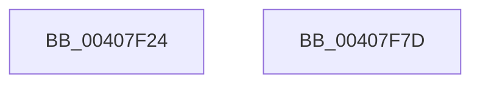

# MiUnlockVa

- RVA: `0x00407F24`–`0x00407F7E` (길이 `90` bytes)
- VA: `0x0000000140407F24`
- 실행 섹션: `.text`
- PDB 이름 있음: `예`; PDB Function 태그: `아니요`
- unwind 정보 RVA: `0x0005C788`
- 디코드: `19`개 명령, `90/90` bytes 표시
- 미해석 바이트: `0` (있으면 어셈블리에 `.byte`로 보존)

> 이 문서는 커널 이미지의 기계어와 PDB 기호를 분석해 생성했습니다. 4번과 5번은 함수 원형과 자료형을 바이너리 사용 방식에서 추정한 C 해석이며 원본 소스 복구 결과는 아닙니다.

## 1. Dependencies

- 직접 호출 지점: **1**; 고유 호출 대상: **1**
- 직접 호출자로 확인된 함수: **4**
- RIP 상대 이미지 참조: **0**

### Outgoing calls
- `0x00407F73` → [MiUnlockWsle](MiUnlockWsle_function_00407F84.md) (function, `0x00407F84`)

### Direct callers
- [sub_002C3A7C](../2C/Unknown_function_002C3A7C.md) at `0x002C4535`
- [NtLockVirtualMemory](NtLockVirtualMemory_function_004088A0.md) at `0x00409140`
- [NtUnlockVirtualMemory](../4E/NtUnlockVirtualMemory_function_004EE890.md) at `0x004EEE43`
- [sub_006F91FE](../6F/Unknown_function_006F91FE.md) at `0x006F9371`

### Static image references
- 디코드된 RIP-relative 메모리 참조가 없습니다.

## 2. Other-region calls and transfers

- 다른 실행 섹션으로 향하는 call: **0**
- 별도 외부 분기/꼬리 이동을 확인하지 못했습니다.

## 3. Assembly (complete function range)

```asm
00407F24  48 83 EC 28                     sub rsp, 0x28
00407F28  48 8B C2                        mov rax, rdx
00407F2B  49 B8 F8 FF FF FF 7F 00 00 00   movabs r8, 0x7ffffffff8
00407F35  48 C1 E8 09                     shr rax, 9
00407F39  49 23 C0                        and rax, r8
00407F3C  49 B8 00 00 00 00 80 F6 FF FF   movabs r8, 0xfffff68000000000
00407F46  4A 8B 04 00                     mov rax, qword ptr [rax + r8]
00407F4A  49 B8 FF FF FF FF FF 00 00 00   movabs r8, 0xffffffffff
00407F54  48 C1 E8 0C                     shr rax, 0xc
00407F58  49 23 C0                        and rax, r8
00407F5B  4C 8D 04 40                     lea r8, [rax + rax*2]
00407F5F  49 C1 E0 04                     shl r8, 4
00407F63  48 B8 00 00 00 00 00 DE FF FF   movabs rax, 0xffffde0000000000
00407F6D  4C 03 C0                        add r8, rax
00407F70  45 33 C9                        xor r9d, r9d
00407F73  E8 0C 00 00 00                  call 0x140407f84
00407F78  48 83 C4 28                     add rsp, 0x28
00407F7C  C3                              ret
00407F7D  CC                              int3
```

## 4. C-style interpretation (structured pseudocode)

```c
__int64 __fastcall MiUnlockVa(__int64 a1, __int64 a2, __int64 a3, int a4)
{
    __int64 result;
    __int64 v_rsp;

    v_rsp = (v_rsp) - (40);
    result = (a2) >> (9);
    result = (result) & (a3);
    result = (*(unsigned __int64 *)(result + a3 * 1)) >> (12);
    result = (result) & (a3);
    a3 = (result + result * 2) << (4);
    a3 = (a3) + (result);
    a4 = 0;
    result = MiUnlockWsle(a1, a2, a3, a4);
    v_rsp = (v_rsp) + (40);
    return result;
}
```

## 5. (Beta) C Style

```c
int64_t MiUnlockVa(int64_t Arg1, int64_t Arg2, int64_t Arg3, int32_t Arg4)
{
    int64_t result;
    int64_t local_rsp;

    local_rsp = (local_rsp) - (40);
    result = (Arg2) >> (9);
    result = (result) & (Arg3);
    result = (*(uint64_t *)(result + Arg3 * 1)) >> (12);
    result = (result) & (Arg3);
    Arg3 = (result + result * 2) << (4);
    Arg3 = (Arg3) + (result);
    Arg4 = 0;
    result = MiUnlockWsle(Arg1, Arg2, Arg3, Arg4);
    local_rsp = (local_rsp) + (40);
    return result;
}
```

## 6. Execution-region graph

[열기: 2D/3D 그래프와 함수 탐색 컨트롤 패널](../../../control-panel.html?section=text&rva=0x00407F24&view=graph)

- 2D 그래프는 위에서 아래로 흐르고, 3D 그래프는 빈 공간을 드래그해 회전합니다. Shift+드래그는 이동, 휠은 확대·축소, 함수 노드 선택은 대상 보고서 이동입니다.

### Static fallback


