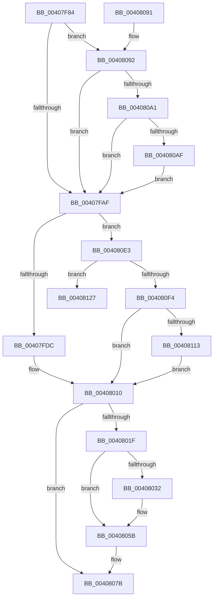

# MiUnlockWsle

- RVA: `0x00407F84`–`0x00408136` (길이 `434` bytes)
- VA: `0x0000000140407F84`
- 실행 섹션: `.text`
- PDB 이름 있음: `예`; PDB Function 태그: `예`
- unwind 정보 RVA: `0x0009A9E0`
- 디코드: `104`개 명령, `434/434` bytes 표시
- 미해석 바이트: `0` (있으면 어셈블리에 `.byte`로 보존)

> 이 문서는 커널 이미지의 기계어와 PDB 기호를 분석해 생성했습니다. 4번과 5번은 함수 원형과 자료형을 바이너리 사용 방식에서 추정한 C 해석이며 원본 소스 복구 결과는 아닙니다.

## 1. Dependencies

- 직접 호출 지점: **8**; 고유 호출 대상: **7**
- 직접 호출자로 확인된 함수: **4**
- RIP 상대 이미지 참조: **2**

### Outgoing calls
- `0x00407FED` → [MiGetEffectivePagePriorityThread](../36/MiGetEffectivePagePriorityThread_function_003626E0.md) (function, `0x003626E0`)
- `0x0040800B` → [MiSetVaAgeList](../29/MiSetVaAgeList_function_00290A20.md) (function, `0x00290A20`)
- `0x00408056` → [MiUnlockPageTableCharges](MiUnlockPageTableCharges_function_00408140.md) (function, `0x00408140`)
- `0x0040805E` → [MiGetContainingPageTable](../34/MiGetContainingPageTable_function_003467F0.md) (function, `0x003467F0`)
- `0x00408076` → [MiUnlockPageTableCharges](MiUnlockPageTableCharges_function_00408140.md) (function, `0x00408140`)
- `0x004080D1` → [MiReturnCommit](../24/MiReturnCommit_function_00248410.md) (function, `0x00248410`)
- `0x004080E6` → [MiGetWsleContents](../31/MiGetWsleContents_function_00316540.md) (function, `0x00316540`)
- `0x00408103` → [MI_WRITE_INVALID_PTE_TB_FLUSH_NEEDED](../24/MI_WRITE_INVALID_PTE_TB_FLUSH_NEEDED_function_002400C0.md) (function, `0x002400C0`)

### Direct callers
- [sub_0023F124](../23/Unknown_function_0023F124.md) at `0x0023F497`
- [MiDecommitAddToList](../24/MiDecommitAddToList_function_00242264.md) at `0x002423FB`
- [sub_0029430C](../29/Unknown_function_0029430C.md) at `0x002943CA`
- [MiUnlockVa](MiUnlockVa_function_00407F24.md) at `0x00407F73`

### Static image references
- `0x004080B6` → RVA `0x00E30088` (`.data`; read)
- `0x004080F6` → RVA `0x00010880` (`.rdata`; read)

## 2. Other-region calls and transfers

- 다른 실행 섹션으로 향하는 call: **0**
- call이 아닌 외부 분기/꼬리 이동: **1**
  - `0x00408131` → [sub_006EC6A4](../6E/Unknown_function_006EC6A4.md) (`tail-transfer`)

## 3. Assembly (complete function range)

```asm
00407F84  48 89 5C 24 08                  mov qword ptr [rsp + 8], rbx
00407F89  48 89 6C 24 10                  mov qword ptr [rsp + 0x10], rbp
00407F8E  56                              push rsi
00407F8F  57                              push rdi
00407F90  41 56                           push r14
00407F92  48 83 EC 20                     sub rsp, 0x20
00407F96  49 8B 40 28                     mov rax, qword ptr [r8 + 0x28]
00407F9A  45 8B F1                        mov r14d, r9d
00407F9D  49 8B F8                        mov rdi, r8
00407FA0  48 8B F2                        mov rsi, rdx
00407FA3  48 8B E9                        mov rbp, rcx
00407FA6  48 85 C0                        test rax, rax
00407FA9  0F 88 E3 00 00 00               js 0x140408092
00407FAF  48 8B DE                        mov rbx, rsi
00407FB2  48 B8 F8 FF FF FF 7F 00 00 00   movabs rax, 0x7ffffffff8
00407FBC  48 C1 EB 09                     shr rbx, 9
00407FC0  48 23 D8                        and rbx, rax
00407FC3  48 B8 00 00 00 00 80 F6 FF FF   movabs rax, 0xfffff68000000000
00407FCD  48 03 D8                        add rbx, rax
00407FD0  48 8B 13                        mov rdx, qword ptr [rbx]
00407FD3  45 85 F6                        test r14d, r14d
00407FD6  0F 85 07 01 00 00               jne 0x1404080e3
00407FDC  65 48 8B 0C 25 88 01 00 00      mov rcx, qword ptr gs:[0x188]
00407FE5  C0 EA 05                        shr dl, 5
00407FE8  F6 D2                           not dl
00407FEA  80 E2 01                        and dl, 1
00407FED  E8 EE A6 F5 FF                  call 0x1403626e0
00407FF2  44 0F B6 CA                     movzx r9d, dl
00407FF6  41 8D 4E 07                     lea ecx, [r14 + 7]
00407FFA  83 F8 05                        cmp eax, 5
00407FFD  45 8D 46 01                     lea r8d, [r14 + 1]
00408001  48 8B D6                        mov rdx, rsi
00408004  44 0F 42 C9                     cmovb r9d, ecx
00408008  48 8B CD                        mov rcx, rbp
0040800B  E8 10 8A E8 FF                  call 0x140290a20
00408010  48 B8 00 00 00 00 00 80 FF FF   movabs rax, 0xffff800000000000
0040801A  48 3B F0                        cmp rsi, rax
0040801D  73 5C                           jae 0x14040807b
0040801F  48 8B 47 28                     mov rax, qword ptr [rdi + 0x28]
00408023  48 BE 00 00 00 00 00 DE FF FF   movabs rsi, 0xffffde0000000000
0040802D  48 85 C0                        test rax, rax
00408030  79 29                           jns 0x14040805b
00408032  48 8B 47 28                     mov rax, qword ptr [rdi + 0x28]
00408036  48 B9 FF FF FF FF FF 00 00 00   movabs rcx, 0xffffffffff
00408040  48 23 C1                        and rax, rcx
00408043  48 8D 0C 40                     lea rcx, [rax + rax*2]
00408047  48 C1 E1 04                     shl rcx, 4
0040804B  48 8B C6                        mov rax, rsi
0040804E  48 03 C8                        add rcx, rax
00408051  BA 01 00 00 00                  mov edx, 1
00408056  E8 E5 00 00 00                  call 0x140408140
0040805B  48 8B CB                        mov rcx, rbx
0040805E  E8 8D E7 F3 FF                  call 0x1403467f0
00408063  48 8D 0C 40                     lea rcx, [rax + rax*2]
00408067  48 C1 E1 04                     shl rcx, 4
0040806B  48 8B C6                        mov rax, rsi
0040806E  48 03 C8                        add rcx, rax
00408071  BA 02 00 00 00                  mov edx, 2
00408076  E8 C5 00 00 00                  call 0x140408140
0040807B  48 8B 5C 24 40                  mov rbx, qword ptr [rsp + 0x40]
00408080  41 8B C6                        mov eax, r14d
00408083  48 8B 6C 24 48                  mov rbp, qword ptr [rsp + 0x48]
00408088  48 83 C4 20                     add rsp, 0x20
0040808C  41 5E                           pop r14
0040808E  5F                              pop rdi
0040808F  5E                              pop rsi
00408090  C3                              ret
00408091  CC                              int3
00408092  41 8B 40 10                     mov eax, dword ptr [r8 + 0x10]
00408096  48 0F BA E0 0A                  bt rax, 0xa
0040809B  0F 83 0E FF FF FF               jae 0x140407faf
004080A1  8B 81 B8 00 00 00               mov eax, dword ptr [rcx + 0xb8]
004080A7  A8 0F                           test al, 0xf
004080A9  0F 85 00 FF FF FF               jne 0x140407faf
004080AF  49 8B 40 28                     mov rax, qword ptr [r8 + 0x28]
004080B3  45 33 C0                        xor r8d, r8d
004080B6  48 8B 0D CB 7F A2 00            mov rcx, qword ptr [rip + 0xa27fcb]
004080BD  48 C1 E8 2B                     shr rax, 0x2b
004080C1  25 FF 03 00 00                  and eax, 0x3ff
004080C6  41 8D 50 01                     lea edx, [r8 + 1]
004080CA  48 8B 1C C1                     mov rbx, qword ptr [rcx + rax*8]
004080CE  48 8B CB                        mov rcx, rbx
004080D1  E8 3A 03 E4 FF                  call 0x140248410
004080D6  F0 48 FF 8B B0 4C 00 00         lock dec qword ptr [rbx + 0x4cb0]
004080DE  E9 CC FE FF FF                  jmp 0x140407faf
004080E3  48 8B D6                        mov rdx, rsi
004080E6  E8 55 E4 F0 FF                  call 0x140316540
004080EB  48 8B 47 28                     mov rax, qword ptr [rdi + 0x28]
004080EF  48 85 C0                        test rax, rax
004080F2  79 33                           jns 0x140408127
004080F4  33 ED                           xor ebp, ebp
004080F6  48 8B 15 83 87 C0 FF            mov rdx, qword ptr [rip - 0x3f787d]
004080FD  45 33 C0                        xor r8d, r8d
00408100  48 8B CB                        mov rcx, rbx
00408103  E8 B8 7F E3 FF                  call 0x1402400c0
00408108  44 8B F0                        mov r14d, eax
0040810B  85 ED                           test ebp, ebp
0040810D  0F 84 FD FE FF FF               je 0x140408010
00408113  48 B8 FF FF FF FF FF FF FF 7F   movabs rax, 0x7fffffffffffffff
0040811D  F0 48 21 47 18                  lock and qword ptr [rdi + 0x18], rax
00408122  E9 E9 FE FF FF                  jmp 0x140408010
00408127  83 64 24 58 00                  and dword ptr [rsp + 0x58], 0
0040812C  BD 01 00 00 00                  mov ebp, 1
00408131  E9 6E 45 2E 00                  jmp 0x1406ec6a4
```

## 4. C-style interpretation (structured pseudocode)

```c
__int64 __fastcall MiUnlockWsle(__int64 a1, __int64 a2, __int64 a3, int a4)
{
    __int64 result;
    __int64 v_rbp;
    __int64 v_rbx;
    __int64 v_rsp;
    unsigned __int64 v_stack_p10;
    unsigned int v_stack_p58;
    unsigned __int64 v_stack_p8;

    v_stack_p8 = v_rbx;
    v_stack_p10 = v_rbp;
    v_rsp = (v_rsp) - (32);
    if (sign_flag) goto loc_00408092;
loc_00407FAF:
    v_rbx = (a2) >> (9);
    v_rbx = (v_rbx) & (*(unsigned __int64 *)(a3 + 40));
    v_rbx = (v_rbx) + (*(unsigned __int64 *)(a3 + 40));
    if ((unsigned int)((unsigned int)(a4)) != 0) goto loc_004080E3;
    a2 = (unsigned __int8)((*(unsigned __int64 *)(v_rbx)) >> (5));
    a2 = (unsigned __int8)(~(a2));
    a2 = (unsigned __int8)((a2) & (1));
    result = MiGetEffectivePagePriorityThread(*(unsigned __int64 *)(gs_base + (0 + 392)), a2, a3, a4);
    a4 = (unsigned __int8)(a2);
    if (((unsigned int)(result)) < 5) { a4 = (unsigned int)((unsigned int)(a4) + 7); }
    result = MiSetVaAgeList(a1, a2, (unsigned int)(a4) + 1, a4);
loc_00408010:
    if (a2 >= result) goto loc_0040807B;
    result = *(unsigned __int64 *)(a3 + 40);
    if (sign_flag) {
        result = *(unsigned __int64 *)(a3 + 40);
        result = (result) & (a1);
        a1 = result + result * 2;
        a1 = (a1) << (4);
        result = a2;
        a1 = (a1) + (result);
        a2 = 1;
        result = MiUnlockPageTableCharges(a1, a2, (unsigned int)(a4) + 1, a4);
    }
    result = MiGetContainingPageTable(v_rbx, a2, (unsigned int)(a4) + 1, a4);
    a1 = (result + result * 2) << (4);
    a1 = (a1) + (a2);
    result = MiUnlockPageTableCharges(a1, 2, (unsigned int)(a4) + 1, a4);
loc_0040807B:
    v_rsp = (v_rsp) + (32);
    return (unsigned int)((unsigned int)((unsigned int)(a4)));
loc_00408092:
    if (condition_is_above_or_equal) goto loc_00407FAF;
    if ((((unsigned __int8)((unsigned int)(*(unsigned int *)(a1 + 184)))) & (15)) != 0) goto loc_00407FAF;
    a3 = 0;
    result = (*(unsigned __int64 *)((unsigned int)(a4) + 1 + 40)) >> (43);
    result = (unsigned int)((result) & (0x3FFULL));
    result = MiReturnCommit(*(unsigned __int64 *)(*(unsigned __int64 *)(v_rip + 10649547) + result * 8), a3 + 1, a3, a4);
    goto loc_00407FAF;
loc_004080E3:
    result = MiGetWsleContents(*(unsigned __int64 *)(*(unsigned __int64 *)(v_rip + 10649547) + result * 8), a2, a3, a4);
    if (!sign_flag) goto loc_00408127;
    v_rbp = 0;
    a3 = 0;
    result = MI_WRITE_INVALID_PTE_TB_FLUSH_NEEDED(*(unsigned __int64 *)(*(unsigned __int64 *)(v_rip + 10649547) + result * 8), *(unsigned __int64 *)(v_rip - 4159613), a3, a4);
    if (0 == 0) goto loc_00408010;
    goto loc_00408010;
loc_00408127:
}
```

## 5. (Beta) C Style

```c
int64_t MiUnlockWsle(void *Arg1, int64_t Arg2, void *Arg3, int32_t Arg4)
{
    uint8_t *arg1 = (uint8_t *)Arg1;
    uint8_t *arg3 = (uint8_t *)Arg3;

    int64_t result;
    int64_t local_rbp;
    int64_t local_rbx;
    int64_t local_rsp;
    uint64_t v_stack_p10;
    uint32_t v_stack_p58;
    uint64_t v_stack_p8;

    v_stack_p8 = local_rbx;
    v_stack_p10 = local_rbp;
    local_rsp = (local_rsp) - (32);
    if (sign_flag) goto loc_00408092;
loc_00407FAF:
    local_rbx = (Arg2) >> (9);
    local_rbx = (local_rbx) & (*(uint64_t *)(arg3 + 0x28));
    local_rbx = (local_rbx) + (*(uint64_t *)(arg3 + 0x28));
    if ((uint32_t)((uint32_t)(Arg4)) != 0) goto loc_004080E3;
    Arg2 = (uint8_t)((*(uint64_t *)(local_rbx)) >> (5));
    Arg2 = (uint8_t)(~(Arg2));
    Arg2 = (uint8_t)((Arg2) & (1));
    result = MiGetEffectivePagePriorityThread(*(uint64_t *)(gs_base + (0 + 0x188)), Arg2, Arg3, Arg4);
    Arg4 = (uint8_t)(Arg2);
    if (((uint32_t)(result)) < 5) { Arg4 = (uint32_t)((uint32_t)(Arg4) + 7); }
    result = MiSetVaAgeList(Arg1, Arg2, (uint32_t)(Arg4) + 1, Arg4);
loc_00408010:
    if (Arg2 >= result) goto loc_0040807B;
    result = *(uint64_t *)(arg3 + 0x28);
    if (sign_flag) {
        result = *(uint64_t *)(arg3 + 0x28);
        result = (result) & (Arg1);
        Arg1 = result + result * 2;
        Arg1 = (Arg1) << (4);
        result = Arg2;
        Arg1 = (Arg1) + (result);
        Arg2 = 1;
        result = MiUnlockPageTableCharges(Arg1, Arg2, (uint32_t)(Arg4) + 1, Arg4);
    }
    result = MiGetContainingPageTable(local_rbx, Arg2, (uint32_t)(Arg4) + 1, Arg4);
    Arg1 = (result + result * 2) << (4);
    Arg1 = (Arg1) + (Arg2);
    result = MiUnlockPageTableCharges(Arg1, 2, (uint32_t)(Arg4) + 1, Arg4);
loc_0040807B:
    local_rsp = (local_rsp) + (32);
    return (uint32_t)((uint32_t)((uint32_t)(Arg4)));
loc_00408092:
    if (condition_is_above_or_equal) goto loc_00407FAF;
    if ((((uint8_t)((uint32_t)(*(uint32_t *)(arg1 + 0xB8)))) & (15)) != 0) goto loc_00407FAF;
    Arg3 = 0;
    result = (*(uint64_t *)((uint32_t)(Arg4) + 0x1 + 0x28)) >> (43);
    result = (uint32_t)((result) & (0x3FFULL));
    result = MiReturnCommit(*(uint64_t *)(*(uint64_t *)(v_rip + 0xA27FCB) + result * 8), Arg3 + 1, Arg3, Arg4);
    goto loc_00407FAF;
loc_004080E3:
    result = MiGetWsleContents(*(uint64_t *)(*(uint64_t *)(v_rip + 0xA27FCB) + result * 8), Arg2, Arg3, Arg4);
    if (!sign_flag) goto loc_00408127;
    local_rbp = 0;
    Arg3 = 0;
    result = MI_WRITE_INVALID_PTE_TB_FLUSH_NEEDED(*(uint64_t *)(*(uint64_t *)(v_rip + 0xA27FCB) + result * 8), *(uint64_t *)(v_rip - 0x3F787D), Arg3, Arg4);
    if (0 == 0) goto loc_00408010;
    goto loc_00408010;
loc_00408127:
}
```

### 관측된 메모리 오프셋

구조체 형식이 확인되지 않은 접근은 인자 기준의 오프셋으로만 기록했습니다.

| 기준 인자 | 오프셋 표현 | 폭 (bit) | 접근 |
|---|---:|---:|---|
| `Arg1` | `+ 0xB8` | `32` | `R` |
| `Arg3` | `+ 0x10` | `32` | `R` |
| `Arg3` | `+ 0x18` | `64` | `R/W` |
| `Arg3` | `+ 0x28` | `64` | `R` |

## 6. Execution-region graph

[열기: 2D/3D 그래프와 함수 탐색 컨트롤 패널](../../../control-panel.html?section=text&rva=0x00407F84&view=graph)

- 2D 그래프는 위에서 아래로 흐르고, 3D 그래프는 빈 공간을 드래그해 회전합니다. Shift+드래그는 이동, 휠은 확대·축소, 함수 노드 선택은 대상 보고서 이동입니다.

### Static fallback


