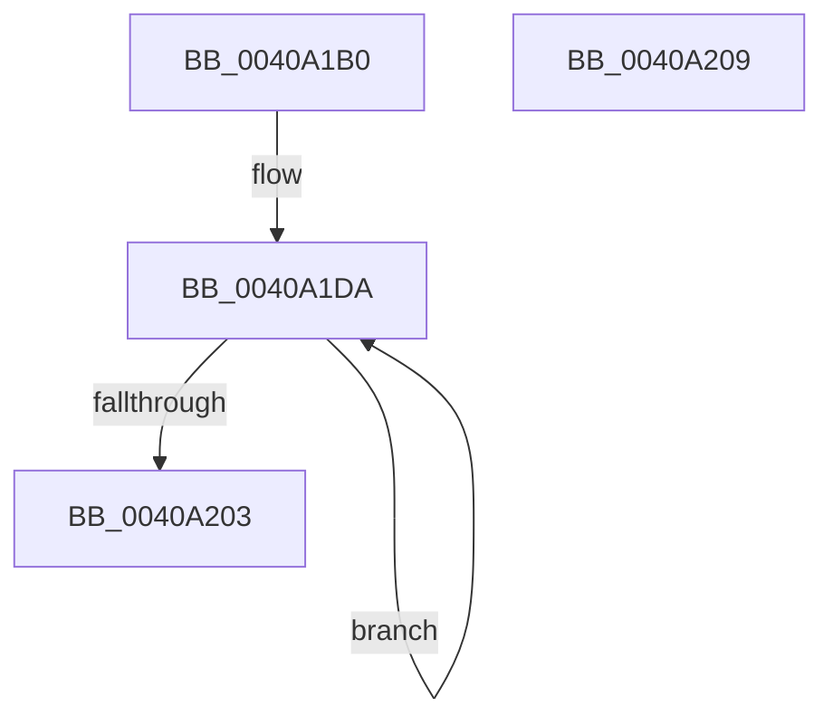

# MiUpdateClaimDistribution

- RVA: `0x0040A1B0`–`0x0040A20A` (길이 `90` bytes)
- VA: `0x000000014040A1B0`
- 실행 섹션: `.text`
- PDB 이름 있음: `예`; PDB Function 태그: `아니요`
- unwind 정보 RVA: `0x00071750`
- 디코드: `26`개 명령, `90/90` bytes 표시
- 미해석 바이트: `0` (있으면 어셈블리에 `.byte`로 보존)

> 이 문서는 커널 이미지의 기계어와 PDB 기호를 분석해 생성했습니다. 4번과 5번은 함수 원형과 자료형을 바이너리 사용 방식에서 추정한 C 해석이며 원본 소스 복구 결과는 아닙니다.

## 1. Dependencies

- 직접 호출 지점: **0**; 고유 호출 대상: **0**
- 직접 호출자로 확인된 함수: **1**
- RIP 상대 이미지 참조: **0**

### Outgoing calls
- 직접 디코드된 call 명령이 없습니다.

### Direct callers
- [MiOrderTrimList](MiOrderTrimList_function_00409F24.md) at `0x00409FC8`

### Static image references
- 디코드된 RIP-relative 메모리 참조가 없습니다.

## 2. Other-region calls and transfers

- 다른 실행 섹션으로 향하는 call: **0**
- 별도 외부 분기/꼬리 이동을 확인하지 못했습니다.

## 3. Assembly (complete function range)

```asm
0040A1B0  48 89 5C 24 08                  mov qword ptr [rsp + 8], rbx
0040A1B5  8B 81 B8 00 00 00               mov eax, dword ptr [rcx + 0xb8]
0040A1BB  BB 01 00 00 00                  mov ebx, 1
0040A1C0  C1 E8 10                        shr eax, 0x10
0040A1C3  4C 8B C9                        mov r9, rcx
0040A1C6  3C 02                           cmp al, 2
0040A1C8  4C 8B C2                        mov r8, rdx
0040A1CB  44 8D 53 02                     lea r10d, [rbx + 2]
0040A1CF  44 0F 45 D3                     cmovne r10d, ebx
0040A1D3  44 8D 5B 07                     lea r11d, [rbx + 7]
0040A1D7  4C 2B CA                        sub r9, rdx
0040A1DA  49 8B 10                        mov rdx, qword ptr [r8]
0040A1DD  41 8B CA                        mov ecx, r10d
0040A1E0  4B 8B 44 01 28                  mov rax, qword ptr [r9 + r8 + 0x28]
0040A1E5  48 D3 E8                        shr rax, cl
0040A1E8  48 8D 0C 10                     lea rcx, [rax + rdx]
0040A1EC  48 83 C8 FF                     or rax, 0xffffffffffffffff
0040A1F0  48 3B CA                        cmp rcx, rdx
0040A1F3  48 0F 42 C8                     cmovb rcx, rax
0040A1F7  49 89 08                        mov qword ptr [r8], rcx
0040A1FA  4D 8D 40 08                     lea r8, [r8 + 8]
0040A1FE  4C 2B DB                        sub r11, rbx
0040A201  75 D7                           jne 0x14040a1da
0040A203  48 8B 5C 24 08                  mov rbx, qword ptr [rsp + 8]
0040A208  C3                              ret
0040A209  CC                              int3
```

## 4. C-style interpretation (structured pseudocode)

```c
__int64 __fastcall MiUpdateClaimDistribution(__int64 a1, __int64 a2)
{
    __int64 result;
    __int64 v_r10;
    __int64 v_r11;
    unsigned __int64 v_stack_p8;

    v_stack_p8 = v_rbx;
    result = (unsigned int)(((unsigned int)(*(unsigned int *)(a1 + 184))) >> (16));
    v_r10 = 1 + 2;
    if (((unsigned __int8)(result)) != 2) { v_r10 = 1; }
    a4 = (a1) - (a2);
loc_0040A1DA:
    result = (*(unsigned __int64 *)(a4 + a2 * 1 + 40)) >> ((unsigned __int8)((unsigned int)((unsigned int)(v_r10))));
    result = (result) | (-1);
    a1 = result + *(unsigned __int64 *)(a2) * 1;
    if ((result + *(unsigned __int64 *)(a2) * 1) < (*(unsigned __int64 *)(a2))) { a1 = result; }
    *(unsigned __int64 *)(a2) = a1;
    v_r11 = (1 + 7) - (1);
    if (condition_is_not_equal) goto loc_0040A1DA;
    return result;
}
```

## 5. (Beta) C Style

```c
int64_t MiUpdateClaimDistribution(void *Arg1, void *Arg2)
{
    uint8_t *arg1 = (uint8_t *)Arg1;
    uint8_t *arg2 = (uint8_t *)Arg2;

    int64_t result;
    int64_t local_r10;
    int64_t local_r11;
    uint64_t v_stack_p8;

    v_stack_p8 = local_rbx;
    result = (uint32_t)(((uint32_t)(*(uint32_t *)(arg1 + 0xB8))) >> (16));
    local_r10 = 1 + 2;
    if (((uint8_t)(result)) != 2) { local_r10 = 1; }
    a4 = (Arg1) - (Arg2);
loc_0040A1DA:
    result = (*(uint64_t *)(a4 + arg2 * 1 + 0x28)) >> ((uint8_t)((uint32_t)((uint32_t)(local_r10))));
    result = (result) | (-1);
    Arg1 = result + *(uint64_t *)(arg2) * 1;
    if ((result + *(uint64_t *)(arg2) * 1) < (*(uint64_t *)(arg2))) { Arg1 = result; }
    *(void **)(arg2) = Arg1;
    local_r11 = (1 + 7) - (1);
    if (condition_is_not_equal) goto loc_0040A1DA;
    return result;
}
```

### 관측된 메모리 오프셋

구조체 형식이 확인되지 않은 접근은 인자 기준의 오프셋으로만 기록했습니다.

| 기준 인자 | 오프셋 표현 | 폭 (bit) | 접근 |
|---|---:|---:|---|
| `Arg1` | `+ 0x28 + r8*1` | `64` | `R` |
| `Arg1` | `+ 0xB8` | `32` | `R` |
| `Arg2` | `+ 0x0` | `64` | `R` |
| `Arg2` | `+ 0x0` | `64` | `W` |
| `Arg2` | `+ 0x8` | `64` | `R` |

## 6. Execution-region graph

[열기: 2D/3D 그래프와 함수 탐색 컨트롤 패널](../../../control-panel.html?section=text&rva=0x0040A1B0&view=graph)

- 2D 그래프는 위에서 아래로 흐르고, 3D 그래프는 빈 공간을 드래그해 회전합니다. Shift+드래그는 이동, 휠은 확대·축소, 함수 노드 선택은 대상 보고서 이동입니다.

### Static fallback


