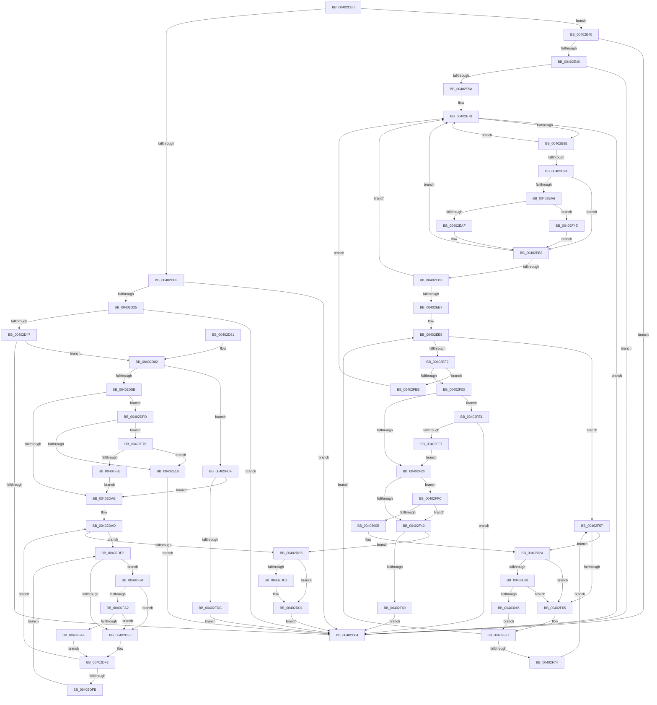

# MiUpdatePrefetchPriority

- RVA: `0x00402CB0`–`0x00403051` (길이 `929` bytes)
- VA: `0x0000000140402CB0`
- 실행 섹션: `.text`
- PDB 이름 있음: `예`; PDB Function 태그: `아니요`
- unwind 정보 RVA: `0x0009A6BC`
- 디코드: `218`개 명령, `929/929` bytes 표시
- 미해석 바이트: `0` (있으면 어셈블리에 `.byte`로 보존)

> 이 문서는 커널 이미지의 기계어와 PDB 기호를 분석해 생성했습니다. 4번과 5번은 함수 원형과 자료형을 바이너리 사용 방식에서 추정한 C 해석이며 원본 소스 복구 결과는 아닙니다.

## 1. Dependencies

- 직접 호출 지점: **16**; 고유 호출 대상: **12**
- 직접 호출자로 확인된 함수: **2**
- RIP 상대 이미지 참조: **5**

### Outgoing calls
- `0x00402CFE` → [MI_READ_PTE_LOCK_FREE](../28/MI_READ_PTE_LOCK_FREE_function_002828A0.md) (function, `0x002828A0`)
- `0x00402DB9` → [MiGetPfnPriority](../32/MiGetPfnPriority_function_003226F0.md) (function, `0x003226F0`)
- `0x00402DCC` → [MiUpdatePfnPriority](../2B/MiUpdatePfnPriority_function_002B8570.md) (function, `0x002B8570`)
- `0x00402E02` → [MiLockVadTree](../27/MiLockVadTree_function_0027C0F0.md) (function, `0x0027C0F0`)
- `0x00402E0A` → [MiLocateAddress](../31/MiLocateAddress_function_003168D0.md) (function, `0x003168D0`)
- `0x00402E36` → [ExReleaseSpinLockSharedFromDpcLevel](../24/ExReleaseSpinLockSharedFromDpcLevel_function_0024A590.md) (function, `0x0024A590`)
- `0x00402E7B` → [MI_READ_PTE_LOCK_FREE](../28/MI_READ_PTE_LOCK_FREE_function_002828A0.md) (function, `0x002828A0`)
- `0x00402E91` → [MiInvalidPteConforms](../37/MiInvalidPteConforms_function_00372A10.md) (function, `0x00372A10`)
- `0x00402EF5` → [MI_READ_PTE_LOCK_FREE](../28/MI_READ_PTE_LOCK_FREE_function_002828A0.md) (function, `0x002828A0`)
- `0x00402F8A` → [MiUnlockVadTree](../29/MiUnlockVadTree_function_00297020.md) (function, `0x00297020`)
- `0x00402FA2` → [KiCheckVpBackingLongSpinWaitHypercall](../30/KiCheckVpBackingLongSpinWaitHypercall_function_0030F490.md) (function, `0x0030F490`)
- `0x00402FB1` → [HvlNotifyLongSpinWait](../30/HvlNotifyLongSpinWait_function_0030F460.md) (function, `0x0030F460`)
- `0x00402FE6` → [MiLockSpecialPurposeMemoryCachedPage](MiLockSpecialPurposeMemoryCachedPage_function_004049F0.md) (function, `0x004049F0`)
- `0x00403024` → [KeBugCheckEx](../4F/KeBugCheckEx_function_004FD660.md) (function, `0x004FD660`)
- `0x00403038` → [KiCheckVpBackingLongSpinWaitHypercall](../30/KiCheckVpBackingLongSpinWaitHypercall_function_0030F490.md) (function, `0x0030F490`)
- `0x00403047` → [HvlNotifyLongSpinWait](../30/HvlNotifyLongSpinWait_function_0030F460.md) (function, `0x0030F460`)

### Direct callers
- [MiValidFault](../32/MiValidFault_function_003280B4.md) at `0x003283E3`
- [MiPrefetchJumpVad](../4D/MiPrefetchJumpVad_function_004D7A28.md) at `0x004D7B10`

### Static image references
- `0x00402D1C` → RVA `0x00E2DCE0` (`.data`; read)
- `0x00402DE4` → RVA `0x00FC52AC` (`ALMOSTRO`; reference)
- `0x00402E9A` → RVA `0x00E2DC80` (`.data`; read)
- `0x00402F07` → RVA `0x00E30088` (`.data`; read)
- `0x00402F94` → RVA `0x00FC6AB8` (`ALMOSTRO`; read)

## 2. Other-region calls and transfers

- 다른 실행 섹션으로 향하는 call: **0**
- 별도 외부 분기/꼬리 이동을 확인하지 못했습니다.

## 3. Assembly (complete function range)

```asm
00402CB0  48 89 5C 24 10                  mov qword ptr [rsp + 0x10], rbx
00402CB5  48 89 6C 24 18                  mov qword ptr [rsp + 0x18], rbp
00402CBA  48 89 74 24 20                  mov qword ptr [rsp + 0x20], rsi
00402CBF  57                              push rdi
00402CC0  41 54                           push r12
00402CC2  41 55                           push r13
00402CC4  41 56                           push r14
00402CC6  41 57                           push r15
00402CC8  48 83 EC 30                     sub rsp, 0x30
00402CCC  44 8B 69 50                     mov r13d, dword ptr [rcx + 0x50]
00402CD0  48 8B F2                        mov rsi, rdx
00402CD3  48 C1 EE 09                     shr rsi, 9
00402CD7  48 B8 F8 FF FF FF 7F 00 00 00   movabs rax, 0x7ffffffff8
00402CE1  48 23 F0                        and rsi, rax
00402CE4  49 8B D8                        mov rbx, r8
00402CE7  48 8B EA                        mov rbp, rdx
00402CEA  41 83 E5 07                     and r13d, 7
00402CEE  48 B8 00 00 00 00 80 F6 FF FF   movabs rax, 0xfffff68000000000
00402CF8  48 03 F0                        add rsi, rax
00402CFB  48 8B CE                        mov rcx, rsi
00402CFE  E8 9D FB E7 FF                  call 0x1402828a0
00402D03  A8 01                           test al, 1
00402D05  0F 84 35 01 00 00               je 0x140402e40
00402D0B  48 C1 E8 0C                     shr rax, 0xc
00402D0F  49 BF FF FF FF FF FF 00 00 00   movabs r15, 0xffffffffff
00402D19  49 23 C7                        and rax, r15
00402D1C  48 3B 05 BD AF A2 00            cmp rax, qword ptr [rip + 0xa2afbd]
00402D23  77 3F                           ja 0x140402d64
00402D25  48 8D 0C 40                     lea rcx, [rax + rax*2]
00402D29  49 BC 28 00 00 00 00 DE FF FF   movabs r12, 0xffffde0000000028
00402D33  48 03 C9                        add rcx, rcx
00402D36  49 8B C4                        mov rax, r12
00402D39  48 8B 04 C8                     mov rax, qword ptr [rax + rcx*8]
00402D3D  48 C1 E8 36                     shr rax, 0x36
00402D41  0F BA E0 00                     bt eax, 0
00402D45  73 1D                           jae 0x140402d64
00402D47  49 BE 00 00 00 00 00 DE FF FF   movabs r14, 0xffffde0000000000
00402D51  49 8B C6                        mov rax, r14
00402D54  48 8D 3C C8                     lea rdi, [rax + rcx*8]
00402D58  0F B6 47 23                     movzx eax, byte ptr [rdi + 0x23]
00402D5C  83 E0 07                        and eax, 7
00402D5F  41 3B C5                        cmp eax, r13d
00402D62  75 1E                           jne 0x140402d82
00402D64  48 8B 5C 24 68                  mov rbx, qword ptr [rsp + 0x68]
00402D69  48 8B 6C 24 70                  mov rbp, qword ptr [rsp + 0x70]
00402D6E  48 8B 74 24 78                  mov rsi, qword ptr [rsp + 0x78]
00402D73  48 83 C4 30                     add rsp, 0x30
00402D77  41 5F                           pop r15
00402D79  41 5E                           pop r14
00402D7B  41 5D                           pop r13
00402D7D  41 5C                           pop r12
00402D7F  5F                              pop rdi
00402D80  C3                              ret
00402D81  CC                              int3
00402D82  48 85 DB                        test rbx, rbx
00402D85  0F 85 44 02 00 00               jne 0x140402fcf
00402D8B  65 48 8B 04 25 88 01 00 00      mov rax, qword ptr gs:[0x188]
00402D94  48 8B 88 B8 00 00 00            mov rcx, qword ptr [rax + 0xb8]
00402D9B  48 8B 81 10 04 00 00            mov rax, qword ptr [rcx + 0x410]
00402DA2  48 39 98 F8 03 00 00            cmp qword ptr [rax + 0x3f8], rbx
00402DA9  75 52                           jne 0x140402dfd
00402DAB  33 DB                           xor ebx, ebx
00402DAD  F0 48 0F BA 6F 18 3F            lock bts qword ptr [rdi + 0x18], 0x3f
00402DB4  72 2C                           jb 0x140402de2
00402DB6  48 8B CF                        mov rcx, rdi
00402DB9  E8 32 F9 F1 FF                  call 0x1403226f0
00402DBE  41 3B C5                        cmp eax, r13d
00402DC1  74 0E                           je 0x140402dd1
00402DC3  45 33 C0                        xor r8d, r8d
00402DC6  41 8B D5                        mov edx, r13d
00402DC9  48 8B CF                        mov rcx, rdi
00402DCC  E8 9F 57 EB FF                  call 0x1402b8570
00402DD1  48 B8 FF FF FF FF FF FF FF 7F   movabs rax, 0x7fffffffffffffff
00402DDB  F0 48 21 47 18                  lock and qword ptr [rdi + 0x18], rax
00402DE0  EB 82                           jmp 0x140402d64
00402DE2  FF C3                           inc ebx
00402DE4  85 1D C2 24 BC 00               test dword ptr [rip + 0xbc24c2], ebx
00402DEA  0F 84 A4 01 00 00               je 0x140402f94
00402DF0  F3 90                           pause
00402DF2  48 8B 47 18                     mov rax, qword ptr [rdi + 0x18]
00402DF6  48 85 C0                        test rax, rax
00402DF9  79 B2                           jns 0x140402dad
00402DFB  EB E5                           jmp 0x140402de2
00402DFD  B9 01 00 00 00                  mov ecx, 1
00402E02  E8 E9 92 E7 FF                  call 0x14027c0f0
00402E07  48 8B CD                        mov rcx, rbp
00402E0A  E8 C1 3A F1 FF                  call 0x1403168d0
00402E0F  48 85 C0                        test rax, rax
00402E12  0F 85 5E 01 00 00               jne 0x140402f76
00402E18  65 48 8B 04 25 88 01 00 00      mov rax, qword ptr gs:[0x188]
00402E21  48 8B 88 B8 00 00 00            mov rcx, qword ptr [rax + 0xb8]
00402E28  48 8B 89 10 04 00 00            mov rcx, qword ptr [rcx + 0x410]
00402E2F  48 81 C1 EC 03 00 00            add rcx, 0x3ec
00402E36  E8 55 77 E4 FF                  call 0x14024a590
00402E3B  E9 24 FF FF FF                  jmp 0x140402d64
00402E40  48 85 C0                        test rax, rax
00402E43  0F 84 1B FF FF FF               je 0x140402d64
00402E49  25 00 0C 00 00                  and eax, 0xc00
00402E4E  48 3D 00 08 00 00               cmp rax, 0x800
00402E54  0F 85 0A FF FF FF               jne 0x140402d64
00402E5A  49 BF FF FF FF FF FF 00 00 00   movabs r15, 0xffffffffff
00402E64  49 BC 28 00 00 00 00 DE FF FF   movabs r12, 0xffffde0000000028
00402E6E  49 BE 00 00 00 00 00 DE FF FF   movabs r14, 0xffffde0000000000
00402E78  48 8B CE                        mov rcx, rsi
00402E7B  E8 20 FA E7 FF                  call 0x1402828a0
00402E80  48 8B D8                        mov rbx, rax
00402E83  48 0F BA E0 0B                  bt rax, 0xb
00402E88  0F 83 D6 FE FF FF               jae 0x140402d64
00402E8E  48 8B C8                        mov rcx, rax
00402E91  E8 7A FB F6 FF                  call 0x140372a10
00402E96  85 C0                           test eax, eax
00402E98  74 DE                           je 0x140402e78
00402E9A  48 8B 05 DF AD A2 00            mov rax, qword ptr [rip + 0xa2addf]
00402EA1  48 85 C0                        test rax, rax
00402EA4  74 12                           je 0x140402eb8
00402EA6  F6 C3 10                        test bl, 0x10
00402EA9  0F 85 9F 00 00 00               jne 0x140402f4e
00402EAF  48 8B C8                        mov rcx, rax
00402EB2  48 F7 D1                        not rcx
00402EB5  48 23 CB                        and rcx, rbx
00402EB8  48 C1 E9 0C                     shr rcx, 0xc
00402EBC  49 23 CF                        and rcx, r15
00402EBF  48 8D 14 49                     lea rdx, [rcx + rcx*2]
00402EC3  48 03 D2                        add rdx, rdx
00402EC6  49 8B C6                        mov rax, r14
00402EC9  48 3B 0D 10 AE A2 00            cmp rcx, qword ptr [rip + 0xa2ae10]
00402ED0  48 8D 3C D0                     lea rdi, [rax + rdx*8]
00402ED4  77 A2                           ja 0x140402e78
00402ED6  49 8B C4                        mov rax, r12
00402ED9  48 8B 04 D0                     mov rax, qword ptr [rax + rdx*8]
00402EDD  48 C1 E8 36                     shr rax, 0x36
00402EE1  0F BA E0 00                     bt eax, 0
00402EE5  73 91                           jae 0x140402e78
00402EE7  33 ED                           xor ebp, ebp
00402EE9  F0 48 0F BA 6F 18 3F            lock bts qword ptr [rdi + 0x18], 0x3f
00402EF0  72 65                           jb 0x140402f57
00402EF2  48 8B CE                        mov rcx, rsi
00402EF5  E8 A6 F9 E7 FF                  call 0x1402828a0
00402EFA  48 3B C3                        cmp rax, rbx
00402EFD  0F 85 B8 00 00 00               jne 0x140402fbb
00402F03  48 8B 47 28                     mov rax, qword ptr [rdi + 0x28]
00402F07  48 8B 15 7A D1 A2 00            mov rdx, qword ptr [rip + 0xa2d17a]
00402F0E  48 C1 E8 2B                     shr rax, 0x2b
00402F12  25 FF 03 00 00                  and eax, 0x3ff
00402F17  48 8B 04 C2                     mov rax, qword ptr [rdx + rax*8]
00402F1B  8B 40 04                        mov eax, dword ptr [rax + 4]
00402F1E  84 C0                           test al, al
00402F20  0F 88 BB 00 00 00               js 0x140402fe1
00402F26  48 8B 47 08                     mov rax, qword ptr [rdi + 8]
00402F2A  48 B9 00 00 00 00 00 00 00 80   movabs rcx, 0x8000000000000000
00402F34  48 0B C1                        or rax, rcx
00402F37  48 3B C6                        cmp rax, rsi
00402F3A  0F 85 BC 00 00 00               jne 0x140402ffc
00402F40  48 85 FF                        test rdi, rdi
00402F43  0F 85 6D FE FF FF               jne 0x140402db6
00402F49  E9 16 FE FF FF                  jmp 0x140402d64
00402F4E  48 83 E1 EF                     and rcx, 0xffffffffffffffef
00402F52  E9 61 FF FF FF                  jmp 0x140402eb8
00402F57  FF C5                           inc ebp
00402F59  85 2D 4D 23 BC 00               test dword ptr [rip + 0xbc234d], ebp
00402F5F  0F 84 C5 00 00 00               je 0x14040302a
00402F65  F3 90                           pause
00402F67  48 8B 47 18                     mov rax, qword ptr [rdi + 0x18]
00402F6B  48 85 C0                        test rax, rax
00402F6E  0F 89 75 FF FF FF               jns 0x140402ee9
00402F74  EB E1                           jmp 0x140402f57
00402F76  8B 40 30                        mov eax, dword ptr [rax + 0x30]
00402F79  24 70                           and al, 0x70
00402F7B  3C 10                           cmp al, 0x10
00402F7D  0F 84 95 FE FF FF               je 0x140402e18
00402F83  B2 11                           mov dl, 0x11
00402F85  B9 01 00 00 00                  mov ecx, 1
00402F8A  E8 91 40 E9 FF                  call 0x140297020
00402F8F  E9 17 FE FF FF                  jmp 0x140402dab
00402F94  8B 05 1E 3B BC 00               mov eax, dword ptr [rip + 0xbc3b1e]
00402F9A  A8 40                           test al, 0x40
00402F9C  0F 84 4E FE FF FF               je 0x140402df0
00402FA2  E8 E9 C4 F0 FF                  call 0x14030f490
00402FA7  84 C0                           test al, al
00402FA9  0F 84 41 FE FF FF               je 0x140402df0
00402FAF  8B CB                           mov ecx, ebx
00402FB1  E8 AA C4 F0 FF                  call 0x14030f460
00402FB6  E9 37 FE FF FF                  jmp 0x140402df2
00402FBB  48 B8 FF FF FF FF FF FF FF 7F   movabs rax, 0x7fffffffffffffff
00402FC5  F0 48 21 47 18                  lock and qword ptr [rdi + 0x18], rax
00402FCA  E9 A9 FE FF FF                  jmp 0x140402e78
00402FCF  8B 43 30                        mov eax, dword ptr [rbx + 0x30]
00402FD2  24 70                           and al, 0x70
00402FD4  3C 10                           cmp al, 0x10
00402FD6  0F 85 CF FD FF FF               jne 0x140402dab
00402FDC  E9 83 FD FF FF                  jmp 0x140402d64
00402FE1  33 D2                           xor edx, edx
00402FE3  48 8B CF                        mov rcx, rdi
00402FE6  E8 05 1A 00 00                  call 0x1404049f0
00402FEB  48 8B F8                        mov rdi, rax
00402FEE  48 85 C0                        test rax, rax
00402FF1  0F 84 6D FD FF FF               je 0x140402d64
00402FF7  E9 2A FF FF FF                  jmp 0x140402f26
00402FFC  48 8B 47 28                     mov rax, qword ptr [rdi + 0x28]
00403000  48 0F BA E0 28                  bt rax, 0x28
00403005  0F 82 35 FF FF FF               jb 0x140402f40
0040300B  48 8B 47 08                     mov rax, qword ptr [rdi + 8]
0040300F  4C 8B CB                        mov r9, rbx
00403012  4C 8B C6                        mov r8, rsi
00403015  48 89 44 24 20                  mov qword ptr [rsp + 0x20], rax
0040301A  BA 11 04 00 00                  mov edx, 0x411
0040301F  B9 1A 00 00 00                  mov ecx, 0x1a
00403024  E8 37 A6 0F 00                  call 0x1404fd660
00403029  CC                              int3
0040302A  8B 05 88 3A BC 00               mov eax, dword ptr [rip + 0xbc3a88]
00403030  A8 40                           test al, 0x40
00403032  0F 84 2D FF FF FF               je 0x140402f65
00403038  E8 53 C4 F0 FF                  call 0x14030f490
0040303D  84 C0                           test al, al
0040303F  0F 84 20 FF FF FF               je 0x140402f65
00403045  8B CD                           mov ecx, ebp
00403047  E8 14 C4 F0 FF                  call 0x14030f460
0040304C  E9 16 FF FF FF                  jmp 0x140402f67
```

## 4. C-style interpretation (structured pseudocode)

```c
__int64 __fastcall MiUpdatePrefetchPriority(__int64 a1, __int64 a2, __int64 a3)
{
    __int64 result;
    __int64 v_r13;
    __int64 v_rbp;
    __int64 v_rbx;
    __int64 v_rsi;
    __int64 v_rsp;
    unsigned __int64 v_stack_p10;
    unsigned __int64 v_stack_p18;
    unsigned __int64 v_stack_p20;

    v_stack_p10 = v_rbx;
    v_stack_p18 = v_rbp;
    v_stack_p20 = v_rsi;
    v_rsp = (v_rsp) - (48);
    v_rsi = (a2) >> (9);
    v_rsi = (v_rsi) & (result);
    v_r13 = (unsigned int)(((unsigned int)(*(unsigned int *)(a1 + 80))) & (7));
    v_rsi = (v_rsi) + (result);
    result = MI_READ_PTE_LOCK_FREE(v_rsi, a2, a3, a4);
    if ((((unsigned __int8)(result)) & (1)) == 0) goto loc_00402E40;
    result = (result) >> (12);
    result = (result) & (v_r15);
    if (result > (*(unsigned __int64 *)(v_rip + 10661821))) goto loc_00402D64;
    a1 = (result + result * 2) + (result + result * 2);
    result = (*(unsigned __int64 *)(v_r12 + a1 * 8)) >> (54);
    if (condition_is_above_or_equal) goto loc_00402D64;
    result = (unsigned int)((*(unsigned __int8 *)(v_r14 + a1 * 8 + 35)) & (7));
    if (((unsigned int)(result)) != ((unsigned int)(v_r13))) goto loc_00402D82;
loc_00402D64:
    v_rsp = (v_rsp) + (48);
    return result;
loc_00402D82:
    if (v_stack_p10 != 0) goto loc_00402FCF;
    if ((*(unsigned __int64 *)(*(unsigned __int64 *)(*(unsigned __int64 *)(*(unsigned __int64 *)(gs_base + (0 + 392)) + 184) + 1040) + 1016)) != v_stack_p10) goto loc_00402DFD;
loc_00402DAB:
    v_rbx = 0;
loc_00402DAD:
    if (condition_is_below) goto loc_00402DE2;
loc_00402DB6:
    result = MiGetPfnPriority(v_r14 + a1 * 8, a2, a3, a4);
    if (((unsigned int)(result)) != ((unsigned int)(v_r13))) {
        a3 = 0;
        a2 = (unsigned int)(v_r13);
        a1 = v_r14 + a1 * 8;
        result = MiUpdatePfnPriority(a1, a2, a3, a4);
    }
    goto loc_00402D64;
loc_00402DE2:
    v_rbx = (unsigned int)((v_rbx) + 1);
    if (((*(unsigned int *)(v_rip + 12330178)) & ((unsigned int)(v_rbx))) == 0) goto loc_00402F94;
loc_00402DF0:
loc_00402DF2:
    if (!sign_flag) goto loc_00402DAD;
    goto loc_00402DE2;
loc_00402DFD:
    result = MiLockVadTree(1, a2, a3, a4);
    result = MiLocateAddress(v_stack_p18, a2, a3, a4);
    if (result != 0) goto loc_00402F76;
loc_00402E18:
    a1 = (*(unsigned __int64 *)(*(unsigned __int64 *)(*(unsigned __int64 *)(gs_base + (0 + 392)) + 184) + 1040)) + (0x3ECULL);
    result = ExReleaseSpinLockSharedFromDpcLevel(a1, a2, a3, a4);
    goto loc_00402D64;
loc_00402E40:
    if (result == 0) goto loc_00402D64;
    result = (unsigned int)((result) & (0xC00ULL));
    if (result != 0x800ULL) goto loc_00402D64;
loc_00402E78:
    result = MI_READ_PTE_LOCK_FREE(v_stack_p20, a2, a3, a4);
    if (result >= 0x800ULL) goto loc_00402D64;
    result = MiInvalidPteConforms(result, a2, a3, a4);
    if ((unsigned int)(result) == 0) goto loc_00402E78;
    if (*(unsigned __int64 *)(v_rip + 10661343) == 0) goto loc_00402EB8;
    if ((((unsigned __int8)(result)) & (16)) != 0) goto loc_00402F4E;
    a1 = ~(*(unsigned __int64 *)(v_rip + 10661343));
    a1 = (a1) & (result);
loc_00402EB8:
    a1 = (a1) >> (12);
    a1 = (a1) & (v_r15);
    a2 = (a1 + a1 * 2) + (a1 + a1 * 2);
    if (a1 > (*(unsigned __int64 *)(v_rip + 10661392))) goto loc_00402E78;
    result = (*(unsigned __int64 *)(v_r12 + a2 * 8)) >> (54);
    if (condition_is_above_or_equal) goto loc_00402E78;
    v_rbp = 0;
loc_00402EE9:
    if (condition_is_below) goto loc_00402F57;
    result = MI_READ_PTE_LOCK_FREE(v_stack_p20, a2, a3, a4);
    if (result != result) goto loc_00402FBB;
    result = (*(unsigned __int64 *)(v_r14 + a2 * 8 + 40)) >> (43);
    result = (unsigned int)((result) & (0x3FFULL));
    if (sign_flag) goto loc_00402FE1;
loc_00402F26:
    result = (*(unsigned __int64 *)(v_r14 + a2 * 8 + 8)) | (v_stack_p20);
    if (result != v_stack_p20) goto loc_00402FFC;
loc_00402F40:
    if (v_r14 + a2 * 8 != 0) goto loc_00402DB6;
    goto loc_00402D64;
loc_00402F4E:
    a1 = (v_stack_p20) & (-17);
    goto loc_00402EB8;
loc_00402F57:
    v_rbp = (unsigned int)((v_rbp) + 1);
    if (((*(unsigned int *)(v_rip + 12329805)) & ((unsigned int)(v_rbp))) == 0) goto loc_0040302A;
loc_00402F65:
loc_00402F67:
    if (!sign_flag) goto loc_00402EE9;
    goto loc_00402F57;
loc_00402F76:
    result = (unsigned __int8)(((unsigned int)(*(unsigned int *)(*(unsigned __int64 *)(v_r14 + a2 * 8 + 24) + 48))) & (112));
    if (((unsigned __int8)(result)) == 16) goto loc_00402E18;
    result = MiUnlockVadTree(1, 17, a3, a4);
    goto loc_00402DAB;
loc_00402F94:
    if ((((unsigned __int8)((unsigned int)(*(unsigned int *)(v_rip + 12335902)))) & (64)) == 0) goto loc_00402DF0;
    result = KiCheckVpBackingLongSpinWaitHypercall(1, 17, a3, a4);
    if ((unsigned __int8)(result) == 0) goto loc_00402DF0;
    result = HvlNotifyLongSpinWait((unsigned int)((unsigned int)(result)), 17, a3, a4);
    goto loc_00402DF2;
loc_00402FBB:
    goto loc_00402E78;
loc_00402FCF:
    result = (unsigned __int8)(((unsigned int)(*(unsigned int *)(result + 48))) & (112));
    if (((unsigned __int8)(result)) != 16) goto loc_00402DAB;
    goto loc_00402D64;
loc_00402FE1:
    a2 = 0;
    result = MiLockSpecialPurposeMemoryCachedPage(v_r14 + a2 * 8, a2, a3, a4);
    if (result == 0) goto loc_00402D64;
    goto loc_00402F26;
loc_00402FFC:
    if (condition_is_below) goto loc_00402F40;
    v_stack_p20 = *(unsigned __int64 *)(result + 8);
    result = KeBugCheckEx(26, (unsigned int)(0x411ULL), v_stack_p20, result);
loc_0040302A:
    if ((((unsigned __int8)((unsigned int)(*(unsigned int *)(v_rip + 12335752)))) & (64)) == 0) goto loc_00402F65;
    result = KiCheckVpBackingLongSpinWaitHypercall(26, (unsigned int)(0x411ULL), v_stack_p20, result);
    if ((unsigned __int8)(result) == 0) goto loc_00402F65;
    result = HvlNotifyLongSpinWait((unsigned int)((unsigned int)(v_rbp)), (unsigned int)(0x411ULL), v_stack_p20, result);
    goto loc_00402F67;
}
```

## 5. (Beta) C Style

```c
int64_t MiUpdatePrefetchPriority(void *Arg1, int64_t Arg2, int64_t Arg3)
{
    uint8_t *arg1 = (uint8_t *)Arg1;

    int64_t result;
    int64_t local_r13;
    int64_t local_rbp;
    int64_t local_rbx;
    int64_t local_rsi;
    int64_t local_rsp;
    uint64_t v_stack_p10;
    uint64_t v_stack_p18;
    uint64_t v_stack_p20;

    v_stack_p10 = local_rbx;
    v_stack_p18 = local_rbp;
    v_stack_p20 = local_rsi;
    local_rsp = (local_rsp) - (48);
    local_rsi = (Arg2) >> (9);
    local_rsi = (local_rsi) & (result);
    local_r13 = (uint32_t)(((uint32_t)(*(uint32_t *)(arg1 + 0x50))) & (7));
    local_rsi = (local_rsi) + (result);
    result = MI_READ_PTE_LOCK_FREE(local_rsi, Arg2, Arg3, a4);
    if ((((uint8_t)(result)) & (1)) == 0) goto loc_00402E40;
    result = (result) >> (12);
    result = (result) & (local_r15);
    if (result > (*(uint64_t *)(v_rip + 0xA2AFBD))) goto loc_00402D64;
    Arg1 = (result + result * 2) + (result + result * 2);
    result = (*(uint64_t *)(local_r12 + arg1 * 8)) >> (54);
    if (condition_is_above_or_equal) goto loc_00402D64;
    result = (uint32_t)((*(uint8_t *)(local_r14 + arg1 * 8 + 0x23)) & (7));
    if (((uint32_t)(result)) != ((uint32_t)(local_r13))) goto loc_00402D82;
loc_00402D64:
    local_rsp = (local_rsp) + (48);
    return result;
loc_00402D82:
    if (v_stack_p10 != 0) goto loc_00402FCF;
    if ((*(uint64_t *)(*(uint64_t *)(*(uint64_t *)(*(uint64_t *)(gs_base + (0 + 0x188)) + 0xB8) + 0x410) + 0x3F8)) != v_stack_p10) goto loc_00402DFD;
loc_00402DAB:
    local_rbx = 0;
loc_00402DAD:
    if (condition_is_below) goto loc_00402DE2;
loc_00402DB6:
    result = MiGetPfnPriority(local_r14 + Arg1 * 8, Arg2, Arg3, a4);
    if (((uint32_t)(result)) != ((uint32_t)(local_r13))) {
        Arg3 = 0;
        Arg2 = (uint32_t)(local_r13);
        Arg1 = local_r14 + Arg1 * 8;
        result = MiUpdatePfnPriority(Arg1, Arg2, Arg3, a4);
    }
    goto loc_00402D64;
loc_00402DE2:
    local_rbx = (uint32_t)((local_rbx) + 1);
    if (((*(uint32_t *)(v_rip + 0xBC24C2)) & ((uint32_t)(local_rbx))) == 0) goto loc_00402F94;
loc_00402DF0:
loc_00402DF2:
    if (!sign_flag) goto loc_00402DAD;
    goto loc_00402DE2;
loc_00402DFD:
    result = MiLockVadTree(1, Arg2, Arg3, a4);
    result = MiLocateAddress(v_stack_p18, Arg2, Arg3, a4);
    if (result != 0) goto loc_00402F76;
loc_00402E18:
    Arg1 = (*(uint64_t *)(*(uint64_t *)(*(uint64_t *)(gs_base + (0 + 0x188)) + 0xB8) + 0x410)) + (0x3ECULL);
    result = ExReleaseSpinLockSharedFromDpcLevel(Arg1, Arg2, Arg3, a4);
    goto loc_00402D64;
loc_00402E40:
    if (result == 0) goto loc_00402D64;
    result = (uint32_t)((result) & (0xC00ULL));
    if (result != 0x800ULL) goto loc_00402D64;
loc_00402E78:
    result = MI_READ_PTE_LOCK_FREE(v_stack_p20, Arg2, Arg3, a4);
    if (result >= 0x800ULL) goto loc_00402D64;
    result = MiInvalidPteConforms(result, Arg2, Arg3, a4);
    if ((uint32_t)(result) == 0) goto loc_00402E78;
    if (*(uint64_t *)(v_rip + 0xA2ADDF) == 0) goto loc_00402EB8;
    if ((((uint8_t)(result)) & (16)) != 0) goto loc_00402F4E;
    Arg1 = ~(*(uint64_t *)(v_rip + 0xA2ADDF));
    Arg1 = (Arg1) & (result);
loc_00402EB8:
    Arg1 = (Arg1) >> (12);
    Arg1 = (Arg1) & (local_r15);
    Arg2 = (Arg1 + Arg1 * 2) + (Arg1 + Arg1 * 2);
    if (Arg1 > (*(uint64_t *)(v_rip + 0xA2AE10))) goto loc_00402E78;
    result = (*(uint64_t *)(local_r12 + Arg2 * 8)) >> (54);
    if (condition_is_above_or_equal) goto loc_00402E78;
    local_rbp = 0;
loc_00402EE9:
    if (condition_is_below) goto loc_00402F57;
    result = MI_READ_PTE_LOCK_FREE(v_stack_p20, Arg2, Arg3, a4);
    if (result != result) goto loc_00402FBB;
    result = (*(uint64_t *)(local_r14 + Arg2 * 8 + 0x28)) >> (43);
    result = (uint32_t)((result) & (0x3FFULL));
    if (sign_flag) goto loc_00402FE1;
loc_00402F26:
    result = (*(uint64_t *)(local_r14 + Arg2 * 8 + 0x8)) | (v_stack_p20);
    if (result != v_stack_p20) goto loc_00402FFC;
loc_00402F40:
    if (local_r14 + Arg2 * 8 != 0) goto loc_00402DB6;
    goto loc_00402D64;
loc_00402F4E:
    Arg1 = (v_stack_p20) & (-17);
    goto loc_00402EB8;
loc_00402F57:
    local_rbp = (uint32_t)((local_rbp) + 1);
    if (((*(uint32_t *)(v_rip + 0xBC234D)) & ((uint32_t)(local_rbp))) == 0) goto loc_0040302A;
loc_00402F65:
loc_00402F67:
    if (!sign_flag) goto loc_00402EE9;
    goto loc_00402F57;
loc_00402F76:
    result = (uint8_t)(((uint32_t)(*(uint32_t *)(*(uint64_t *)(local_r14 + Arg2 * 8 + 0x18) + 0x30))) & (112));
    if (((uint8_t)(result)) == 16) goto loc_00402E18;
    result = MiUnlockVadTree(1, 17, Arg3, a4);
    goto loc_00402DAB;
loc_00402F94:
    if ((((uint8_t)((uint32_t)(*(uint32_t *)(v_rip + 0xBC3B1E)))) & (64)) == 0) goto loc_00402DF0;
    result = KiCheckVpBackingLongSpinWaitHypercall(1, 17, Arg3, a4);
    if ((uint8_t)(result) == 0) goto loc_00402DF0;
    result = HvlNotifyLongSpinWait((uint32_t)((uint32_t)(result)), 17, Arg3, a4);
    goto loc_00402DF2;
loc_00402FBB:
    goto loc_00402E78;
loc_00402FCF:
    result = (uint8_t)(((uint32_t)(*(uint32_t *)(result + 0x30))) & (112));
    if (((uint8_t)(result)) != 16) goto loc_00402DAB;
    goto loc_00402D64;
loc_00402FE1:
    Arg2 = 0;
    result = MiLockSpecialPurposeMemoryCachedPage(local_r14 + Arg2 * 8, Arg2, Arg3, a4);
    if (result == 0) goto loc_00402D64;
    goto loc_00402F26;
loc_00402FFC:
    if (condition_is_below) goto loc_00402F40;
    v_stack_p20 = *(uint64_t *)(result + 0x8);
    result = KeBugCheckEx(26, (uint32_t)(0x411ULL), v_stack_p20, result);
loc_0040302A:
    if ((((uint8_t)((uint32_t)(*(uint32_t *)(v_rip + 0xBC3A88)))) & (64)) == 0) goto loc_00402F65;
    result = KiCheckVpBackingLongSpinWaitHypercall(26, (uint32_t)(0x411ULL), v_stack_p20, result);
    if ((uint8_t)(result) == 0) goto loc_00402F65;
    result = HvlNotifyLongSpinWait((uint32_t)((uint32_t)(local_rbp)), (uint32_t)(0x411ULL), v_stack_p20, result);
    goto loc_00402F67;
}
```

### 관측된 메모리 오프셋

구조체 형식이 확인되지 않은 접근은 인자 기준의 오프셋으로만 기록했습니다.

| 기준 인자 | 오프셋 표현 | 폭 (bit) | 접근 |
|---|---:|---:|---|
| `Arg1` | `+ 0x50` | `32` | `R` |

## 6. Execution-region graph

[열기: 2D/3D 그래프와 함수 탐색 컨트롤 패널](../../../control-panel.html?section=text&rva=0x00402CB0&view=graph)

- 2D 그래프는 위에서 아래로 흐르고, 3D 그래프는 빈 공간을 드래그해 회전합니다. Shift+드래그는 이동, 휠은 확대·축소, 함수 노드 선택은 대상 보고서 이동입니다.

### Static fallback


