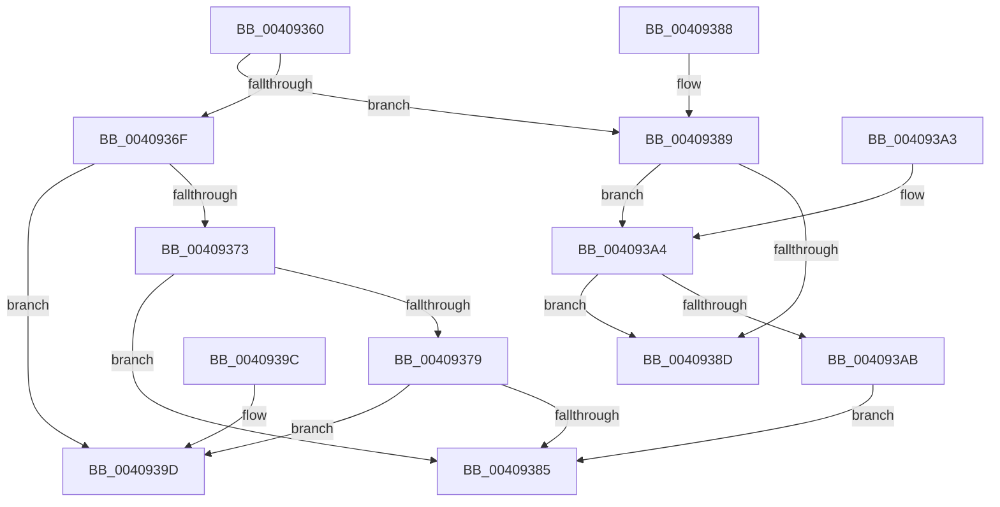

# MiVadPagesTradable

- RVA: `0x00409360`–`0x004093AD` (길이 `77` bytes)
- VA: `0x0000000140409360`
- 실행 섹션: `.text`
- PDB 이름 있음: `예`; PDB Function 태그: `아니요`
- unwind 정보 RVA: `0x000DB714`
- 디코드: `31`개 명령, `77/77` bytes 표시
- 미해석 바이트: `0` (있으면 어셈블리에 `.byte`로 보존)

> 이 문서는 커널 이미지의 기계어와 PDB 기호를 분석해 생성했습니다. 4번과 5번은 함수 원형과 자료형을 바이너리 사용 방식에서 추정한 C 해석이며 원본 소스 복구 결과는 아닙니다.

## 1. Dependencies

- 직접 호출 지점: **0**; 고유 호출 대상: **0**
- 직접 호출자로 확인된 함수: **4**
- RIP 상대 이미지 참조: **0**

### Outgoing calls
- 직접 디코드된 call 명령이 없습니다.

### Direct callers
- [MiLockStealUserVm](../2B/MiLockStealUserVm_function_002B3EDC.md) at `0x002B40FC`
- [NtLockVirtualMemory](NtLockVirtualMemory_function_004088A0.md) at `0x00408EFD`
- [NtUnlockVirtualMemory](../4E/NtUnlockVirtualMemory_function_004EE890.md) at `0x004EEAB5`
- [NtUnlockVirtualMemory](../4E/NtUnlockVirtualMemory_function_004EE890.md) at `0x004EEDAD`
- [MiProcessVaContiguityInformation](../69/MiProcessVaContiguityInformation_function_006939C0.md) at `0x00693B7D`

### Static image references
- 디코드된 RIP-relative 메모리 참조가 없습니다.

## 2. Other-region calls and transfers

- 다른 실행 섹션으로 향하는 call: **0**
- 별도 외부 분기/꼬리 이동을 확인하지 못했습니다.

## 3. Assembly (complete function range)

```asm
00409360  8B 41 30                        mov eax, dword ptr [rcx + 0x30]
00409363  8B D0                           mov edx, eax
00409365  81 E2 00 00 20 00               and edx, 0x200000
0040936B  A8 70                           test al, 0x70
0040936D  75 1A                           jne 0x140409389
0040936F  85 D2                           test edx, edx
00409371  74 2A                           je 0x14040939d
00409373  0F BA E0 17                     bt eax, 0x17
00409377  72 0C                           jb 0x140409385
00409379  25 00 00 18 00                  and eax, 0x180000
0040937E  3D 00 00 10 00                  cmp eax, 0x100000
00409383  72 18                           jb 0x14040939d
00409385  33 C0                           xor eax, eax
00409387  C3                              ret
00409388  CC                              int3
00409389  85 D2                           test edx, edx
0040938B  74 17                           je 0x1404093a4
0040938D  8B 49 30                        mov ecx, dword ptr [rcx + 0x30]
00409390  33 C0                           xor eax, eax
00409392  80 E1 70                        and cl, 0x70
00409395  80 F9 20                        cmp cl, 0x20
00409398  0F 94 C0                        sete al
0040939B  C3                              ret
0040939C  CC                              int3
0040939D  B8 01 00 00 00                  mov eax, 1
004093A2  C3                              ret
004093A3  CC                              int3
004093A4  8B 41 40                        mov eax, dword ptr [rcx + 0x40]
004093A7  A8 01                           test al, 1
004093A9  74 E2                           je 0x14040938d
004093AB  EB D8                           jmp 0x140409385
```

## 4. C-style interpretation (structured pseudocode)

```c
__int64 __fastcall MiVadPagesTradable(__int64 a1)
{
    __int64 result;

    a2 = (unsigned int)(((unsigned int)((unsigned int)((unsigned int)(*(unsigned int *)(a1 + 48))))) & (0x200000ULL));
    if ((((unsigned __int8)((unsigned int)(*(unsigned int *)(a1 + 48)))) & (112)) != 0) goto loc_00409389;
    if ((unsigned int)(a2) == 0) goto loc_0040939D;
    if (condition_is_below) goto loc_00409385;
    result = (unsigned int)(((unsigned int)(*(unsigned int *)(a1 + 48))) & (0x180000ULL));
    if (((unsigned int)(result)) < 0x100000ULL) goto loc_0040939D;
loc_00409385:
    result = 0;
    return result;
loc_00409389:
    if ((unsigned int)(a2) == 0) goto loc_004093A4;
loc_0040938D:
    result = 0;
    a1 = (unsigned __int8)(((unsigned int)(*(unsigned int *)(a1 + 48))) & (112));
    result = (((unsigned __int8)(a1)) == 32) ? 1 : 0;
    return result;
loc_0040939D:
    return 1;
loc_004093A4:
    if ((((unsigned __int8)((unsigned int)(*(unsigned int *)(a1 + 64)))) & (1)) == 0) goto loc_0040938D;
    goto loc_00409385;
}
```

## 5. (Beta) C Style

```c
int64_t MiVadPagesTradable(void *Arg1)
{
    uint8_t *arg1 = (uint8_t *)Arg1;

    int64_t result;

    a2 = (uint32_t)(((uint32_t)((uint32_t)((uint32_t)(*(uint32_t *)(arg1 + 0x30))))) & (0x200000ULL));
    if ((((uint8_t)((uint32_t)(*(uint32_t *)(arg1 + 0x30)))) & (112)) != 0) goto loc_00409389;
    if ((uint32_t)(a2) == 0) goto loc_0040939D;
    if (condition_is_below) goto loc_00409385;
    result = (uint32_t)(((uint32_t)(*(uint32_t *)(arg1 + 0x30))) & (0x180000ULL));
    if (((uint32_t)(result)) < 0x100000ULL) goto loc_0040939D;
loc_00409385:
    result = 0;
    return result;
loc_00409389:
    if ((uint32_t)(a2) == 0) goto loc_004093A4;
loc_0040938D:
    result = 0;
    Arg1 = (uint8_t)(((uint32_t)(*(uint32_t *)(arg1 + 0x30))) & (112));
    result = (((uint8_t)(Arg1)) == 32) ? 1 : 0;
    return result;
loc_0040939D:
    return 1;
loc_004093A4:
    if ((((uint8_t)((uint32_t)(*(uint32_t *)(arg1 + 0x40)))) & (1)) == 0) goto loc_0040938D;
    goto loc_00409385;
}
```

### 관측된 메모리 오프셋

구조체 형식이 확인되지 않은 접근은 인자 기준의 오프셋으로만 기록했습니다.

| 기준 인자 | 오프셋 표현 | 폭 (bit) | 접근 |
|---|---:|---:|---|
| `Arg1` | `+ 0x30` | `32` | `R` |
| `Arg1` | `+ 0x40` | `32` | `R` |

## 6. Execution-region graph

[열기: 2D/3D 그래프와 함수 탐색 컨트롤 패널](../../../control-panel.html?section=text&rva=0x00409360&view=graph)

- 2D 그래프는 위에서 아래로 흐르고, 3D 그래프는 빈 공간을 드래그해 회전합니다. Shift+드래그는 이동, 휠은 확대·축소, 함수 노드 선택은 대상 보고서 이동입니다.

### Static fallback


