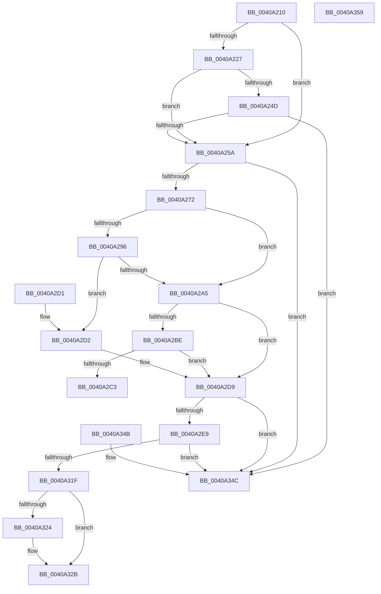

# MiWorkingSetVeryLarge

- RVA: `0x0040A210`–`0x0040A35A` (길이 `330` bytes)
- VA: `0x000000014040A210`
- 실행 섹션: `.text`
- PDB 이름 있음: `예`; PDB Function 태그: `아니요`
- unwind 정보 RVA: `0x0009AC98`
- 디코드: `78`개 명령, `330/330` bytes 표시
- 미해석 바이트: `0` (있으면 어셈블리에 `.byte`로 보존)

> 이 문서는 커널 이미지의 기계어와 PDB 기호를 분석해 생성했습니다. 4번과 5번은 함수 원형과 자료형을 바이너리 사용 방식에서 추정한 C 해석이며 원본 소스 복구 결과는 아닙니다.

## 1. Dependencies

- 직접 호출 지점: **0**; 고유 호출 대상: **0**
- 직접 호출자로 확인된 함수: **2**
- RIP 상대 이미지 참조: **1**

### Outgoing calls
- 직접 디코드된 call 명령이 없습니다.

### Direct callers
- [MiAddWorkingSetEntries](../27/MiAddWorkingSetEntries_function_0027DC00.md) at `0x0027DD83`
- [MiOrderTrimList](MiOrderTrimList_function_00409F24.md) at `0x0040A0B1`

### Static image references
- `0x0040A227` → RVA `0x00E30088` (`.data`; read)

## 2. Other-region calls and transfers

- 다른 실행 섹션으로 향하는 call: **0**
- 별도 외부 분기/꼬리 이동을 확인하지 못했습니다.

## 3. Assembly (complete function range)

```asm
0040A210  48 89 5C 24 08                  mov qword ptr [rsp + 8], rbx
0040A215  48 89 7C 24 10                  mov qword ptr [rsp + 0x10], rdi
0040A21A  8B 81 B8 00 00 00               mov eax, dword ptr [rcx + 0xb8]
0040A220  48 8B DA                        mov rbx, rdx
0040A223  A8 0F                           test al, 0xf
0040A225  75 33                           jne 0x14040a25a
0040A227  48 8B 05 5A 5E A2 00            mov rax, qword ptr [rip + 0xa25e5a]
0040A22E  4C 8D 89 00 FC FF FF            lea r9, [rcx - 0x400]
0040A235  45 0F B7 81 AE 04 00 00         movzx r8d, word ptr [r9 + 0x4ae]
0040A23D  4E 8B 14 C0                     mov r10, qword ptr [rax + r8*8]
0040A241  41 8B 82 B4 04 00 00            mov eax, dword ptr [r10 + 0x4b4]
0040A248  83 F8 FF                        cmp eax, -1
0040A24B  74 0D                           je 0x14040a25a
0040A24D  4D 39 8A A0 06 00 00            cmp qword ptr [r10 + 0x6a0], r9
0040A254  0F 84 F2 00 00 00               je 0x14040a34c
0040A25A  4C 8B 81 90 00 00 00            mov r8, qword ptr [rcx + 0x90]
0040A261  48 8B 41 10                     mov rax, qword ptr [rcx + 0x10]
0040A265  48 8B 78 20                     mov rdi, qword ptr [rax + 0x20]
0040A269  4C 3B C7                        cmp r8, rdi
0040A26C  0F 86 DA 00 00 00               jbe 0x14040a34c
0040A272  0F B7 89 AE 00 00 00            movzx ecx, word ptr [rcx + 0xae]
0040A279  45 33 DB                        xor r11d, r11d
0040A27C  48 8B 05 05 5E A2 00            mov rax, qword ptr [rip + 0xa25e05]
0040A283  45 8B D3                        mov r10d, r11d
0040A286  48 8B 14 C8                     mov rdx, qword ptr [rax + rcx*8]
0040A28A  48 8B 8A 50 48 00 00            mov rcx, qword ptr [rdx + 0x4850]
0040A291  48 85 DB                        test rbx, rbx
0040A294  74 0F                           je 0x14040a2a5
0040A296  49 8D 04 18                     lea rax, [r8 + rbx]
0040A29A  49 33 C0                        xor rax, r8
0040A29D  48 A9 C0 FF FF FF               test rax, -0x40
0040A2A3  74 2D                           je 0x14040a2d2
0040A2A5  4C 8B 8A 00 49 00 00            mov r9, qword ptr [rdx + 0x4900]
0040A2AC  48 8B C1                        mov rax, rcx
0040A2AF  48 C1 E8 04                     shr rax, 4
0040A2B3  41 BA 01 00 00 00               mov r10d, 1
0040A2B9  4C 3B C8                        cmp r9, rax
0040A2BC  73 1B                           jae 0x14040a2d9
0040A2BE  4C 3B C0                        cmp r8, rax
0040A2C1  72 16                           jb 0x14040a2d9
0040A2C3  41 8B C2                        mov eax, r10d
0040A2C6  48 8B 5C 24 08                  mov rbx, qword ptr [rsp + 8]
0040A2CB  48 8B 7C 24 10                  mov rdi, qword ptr [rsp + 0x10]
0040A2D0  C3                              ret
0040A2D1  CC                              int3
0040A2D2  49 C7 C1 FF FF FF FF            mov r9, 0xffffffffffffffff
0040A2D9  48 C1 E9 02                     shr rcx, 2
0040A2DD  4C 2B C7                        sub r8, rdi
0040A2E0  48 8D 04 49                     lea rax, [rcx + rcx*2]
0040A2E4  4C 3B C0                        cmp r8, rax
0040A2E7  72 63                           jb 0x14040a34c
0040A2E9  8B 8A 3C 1C 00 00               mov ecx, dword ptr [rdx + 0x1c3c]
0040A2EF  03 8A 38 1C 00 00               add ecx, dword ptr [rdx + 0x1c38]
0040A2F5  03 8A 34 1C 00 00               add ecx, dword ptr [rdx + 0x1c34]
0040A2FB  03 8A 30 1C 00 00               add ecx, dword ptr [rdx + 0x1c30]
0040A301  03 8A 2C 1C 00 00               add ecx, dword ptr [rdx + 0x1c2c]
0040A307  03 8A 28 1C 00 00               add ecx, dword ptr [rdx + 0x1c28]
0040A30D  48 8B 82 C0 44 00 00            mov rax, qword ptr [rdx + 0x44c0]
0040A314  03 8A 24 1C 00 00               add ecx, dword ptr [rdx + 0x1c24]
0040A31A  3B 48 2C                        cmp ecx, dword ptr [rax + 0x2c]
0040A31D  74 2D                           je 0x14040a34c
0040A31F  45 85 D2                        test r10d, r10d
0040A322  75 07                           jne 0x14040a32b
0040A324  4C 8B 8A 00 49 00 00            mov r9, qword ptr [rdx + 0x4900]
0040A32B  48 8B 88 38 01 00 00            mov rcx, qword ptr [rax + 0x138]
0040A332  48 C1 E1 03                     shl rcx, 3
0040A336  4C 3B C9                        cmp r9, rcx
0040A339  41 0F 92 C3                     setb r11b
0040A33D  41 8B C3                        mov eax, r11d
0040A340  48 8B 5C 24 08                  mov rbx, qword ptr [rsp + 8]
0040A345  48 8B 7C 24 10                  mov rdi, qword ptr [rsp + 0x10]
0040A34A  C3                              ret
0040A34B  CC                              int3
0040A34C  48 8B 5C 24 08                  mov rbx, qword ptr [rsp + 8]
0040A351  33 C0                           xor eax, eax
0040A353  48 8B 7C 24 10                  mov rdi, qword ptr [rsp + 0x10]
0040A358  C3                              ret
0040A359  CC                              int3
```

## 4. C-style interpretation (structured pseudocode)

```c
__int64 __fastcall MiWorkingSetVeryLarge(__int64 a1, __int64 a2)
{
    __int64 result;
    __int64 v_r11;
    unsigned __int64 v_stack_p10;
    unsigned __int64 v_stack_p8;

    v_stack_p8 = v_rbx;
    v_stack_p10 = v_rdi;
    if ((((unsigned __int8)((unsigned int)(*(unsigned int *)(a1 + 184)))) & (15)) != 0) goto loc_0040A25A;
    if (((unsigned int)((unsigned int)(*(unsigned int *)(*(unsigned __int64 *)(*(unsigned __int64 *)(v_rip + 10640986) + *(unsigned __int16 *)(a1 - 1024 + 1198) * 8) + 1204)))) == -1) goto loc_0040A25A;
    if ((*(unsigned __int64 *)(*(unsigned __int64 *)(*(unsigned __int64 *)(v_rip + 10640986) + *(unsigned __int16 *)(a1 - 1024 + 1198) * 8) + 1696)) == (a1 - 1024)) goto loc_0040A34C;
loc_0040A25A:
    if ((*(unsigned __int64 *)(a1 + 144)) <= (*(unsigned __int64 *)(*(unsigned __int64 *)(a1 + 16) + 32))) goto loc_0040A34C;
    v_r11 = 0;
    if (a2 == 0) goto loc_0040A2A5;
    result = (*(unsigned __int64 *)(a1 + 144) + a2 * 1) ^ (*(unsigned __int64 *)(a1 + 144));
    if (((result) & (-64)) == 0) goto loc_0040A2D2;
loc_0040A2A5:
    result = (*(unsigned __int64 *)(*(unsigned __int64 *)(*(unsigned __int64 *)(v_rip + 10640901) + *(unsigned __int16 *)(a1 + 174) * 8) + 18512)) >> (4);
    if ((*(unsigned __int64 *)(*(unsigned __int64 *)(*(unsigned __int64 *)(v_rip + 10640901) + *(unsigned __int16 *)(a1 + 174) * 8) + 18688)) >= result) goto loc_0040A2D9;
    if ((*(unsigned __int64 *)(a1 + 144)) < result) goto loc_0040A2D9;
    return 1;
loc_0040A2D2:
loc_0040A2D9:
    a1 = (*(unsigned __int64 *)(*(unsigned __int64 *)(*(unsigned __int64 *)(v_rip + 10640901) + *(unsigned __int16 *)(a1 + 174) * 8) + 18512)) >> (2);
    a3 = (*(unsigned __int64 *)(a1 + 144)) - (v_stack_p10);
    if (a3 < (a1 + a1 * 2)) goto loc_0040A34C;
    a1 = (unsigned int)(((unsigned int)(*(unsigned int *)(*(unsigned __int64 *)(*(unsigned __int64 *)(v_rip + 10640901) + *(unsigned __int16 *)(a1 + 174) * 8) + 7228))) + (*(unsigned int *)(*(unsigned __int64 *)(*(unsigned __int64 *)(v_rip + 10640901) + *(unsigned __int16 *)(a1 + 174) * 8) + 7224)));
    a1 = (unsigned int)((a1) + (*(unsigned int *)(*(unsigned __int64 *)(*(unsigned __int64 *)(v_rip + 10640901) + *(unsigned __int16 *)(a1 + 174) * 8) + 7220)));
    a1 = (unsigned int)((a1) + (*(unsigned int *)(*(unsigned __int64 *)(*(unsigned __int64 *)(v_rip + 10640901) + *(unsigned __int16 *)(a1 + 174) * 8) + 7216)));
    a1 = (unsigned int)((a1) + (*(unsigned int *)(*(unsigned __int64 *)(*(unsigned __int64 *)(v_rip + 10640901) + *(unsigned __int16 *)(a1 + 174) * 8) + 7212)));
    a1 = (unsigned int)((a1) + (*(unsigned int *)(*(unsigned __int64 *)(*(unsigned __int64 *)(v_rip + 10640901) + *(unsigned __int16 *)(a1 + 174) * 8) + 7208)));
    a1 = (unsigned int)((a1) + (*(unsigned int *)(*(unsigned __int64 *)(*(unsigned __int64 *)(v_rip + 10640901) + *(unsigned __int16 *)(a1 + 174) * 8) + 7204)));
    if (((unsigned int)(a1)) == (*(unsigned int *)(*(unsigned __int64 *)(*(unsigned __int64 *)(*(unsigned __int64 *)(v_rip + 10640901) + *(unsigned __int16 *)(a1 + 174) * 8) + 17600) + 44))) goto loc_0040A34C;
    if (1 == 0) {
        a4 = *(unsigned __int64 *)(*(unsigned __int64 *)(*(unsigned __int64 *)(v_rip + 10640901) + *(unsigned __int16 *)(a1 + 174) * 8) + 18688);
    }
    a1 = (*(unsigned __int64 *)(*(unsigned __int64 *)(*(unsigned __int64 *)(*(unsigned __int64 *)(v_rip + 10640901) + *(unsigned __int16 *)(a1 + 174) * 8) + 17600) + 312)) << (3);
    v_r11 = (a4 < a1) ? 1 : 0;
    return (unsigned int)((unsigned int)(v_r11));
loc_0040A34C:
    result = 0;
    return result;
}
```

## 5. (Beta) C Style

```c
int64_t MiWorkingSetVeryLarge(void *Arg1, int64_t Arg2)
{
    uint8_t *arg1 = (uint8_t *)Arg1;

    int64_t result;
    int64_t local_r11;
    uint64_t v_stack_p10;
    uint64_t v_stack_p8;

    v_stack_p8 = local_rbx;
    v_stack_p10 = local_rdi;
    if ((((uint8_t)((uint32_t)(*(uint32_t *)(arg1 + 0xB8)))) & (15)) != 0) goto loc_0040A25A;
    if (((uint32_t)((uint32_t)(*(uint32_t *)(*(uint64_t *)(*(uint64_t *)(v_rip + 0xA25E5A) + *(uint16_t *)(arg1 - 0x400 + 0x4AE) * 8) + 0x4B4)))) == -1) goto loc_0040A25A;
    if ((*(uint64_t *)(*(uint64_t *)(*(uint64_t *)(v_rip + 0xA25E5A) + *(uint16_t *)(arg1 - 0x400 + 0x4AE) * 8) + 0x6A0)) == (Arg1 - 1024)) goto loc_0040A34C;
loc_0040A25A:
    if ((*(uint64_t *)(arg1 + 0x90)) <= (*(uint64_t *)(*(uint64_t *)(arg1 + 0x10) + 0x20))) goto loc_0040A34C;
    local_r11 = 0;
    if (Arg2 == 0) goto loc_0040A2A5;
    result = (*(uint64_t *)(arg1 + 0x90) + Arg2 * 1) ^ (*(uint64_t *)(arg1 + 0x90));
    if (((result) & (-64)) == 0) goto loc_0040A2D2;
loc_0040A2A5:
    result = (*(uint64_t *)(*(uint64_t *)(*(uint64_t *)(v_rip + 0xA25E05) + *(uint16_t *)(arg1 + 0xAE) * 8) + 0x4850)) >> (4);
    if ((*(uint64_t *)(*(uint64_t *)(*(uint64_t *)(v_rip + 0xA25E05) + *(uint16_t *)(arg1 + 0xAE) * 8) + 0x4900)) >= result) goto loc_0040A2D9;
    if ((*(uint64_t *)(arg1 + 0x90)) < result) goto loc_0040A2D9;
    return 1;
loc_0040A2D2:
loc_0040A2D9:
    Arg1 = (*(uint64_t *)(*(uint64_t *)(*(uint64_t *)(v_rip + 0xA25E05) + *(uint16_t *)(arg1 + 0xAE) * 8) + 0x4850)) >> (2);
    a3 = (*(uint64_t *)(arg1 + 0x90)) - (v_stack_p10);
    if (a3 < (Arg1 + Arg1 * 2)) goto loc_0040A34C;
    Arg1 = (uint32_t)(((uint32_t)(*(uint32_t *)(*(uint64_t *)(*(uint64_t *)(v_rip + 0xA25E05) + *(uint16_t *)(arg1 + 0xAE) * 8) + 0x1C3C))) + (*(uint32_t *)(*(uint64_t *)(*(uint64_t *)(v_rip + 0xA25E05) + *(uint16_t *)(arg1 + 0xAE) * 8) + 0x1C38)));
    Arg1 = (uint32_t)((Arg1) + (*(uint32_t *)(*(uint64_t *)(*(uint64_t *)(v_rip + 0xA25E05) + *(uint16_t *)(arg1 + 0xAE) * 8) + 0x1C34)));
    Arg1 = (uint32_t)((Arg1) + (*(uint32_t *)(*(uint64_t *)(*(uint64_t *)(v_rip + 0xA25E05) + *(uint16_t *)(arg1 + 0xAE) * 8) + 0x1C30)));
    Arg1 = (uint32_t)((Arg1) + (*(uint32_t *)(*(uint64_t *)(*(uint64_t *)(v_rip + 0xA25E05) + *(uint16_t *)(arg1 + 0xAE) * 8) + 0x1C2C)));
    Arg1 = (uint32_t)((Arg1) + (*(uint32_t *)(*(uint64_t *)(*(uint64_t *)(v_rip + 0xA25E05) + *(uint16_t *)(arg1 + 0xAE) * 8) + 0x1C28)));
    Arg1 = (uint32_t)((Arg1) + (*(uint32_t *)(*(uint64_t *)(*(uint64_t *)(v_rip + 0xA25E05) + *(uint16_t *)(arg1 + 0xAE) * 8) + 0x1C24)));
    if (((uint32_t)(Arg1)) == (*(uint32_t *)(*(uint64_t *)(*(uint64_t *)(*(uint64_t *)(v_rip + 0xA25E05) + *(uint16_t *)(arg1 + 0xAE) * 8) + 0x44C0) + 0x2C))) goto loc_0040A34C;
    if (1 == 0) {
        a4 = *(uint64_t *)(*(uint64_t *)(*(uint64_t *)(v_rip + 0xA25E05) + *(uint16_t *)(arg1 + 0xAE) * 8) + 0x4900);
    }
    Arg1 = (*(uint64_t *)(*(uint64_t *)(*(uint64_t *)(*(uint64_t *)(v_rip + 0xA25E05) + *(uint16_t *)(arg1 + 0xAE) * 8) + 0x44C0) + 0x138)) << (3);
    local_r11 = (a4 < Arg1) ? 1 : 0;
    return (uint32_t)((uint32_t)(local_r11));
loc_0040A34C:
    result = 0;
    return result;
}
```

### 관측된 메모리 오프셋

구조체 형식이 확인되지 않은 접근은 인자 기준의 오프셋으로만 기록했습니다.

| 기준 인자 | 오프셋 표현 | 폭 (bit) | 접근 |
|---|---:|---:|---|
| `Arg1` | `- 0x400` | `64` | `R` |
| `Arg1` | `+ 0x10` | `64` | `R` |
| `Arg1` | `+ 0x90` | `64` | `R` |
| `Arg1` | `+ 0xAE` | `16` | `R` |
| `Arg1` | `+ 0xB8` | `32` | `R` |
| `Arg1` | `+ 0x4AE` | `16` | `R` |

## 6. Execution-region graph

[열기: 2D/3D 그래프와 함수 탐색 컨트롤 패널](../../../control-panel.html?section=text&rva=0x0040A210&view=graph)

- 2D 그래프는 위에서 아래로 흐르고, 3D 그래프는 빈 공간을 드래그해 회전합니다. Shift+드래그는 이동, 휠은 확대·축소, 함수 노드 선택은 대상 보고서 이동입니다.

### Static fallback


