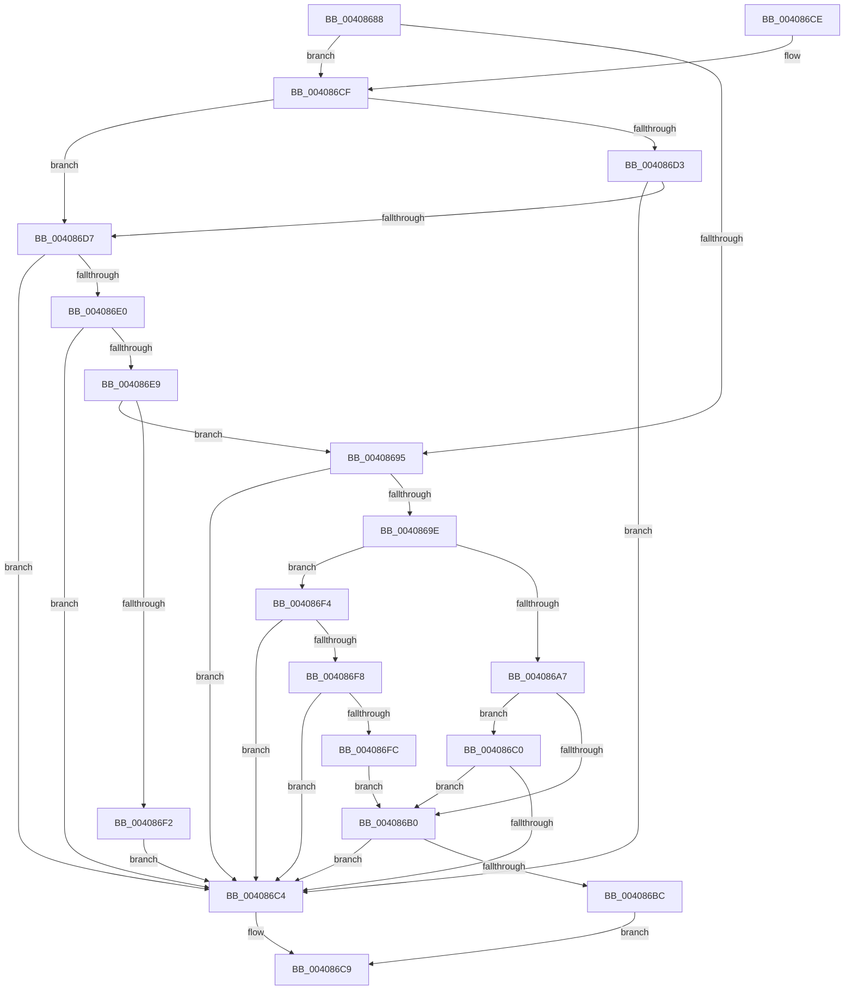

# MmIsWriteErrorFatal

- RVA: `0x00408688`–`0x004086FE` (길이 `118` bytes)
- VA: `0x0000000140408688`
- 실행 섹션: `.text`
- PDB 이름 있음: `예`; PDB Function 태그: `아니요`
- unwind 정보 RVA: `0x00078414`
- 디코드: `37`개 명령, `118/118` bytes 표시
- 미해석 바이트: `0` (있으면 어셈블리에 `.byte`로 보존)

> 이 문서는 커널 이미지의 기계어와 PDB 기호를 분석해 생성했습니다. 4번과 5번은 함수 원형과 자료형을 바이너리 사용 방식에서 추정한 C 해석이며 원본 소스 복구 결과는 아닙니다.

## 1. Dependencies

- 직접 호출 지점: **1**; 고유 호출 대상: **1**
- 직접 호출자로 확인된 함수: **3**
- RIP 상대 이미지 참조: **0**

### Outgoing calls
- `0x004086B3` → [FsRtlIsTotalDeviceFailure](FsRtlIsTotalDeviceFailure_function_00408710.md) (function, `0x00408710`)

### Direct callers
- [MiDeleteCachedSubsection](../29/MiDeleteCachedSubsection_function_00297888.md) at `0x00297B7B`
- [MiWriteComplete](MiWriteComplete_function_004069B0.md) at `0x00406CAC`
- [FsRtlLogCcFlushError](../../page/AC/FsRtlLogCcFlushError_function_00ACA170.md) at `0x00ACA1AA`

### Static image references
- 디코드된 RIP-relative 메모리 참조가 없습니다.

## 2. Other-region calls and transfers

- 다른 실행 섹션으로 향하는 call: **0**
- 별도 외부 분기/꼬리 이동을 확인하지 못했습니다.

## 3. Assembly (complete function range)

```asm
00408688  48 83 EC 28                     sub rsp, 0x28
0040868C  41 81 F8 54 00 00 C0            cmp r8d, 0xc0000054
00408693  75 3A                           jne 0x1404086cf
00408695  41 81 F8 0E 00 00 C0            cmp r8d, 0xc000000e
0040869C  74 26                           je 0x1404086c4
0040869E  41 81 F8 9D 00 00 C0            cmp r8d, 0xc000009d
004086A5  74 4D                           je 0x1404086f4
004086A7  41 81 F8 A2 00 00 C0            cmp r8d, 0xc00000a2
004086AE  74 10                           je 0x1404086c0
004086B0  41 8B C8                        mov ecx, r8d
004086B3  E8 58 00 00 00                  call 0x140408710
004086B8  84 C0                           test al, al
004086BA  74 08                           je 0x1404086c4
004086BC  33 C0                           xor eax, eax
004086BE  EB 09                           jmp 0x1404086c9
004086C0  85 C9                           test ecx, ecx
004086C2  74 EC                           je 0x1404086b0
004086C4  B8 01 00 00 00                  mov eax, 1
004086C9  48 83 C4 28                     add rsp, 0x28
004086CD  C3                              ret
004086CE  CC                              int3
004086CF  85 C9                           test ecx, ecx
004086D1  74 04                           je 0x1404086d7
004086D3  85 D2                           test edx, edx
004086D5  75 ED                           jne 0x1404086c4
004086D7  41 81 F8 98 00 00 C0            cmp r8d, 0xc0000098
004086DE  74 E4                           je 0x1404086c4
004086E0  41 81 F8 02 01 00 C0            cmp r8d, 0xc0000102
004086E7  74 DB                           je 0x1404086c4
004086E9  41 81 F8 6E 02 00 C0            cmp r8d, 0xc000026e
004086F0  75 A3                           jne 0x140408695
004086F2  EB D0                           jmp 0x1404086c4
004086F4  85 C9                           test ecx, ecx
004086F6  74 CC                           je 0x1404086c4
004086F8  85 D2                           test edx, edx
004086FA  74 C8                           je 0x1404086c4
004086FC  EB B2                           jmp 0x1404086b0
```

## 4. C-style interpretation (structured pseudocode)

```c
__int64 __fastcall MmIsWriteErrorFatal(__int64 a1, int a2, int a3)
{
    __int64 result;
    __int64 v_rsp;

    v_rsp = (v_rsp) - (40);
    if (a3 != 0xC0000054ULL) goto loc_004086CF;
loc_00408695:
    if (a3 == 0xC000000EULL) goto loc_004086C4;
    if (a3 == 0xC000009DULL) goto loc_004086F4;
    if (a3 == 0xC00000A2ULL) goto loc_004086C0;
loc_004086B0:
    result = FsRtlIsTotalDeviceFailure((unsigned int)(a3), a2, a3, a4);
    if ((unsigned __int8)(result) == 0) goto loc_004086C4;
    result = 0;
    goto loc_004086C9;
loc_004086C0:
    if ((unsigned int)((unsigned int)(a3)) == 0) goto loc_004086B0;
loc_004086C4:
loc_004086C9:
    v_rsp = (v_rsp) + (40);
    return 1;
loc_004086CF:
    if ((unsigned int)((unsigned int)(a3)) == 0) goto loc_004086D7;
    if (a2 != 0) goto loc_004086C4;
loc_004086D7:
    if (a3 == 0xC0000098ULL) goto loc_004086C4;
    if (a3 == 0xC0000102ULL) goto loc_004086C4;
    if (a3 != 0xC000026EULL) goto loc_00408695;
    goto loc_004086C4;
loc_004086F4:
    if ((unsigned int)((unsigned int)(a3)) == 0) goto loc_004086C4;
    if (a2 == 0) goto loc_004086C4;
    goto loc_004086B0;
}
```

## 5. (Beta) C Style

```c
int64_t MmIsWriteErrorFatal(int64_t Arg1, int32_t Arg2, int32_t Arg3)
{
    int64_t result;
    int64_t local_rsp;

    local_rsp = (local_rsp) - (40);
    if (Arg3 != 0xC0000054ULL) goto loc_004086CF;
loc_00408695:
    if (Arg3 == 0xC000000EULL) goto loc_004086C4;
    if (Arg3 == 0xC000009DULL) goto loc_004086F4;
    if (Arg3 == 0xC00000A2ULL) goto loc_004086C0;
loc_004086B0:
    result = FsRtlIsTotalDeviceFailure((uint32_t)(Arg3), Arg2, Arg3, a4);
    if ((uint8_t)(result) == 0) goto loc_004086C4;
    result = 0;
    goto loc_004086C9;
loc_004086C0:
    if ((uint32_t)((uint32_t)(Arg3)) == 0) goto loc_004086B0;
loc_004086C4:
loc_004086C9:
    local_rsp = (local_rsp) + (40);
    return 1;
loc_004086CF:
    if ((uint32_t)((uint32_t)(Arg3)) == 0) goto loc_004086D7;
    if (Arg2 != 0) goto loc_004086C4;
loc_004086D7:
    if (Arg3 == 0xC0000098ULL) goto loc_004086C4;
    if (Arg3 == 0xC0000102ULL) goto loc_004086C4;
    if (Arg3 != 0xC000026EULL) goto loc_00408695;
    goto loc_004086C4;
loc_004086F4:
    if ((uint32_t)((uint32_t)(Arg3)) == 0) goto loc_004086C4;
    if (Arg2 == 0) goto loc_004086C4;
    goto loc_004086B0;
}
```

## 6. Execution-region graph

[열기: 2D/3D 그래프와 함수 탐색 컨트롤 패널](../../../control-panel.html?section=text&rva=0x00408688&view=graph)

- 2D 그래프는 위에서 아래로 흐르고, 3D 그래프는 빈 공간을 드래그해 회전합니다. Shift+드래그는 이동, 휠은 확대·축소, 함수 노드 선택은 대상 보고서 이동입니다.

### Static fallback


