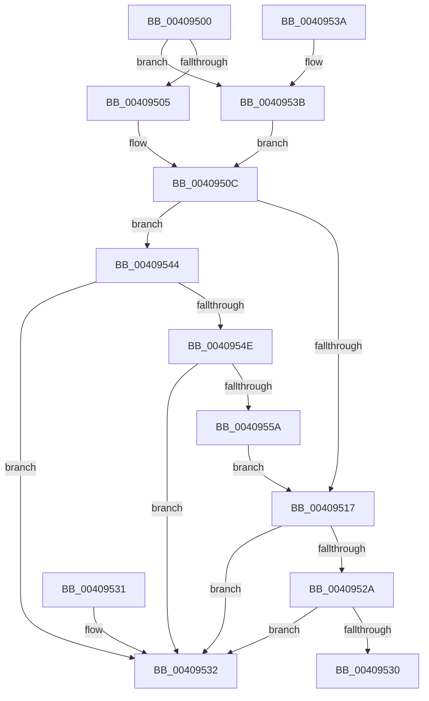

# OBP_GET_SILO_ROOT_DIRECTORY_FROM_SILO

- RVA: `0x00409500`–`0x0040955C` (길이 `92` bytes)
- VA: `0x0000000140409500`
- 실행 섹션: `.text`
- PDB 이름 있음: `예`; PDB Function 태그: `아니요`
- unwind 정보 RVA: `0x000DB714`
- 디코드: `28`개 명령, `92/92` bytes 표시
- 미해석 바이트: `0` (있으면 어셈블리에 `.byte`로 보존)

> 이 문서는 커널 이미지의 기계어와 PDB 기호를 분석해 생성했습니다. 4번과 5번은 함수 원형과 자료형을 바이너리 사용 방식에서 추정한 C 해석이며 원본 소스 복구 결과는 아닙니다.

## 1. Dependencies

- 직접 호출 지점: **0**; 고유 호출 대상: **0**
- 직접 호출자로 확인된 함수: **3**
- RIP 상대 이미지 참조: **3**

### Outgoing calls
- 직접 디코드된 call 명령이 없습니다.

### Direct callers
- [ObpCreateSymbolicLinkName](../../page/74/ObpCreateSymbolicLinkName_function_0074EB80.md) at `0x0074EC39`
- [ObpLookupObjectName](../../page/89/ObpLookupObjectName_function_0089BE90.md) at `0x0089CD42`
- [ObQueryNameStringMode](../../page/8A/ObQueryNameStringMode_function_008A7ED0.md) at `0x008A8037`

### Static image references
- `0x00409505` → RVA `0x00FCFE30` (`CACHEALI`; read)
- `0x0040950C` → RVA `0x00FC5068` (`ALMOSTRO`; read)
- `0x00409532` → RVA `0x00F0F668` (`.data`; read)

## 2. Other-region calls and transfers

- 다른 실행 섹션으로 향하는 call: **0**
- 별도 외부 분기/꼬리 이동을 확인하지 못했습니다.

## 3. Assembly (complete function range)

```asm
00409500  48 85 C9                        test rcx, rcx
00409503  75 36                           jne 0x14040953b
00409505  48 8B 15 24 69 BC 00            mov rdx, qword ptr [rip + 0xbc6924]
0040950C  8B 05 56 BB BB 00               mov eax, dword ptr [rip + 0xbbbb56]
00409512  83 F8 20                        cmp eax, 0x20
00409515  73 2D                           jae 0x140409544
00409517  8B C8                           mov ecx, eax
00409519  48 03 C9                        add rcx, rcx
0040951C  4C 8B 44 CA 08                  mov r8, qword ptr [rdx + rcx*8 + 8]
00409521  49 8B C0                        mov rax, r8
00409524  48 83 E0 FE                     and rax, 0xfffffffffffffffe
00409528  74 08                           je 0x140409532
0040952A  41 F6 C0 01                     test r8b, 1
0040952E  74 02                           je 0x140409532
00409530  C3                              ret
00409531  CC                              int3
00409532  48 8B 05 2F 61 B0 00            mov rax, qword ptr [rip + 0xb0612f]
00409539  C3                              ret
0040953A  CC                              int3
0040953B  48 8B 91 00 06 00 00            mov rdx, qword ptr [rcx + 0x600]
00409542  EB C8                           jmp 0x14040950c
00409544  83 C0 E0                        add eax, -0x20
00409547  3D 00 01 00 00                  cmp eax, 0x100
0040954C  73 E4                           jae 0x140409532
0040954E  48 8B 92 00 02 00 00            mov rdx, qword ptr [rdx + 0x200]
00409555  48 85 D2                        test rdx, rdx
00409558  74 D8                           je 0x140409532
0040955A  EB BB                           jmp 0x140409517
```

## 4. C-style interpretation (structured pseudocode)

```c
__int64 __fastcall OBP_GET_SILO_ROOT_DIRECTORY_FROM_SILO(__int64 a1)
{
    __int64 result;

    if (a1 != 0) goto loc_0040953B;
loc_0040950C:
    if (((unsigned int)((unsigned int)(*(unsigned int *)(v_rip + 12303190)))) >= 32) goto loc_00409544;
loc_00409517:
    a1 = ((unsigned int)((unsigned int)((unsigned int)(*(unsigned int *)(v_rip + 12303190))))) + ((unsigned int)((unsigned int)((unsigned int)(*(unsigned int *)(v_rip + 12303190)))));
    result = (*(unsigned __int64 *)(*(unsigned __int64 *)(v_rip + 12347684) + a1 * 8 + 8)) & (-2);
    if (condition_is_equal) goto loc_00409532;
    if ((((unsigned __int8)(*(unsigned __int64 *)(*(unsigned __int64 *)(v_rip + 12347684) + a1 * 8 + 8))) & (1)) == 0) goto loc_00409532;
    return result;
loc_00409532:
    return *(unsigned __int64 *)(v_rip + 11559215);
loc_0040953B:
    goto loc_0040950C;
loc_00409544:
    result = (unsigned int)((*(unsigned __int64 *)(v_rip + 11559215)) + (-32));
    if (((unsigned int)(result)) >= 256) goto loc_00409532;
    if (*(unsigned __int64 *)(*(unsigned __int64 *)(a1 + 1536) + 512) == 0) goto loc_00409532;
    goto loc_00409517;
}
```

## 5. (Beta) C Style

```c
int64_t OBP_GET_SILO_ROOT_DIRECTORY_FROM_SILO(int64_t Arg1)
{
    int64_t result;

    if (Arg1 != 0) goto loc_0040953B;
loc_0040950C:
    if (((uint32_t)((uint32_t)(*(uint32_t *)(v_rip + 0xBBBB56)))) >= 32) goto loc_00409544;
loc_00409517:
    Arg1 = ((uint32_t)((uint32_t)((uint32_t)(*(uint32_t *)(v_rip + 0xBBBB56))))) + ((uint32_t)((uint32_t)((uint32_t)(*(uint32_t *)(v_rip + 0xBBBB56)))));
    result = (*(uint64_t *)(*(uint64_t *)(v_rip + 0xBC6924) + Arg1 * 8 + 0x8)) & (-2);
    if (condition_is_equal) goto loc_00409532;
    if ((((uint8_t)(*(uint64_t *)(*(uint64_t *)(v_rip + 0xBC6924) + Arg1 * 8 + 0x8))) & (1)) == 0) goto loc_00409532;
    return result;
loc_00409532:
    return *(uint64_t *)(v_rip + 0xB0612F);
loc_0040953B:
    goto loc_0040950C;
loc_00409544:
    result = (uint32_t)((*(uint64_t *)(v_rip + 0xB0612F)) + (-32));
    if (((uint32_t)(result)) >= 256) goto loc_00409532;
    if (*(uint64_t *)(*(uint64_t *)(Arg1 + 0x600) + 0x200) == 0) goto loc_00409532;
    goto loc_00409517;
}
```

## 6. Execution-region graph

[열기: 2D/3D 그래프와 함수 탐색 컨트롤 패널](../../../control-panel.html?section=text&rva=0x00409500&view=graph)

- 2D 그래프는 위에서 아래로 흐르고, 3D 그래프는 빈 공간을 드래그해 회전합니다. Shift+드래그는 이동, 휠은 확대·축소, 함수 노드 선택은 대상 보고서 이동입니다.

### Static fallback


