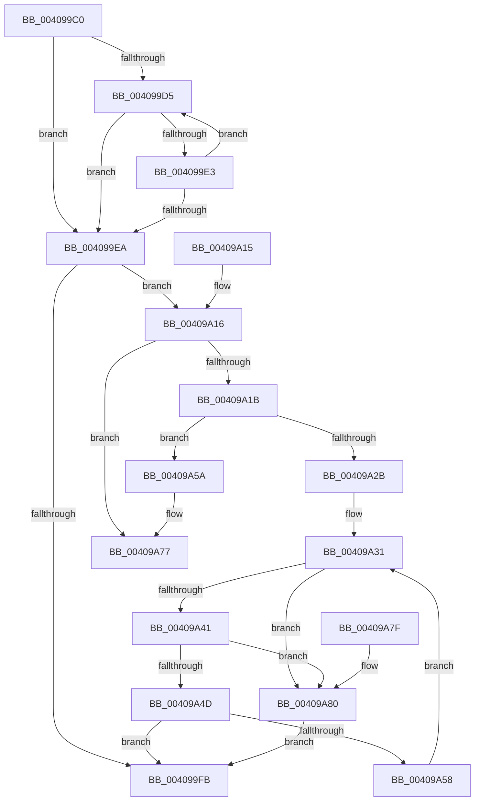

# ObFastReferenceObject

- RVA: `0x004099C0`–`0x00409A8B` (길이 `203` bytes)
- VA: `0x00000001404099C0`
- 실행 섹션: `.text`
- PDB 이름 있음: `예`; PDB Function 태그: `아니요`
- unwind 정보 RVA: `0x0009AC50`
- 디코드: `64`개 명령, `203/203` bytes 표시
- 미해석 바이트: `0` (있으면 어셈블리에 `.byte`로 보존)

> 이 문서는 커널 이미지의 기계어와 PDB 기호를 분석해 생성했습니다. 4번과 5번은 함수 원형과 자료형을 바이너리 사용 방식에서 추정한 C 해석이며 원본 소스 복구 결과는 아닙니다.

## 1. Dependencies

- 직접 호출 지점: **2**; 고유 호출 대상: **2**
- 직접 호출자로 확인된 함수: **2**
- RIP 상대 이미지 참조: **0**

### Outgoing calls
- `0x00409A07` → [ObpTraceObjectReferenceIfActive](../21/ObpTraceObjectReferenceIfActive_function_00210780.md) (function, `0x00210780`)
- `0x00409A71` → [KeBugCheckEx](../4F/KeBugCheckEx_function_004FD660.md) (function, `0x004FD660`)

### Direct callers
- [IopQueueIrpToFileObject](IopQueueIrpToFileObject_function_00409864.md) at `0x00409924`
- [PspReferenceSystemDll](../../page/8D/PspReferenceSystemDll_function_008D6AD8.md) at `0x008D6AF8`

### Static image references
- 디코드된 RIP-relative 메모리 참조가 없습니다.

## 2. Other-region calls and transfers

- 다른 실행 섹션으로 향하는 call: **0**
- 별도 외부 분기/꼬리 이동을 확인하지 못했습니다.

## 3. Assembly (complete function range)

```asm
004099C0  40 53                           push rbx
004099C2  48 83 EC 30                     sub rsp, 0x30
004099C6  4C 8B D1                        mov r10, rcx
004099C9  0F 0D 09                        prefetchw byte ptr [rcx]
004099CC  4C 8B 09                        mov r9, qword ptr [rcx]
004099CF  41 F6 C1 0F                     test r9b, 0xf
004099D3  74 15                           je 0x1404099ea
004099D5  4D 8D 41 FF                     lea r8, [r9 - 1]
004099D9  49 8B C1                        mov rax, r9
004099DC  F0 4C 0F B1 01                  lock cmpxchg qword ptr [rcx], r8
004099E1  74 07                           je 0x1404099ea
004099E3  4C 8B C8                        mov r9, rax
004099E6  A8 0F                           test al, 0xf
004099E8  75 EB                           jne 0x1404099d5
004099EA  49 8B D9                        mov rbx, r9
004099ED  41 83 E1 0F                     and r9d, 0xf
004099F1  48 83 E3 F0                     and rbx, 0xfffffffffffffff0
004099F5  41 83 F9 01                     cmp r9d, 1
004099F9  76 1B                           jbe 0x140409a16
004099FB  44 8B C2                        mov r8d, edx
004099FE  48 8D 4B D0                     lea rcx, [rbx - 0x30]
00409A02  BA 01 00 00 00                  mov edx, 1
00409A07  E8 74 6D E0 FF                  call 0x140210780
00409A0C  48 8B C3                        mov rax, rbx
00409A0F  48 83 C4 30                     add rsp, 0x30
00409A13  5B                              pop rbx
00409A14  C3                              ret
00409A15  CC                              int3
00409A16  45 85 C9                        test r9d, r9d
00409A19  74 5C                           je 0x140409a77
00409A1B  B8 0F 00 00 00                  mov eax, 0xf
00409A20  F0 48 0F C1 43 D0               lock xadd qword ptr [rbx - 0x30], rax
00409A26  48 85 C0                        test rax, rax
00409A29  7E 2F                           jle 0x140409a5a
00409A2B  0F 0D 09                        prefetchw byte ptr [rcx]
00409A2E  48 8B 01                        mov rax, qword ptr [rcx]
00409A31  48 8B C8                        mov rcx, rax
00409A34  83 E1 0F                        and ecx, 0xf
00409A37  48 83 C1 0F                     add rcx, 0xf
00409A3B  48 83 F9 0F                     cmp rcx, 0xf
00409A3F  77 3F                           ja 0x140409a80
00409A41  48 8B C8                        mov rcx, rax
00409A44  48 83 E1 F0                     and rcx, 0xfffffffffffffff0
00409A48  48 3B D9                        cmp rbx, rcx
00409A4B  75 33                           jne 0x140409a80
00409A4D  48 8D 48 0F                     lea rcx, [rax + 0xf]
00409A51  F0 49 0F B1 0A                  lock cmpxchg qword ptr [r10], rcx
00409A56  74 A3                           je 0x1404099fb
00409A58  EB D7                           jmp 0x140409a31
00409A5A  33 D2                           xor edx, edx
00409A5C  48 83 C0 0F                     add rax, 0xf
00409A60  41 B9 10 00 00 00               mov r9d, 0x10
00409A66  48 89 44 24 20                  mov qword ptr [rsp + 0x20], rax
00409A6B  4C 8B C3                        mov r8, rbx
00409A6E  8D 4A 18                        lea ecx, [rdx + 0x18]
00409A71  E8 EA 3B 0F 00                  call 0x1404fd660
00409A76  CC                              int3
00409A77  33 C0                           xor eax, eax
00409A79  48 83 C4 30                     add rsp, 0x30
00409A7D  5B                              pop rbx
00409A7E  C3                              ret
00409A7F  CC                              int3
00409A80  F0 48 83 43 D0 F1               lock add qword ptr [rbx - 0x30], -0xf
00409A86  E9 70 FF FF FF                  jmp 0x1404099fb
```

## 4. C-style interpretation (structured pseudocode)

```c
__int64 __fastcall ObFastReferenceObject(__int64 a1, int a2)
{
    __int64 result;
    __int64 v_rbx;
    __int64 v_rsp;
    unsigned __int64 v_stack_p20;

    v_rsp = (v_rsp) - (48);
    if ((((unsigned __int8)(*(unsigned __int64 *)(a1))) & (15)) == 0) goto loc_004099EA;
loc_004099D5:
    if ((((unsigned __int8)(*(unsigned __int64 *)(a1))) & (15)) == 0) goto loc_004099EA;
    if ((((unsigned __int8)(*(unsigned __int64 *)(a1))) & (15)) != 0) goto loc_004099D5;
loc_004099EA:
    a4 = (unsigned int)((*(unsigned __int64 *)(a1)) & (15));
    v_rbx = (*(unsigned __int64 *)(a1)) & (-16);
    if (((unsigned int)(a4)) <= 1) goto loc_00409A16;
loc_004099FB:
    result = ObpTraceObjectReferenceIfActive(v_rbx - 48, 1, (unsigned int)(a2), a4);
    v_rsp = (v_rsp) + (48);
    return v_rbx;
loc_00409A16:
    if ((unsigned int)(a4) == 0) goto loc_00409A77;
    if (condition_is_less_or_equal) goto loc_00409A5A;
loc_00409A31:
    a1 = (unsigned int)((*(unsigned __int64 *)(v_rbx - 48)) & (15));
    a1 = (a1) + (15);
    if (a1 > 15) goto loc_00409A80;
    a1 = (*(unsigned __int64 *)(v_rbx - 48)) & (-16);
    if (v_rbx != a1) goto loc_00409A80;
    if (v_rbx == a1) goto loc_004099FB;
    goto loc_00409A31;
loc_00409A5A:
    a2 = 0;
    result = (*(unsigned __int64 *)(v_rbx - 48)) + (15);
    v_stack_p20 = result;
    result = KeBugCheckEx(a2 + 24, a2, v_rbx, 16);
loc_00409A77:
    result = 0;
    v_rsp = (v_rsp) + (48);
    return result;
loc_00409A80:
    goto loc_004099FB;
}
```

## 5. (Beta) C Style

```c
int64_t ObFastReferenceObject(void *Arg1, int32_t Arg2)
{
    uint8_t *arg1 = (uint8_t *)Arg1;

    int64_t result;
    int64_t local_rbx;
    int64_t local_rsp;
    uint64_t v_stack_p20;

    local_rsp = (local_rsp) - (48);
    if ((((uint8_t)(*(uint64_t *)(arg1))) & (15)) == 0) goto loc_004099EA;
loc_004099D5:
    if ((((uint8_t)(*(uint64_t *)(arg1))) & (15)) == 0) goto loc_004099EA;
    if ((((uint8_t)(*(uint64_t *)(arg1))) & (15)) != 0) goto loc_004099D5;
loc_004099EA:
    a4 = (uint32_t)((*(uint64_t *)(arg1)) & (15));
    local_rbx = (*(uint64_t *)(arg1)) & (-16);
    if (((uint32_t)(a4)) <= 1) goto loc_00409A16;
loc_004099FB:
    result = ObpTraceObjectReferenceIfActive(local_rbx - 48, 1, (uint32_t)(Arg2), a4);
    local_rsp = (local_rsp) + (48);
    return local_rbx;
loc_00409A16:
    if ((uint32_t)(a4) == 0) goto loc_00409A77;
    if (condition_is_less_or_equal) goto loc_00409A5A;
loc_00409A31:
    Arg1 = (uint32_t)((*(uint64_t *)(local_rbx - 0x30)) & (15));
    Arg1 = (Arg1) + (15);
    if (Arg1 > 15) goto loc_00409A80;
    Arg1 = (*(uint64_t *)(local_rbx - 0x30)) & (-16);
    if (local_rbx != Arg1) goto loc_00409A80;
    if (local_rbx == Arg1) goto loc_004099FB;
    goto loc_00409A31;
loc_00409A5A:
    Arg2 = 0;
    result = (*(uint64_t *)(local_rbx - 0x30)) + (15);
    v_stack_p20 = result;
    result = KeBugCheckEx(Arg2 + 24, Arg2, local_rbx, 16);
loc_00409A77:
    result = 0;
    local_rsp = (local_rsp) + (48);
    return result;
loc_00409A80:
    goto loc_004099FB;
}
```

### 관측된 메모리 오프셋

구조체 형식이 확인되지 않은 접근은 인자 기준의 오프셋으로만 기록했습니다.

| 기준 인자 | 오프셋 표현 | 폭 (bit) | 접근 |
|---|---:|---:|---|
| `Arg1` | `+ 0x0` | `8` | `R` |
| `Arg1` | `+ 0x0` | `64` | `R` |

## 6. Execution-region graph

[열기: 2D/3D 그래프와 함수 탐색 컨트롤 패널](../../../control-panel.html?section=text&rva=0x004099C0&view=graph)

- 2D 그래프는 위에서 아래로 흐르고, 3D 그래프는 빈 공간을 드래그해 회전합니다. Shift+드래그는 이동, 휠은 확대·축소, 함수 노드 선택은 대상 보고서 이동입니다.

### Static fallback


