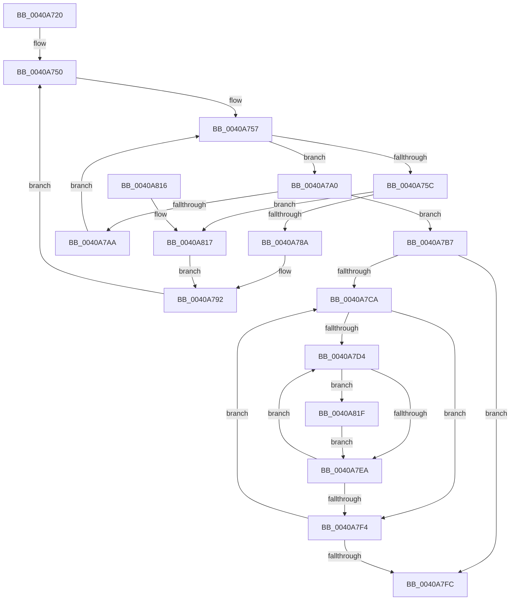

# PpmCheckRecordAllUtility

- RVA: `0x0040A720`–`0x0040A829` (길이 `265` bytes)
- VA: `0x000000014040A720`
- 실행 섹션: `.text`
- PDB 이름 있음: `예`; PDB Function 태그: `아니요`
- unwind 정보 RVA: `0x0009AD28`
- 디코드: `70`개 명령, `265/265` bytes 표시
- 미해석 바이트: `0` (있으면 어셈블리에 `.byte`로 보존)

> 이 문서는 커널 이미지의 기계어와 PDB 기호를 분석해 생성했습니다. 4번과 5번은 함수 원형과 자료형을 바이너리 사용 방식에서 추정한 C 해석이며 원본 소스 복구 결과는 아닙니다.

## 1. Dependencies

- 직접 호출 지점: **3**; 고유 호출 대상: **2**
- 직접 호출자로 확인된 함수: **0**
- RIP 상대 이미지 참조: **6**

### Outgoing calls
- `0x0040A799` → [PpmPerfRecordUtility](PpmPerfRecordUtility_function_0040A830.md) (function, `0x0040A830`)
- `0x0040A7FC` → [PpmParkRecordNodeStatistics](PpmParkRecordNodeStatistics_function_0040B02C.md) (function, `0x0040B02C`)
- `0x0040A822` → [PpmPerfRecordUtility](PpmPerfRecordUtility_function_0040A830.md) (function, `0x0040A830`)

### Direct callers
- 이 함수 시작 RVA로 연결되는 직접 call은 확인되지 않았습니다. 간접 호출은 완전히 역산할 수 없습니다.

### Static image references
- `0x0040A732` → RVA `0x00E0B5A8` (`.data`; read)
- `0x0040A739` → RVA `0x00000000` (`image boundary/outside`; read)
- `0x0040A750` → RVA `0x00E0B5A0` (`.data`; read)
- `0x0040A772` → RVA `0x00F231B8` (`.data`; read)
- `0x0040A77C` → RVA `0x00FC6A80` (`ALMOSTRO`; read)
- `0x0040A7B7` → RVA `0x00FC6BA8` (`ALMOSTRO`; read)

## 2. Other-region calls and transfers

- 다른 실행 섹션으로 향하는 call: **0**
- 별도 외부 분기/꼬리 이동을 확인하지 못했습니다.

## 3. Assembly (complete function range)

```asm
0040A720  48 89 5C 24 10                  mov qword ptr [rsp + 0x10], rbx
0040A725  48 89 6C 24 18                  mov qword ptr [rsp + 0x18], rbp
0040A72A  56                              push rsi
0040A72B  57                              push rdi
0040A72C  41 56                           push r14
0040A72E  48 83 EC 20                     sub rsp, 0x20
0040A732  48 8B 1D 6F 0E A0 00            mov rbx, qword ptr [rip + 0xa00e6f]
0040A739  4C 8D 35 C0 58 BF FF            lea r14, [rip - 0x40a740]
0040A740  33 F6                           xor esi, esi
0040A742  0F B7 FE                        movzx edi, si
0040A745  66 66 66 0F 1F 84 00 00 00 00 00  nop word ptr [rax + rax]
0040A750  0F B7 0D 49 0E A0 00            movzx ecx, word ptr [rip + 0xa00e49]
0040A757  48 85 DB                        test rbx, rbx
0040A75A  74 44                           je 0x14040a7a0
0040A75C  48 0F BC D3                     bsf rdx, rbx
0040A760  0F B7 CF                        movzx ecx, di
0040A763  0F B6 C2                        movzx eax, dl
0040A766  48 0F B3 C3                     btr rbx, rax
0040A76A  C1 E1 06                        shl ecx, 6
0040A76D  0F B6 C2                        movzx eax, dl
0040A770  03 C8                           add ecx, eax
0040A772  48 8B 05 3F 8A B1 00            mov rax, qword ptr [rip + 0xb18a3f]
0040A779  8B 14 88                        mov edx, dword ptr [rax + rcx*4]
0040A77C  8B 05 FE C2 BB 00               mov eax, dword ptr [rip + 0xbbc2fe]
0040A782  3B D0                           cmp edx, eax
0040A784  0F 83 8D 00 00 00               jae 0x14040a817
0040A78A  49 8B 8C D6 40 8C FC 00         mov rcx, qword ptr [r14 + rdx*8 + 0xfc8c40]
0040A792  48 81 C1 B0 89 00 00            add rcx, 0x89b0
0040A799  E8 92 00 00 00                  call 0x14040a830
0040A79E  EB B0                           jmp 0x14040a750
0040A7A0  66 FF C7                        inc di
0040A7A3  0F B7 C7                        movzx eax, di
0040A7A6  3B C1                           cmp eax, ecx
0040A7A8  73 0D                           jae 0x14040a7b7
0040A7AA  0F B7 DF                        movzx ebx, di
0040A7AD  49 8B 9C DE A8 B5 E0 00         mov rbx, qword ptr [r14 + rbx*8 + 0xe0b5a8]
0040A7B5  EB A0                           jmp 0x14040a757
0040A7B7  48 8B 3D EA C3 BB 00            mov rdi, qword ptr [rip + 0xbbc3ea]
0040A7BE  48 8D 2D E3 C3 BB 00            lea rbp, [rip + 0xbbc3e3]
0040A7C5  48 3B FD                        cmp rdi, rbp
0040A7C8  74 32                           je 0x14040a7fc
0040A7CA  8B DE                           mov ebx, esi
0040A7CC  39 B7 28 01 00 00               cmp dword ptr [rdi + 0x128], esi
0040A7D2  76 20                           jbe 0x14040a7f4
0040A7D4  8B C3                           mov eax, ebx
0040A7D6  48 69 C8 A8 04 00 00            imul rcx, rax, 0x4a8
0040A7DD  48 03 8F 38 01 00 00            add rcx, qword ptr [rdi + 0x138]
0040A7E4  83 79 10 01                     cmp dword ptr [rcx + 0x10], 1
0040A7E8  74 35                           je 0x14040a81f
0040A7EA  FF C3                           inc ebx
0040A7EC  3B 9F 28 01 00 00               cmp ebx, dword ptr [rdi + 0x128]
0040A7F2  72 E0                           jb 0x14040a7d4
0040A7F4  48 8B 3F                        mov rdi, qword ptr [rdi]
0040A7F7  48 3B FD                        cmp rdi, rbp
0040A7FA  75 CE                           jne 0x14040a7ca
0040A7FC  E8 2B 08 00 00                  call 0x14040b02c
0040A801  48 8B 5C 24 48                  mov rbx, qword ptr [rsp + 0x48]
0040A806  B0 01                           mov al, 1
0040A808  48 8B 6C 24 50                  mov rbp, qword ptr [rsp + 0x50]
0040A80D  48 83 C4 20                     add rsp, 0x20
0040A811  41 5E                           pop r14
0040A813  5F                              pop rdi
0040A814  5E                              pop rsi
0040A815  C3                              ret
0040A816  CC                              int3
0040A817  48 8B CE                        mov rcx, rsi
0040A81A  E9 73 FF FF FF                  jmp 0x14040a792
0040A81F  48 8B 09                        mov rcx, qword ptr [rcx]
0040A822  E8 09 00 00 00                  call 0x14040a830
0040A827  EB C1                           jmp 0x14040a7ea
```

## 4. C-style interpretation (structured pseudocode)

```c
__int64 __fastcall PpmCheckRecordAllUtility(void)
{
    __int64 result;
    __int64 v_rbx;
    __int64 v_rdi;
    __int64 v_rsi;
    __int64 v_rsp;
    unsigned __int64 v_stack_p10;
    unsigned __int64 v_stack_p18;

    v_stack_p10 = v_rbx;
    v_stack_p18 = v_rbp;
    v_rsp = (v_rsp) - (32);
    v_rsi = 0;
loc_0040A750:
loc_0040A757:
    if (*(unsigned __int64 *)(v_rip + 10489455) == 0) goto loc_0040A7A0;
    a1 = (unsigned int)((0) << (6));
    a1 = (unsigned int)((a1) + ((unsigned int)((unsigned __int8)(a2))));
    if (((unsigned int)((unsigned int)(*(unsigned int *)(*(unsigned __int64 *)(v_rip + 11635263) + a1 * 4)))) >= ((unsigned int)((unsigned int)(*(unsigned int *)(v_rip + 12305150))))) goto loc_0040A817;
loc_0040A792:
    a1 = (*(unsigned __int64 *)(v_rip - 4237120 + (unsigned int)(*(unsigned int *)(*(unsigned __int64 *)(v_rip + 11635263) + a1 * 4)) * 8 + 16550976)) + (0x89B0ULL);
    result = PpmPerfRecordUtility(a1, (unsigned int)(*(unsigned int *)(*(unsigned __int64 *)(v_rip + 11635263) + a1 * 4)), a3, a4);
    goto loc_0040A750;
loc_0040A7A0:
    v_rdi = (unsigned __int16)((0) + 1);
    if (((unsigned int)((unsigned __int16)(v_rdi))) >= ((unsigned int)(a1))) goto loc_0040A7B7;
    goto loc_0040A757;
loc_0040A7B7:
    if ((*(unsigned __int64 *)(v_rip + 12305386)) == (v_rip + 12305379)) goto loc_0040A7FC;
loc_0040A7CA:
    if ((*(unsigned int *)(*(unsigned __int64 *)(v_rip + 12305386) + 296)) <= 0) goto loc_0040A7F4;
loc_0040A7D4:
    a1 = (a1) * (0);
    a1 = (a1) + (*(unsigned __int64 *)(*(unsigned __int64 *)(v_rip + 12305386) + 312));
    if ((*(unsigned int *)(a1 + 16)) == 1) goto loc_0040A81F;
loc_0040A7EA:
    v_rbx = (unsigned int)((0) + 1);
    if (((unsigned int)(v_rbx)) < (*(unsigned int *)(*(unsigned __int64 *)(v_rip + 12305386) + 296))) goto loc_0040A7D4;
loc_0040A7F4:
    if ((*(unsigned __int64 *)(*(unsigned __int64 *)(v_rip + 12305386))) != (v_rip + 12305379)) goto loc_0040A7CA;
loc_0040A7FC:
    result = PpmParkRecordNodeStatistics(a1, (unsigned int)(*(unsigned int *)(*(unsigned __int64 *)(v_rip + 11635263) + a1 * 4)), a3, a4);
    v_rsp = (v_rsp) + (32);
    return 1;
loc_0040A817:
    goto loc_0040A792;
loc_0040A81F:
    result = PpmPerfRecordUtility(*(unsigned __int64 *)(0), (unsigned int)(*(unsigned int *)(*(unsigned __int64 *)(v_rip + 11635263) + a1 * 4)), a3, a4);
    goto loc_0040A7EA;
}
```

## 5. (Beta) C Style

```c
void PpmCheckRecordAllUtility(void)
{
    int64_t result;
    int64_t local_rbx;
    int64_t local_rdi;
    int64_t local_rsi;
    int64_t local_rsp;
    uint64_t v_stack_p10;
    uint64_t v_stack_p18;

    v_stack_p10 = local_rbx;
    v_stack_p18 = local_rbp;
    local_rsp = (local_rsp) - (32);
    local_rsi = 0;
loc_0040A750:
loc_0040A757:
    if (*(uint64_t *)(v_rip + 0xA00E6F) == 0) goto loc_0040A7A0;
    a1 = (uint32_t)((0) << (6));
    a1 = (uint32_t)((a1) + ((uint32_t)((uint8_t)(a2))));
    if (((uint32_t)((uint32_t)(*(uint32_t *)(*(uint64_t *)(v_rip + 0xB18A3F) + a1 * 4)))) >= ((uint32_t)((uint32_t)(*(uint32_t *)(v_rip + 0xBBC2FE))))) goto loc_0040A817;
loc_0040A792:
    a1 = (*(uint64_t *)(v_rip - 0x40A740 + (uint32_t)(*(uint32_t *)(*(uint64_t *)(v_rip + 0xB18A3F) + a1 * 4)) * 8 + 0xFC8C40)) + (0x89B0ULL);
    result = PpmPerfRecordUtility(a1, (uint32_t)(*(uint32_t *)(*(uint64_t *)(v_rip + 0xB18A3F) + a1 * 4)), a3, a4);
    goto loc_0040A750;
loc_0040A7A0:
    local_rdi = (uint16_t)((0) + 1);
    if (((uint32_t)((uint16_t)(local_rdi))) >= ((uint32_t)(a1))) goto loc_0040A7B7;
    goto loc_0040A757;
loc_0040A7B7:
    if ((*(uint64_t *)(v_rip + 0xBBC3EA)) == (v_rip + 12305379)) goto loc_0040A7FC;
loc_0040A7CA:
    if ((*(uint32_t *)(*(uint64_t *)(v_rip + 0xBBC3EA) + 0x128)) <= 0) goto loc_0040A7F4;
loc_0040A7D4:
    a1 = (a1) * (0);
    a1 = (a1) + (*(uint64_t *)(*(uint64_t *)(v_rip + 0xBBC3EA) + 0x138));
    if ((*(uint32_t *)(a1 + 0x10)) == 1) goto loc_0040A81F;
loc_0040A7EA:
    local_rbx = (uint32_t)((0) + 1);
    if (((uint32_t)(local_rbx)) < (*(uint32_t *)(*(uint64_t *)(v_rip + 0xBBC3EA) + 0x128))) goto loc_0040A7D4;
loc_0040A7F4:
    if ((*(uint64_t *)(*(uint64_t *)(v_rip + 0xBBC3EA))) != (v_rip + 12305379)) goto loc_0040A7CA;
loc_0040A7FC:
    result = PpmParkRecordNodeStatistics(a1, (uint32_t)(*(uint32_t *)(*(uint64_t *)(v_rip + 0xB18A3F) + a1 * 4)), a3, a4);
    local_rsp = (local_rsp) + (32);
    return 1;
loc_0040A817:
    goto loc_0040A792;
loc_0040A81F:
    result = PpmPerfRecordUtility(*(uint64_t *)(0), (uint32_t)(*(uint32_t *)(*(uint64_t *)(v_rip + 0xB18A3F) + a1 * 4)), a3, a4);
    goto loc_0040A7EA;
}
```

## 6. Execution-region graph

[열기: 2D/3D 그래프와 함수 탐색 컨트롤 패널](../../../control-panel.html?section=text&rva=0x0040A720&view=graph)

- 2D 그래프는 위에서 아래로 흐르고, 3D 그래프는 빈 공간을 드래그해 회전합니다. Shift+드래그는 이동, 휠은 확대·축소, 함수 노드 선택은 대상 보고서 이동입니다.

### Static fallback


