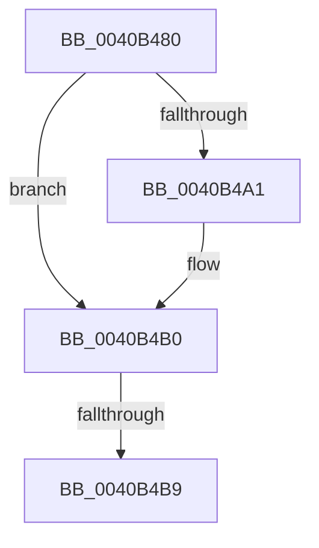

# PpmParkComputeSnapStatistics

- RVA: `0x0040B480`–`0x0040B4C0` (길이 `64` bytes)
- VA: `0x000000014040B480`
- 실행 섹션: `.text`
- PDB 이름 있음: `예`; PDB Function 태그: `아니요`
- unwind 정보 RVA: `0x0009AE30`
- 디코드: `19`개 명령, `64/64` bytes 표시
- 미해석 바이트: `0` (있으면 어셈블리에 `.byte`로 보존)

> 이 문서는 커널 이미지의 기계어와 PDB 기호를 분석해 생성했습니다. 4번과 5번은 함수 원형과 자료형을 바이너리 사용 방식에서 추정한 C 해석이며 원본 소스 복구 결과는 아닙니다.

## 1. Dependencies

- 직접 호출 지점: **0**; 고유 호출 대상: **0**
- 직접 호출자로 확인된 함수: **2**
- RIP 상대 이미지 참조: **0**

### Outgoing calls
- 직접 디코드된 call 명령이 없습니다.

### Direct callers
- [PpmParkRecordNodeStatistics](PpmParkRecordNodeStatistics_function_0040B02C.md) at `0x0040B0E3`
- [sub_006EC724](../6E/Unknown_function_006EC724.md) at `0x006EC773`

### Static image references
- 디코드된 RIP-relative 메모리 참조가 없습니다.

## 2. Other-region calls and transfers

- 다른 실행 섹션으로 향하는 call: **0**
- call이 아닌 외부 분기/꼬리 이동: **1**
  - `0x0040B4B3` → [sub_0040B586 + 0x99](Unknown_function_0040B586.md) (`tail-transfer`)

## 3. Assembly (complete function range)

```asm
0040B480  48 89 5C 24 10                  mov qword ptr [rsp + 0x10], rbx
0040B485  48 89 6C 24 18                  mov qword ptr [rsp + 0x18], rbp
0040B48A  56                              push rsi
0040B48B  4D 8B 59 18                     mov r11, qword ptr [r9 + 0x18]
0040B48F  49 8B D9                        mov rbx, r9
0040B492  4D 2B 59 20                     sub r11, qword ptr [r9 + 0x20]
0040B496  41 0F B6 F0                     movzx esi, r8b
0040B49A  0F B6 EA                        movzx ebp, dl
0040B49D  85 C9                           test ecx, ecx
0040B49F  74 0F                           je 0x14040b4b0
0040B4A1  49 8B C3                        mov rax, r11
0040B4A4  44 8D 51 01                     lea r10d, [rcx + 1]
0040B4A8  33 D2                           xor edx, edx
0040B4AA  49 F7 F2                        div r10
0040B4AD  4C 8B D8                        mov r11, rax
0040B4B0  4D 85 DB                        test r11, r11
0040B4B3  0F 84 66 01 00 00               je 0x14040b61f
0040B4B9  45 8B 41 30                     mov r8d, dword ptr [r9 + 0x30]
0040B4BD  45 33 D2                        xor r10d, r10d
```

## 4. C-style interpretation (structured pseudocode)

```c
__int64 __fastcall PpmParkComputeSnapStatistics(__int64 a1, int a2, unsigned __int8 a3, __int64 a4)
{
    __int64 result;
    __int64 v_r10;
    __int64 v_r11;
    unsigned __int64 v_stack_p10;
    unsigned __int64 v_stack_p18;

    v_stack_p10 = v_rbx;
    v_stack_p18 = v_rbp;
    v_r11 = (*(unsigned __int64 *)(a4 + 24)) - (*(unsigned __int64 *)(a4 + 32));
    if ((unsigned int)(a1) != 0) {
        result = v_r11;
        v_r10 = a1 + 1;
        a2 = 0;
        v_r11 = result;
    }
    v_r10 = 0;
    return result;
}
```

## 5. (Beta) C Style

```c
int64_t PpmParkComputeSnapStatistics(int64_t Arg1, int32_t Arg2, uint8_t Arg3, void *Arg4)
{
    uint8_t *arg4 = (uint8_t *)Arg4;

    int64_t result;
    int64_t local_r10;
    int64_t local_r11;
    uint64_t v_stack_p10;
    uint64_t v_stack_p18;

    v_stack_p10 = local_rbx;
    v_stack_p18 = local_rbp;
    local_r11 = (*(uint64_t *)(arg4 + 0x18)) - (*(uint64_t *)(arg4 + 0x20));
    if ((uint32_t)(Arg1) != 0) {
        result = local_r11;
        local_r10 = Arg1 + 1;
        Arg2 = 0;
        local_r11 = result;
    }
    local_r10 = 0;
    return result;
}
```

### 관측된 메모리 오프셋

구조체 형식이 확인되지 않은 접근은 인자 기준의 오프셋으로만 기록했습니다.

| 기준 인자 | 오프셋 표현 | 폭 (bit) | 접근 |
|---|---:|---:|---|
| `Arg4` | `+ 0x18` | `64` | `R` |
| `Arg4` | `+ 0x20` | `64` | `R` |
| `Arg4` | `+ 0x30` | `32` | `R` |

## 6. Execution-region graph

[열기: 2D/3D 그래프와 함수 탐색 컨트롤 패널](../../../control-panel.html?section=text&rva=0x0040B480&view=graph)

- 2D 그래프는 위에서 아래로 흐르고, 3D 그래프는 빈 공간을 드래그해 회전합니다. Shift+드래그는 이동, 휠은 확대·축소, 함수 노드 선택은 대상 보고서 이동입니다.

### Static fallback


