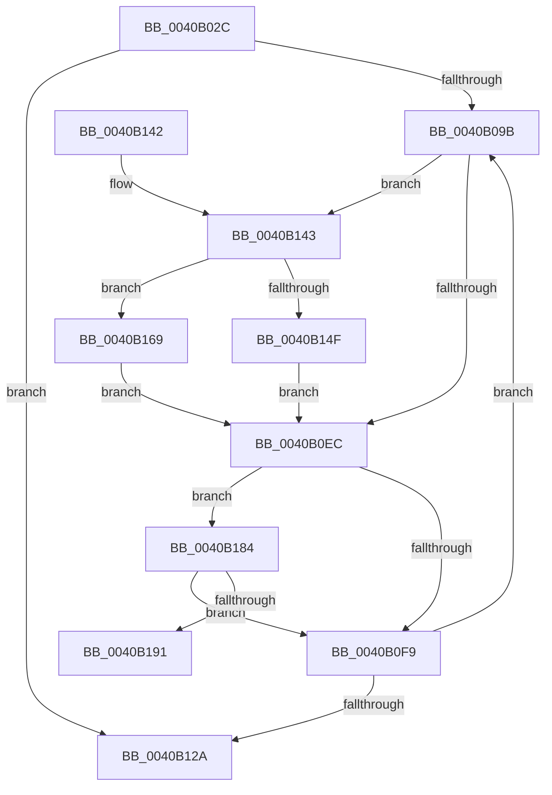

# PpmParkRecordNodeStatistics

- RVA: `0x0040B02C`–`0x0040B19E` (길이 `370` bytes)
- VA: `0x000000014040B02C`
- 실행 섹션: `.text`
- PDB 이름 있음: `예`; PDB Function 태그: `예`
- unwind 정보 RVA: `0x0009ADC8`
- 디코드: `85`개 명령, `370/370` bytes 표시
- 미해석 바이트: `0` (있으면 어셈블리에 `.byte`로 보존)

> 이 문서는 커널 이미지의 기계어와 PDB 기호를 분석해 생성했습니다. 4번과 5번은 함수 원형과 자료형을 바이너리 사용 방식에서 추정한 C 해석이며 원본 소스 복구 결과는 아닙니다.

## 1. Dependencies

- 직접 호출 지점: **5**; 고유 호출 대상: **5**
- 직접 호출자로 확인된 함수: **1**
- RIP 상대 이미지 참조: **5**

### Outgoing calls
- `0x0040B0E3` → [PpmParkComputeSnapStatistics](PpmParkComputeSnapStatistics_function_0040B480.md) (function, `0x0040B480`)
- `0x0040B0FC` → [PpmPerfRecordMostActiveWorkloadClass](PpmPerfRecordMostActiveWorkloadClass_function_0040B1A4.md) (function, `0x0040B1A4`)
- `0x0040B143` → [Feature_PpmParkEx__private_IsEnabledDeviceUsageNoInline](../4F/Feature_PpmParkEx__private_IsEnabledDeviceUsageNoInline_function_004F135C.md) (function, `0x004F135C`)
- `0x0040B162` → [PpmEventParkNodeRecordedStatsEx](../4E/PpmEventParkNodeRecordedStatsEx_function_004EF378.md) (function, `0x004EF378`)
- `0x0040B17A` → [PpmEventParkNodeRecordedStats](../45/PpmEventParkNodeRecordedStats_function_0045AD74.md) (function, `0x0045AD74`)

### Direct callers
- [PpmCheckRecordAllUtility](PpmCheckRecordAllUtility_function_0040A720.md) at `0x0040A7FC`

### Static image references
- `0x0040B044` → RVA `0x00E08380` (`.data`; read)
- `0x0040B04E` → RVA `0x00F0CE0C` (`.data`; read)
- `0x0040B059` → RVA `0x00F0B27C` (`.data`; read)
- `0x0040B067` → RVA `0x00F083E0` (`.data`; read)
- `0x0040B0AE` → RVA `0x00F083D8` (`.data`; read)

## 2. Other-region calls and transfers

- 다른 실행 섹션으로 향하는 call: **0**
- call이 아닌 외부 분기/꼬리 이동: **1**
  - `0x0040B199` → [sub_006EC724](../6E/Unknown_function_006EC724.md) (`tail-transfer`)

## 3. Assembly (complete function range)

```asm
0040B02C  48 89 5C 24 20                  mov qword ptr [rsp + 0x20], rbx
0040B031  89 4C 24 08                     mov dword ptr [rsp + 8], ecx
0040B035  55                              push rbp
0040B036  56                              push rsi
0040B037  57                              push rdi
0040B038  41 54                           push r12
0040B03A  41 55                           push r13
0040B03C  41 56                           push r14
0040B03E  41 57                           push r15
0040B040  48 83 EC 40                     sub rsp, 0x40
0040B044  48 8B 15 35 D3 9F 00            mov rdx, qword ptr [rip + 0x9fd335]
0040B04B  45 33 FF                        xor r15d, r15d
0040B04E  48 63 05 B7 1D B0 00            movsxd rax, dword ptr [rip + 0xb01db7]
0040B055  41 0F B7 F7                     movzx esi, r15w
0040B059  44 8B 2D 1C 02 B0 00            mov r13d, dword ptr [rip + 0xb0021c]
0040B060  48 69 C8 E8 01 00 00            imul rcx, rax, 0x1e8
0040B067  44 39 3D 72 D3 AF 00            cmp dword ptr [rip + 0xafd372], r15d
0040B06E  66 44 89 BC 24 90 00 00 00      mov word ptr [rsp + 0x90], r15w
0040B077  44 8A 94 11 B5 00 00 00         mov r10b, byte ptr [rcx + rdx + 0xb5]
0040B07F  8A 8C 11 B7 00 00 00            mov cl, byte ptr [rcx + rdx + 0xb7]
0040B086  88 8C 24 88 00 00 00            mov byte ptr [rsp + 0x88], cl
0040B08D  44 88 94 24 80 00 00 00         mov byte ptr [rsp + 0x80], r10b
0040B095  0F 86 8F 00 00 00               jbe 0x14040b12a
0040B09B  0F B7 C6                        movzx eax, si
0040B09E  44 8A C1                        mov r8b, cl
0040B0A1  48 69 D8 10 05 00 00            imul rbx, rax, 0x510
0040B0A8  41 8A D2                        mov dl, r10b
0040B0AB  41 8B CD                        mov ecx, r13d
0040B0AE  48 03 1D 23 D3 AF 00            add rbx, qword ptr [rip + 0xafd323]
0040B0B5  48 8D 83 9A 04 00 00            lea rax, [rbx + 0x49a]
0040B0BC  48 8D BB 9C 04 00 00            lea rdi, [rbx + 0x49c]
0040B0C3  48 89 7C 24 30                  mov qword ptr [rsp + 0x30], rdi
0040B0C8  48 8D AB 58 04 00 00            lea rbp, [rbx + 0x458]
0040B0CF  48 89 44 24 28                  mov qword ptr [rsp + 0x28], rax
0040B0D4  4C 8D B3 98 04 00 00            lea r14, [rbx + 0x498]
0040B0DB  4C 8B CD                        mov r9, rbp
0040B0DE  4C 89 74 24 20                  mov qword ptr [rsp + 0x20], r14
0040B0E3  E8 98 03 00 00                  call 0x14040b480
0040B0E8  84 C0                           test al, al
0040B0EA  75 57                           jne 0x14040b143
0040B0EC  44 38 BB A1 04 00 00            cmp byte ptr [rbx + 0x4a1], r15b
0040B0F3  0F 85 8B 00 00 00               jne 0x14040b184
0040B0F9  48 8B CB                        mov rcx, rbx
0040B0FC  E8 A3 00 00 00                  call 0x14040b1a4
0040B101  44 8A 94 24 80 00 00 00         mov r10b, byte ptr [rsp + 0x80]
0040B109  66 FF C6                        inc si
0040B10C  8A 8C 24 88 00 00 00            mov cl, byte ptr [rsp + 0x88]
0040B113  0F B7 C6                        movzx eax, si
0040B116  3B 05 C4 D2 AF 00               cmp eax, dword ptr [rip + 0xafd2c4]
0040B11C  66 89 B4 24 90 00 00 00         mov word ptr [rsp + 0x90], si
0040B124  0F 82 71 FF FF FF               jb 0x14040b09b
0040B12A  48 8B 9C 24 98 00 00 00         mov rbx, qword ptr [rsp + 0x98]
0040B132  48 83 C4 40                     add rsp, 0x40
0040B136  41 5F                           pop r15
0040B138  41 5E                           pop r14
0040B13A  41 5D                           pop r13
0040B13C  41 5C                           pop r12
0040B13E  5F                              pop rdi
0040B13F  5E                              pop rsi
0040B140  5D                              pop rbp
0040B141  C3                              ret
0040B142  CC                              int3
0040B143  E8 14 62 0E 00                  call 0x1404f135c
0040B148  4C 8B CD                        mov r9, rbp
0040B14B  85 C0                           test eax, eax
0040B14D  74 1A                           je 0x14040b169
0040B14F  0F B7 07                        movzx eax, word ptr [rdi]
0040B152  48 8D 53 30                     lea rdx, [rbx + 0x30]
0040B156  45 0F B7 06                     movzx r8d, word ptr [r14]
0040B15A  0F B7 CE                        movzx ecx, si
0040B15D  66 89 44 24 20                  mov word ptr [rsp + 0x20], ax
0040B162  E8 11 42 0E 00                  call 0x1404ef378
0040B167  EB 83                           jmp 0x14040b0ec
0040B169  8A 07                           mov al, byte ptr [rdi]
0040B16B  45 8A 06                        mov r8b, byte ptr [r14]
0040B16E  48 8B 53 10                     mov rdx, qword ptr [rbx + 0x10]
0040B172  0F B7 4B 04                     movzx ecx, word ptr [rbx + 4]
0040B176  88 44 24 20                     mov byte ptr [rsp + 0x20], al
0040B17A  E8 F5 FB 04 00                  call 0x14045ad74
0040B17F  E9 68 FF FF FF                  jmp 0x14040b0ec
0040B184  41 8A FF                        mov dil, r15b
0040B187  44 38 7B 0C                     cmp byte ptr [rbx + 0xc], r15b
0040B18B  0F 86 68 FF FF FF               jbe 0x14040b0f9
0040B191  40 8A B4 24 80 00 00 00         mov sil, byte ptr [rsp + 0x80]
0040B199  E9 86 15 2E 00                  jmp 0x1406ec724
```

## 4. C-style interpretation (structured pseudocode)

```c
__int64 __fastcall PpmParkRecordNodeStatistics(int a1)
{
    __int64 result;
    __int64 v_r15;
    __int64 v_rbx;
    __int64 v_rsi;
    __int64 v_rsp;
    unsigned __int64 v_stack_m48;
    unsigned __int64 v_stack_m50;
    unsigned __int64 v_stack_m58;
    unsigned __int8 v_stack_p10;
    unsigned __int16 v_stack_p18;
    unsigned __int64 v_stack_p20;
    unsigned int v_stack_p8;
    unsigned __int8 v_stack_p80;

    v_stack_p20 = v_rbx;
    v_stack_p8 = a1;
    v_rsp = (v_rsp) - (64);
    v_r15 = 0;
    a1 = (a1) * ((int)(*(unsigned int *)(v_rip + 11541943)));
    v_stack_p18 = 0;
    v_stack_p10 = (unsigned __int8)(*(unsigned __int8 *)(a1 + *(unsigned __int64 *)(v_rip + 10474293) * 1 + 183));
    v_stack_p8 = (unsigned __int8)(*(unsigned __int8 *)(a1 + *(unsigned __int64 *)(v_rip + 10474293) * 1 + 181));
    if ((*(unsigned int *)(v_rip + 11522930)) <= 0) goto loc_0040B12A;
loc_0040B09B:
    v_rbx = (v_rbx) * (0);
    v_rbx = (v_rbx) + (*(unsigned __int64 *)(v_rip + 11522851));
    v_stack_m48 = v_rbx + 1180;
    v_stack_m50 = v_rbx + 1178;
    v_stack_m58 = v_rbx + 1176;
    result = PpmParkComputeSnapStatistics((unsigned int)((unsigned int)((unsigned int)(*(unsigned int *)(v_rip + 11534876)))), (unsigned __int8)(*(unsigned __int8 *)(a1 + *(unsigned __int64 *)(v_rip + 10474293) * 1 + 181)), (unsigned __int8)(*(unsigned __int8 *)(a1 + *(unsigned __int64 *)(v_rip + 10474293) * 1 + 183)), v_rbx + 1112);
    if ((unsigned __int8)(result) != 0) goto loc_0040B143;
loc_0040B0EC:
    if ((*(unsigned __int8 *)(v_rbx + 1185)) != 0) goto loc_0040B184;
loc_0040B0F9:
    result = PpmPerfRecordMostActiveWorkloadClass(v_rbx, (unsigned __int8)(*(unsigned __int8 *)(a1 + *(unsigned __int64 *)(v_rip + 10474293) * 1 + 181)), (unsigned __int8)(*(unsigned __int8 *)(a1 + *(unsigned __int64 *)(v_rip + 10474293) * 1 + 183)), v_rbx + 1112);
    v_rsi = (unsigned __int16)((0) + 1);
    v_stack_p18 = (unsigned __int16)(v_rsi);
    if (((unsigned int)((unsigned __int16)(v_rsi))) < (*(unsigned int *)(v_rip + 11522756))) goto loc_0040B09B;
loc_0040B12A:
    v_rsp = (v_rsp) + (64);
    return (unsigned __int16)(v_rsi);
loc_0040B143:
    result = Feature_PpmParkEx__private_IsEnabledDeviceUsageNoInline(v_stack_p10, (unsigned __int8)(*(unsigned __int8 *)(a1 + *(unsigned __int64 *)(v_rip + 10474293) * 1 + 181)), (unsigned __int8)(*(unsigned __int8 *)(a1 + *(unsigned __int64 *)(v_rip + 10474293) * 1 + 183)), v_rbx + 1112);
    if ((unsigned int)(result) == 0) goto loc_0040B169;
    v_stack_p20 = (unsigned __int16)(*(unsigned __int16 *)(v_rbx + 1180));
    result = PpmEventParkNodeRecordedStatsEx((unsigned __int16)(v_rsi), v_stack_p20 + 48, *(unsigned __int16 *)(v_rbx + 1176), v_rbx + 1112);
    goto loc_0040B0EC;
loc_0040B169:
    v_stack_p20 = (unsigned __int8)(*(unsigned __int8 *)(v_rbx + 1180));
    result = PpmEventParkNodeRecordedStats(*(unsigned __int16 *)(v_stack_p20 + 4), *(unsigned __int64 *)(v_stack_p20 + 16), *(unsigned __int8 *)(v_rbx + 1176), v_rbx + 1112);
    goto loc_0040B0EC;
loc_0040B184:
    if ((*(unsigned __int8 *)(v_stack_p20 + 12)) <= 0) goto loc_0040B0F9;
}
```

## 5. (Beta) C Style

```c
int64_t PpmParkRecordNodeStatistics(void *Arg1)
{
    uint8_t *arg1 = (uint8_t *)Arg1;

    int64_t result;
    int64_t local_r15;
    int64_t local_rbx;
    int64_t local_rsi;
    int64_t local_rsp;
    uint64_t v_stack_m48;
    uint64_t v_stack_m50;
    uint64_t v_stack_m58;
    uint8_t v_stack_p10;
    uint16_t v_stack_p18;
    uint64_t v_stack_p20;
    uint32_t v_stack_p8;
    uint8_t v_stack_p80;

    v_stack_p20 = local_rbx;
    v_stack_p8 = Arg1;
    local_rsp = (local_rsp) - (64);
    local_r15 = 0;
    Arg1 = (Arg1) * ((int32_t)(*(uint32_t *)(v_rip + 0xB01DB7)));
    v_stack_p18 = 0;
    v_stack_p10 = (uint8_t)(*(uint8_t *)(arg1 + *(uint64_t *)(v_rip + 0x9FD335) * 1 + 0xB7));
    v_stack_p8 = (uint8_t)(*(uint8_t *)(arg1 + *(uint64_t *)(v_rip + 0x9FD335) * 1 + 0xB5));
    if ((*(uint32_t *)(v_rip + 0xAFD372)) <= 0) goto loc_0040B12A;
loc_0040B09B:
    local_rbx = (local_rbx) * (0);
    local_rbx = (local_rbx) + (*(uint64_t *)(v_rip + 0xAFD323));
    v_stack_m48 = local_rbx + 1180;
    v_stack_m50 = local_rbx + 1178;
    v_stack_m58 = local_rbx + 1176;
    result = PpmParkComputeSnapStatistics((uint32_t)((uint32_t)((uint32_t)(*(uint32_t *)(v_rip + 0xB0021C)))), (uint8_t)(*(uint8_t *)(arg1 + *(uint64_t *)(v_rip + 0x9FD335) * 1 + 0xB5)), (uint8_t)(*(uint8_t *)(arg1 + *(uint64_t *)(v_rip + 0x9FD335) * 1 + 0xB7)), local_rbx + 1112);
    if ((uint8_t)(result) != 0) goto loc_0040B143;
loc_0040B0EC:
    if ((*(uint8_t *)(local_rbx + 0x4A1)) != 0) goto loc_0040B184;
loc_0040B0F9:
    result = PpmPerfRecordMostActiveWorkloadClass(local_rbx, (uint8_t)(*(uint8_t *)(arg1 + *(uint64_t *)(v_rip + 0x9FD335) * 1 + 0xB5)), (uint8_t)(*(uint8_t *)(arg1 + *(uint64_t *)(v_rip + 0x9FD335) * 1 + 0xB7)), local_rbx + 1112);
    local_rsi = (uint16_t)((0) + 1);
    v_stack_p18 = (uint16_t)(local_rsi);
    if (((uint32_t)((uint16_t)(local_rsi))) < (*(uint32_t *)(v_rip + 0xAFD2C4))) goto loc_0040B09B;
loc_0040B12A:
    local_rsp = (local_rsp) + (64);
    return (uint16_t)(local_rsi);
loc_0040B143:
    result = Feature_PpmParkEx__private_IsEnabledDeviceUsageNoInline(v_stack_p10, (uint8_t)(*(uint8_t *)(arg1 + *(uint64_t *)(v_rip + 0x9FD335) * 1 + 0xB5)), (uint8_t)(*(uint8_t *)(arg1 + *(uint64_t *)(v_rip + 0x9FD335) * 1 + 0xB7)), local_rbx + 1112);
    if ((uint32_t)(result) == 0) goto loc_0040B169;
    v_stack_p20 = (uint16_t)(*(uint16_t *)(local_rbx + 0x49C));
    result = PpmEventParkNodeRecordedStatsEx((uint16_t)(local_rsi), v_stack_p20 + 48, *(uint16_t *)(local_rbx + 0x498), local_rbx + 1112);
    goto loc_0040B0EC;
loc_0040B169:
    v_stack_p20 = (uint8_t)(*(uint8_t *)(local_rbx + 0x49C));
    result = PpmEventParkNodeRecordedStats(*(uint16_t *)(v_stack_p20 + 0x4), *(uint64_t *)(v_stack_p20 + 0x10), *(uint8_t *)(local_rbx + 0x498), local_rbx + 1112);
    goto loc_0040B0EC;
loc_0040B184:
    if ((*(uint8_t *)(v_stack_p20 + 0xC)) <= 0) goto loc_0040B0F9;
}
```

### 관측된 메모리 오프셋

구조체 형식이 확인되지 않은 접근은 인자 기준의 오프셋으로만 기록했습니다.

| 기준 인자 | 오프셋 표현 | 폭 (bit) | 접근 |
|---|---:|---:|---|
| `Arg1` | `+ 0xB5 + rdx*1` | `8` | `R` |
| `Arg1` | `+ 0xB7 + rdx*1` | `8` | `R` |

## 6. Execution-region graph

[열기: 2D/3D 그래프와 함수 탐색 컨트롤 패널](../../../control-panel.html?section=text&rva=0x0040B02C&view=graph)

- 2D 그래프는 위에서 아래로 흐르고, 3D 그래프는 빈 공간을 드래그해 회전합니다. Shift+드래그는 이동, 휠은 확대·축소, 함수 노드 선택은 대상 보고서 이동입니다.

### Static fallback


