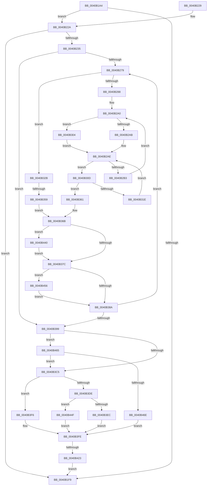

# PpmPerfRecordMostActiveWorkloadClass

- RVA: `0x0040B1A4`–`0x0040B474` (길이 `720` bytes)
- VA: `0x000000014040B1A4`
- 실행 섹션: `.text`
- PDB 이름 있음: `예`; PDB Function 태그: `예`
- unwind 정보 RVA: `0x0009ADF4`
- 디코드: `182`개 명령, `720/720` bytes 표시
- 미해석 바이트: `0` (있으면 어셈블리에 `.byte`로 보존)

> 이 문서는 커널 이미지의 기계어와 PDB 기호를 분석해 생성했습니다. 4번과 5번은 함수 원형과 자료형을 바이너리 사용 방식에서 추정한 C 해석이며 원본 소스 복구 결과는 아닙니다.

## 1. Dependencies

- 직접 호출 지점: **9**; 고유 호출 대상: **7**
- 직접 호출자로 확인된 함수: **1**
- RIP 상대 이미지 참조: **5**

### Outgoing calls
- `0x0040B203` → [_security_check_cookie](../6A/_security_check_cookie_function_006AC640.md) (function, `0x006AC640`)
- `0x0040B25C` → [memset](../6C/memset_function_006C6C40.md) (function, `0x006C6C40`)
- `0x0040B26A` → [memset](../6C/memset_function_006C6C40.md) (function, `0x006C6C40`)
- `0x0040B279` → [Feature_PpmParkEx__private_IsEnabledDeviceUsageNoInline](../4F/Feature_PpmParkEx__private_IsEnabledDeviceUsageNoInline_function_004F135C.md) (function, `0x004F135C`)
- `0x0040B2D8` → [KeGetPrcb](../2D/KeGetPrcb_function_002D85D0.md) (function, `0x002D85D0`)
- `0x0040B34C` → [KeEnumerateNextProcessor](../41/KeEnumerateNextProcessor_function_00415480.md) (function, `0x00415480`)
- `0x0040B3B7` → [Feature_NewWpsAssignmentAlgorithm__private_IsEnabledPreCheck](Feature_NewWpsAssignmentAlgorithm__private_IsEnabledPreCheck_function_0040B634.md) (function, `0x0040B634`)
- `0x0040B416` → [Feature_PpmParkEx__private_IsEnabledDeviceUsageNoInline](../4F/Feature_PpmParkEx__private_IsEnabledDeviceUsageNoInline_function_004F135C.md) (function, `0x004F135C`)
- `0x0040B436` → [PpmEventHgsActiveWorkloadClassEx](../4F/PpmEventHgsActiveWorkloadClassEx_function_004F3BB0.md) (function, `0x004F3BB0`)

### Direct callers
- [PpmParkRecordNodeStatistics](PpmParkRecordNodeStatistics_function_0040B02C.md) at `0x0040B0FC`

### Static image references
- `0x0040B1CA` → RVA `0x00E0A740` (`.data`; read)
- `0x0040B1E0` → RVA `0x00FC6A86` (`ALMOSTRO`; read)
- `0x0040B22A` → RVA `0x00E0B804` (`.data`; read)
- `0x0040B2CA` → RVA `0x00F231B8` (`.data`; read)
- `0x0040B3C5` → RVA `0x00FC526C` (`ALMOSTRO`; read)

## 2. Other-region calls and transfers

- 다른 실행 섹션으로 향하는 call: **0**
- call이 아닌 외부 분기/꼬리 이동: **2**
  - `0x0040B353` → [sub_006EC7EE](../6E/Unknown_function_006EC7EE.md) (`tail-transfer`)
  - `0x0040B41D` → [sub_006EC7EE + 0x33](../6E/Unknown_function_006EC7EE.md) (`tail-transfer`)

## 3. Assembly (complete function range)

```asm
0040B1A4  48 8B C4                        mov rax, rsp
0040B1A7  48 89 58 10                     mov qword ptr [rax + 0x10], rbx
0040B1AB  48 89 70 18                     mov qword ptr [rax + 0x18], rsi
0040B1AF  48 89 78 20                     mov qword ptr [rax + 0x20], rdi
0040B1B3  55                              push rbp
0040B1B4  41 54                           push r12
0040B1B6  41 55                           push r13
0040B1B8  41 56                           push r14
0040B1BA  41 57                           push r15
0040B1BC  48 8D A8 C8 FD FF FF            lea rbp, [rax - 0x238]
0040B1C3  48 81 EC 10 03 00 00            sub rsp, 0x310
0040B1CA  48 8B 05 6F F5 9F 00            mov rax, qword ptr [rip + 0x9ff56f]
0040B1D1  48 33 C4                        xor rax, rsp
0040B1D4  48 89 85 00 02 00 00            mov qword ptr [rbp + 0x200], rax
0040B1DB  33 C0                           xor eax, eax
0040B1DD  0F 57 C0                        xorps xmm0, xmm0
0040B1E0  38 05 A0 B8 BB 00               cmp byte ptr [rip + 0xbbb8a0], al
0040B1E6  48 8B F1                        mov rsi, rcx
0040B1E9  0F 11 44 24 58                  movups xmmword ptr [rsp + 0x58], xmm0
0040B1EE  48 89 44 24 68                  mov qword ptr [rsp + 0x68], rax
0040B1F3  89 44 24 48                     mov dword ptr [rsp + 0x48], eax
0040B1F7  75 31                           jne 0x14040b22a
0040B1F9  48 8B 8D 00 02 00 00            mov rcx, qword ptr [rbp + 0x200]
0040B200  48 33 CC                        xor rcx, rsp
0040B203  E8 38 14 2A 00                  call 0x1406ac640
0040B208  4C 8D 9C 24 10 03 00 00         lea r11, [rsp + 0x310]
0040B210  49 8B 5B 38                     mov rbx, qword ptr [r11 + 0x38]
0040B214  49 8B 73 40                     mov rsi, qword ptr [r11 + 0x40]
0040B218  49 8B 7B 48                     mov rdi, qword ptr [r11 + 0x48]
0040B21C  49 8B E3                        mov rsp, r11
0040B21F  41 5F                           pop r15
0040B221  41 5E                           pop r14
0040B223  41 5D                           pop r13
0040B225  41 5C                           pop r12
0040B227  5D                              pop rbp
0040B228  C3                              ret
0040B229  CC                              int3
0040B22A  8B 3D D4 05 A0 00               mov edi, dword ptr [rip + 0xa005d4]
0040B230  83 FF 20                        cmp edi, 0x20
0040B233  77 C4                           ja 0x14040b1f9
0040B235  41 B5 FF                        mov r13b, 0xff
0040B238  48 8D 8D 00 01 00 00            lea rcx, [rbp + 0x100]
0040B23F  BB 00 01 00 00                  mov ebx, 0x100
0040B244  44 88 6C 24 40                  mov byte ptr [rsp + 0x40], r13b
0040B249  44 8B C3                        mov r8d, ebx
0040B24C  44 88 6C 24 41                  mov byte ptr [rsp + 0x41], r13b
0040B251  33 D2                           xor edx, edx
0040B253  4C 8B F8                        mov r15, rax
0040B256  4C 8B E0                        mov r12, rax
0040B259  45 8A F5                        mov r14b, r13b
0040B25C  E8 DF B9 2B 00                  call 0x1406c6c40
0040B261  44 8B C3                        mov r8d, ebx
0040B264  48 8D 4D 00                     lea rcx, [rbp]
0040B268  33 D2                           xor edx, edx
0040B26A  E8 D1 B9 2B 00                  call 0x1406c6c40
0040B26F  33 DB                           xor ebx, ebx
0040B271  85 FF                           test edi, edi
0040B273  0F 84 20 01 00 00               je 0x14040b399
0040B279  E8 DE 60 0E 00                  call 0x1404f135c
0040B27E  33 D2                           xor edx, edx
0040B280  85 C0                           test eax, eax
0040B282  0F 84 A3 00 00 00               je 0x14040b32b
0040B288  48 8D 7E 30                     lea rdi, [rsi + 0x30]
0040B28C  66 89 54 24 68                  mov word ptr [rsp + 0x68], dx
0040B291  4C 8B 6F 08                     mov r13, qword ptr [rdi + 8]
0040B295  44 0F B7 74 24 68               movzx r14d, word ptr [rsp + 0x68]
0040B29B  48 89 7C 24 58                  mov qword ptr [rsp + 0x58], rdi
0040B2A0  41 B8 01 00 00 00               mov r8d, 1
0040B2A6  48 85 FF                        test rdi, rdi
0040B2A9  74 59                           je 0x14040b304
0040B2AB  0F B7 0F                        movzx ecx, word ptr [rdi]
0040B2AE  4D 85 ED                        test r13, r13
0040B2B1  74 5A                           je 0x14040b30d
0040B2B3  49 0F BC D5                     bsf rdx, r13
0040B2B7  41 0F B7 CE                     movzx ecx, r14w
0040B2BB  0F B6 C2                        movzx eax, dl
0040B2BE  49 0F B3 C5                     btr r13, rax
0040B2C2  C1 E1 06                        shl ecx, 6
0040B2C5  0F B6 C2                        movzx eax, dl
0040B2C8  03 C8                           add ecx, eax
0040B2CA  48 8B 05 E7 7E B1 00            mov rax, qword ptr [rip + 0xb17ee7]
0040B2D1  8B 0C 88                        mov ecx, dword ptr [rax + rcx*4]
0040B2D4  89 4C 24 48                     mov dword ptr [rsp + 0x48], ecx
0040B2D8  E8 F3 D2 EC FF                  call 0x1402d85d0
0040B2DD  48 8B 90 58 8A 00 00            mov rdx, qword ptr [rax + 0x8a58]
0040B2E4  48 8B 80 60 8A 00 00            mov rax, qword ptr [rax + 0x8a60]
0040B2EB  48 8B 4C D8 08                  mov rcx, qword ptr [rax + rbx*8 + 8]
0040B2F0  48 01 8C DD 00 01 00 00         add qword ptr [rbp + rbx*8 + 0x100], rcx
0040B2F8  48 8B 44 DA 08                  mov rax, qword ptr [rdx + rbx*8 + 8]
0040B2FD  48 01 44 DD 00                  add qword ptr [rbp + rbx*8], rax
0040B302  EB 9C                           jmp 0x14040b2a0
0040B304  41 0F B7 CE                     movzx ecx, r14w
0040B308  41 03 C8                        add ecx, r8d
0040B30B  EB A1                           jmp 0x14040b2ae
0040B30D  66 45 03 F0                     add r14w, r8w
0040B311  41 0F B7 C6                     movzx eax, r14w
0040B315  66 89 44 24 68                  mov word ptr [rsp + 0x68], ax
0040B31A  3B C1                           cmp eax, ecx
0040B31C  73 43                           jae 0x14040b361
0040B31E  4C 8B 6C C7 08                  mov r13, qword ptr [rdi + rax*8 + 8]
0040B323  44 0F B7 74 24 68               movzx r14d, word ptr [rsp + 0x68]
0040B329  EB 83                           jmp 0x14040b2ae
0040B32B  0F B7 46 04                     movzx eax, word ptr [rsi + 4]
0040B32F  66 89 44 24 68                  mov word ptr [rsp + 0x68], ax
0040B334  48 8B 46 10                     mov rax, qword ptr [rsi + 0x10]
0040B338  48 89 44 24 60                  mov qword ptr [rsp + 0x60], rax
0040B33D  48 89 54 24 58                  mov qword ptr [rsp + 0x58], rdx
0040B342  48 8D 54 24 58                  lea rdx, [rsp + 0x58]
0040B347  48 8D 4C 24 48                  lea rcx, [rsp + 0x48]
0040B34C  E8 2F A1 00 00                  call 0x140415480
0040B351  85 C0                           test eax, eax
0040B353  0F 84 95 14 2E 00               je 0x1406ec7ee
0040B359  41 B8 01 00 00 00               mov r8d, 1
0040B35F  EB 0A                           jmp 0x14040b36b
0040B361  44 8A 74 24 41                  mov r14b, byte ptr [rsp + 0x41]
0040B366  44 8A 6C 24 40                  mov r13b, byte ptr [rsp + 0x40]
0040B36B  48 8B 84 DD 00 01 00 00         mov rax, qword ptr [rbp + rbx*8 + 0x100]
0040B373  49 3B C7                        cmp rax, r15
0040B376  0F 87 C4 00 00 00               ja 0x14040b440
0040B37C  48 8B 44 DD 00                  mov rax, qword ptr [rbp + rbx*8]
0040B381  49 3B C4                        cmp rax, r12
0040B384  0F 87 CC 00 00 00               ja 0x14040b456
0040B38A  41 03 D8                        add ebx, r8d
0040B38D  3B 1D 71 04 A0 00               cmp ebx, dword ptr [rip + 0xa00471]
0040B393  0F 82 E0 FE FF FF               jb 0x14040b279
0040B399  41 0F B6 CD                     movzx ecx, r13b
0040B39D  45 33 ED                        xor r13d, r13d
0040B3A0  41 80 FE FF                     cmp r14b, 0xff
0040B3A4  41 0F B6 C6                     movzx eax, r14b
0040B3A8  41 8B DD                        mov ebx, r13d
0040B3AB  41 8B FD                        mov edi, r13d
0040B3AE  0F 45 D8                        cmovne ebx, eax
0040B3B1  80 F9 FF                        cmp cl, 0xff
0040B3B4  0F 45 F9                        cmovne edi, ecx
0040B3B7  E8 78 02 00 00                  call 0x14040b634
0040B3BC  4D 85 E4                        test r12, r12
0040B3BF  0F 84 A0 00 00 00               je 0x14040b465
0040B3C5  44 8B 05 A0 9E BB 00            mov r8d, dword ptr [rip + 0xbb9ea0]
0040B3CC  4B 8D 0C 27                     lea rcx, [r15 + r12]
0040B3D0  49 6B C4 64                     imul rax, r12, 0x64
0040B3D4  33 D2                           xor edx, edx
0040B3D6  48 F7 F1                        div rcx
0040B3D9  49 3B C0                        cmp rax, r8
0040B3DC  72 18                           jb 0x14040b3f6
0040B3DE  49 6B C7 64                     imul rax, r15, 0x64
0040B3E2  33 D2                           xor edx, edx
0040B3E4  48 F7 F1                        div rcx
0040B3E7  49 3B C0                        cmp rax, r8
0040B3EA  73 63                           jae 0x14040b44f
0040B3EC  40 8A FB                        mov dil, bl
0040B3EF  B8 01 00 00 00                  mov eax, 1
0040B3F4  EB 08                           jmp 0x14040b3fe
0040B3F6  40 8A DF                        mov bl, dil
0040B3F9  B8 02 00 00 00                  mov eax, 2
0040B3FE  4C 8D B6 F7 04 00 00            lea r14, [rsi + 0x4f7]
0040B405  89 44 24 48                     mov dword ptr [rsp + 0x48], eax
0040B409  41 88 1E                        mov byte ptr [r14], bl
0040B40C  48 8D 9E F6 04 00 00            lea rbx, [rsi + 0x4f6]
0040B413  40 88 3B                        mov byte ptr [rbx], dil
0040B416  E8 41 5F 0E 00                  call 0x1404f135c
0040B41B  85 C0                           test eax, eax
0040B41D  0F 84 FE 13 2E 00               je 0x1406ec821
0040B423  44 8B 4C 24 48                  mov r9d, dword ptr [rsp + 0x48]
0040B428  4C 8D 45 00                     lea r8, [rbp]
0040B42C  48 8D 95 00 01 00 00            lea rdx, [rbp + 0x100]
0040B433  48 8B CE                        mov rcx, rsi
0040B436  E8 75 87 0E 00                  call 0x1404f3bb0
0040B43B  E9 B9 FD FF FF                  jmp 0x14040b1f9
0040B440  4C 8B F8                        mov r15, rax
0040B443  88 5C 24 40                     mov byte ptr [rsp + 0x40], bl
0040B447  44 8A EB                        mov r13b, bl
0040B44A  E9 2D FF FF FF                  jmp 0x14040b37c
0040B44F  B8 04 00 00 00                  mov eax, 4
0040B454  EB A8                           jmp 0x14040b3fe
0040B456  4C 8B E0                        mov r12, rax
0040B459  88 5C 24 41                     mov byte ptr [rsp + 0x41], bl
0040B45D  44 8A F3                        mov r14b, bl
0040B460  E9 25 FF FF FF                  jmp 0x14040b38a
0040B465  4D 85 FF                        test r15, r15
0040B468  0F 85 57 FF FF FF               jne 0x14040b3c5
0040B46E  41 8D 47 08                     lea eax, [r15 + 8]
0040B472  EB 8A                           jmp 0x14040b3fe
```

## 4. C-style interpretation (structured pseudocode)

```c
__int64 __fastcall PpmPerfRecordMostActiveWorkloadClass(__int64 a1, int a2)
{
    __int64 result;
    __int64 v_r13;
    __int64 v_r14;
    __int64 v_rbx;
    __int64 v_rdi;
    __int64 v_rsp;
    unsigned __int64 v_stack_m28;
    unsigned __int16 v_stack_m2A8;
    unsigned __int64 v_stack_m2B0;
    unsigned __int64 v_stack_m2B8;
    unsigned int v_stack_m2C8;
    unsigned __int8 v_stack_m2CF;
    unsigned __int64 v_stack_m2D0;
    unsigned __int64 v_stack_m2E0;
    unsigned int v_stack_m2F0;

    *(unsigned __int64 *)(v_rsp + 16) = v_rbx;
    *(unsigned __int64 *)(v_rsp + 24) = v_rsi;
    *(unsigned __int64 *)(v_rsp + 32) = v_rdi;
    v_rsp = (v_rsp) - (784);
    result = (*(unsigned __int64 *)(v_rip + 10483055)) ^ (v_rsp);
    *(unsigned __int64 *)(v_rsp - 568 + 512) = result;
    result = 0;
    v_stack_m2E0 = v_xmm0;
    v_stack_m2D0 = 0;
    v_stack_m2F0 = 0;
    if ((*(unsigned __int8 *)(v_rip + 12302496)) != 0) goto loc_0040B22A;
loc_0040B1F9:
    a1 = (*(unsigned __int64 *)(v_rsp - 568 + 512)) ^ (v_rsp);
    result = _security_check_cookie(a1, a2, a3, a4);
    return result;
loc_0040B22A:
    if (((unsigned int)((unsigned int)(*(unsigned int *)(v_rip + 10487252)))) > 32) goto loc_0040B1F9;
    v_stack_m2D0 = 255;
    v_stack_m2CF = 255;
    a2 = 0;
    result = memset(v_rsp - 568 + 256, a2, 256, a4);
    a2 = 0;
    result = memset(v_rsp - 568, a2, 256, a4);
    v_rbx = 0;
    if ((unsigned int)((unsigned int)(*(unsigned int *)(v_rip + 10487252))) == 0) goto loc_0040B399;
loc_0040B279:
    result = Feature_PpmParkEx__private_IsEnabledDeviceUsageNoInline(v_rsp - 568, a2, 256, a4);
    a2 = 0;
    if ((unsigned int)(result) == 0) goto loc_0040B32B;
    v_stack_m2A8 = 0;
    v_stack_m2B8 = *(unsigned __int64 *)(v_stack_m28 + 64) + 48;
loc_0040B2A0:
    if (*(unsigned __int64 *)(v_stack_m28 + 64) + 48 == 0) goto loc_0040B304;
loc_0040B2AE:
    if (*(unsigned __int64 *)(*(unsigned __int64 *)(v_stack_m28 + 64) + 48 + 8) == 0) goto loc_0040B30D;
    a1 = (unsigned int)(((unsigned __int16)(v_stack_m2A8)) << (6));
    a1 = (unsigned int)((a1) + (0));
    v_stack_m2C8 = (unsigned int)((unsigned int)(*(unsigned int *)(*(unsigned __int64 *)(v_rip + 11632359) + a1 * 4)));
    result = KeGetPrcb((unsigned int)(*(unsigned int *)(*(unsigned __int64 *)(v_rip + 11632359) + a1 * 4)), a2, 1, a4);
    goto loc_0040B2A0;
loc_0040B304:
    a1 = (unsigned int)(((unsigned __int16)(v_stack_m2A8)) + (1));
    goto loc_0040B2AE;
loc_0040B30D:
    v_r14 = (unsigned __int16)((v_stack_m2A8) + (1));
    v_stack_m2A8 = (unsigned __int16)((unsigned __int16)(v_r14));
    if (((unsigned int)((unsigned __int16)(v_r14))) >= ((unsigned int)(a1))) goto loc_0040B361;
    goto loc_0040B2AE;
loc_0040B32B:
    v_stack_m2A8 = (unsigned __int16)(*(unsigned __int16 *)(*(unsigned __int64 *)(v_stack_m28 + 64) + 4));
    v_stack_m2B0 = *(unsigned __int64 *)(*(unsigned __int64 *)(v_stack_m28 + 64) + 16);
    v_stack_m2B8 = *(unsigned __int64 *)(result + 35416);
    result = KeEnumerateNextProcessor(v_stack_m2C8, v_stack_m2B8, 1, a4);
    goto loc_0040B36B;
loc_0040B361:
loc_0040B36B:
    if ((*(unsigned __int64 *)(v_rsp - 568 + v_rbx * 8 + 256)) > result) goto loc_0040B440;
loc_0040B37C:
    if ((*(unsigned __int64 *)(v_rsp - 568 + v_rbx * 8)) > result) goto loc_0040B456;
loc_0040B38A:
    v_rbx = (unsigned int)((v_rbx) + (1));
    if (((unsigned int)(v_rbx)) < (*(unsigned int *)(v_rip + 10486897))) goto loc_0040B279;
loc_0040B399:
    v_r13 = 0;
    v_rbx = 0;
    if (((unsigned __int8)(v_stack_m2CF)) != 255) { v_rbx = (unsigned int)((unsigned __int8)(v_stack_m2CF)); }
    v_rdi = 0;
    if (((unsigned __int8)((unsigned __int8)(v_stack_m2D0))) != 255) { v_rdi = (unsigned int)((unsigned __int8)(v_stack_m2D0)); }
    result = Feature_NewWpsAssignmentAlgorithm__private_IsEnabledPreCheck((unsigned __int8)(v_stack_m2D0), v_stack_m2B8, 1, a4);
    if (result == 0) goto loc_0040B465;
loc_0040B3C5:
    result = (result) * (result);
    a2 = 0;
    if (result < ((unsigned int)(*(unsigned int *)(v_rip + 12295840)))) goto loc_0040B3F6;
    result = (result) * (result);
    a2 = 0;
    if (result >= ((unsigned int)(*(unsigned int *)(v_rip + 12295840)))) goto loc_0040B44F;
    goto loc_0040B3FE;
loc_0040B3F6:
loc_0040B3FE:
    v_stack_m2C8 = 2;
    *(unsigned __int8 *)(*(unsigned __int64 *)(v_stack_m28 + 64) + 1271) = (unsigned __int8)((unsigned __int8)((unsigned __int8)(v_rbx)));
    *(unsigned __int8 *)(*(unsigned __int64 *)(v_stack_m28 + 64) + 1270) = (unsigned __int8)((unsigned __int8)(v_rbx));
    result = Feature_PpmParkEx__private_IsEnabledDeviceUsageNoInline(result + result * 1, a2, (unsigned int)(*(unsigned int *)(v_rip + 12295840)), a4);
    result = PpmEventHgsActiveWorkloadClassEx(*(unsigned __int64 *)(v_stack_m28 + 64), v_rsp - 568 + 256, v_rsp - 568, (unsigned int)(v_stack_m2C8));
    goto loc_0040B1F9;
loc_0040B440:
    v_stack_m2D0 = (unsigned __int8)(*(unsigned __int64 *)(v_stack_m28 + 64) + 1270);
    goto loc_0040B37C;
loc_0040B44F:
    goto loc_0040B3FE;
loc_0040B456:
    v_stack_m2CF = (unsigned __int8)(*(unsigned __int64 *)(v_stack_m28 + 64) + 1270);
    goto loc_0040B38A;
loc_0040B465:
    if (result != 0) goto loc_0040B3C5;
    goto loc_0040B3FE;
}
```

## 5. (Beta) C Style

```c
int64_t PpmPerfRecordMostActiveWorkloadClass(void *Arg1, int32_t Arg2)
{
    uint8_t *arg1 = (uint8_t *)Arg1;

    int64_t result;
    int64_t local_r13;
    int64_t local_r14;
    int64_t local_rbx;
    int64_t local_rdi;
    int64_t local_rsp;
    uint64_t v_stack_m28;
    uint16_t v_stack_m2A8;
    uint64_t v_stack_m2B0;
    uint64_t v_stack_m2B8;
    uint32_t v_stack_m2C8;
    uint8_t v_stack_m2CF;
    uint64_t v_stack_m2D0;
    uint64_t v_stack_m2E0;
    uint32_t v_stack_m2F0;

    *(uint64_t *)(local_rsp + 0x10) = local_rbx;
    *(uint64_t *)(local_rsp + 0x18) = local_rsi;
    *(uint64_t *)(local_rsp + 0x20) = local_rdi;
    local_rsp = (local_rsp) - (784);
    result = (*(uint64_t *)(v_rip + 0x9FF56F)) ^ (local_rsp);
    *(uint64_t *)(local_rsp - 0x238 + 0x200) = result;
    result = 0;
    v_stack_m2E0 = v_xmm0;
    v_stack_m2D0 = 0;
    v_stack_m2F0 = 0;
    if ((*(uint8_t *)(v_rip + 0xBBB8A0)) != 0) goto loc_0040B22A;
loc_0040B1F9:
    Arg1 = (*(uint64_t *)(local_rsp - 0x238 + 0x200)) ^ (local_rsp);
    result = _security_check_cookie(Arg1, Arg2, a3, a4);
    return result;
loc_0040B22A:
    if (((uint32_t)((uint32_t)(*(uint32_t *)(v_rip + 0xA005D4)))) > 32) goto loc_0040B1F9;
    v_stack_m2D0 = 255;
    v_stack_m2CF = 255;
    Arg2 = 0;
    result = memset(local_rsp - 568 + 256, Arg2, 256, a4);
    Arg2 = 0;
    result = memset(local_rsp - 568, Arg2, 256, a4);
    local_rbx = 0;
    if ((uint32_t)((uint32_t)(*(uint32_t *)(v_rip + 0xA005D4))) == 0) goto loc_0040B399;
loc_0040B279:
    result = Feature_PpmParkEx__private_IsEnabledDeviceUsageNoInline(local_rsp - 568, Arg2, 256, a4);
    Arg2 = 0;
    if ((uint32_t)(result) == 0) goto loc_0040B32B;
    v_stack_m2A8 = 0;
    v_stack_m2B8 = *(uint64_t *)(v_stack_m28 + 0x40) + 48;
loc_0040B2A0:
    if (*(uint64_t *)(v_stack_m28 + 0x40) + 48 == 0) goto loc_0040B304;
loc_0040B2AE:
    if (*(uint64_t *)(*(uint64_t *)(v_stack_m28 + 0x40) + 0x30 + 0x8) == 0) goto loc_0040B30D;
    Arg1 = (uint32_t)(((uint16_t)(v_stack_m2A8)) << (6));
    Arg1 = (uint32_t)((Arg1) + (0));
    v_stack_m2C8 = (uint32_t)((uint32_t)(*(uint32_t *)(*(uint64_t *)(v_rip + 0xB17EE7) + arg1 * 4)));
    result = KeGetPrcb((uint32_t)(*(uint32_t *)(*(uint64_t *)(v_rip + 0xB17EE7) + arg1 * 4)), Arg2, 1, a4);
    goto loc_0040B2A0;
loc_0040B304:
    Arg1 = (uint32_t)(((uint16_t)(v_stack_m2A8)) + (1));
    goto loc_0040B2AE;
loc_0040B30D:
    local_r14 = (uint16_t)((v_stack_m2A8) + (1));
    v_stack_m2A8 = (uint16_t)((uint16_t)(local_r14));
    if (((uint32_t)((uint16_t)(local_r14))) >= ((uint32_t)(Arg1))) goto loc_0040B361;
    goto loc_0040B2AE;
loc_0040B32B:
    v_stack_m2A8 = (uint16_t)(*(uint16_t *)(*(uint64_t *)(v_stack_m28 + 0x40) + 0x4));
    v_stack_m2B0 = *(uint64_t *)(*(uint64_t *)(v_stack_m28 + 0x40) + 0x10);
    v_stack_m2B8 = *(uint64_t *)(result + 0x8A58);
    result = KeEnumerateNextProcessor(v_stack_m2C8, v_stack_m2B8, 1, a4);
    goto loc_0040B36B;
loc_0040B361:
loc_0040B36B:
    if ((*(uint64_t *)(local_rsp - 0x238 + local_rbx * 8 + 0x100)) > result) goto loc_0040B440;
loc_0040B37C:
    if ((*(uint64_t *)(local_rsp - 0x238 + local_rbx * 8)) > result) goto loc_0040B456;
loc_0040B38A:
    local_rbx = (uint32_t)((local_rbx) + (1));
    if (((uint32_t)(local_rbx)) < (*(uint32_t *)(v_rip + 0xA00471))) goto loc_0040B279;
loc_0040B399:
    local_r13 = 0;
    local_rbx = 0;
    if (((uint8_t)(v_stack_m2CF)) != 255) { local_rbx = (uint32_t)((uint8_t)(v_stack_m2CF)); }
    local_rdi = 0;
    if (((uint8_t)((uint8_t)(v_stack_m2D0))) != 255) { local_rdi = (uint32_t)((uint8_t)(v_stack_m2D0)); }
    result = Feature_NewWpsAssignmentAlgorithm__private_IsEnabledPreCheck((uint8_t)(v_stack_m2D0), v_stack_m2B8, 1, a4);
    if (result == 0) goto loc_0040B465;
loc_0040B3C5:
    result = (result) * (result);
    Arg2 = 0;
    if (result < ((uint32_t)(*(uint32_t *)(v_rip + 0xBB9EA0)))) goto loc_0040B3F6;
    result = (result) * (result);
    Arg2 = 0;
    if (result >= ((uint32_t)(*(uint32_t *)(v_rip + 0xBB9EA0)))) goto loc_0040B44F;
    goto loc_0040B3FE;
loc_0040B3F6:
loc_0040B3FE:
    v_stack_m2C8 = 2;
    *(uint8_t *)(*(uint64_t *)(v_stack_m28 + 0x40) + 0x4F7) = (uint8_t)((uint8_t)((uint8_t)(local_rbx)));
    *(uint8_t *)(*(uint64_t *)(v_stack_m28 + 0x40) + 0x4F6) = (uint8_t)((uint8_t)(local_rbx));
    result = Feature_PpmParkEx__private_IsEnabledDeviceUsageNoInline(result + result * 1, Arg2, (uint32_t)(*(uint32_t *)(v_rip + 0xBB9EA0)), a4);
    result = PpmEventHgsActiveWorkloadClassEx(*(uint64_t *)(v_stack_m28 + 0x40), local_rsp - 568 + 256, local_rsp - 568, (uint32_t)(v_stack_m2C8));
    goto loc_0040B1F9;
loc_0040B440:
    v_stack_m2D0 = (uint8_t)(*(uint64_t *)(v_stack_m28 + 0x40) + 1270);
    goto loc_0040B37C;
loc_0040B44F:
    goto loc_0040B3FE;
loc_0040B456:
    v_stack_m2CF = (uint8_t)(*(uint64_t *)(v_stack_m28 + 0x40) + 1270);
    goto loc_0040B38A;
loc_0040B465:
    if (result != 0) goto loc_0040B3C5;
    goto loc_0040B3FE;
}
```

### 관측된 메모리 오프셋

구조체 형식이 확인되지 않은 접근은 인자 기준의 오프셋으로만 기록했습니다.

| 기준 인자 | 오프셋 표현 | 폭 (bit) | 접근 |
|---|---:|---:|---|
| `Arg1` | `+ 0x0` | `8` | `W` |
| `Arg1` | `+ 0x4` | `16` | `R` |
| `Arg1` | `+ 0x8` | `64` | `R` |
| `Arg1` | `+ 0x10` | `64` | `R` |
| `Arg1` | `+ 0x30` | `64` | `R` |
| `Arg1` | `+ 0x4F6` | `64` | `R` |
| `Arg1` | `+ 0x4F7` | `64` | `R` |

## 6. Execution-region graph

[열기: 2D/3D 그래프와 함수 탐색 컨트롤 패널](../../../control-panel.html?section=text&rva=0x0040B1A4&view=graph)

- 2D 그래프는 위에서 아래로 흐르고, 3D 그래프는 빈 공간을 드래그해 회전합니다. Shift+드래그는 이동, 휠은 확대·축소, 함수 노드 선택은 대상 보고서 이동입니다.

### Static fallback


