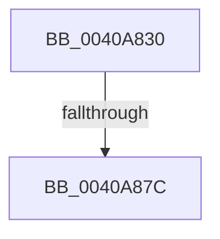

# PpmPerfRecordUtility

- RVA: `0x0040A830`–`0x0040A884` (길이 `84` bytes)
- VA: `0x000000014040A830`
- 실행 섹션: `.text`
- PDB 이름 있음: `예`; PDB Function 태그: `아니요`
- unwind 정보 RVA: `0x0009AD40`
- 디코드: `21`개 명령, `84/84` bytes 표시
- 미해석 바이트: `0` (있으면 어셈블리에 `.byte`로 보존)

> 이 문서는 커널 이미지의 기계어와 PDB 기호를 분석해 생성했습니다. 4번과 5번은 함수 원형과 자료형을 바이너리 사용 방식에서 추정한 C 해석이며 원본 소스 복구 결과는 아닙니다.

## 1. Dependencies

- 직접 호출 지점: **0**; 고유 호출 대상: **0**
- 직접 호출자로 확인된 함수: **1**
- RIP 상대 이미지 참조: **2**

### Outgoing calls
- 직접 디코드된 call 명령이 없습니다.

### Direct callers
- [PpmCheckRecordAllUtility](PpmCheckRecordAllUtility_function_0040A720.md) at `0x0040A799`
- [PpmCheckRecordAllUtility](PpmCheckRecordAllUtility_function_0040A720.md) at `0x0040A822`

### Static image references
- `0x0040A846` → RVA `0x00E0A740` (`.data`; read)
- `0x0040A85F` → RVA `0x00F0B27C` (`.data`; read)

## 2. Other-region calls and transfers

- 다른 실행 섹션으로 향하는 call: **0**
- call이 아닌 외부 분기/꼬리 이동: **1**
  - `0x0040A876` → [sub_0040AB1A](Unknown_function_0040AB1A.md) (`tail-transfer`)

## 3. Assembly (complete function range)

```asm
0040A830  4C 8B DC                        mov r11, rsp
0040A833  55                              push rbp
0040A834  53                              push rbx
0040A835  57                              push rdi
0040A836  41 57                           push r15
0040A838  49 8D AB 58 FF FF FF            lea rbp, [r11 - 0xa8]
0040A83F  48 81 EC 88 01 00 00            sub rsp, 0x188
0040A846  48 8B 05 F3 FE 9F 00            mov rax, qword ptr [rip + 0x9ffef3]
0040A84D  48 33 C4                        xor rax, rsp
0040A850  48 89 45 70                     mov qword ptr [rbp + 0x70], rax
0040A854  48 8B 59 10                     mov rbx, qword ptr [rcx + 0x10]
0040A858  48 8B F9                        mov rdi, rcx
0040A85B  48 8B 51 18                     mov rdx, qword ptr [rcx + 0x18]
0040A85F  8B 05 17 0A B0 00               mov eax, dword ptr [rip + 0xb00a17]
0040A865  4C 8B 79 08                     mov r15, qword ptr [rcx + 8]
0040A869  C6 44 24 48 00                  mov byte ptr [rsp + 0x48], 0
0040A86E  48 89 54 24 70                  mov qword ptr [rsp + 0x70], rdx
0040A873  48 85 DB                        test rbx, rbx
0040A876  0F 84 9E 02 00 00               je 0x14040ab1a
0040A87C  4C 8B 4B 20                     mov r9, qword ptr [rbx + 0x20]
0040A880  4C 8B 53 28                     mov r10, qword ptr [rbx + 0x28]
```

## 4. C-style interpretation (structured pseudocode)

```c
__int64 __fastcall PpmPerfRecordUtility(__int64 a1)
{
    __int64 result;
    __int64 v_rsp;
    unsigned __int64 v_stack_m138;
    unsigned __int8 v_stack_m160;

    v_rsp = (v_rsp) - (392);
    result = (*(unsigned __int64 *)(v_rip + 10485491)) ^ (v_rsp);
    *(unsigned __int64 *)(v_rsp - 168 + 112) = result;
    v_stack_m160 = 0;
    v_stack_m138 = *(unsigned __int64 *)(a1 + 24);
    return (unsigned int)(*(unsigned int *)(v_rip + 11536919));
}
```

## 5. (Beta) C Style

```c
int64_t PpmPerfRecordUtility(void *Arg1)
{
    uint8_t *arg1 = (uint8_t *)Arg1;

    int64_t result;
    int64_t local_rsp;
    uint64_t v_stack_m138;
    uint8_t v_stack_m160;

    local_rsp = (local_rsp) - (392);
    result = (*(uint64_t *)(v_rip + 0x9FFEF3)) ^ (local_rsp);
    *(uint64_t *)(local_rsp - 0xA8 + 0x70) = result;
    v_stack_m160 = 0;
    v_stack_m138 = *(uint64_t *)(arg1 + 0x18);
    return (uint32_t)(*(uint32_t *)(v_rip + 0xB00A17));
}
```

### 관측된 메모리 오프셋

구조체 형식이 확인되지 않은 접근은 인자 기준의 오프셋으로만 기록했습니다.

| 기준 인자 | 오프셋 표현 | 폭 (bit) | 접근 |
|---|---:|---:|---|
| `Arg1` | `+ 0x8` | `64` | `R` |
| `Arg1` | `+ 0x10` | `64` | `R` |
| `Arg1` | `+ 0x18` | `64` | `R` |

## 6. Execution-region graph

[열기: 2D/3D 그래프와 함수 탐색 컨트롤 패널](../../../control-panel.html?section=text&rva=0x0040A830&view=graph)

- 2D 그래프는 위에서 아래로 흐르고, 3D 그래프는 빈 공간을 드래그해 회전합니다. Shift+드래그는 이동, 휠은 확대·축소, 함수 노드 선택은 대상 보고서 이동입니다.

### Static fallback


