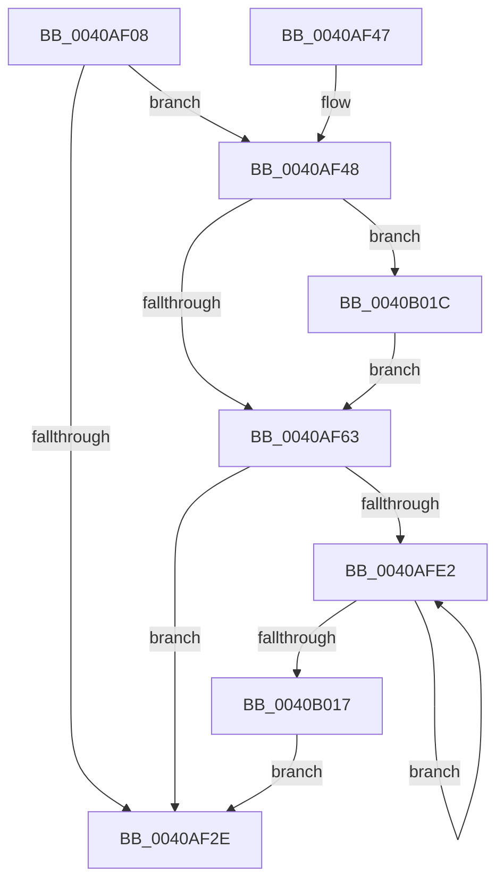

# PpmPerfResetHistory

- RVA: `0x0040AF08`–`0x0040B024` (길이 `284` bytes)
- VA: `0x000000014040AF08`
- 실행 섹션: `.text`
- PDB 이름 있음: `예`; PDB Function 태그: `아니요`
- unwind 정보 RVA: `0x0009ADAC`
- 디코드: `78`개 명령, `284/284` bytes 표시
- 미해석 바이트: `0` (있으면 어셈블리에 `.byte`로 보존)

> 이 문서는 커널 이미지의 기계어와 PDB 기호를 분석해 생성했습니다. 4번과 5번은 함수 원형과 자료형을 바이너리 사용 방식에서 추정한 C 해석이며 원본 소스 복구 결과는 아닙니다.

## 1. Dependencies

- 직접 호출 지점: **0**; 고유 호출 대상: **0**
- 직접 호출자로 확인된 함수: **3**
- RIP 상대 이미지 참조: **0**

### Outgoing calls
- 직접 디코드된 call 명령이 없습니다.

### Direct callers
- [sub_0040A884](Unknown_function_0040A884.md) at `0x0040AAF5`
- [PpmPerfResetHistoryAll](../../page/AC/PpmPerfResetHistoryAll_function_00ACF5E4.md) at `0x00ACF654`
- [PpmPerfResetHistoryAll](../../page/AC/PpmPerfResetHistoryAll_function_00ACF5E4.md) at `0x00ACF68D`
- [sub_00B4A89A](../../page/B4/Unknown_function_00B4A89A.md) at `0x00B4A8A3`

### Static image references
- 디코드된 RIP-relative 메모리 참조가 없습니다.

## 2. Other-region calls and transfers

- 다른 실행 섹션으로 향하는 call: **0**
- 별도 외부 분기/꼬리 이동을 확인하지 못했습니다.

## 3. Assembly (complete function range)

```asm
0040AF08  48 8B C4                        mov rax, rsp
0040AF0B  48 89 58 08                     mov qword ptr [rax + 8], rbx
0040AF0F  48 89 68 10                     mov qword ptr [rax + 0x10], rbp
0040AF13  48 89 70 18                     mov qword ptr [rax + 0x18], rsi
0040AF17  48 89 78 20                     mov qword ptr [rax + 0x20], rdi
0040AF1B  41 56                           push r14
0040AF1D  41 57                           push r15
0040AF1F  4C 8B 49 20                     mov r9, qword ptr [rcx + 0x20]
0040AF23  45 33 FF                        xor r15d, r15d
0040AF26  4C 8B D9                        mov r11, rcx
0040AF29  4D 85 C9                        test r9, r9
0040AF2C  75 1A                           jne 0x14040af48
0040AF2E  48 8B 5C 24 18                  mov rbx, qword ptr [rsp + 0x18]
0040AF33  48 8B 6C 24 20                  mov rbp, qword ptr [rsp + 0x20]
0040AF38  48 8B 74 24 28                  mov rsi, qword ptr [rsp + 0x28]
0040AF3D  48 8B 7C 24 30                  mov rdi, qword ptr [rsp + 0x30]
0040AF42  41 5F                           pop r15
0040AF44  41 5E                           pop r14
0040AF46  C3                              ret
0040AF47  CC                              int3
0040AF48  44 0F B7 51 28                  movzx r10d, word ptr [rcx + 0x28]
0040AF4D  41 BE 01 00 00 00               mov r14d, 1
0040AF53  41 8B 19                        mov ebx, dword ptr [r9]
0040AF56  41 8B CE                        mov ecx, r14d
0040AF59  66 45 3B F2                     cmp r14w, r10w
0040AF5D  0F 86 B9 00 00 00               jbe 0x14040b01c
0040AF63  41 6B 43 34 64                  imul eax, dword ptr [r11 + 0x34], 0x64
0040AF68  33 D2                           xor edx, edx
0040AF6A  BD 64 00 00 00                  mov ebp, 0x64
0040AF6F  45 8B C2                        mov r8d, r10d
0040AF72  0F 57 C0                        xorps xmm0, xmm0
0040AF75  F7 F1                           div ecx
0040AF77  41 8B CA                        mov ecx, r10d
0040AF7A  40 3A C5                        cmp al, bpl
0040AF7D  0F B6 F8                        movzx edi, al
0040AF80  0F 47 FD                        cmova edi, ebp
0040AF83  66 45 3B F2                     cmp r14w, r10w
0040AF87  41 0F 47 CE                     cmova ecx, r14d
0040AF8B  41 6B 43 38 64                  imul eax, dword ptr [r11 + 0x38], 0x64
0040AF90  33 D2                           xor edx, edx
0040AF92  45 89 79 04                     mov dword ptr [r9 + 4], r15d
0040AF96  45 89 79 0C                     mov dword ptr [r9 + 0xc], r15d
0040AF9A  F7 F1                           div ecx
0040AF9C  41 8B D7                        mov edx, r15d
0040AF9F  40 3A C5                        cmp al, bpl
0040AFA2  0F B6 F0                        movzx esi, al
0040AFA5  0F 47 F5                        cmova esi, ebp
0040AFA8  44 0F AF C3                     imul r8d, ebx
0040AFAC  45 89 41 08                     mov dword ptr [r9 + 8], r8d
0040AFB0  45 0F B7 43 3E                  movzx r8d, word ptr [r11 + 0x3e]
0040AFB5  41 8B C0                        mov eax, r8d
0040AFB8  0F AF C3                        imul eax, ebx
0040AFBB  41 89 41 10                     mov dword ptr [r9 + 0x10], eax
0040AFBF  40 0F B6 C7                     movzx eax, dil
0040AFC3  0F AF C3                        imul eax, ebx
0040AFC6  41 89 41 14                     mov dword ptr [r9 + 0x14], eax
0040AFCA  40 0F B6 C6                     movzx eax, sil
0040AFCE  0F AF C3                        imul eax, ebx
0040AFD1  41 89 41 18                     mov dword ptr [r9 + 0x18], eax
0040AFD5  41 0F 11 41 1C                  movups xmmword ptr [r9 + 0x1c], xmm0
0040AFDA  85 DB                           test ebx, ebx
0040AFDC  0F 84 4C FF FF FF               je 0x14040af2e
0040AFE2  8B C2                           mov eax, edx
0040AFE4  41 03 D6                        add edx, r14d
0040AFE7  48 8D 0C 40                     lea rcx, [rax + rax*2]
0040AFEB  48 8D 04 40                     lea rax, [rax + rax*2]
0040AFEF  66 45 89 7C 89 2E               mov word ptr [r9 + rcx*4 + 0x2e], r15w
0040AFF5  66 45 89 44 81 30               mov word ptr [r9 + rax*4 + 0x30], r8w
0040AFFB  33 C0                           xor eax, eax
0040AFFD  66 45 89 54 89 2C               mov word ptr [r9 + rcx*4 + 0x2c], r10w
0040B003  41 88 7C 89 32                  mov byte ptr [r9 + rcx*4 + 0x32], dil
0040B008  41 88 74 89 33                  mov byte ptr [r9 + rcx*4 + 0x33], sil
0040B00D  41 89 44 89 34                  mov dword ptr [r9 + rcx*4 + 0x34], eax
0040B012  41 3B 11                        cmp edx, dword ptr [r9]
0040B015  72 CB                           jb 0x14040afe2
0040B017  E9 12 FF FF FF                  jmp 0x14040af2e
0040B01C  41 8B CA                        mov ecx, r10d
0040B01F  E9 3F FF FF FF                  jmp 0x14040af63
```

## 4. C-style interpretation (structured pseudocode)

```c
__int64 __fastcall PpmPerfResetHistory(__int64 a1, int a2)
{
    __int64 result;
    __int64 v_r15;
    __int64 v_rdi;
    __int64 v_rsi;
    unsigned __int64 v_stack_p10;
    unsigned __int64 v_stack_p18;
    unsigned __int64 v_stack_p20;
    unsigned __int64 v_stack_p8;

    *(unsigned __int64 *)(v_rsp + 8) = v_rbx;
    *(unsigned __int64 *)(v_rsp + 16) = v_rbp;
    *(unsigned __int64 *)(v_rsp + 24) = v_rsi;
    *(unsigned __int64 *)(v_rsp + 32) = v_rdi;
    v_r15 = 0;
    if (*(unsigned __int64 *)(a1 + 32) != 0) goto loc_0040AF48;
loc_0040AF2E:
    return v_rsp;
loc_0040AF48:
    if (1 <= ((unsigned __int16)(*(unsigned __int16 *)(a1 + 40)))) goto loc_0040B01C;
loc_0040AF63:
    result = (unsigned int)((v_rsp) * (*(unsigned int *)(a1 + 52)));
    a2 = 0;
    v_rdi = (unsigned __int8)(result);
    if (((unsigned __int8)(result)) > 100) { v_rdi = 100; }
    a1 = (unsigned int)((unsigned int)(*(unsigned __int16 *)(a1 + 40)));
    if (1 > ((unsigned __int16)(*(unsigned __int16 *)(a1 + 40)))) { a1 = 1; }
    result = (unsigned int)((result) * (*(unsigned int *)(a1 + 56)));
    a2 = 0;
    *(unsigned int *)(*(unsigned __int64 *)(a1 + 32) + 4) = 0;
    *(unsigned int *)(*(unsigned __int64 *)(a1 + 32) + 12) = 0;
    v_rsi = (unsigned __int8)(result);
    if (((unsigned __int8)(result)) > 100) { v_rsi = 100; }
    a3 = (unsigned int)(((unsigned int)((unsigned int)(*(unsigned __int16 *)(a1 + 40)))) * ((unsigned int)((unsigned int)(*(unsigned int *)(*(unsigned __int64 *)(a1 + 32))))));
    *(unsigned int *)(*(unsigned __int64 *)(a1 + 32) + 8) = (unsigned int)(a3);
    result = (unsigned int)(((unsigned int)((unsigned int)(*(unsigned __int16 *)(a1 + 62)))) * ((unsigned int)((unsigned int)(*(unsigned int *)(*(unsigned __int64 *)(a1 + 32))))));
    *(unsigned int *)(*(unsigned __int64 *)(a1 + 32) + 16) = (unsigned int)(result);
    result = (unsigned int)(((unsigned __int8)(v_rdi)) * ((unsigned int)((unsigned int)(*(unsigned int *)(*(unsigned __int64 *)(a1 + 32))))));
    *(unsigned int *)(*(unsigned __int64 *)(a1 + 32) + 20) = (unsigned int)(result);
    result = (unsigned int)(((unsigned __int8)(v_rsi)) * ((unsigned int)((unsigned int)(*(unsigned int *)(*(unsigned __int64 *)(a1 + 32))))));
    *(unsigned int *)(*(unsigned __int64 *)(a1 + 32) + 24) = (unsigned int)(result);
    *(unsigned __int64 *)(*(unsigned __int64 *)(a1 + 32) + 28) = v_xmm0;
    if ((unsigned int)((unsigned int)(*(unsigned int *)(*(unsigned __int64 *)(a1 + 32)))) == 0) goto loc_0040AF2E;
loc_0040AFE2:
    a2 = (unsigned int)((0) + (1));
    *(unsigned __int16 *)(*(unsigned __int64 *)(a1 + 32) + 0 + 0 * 2 * 4 + 46) = 0;
    *(unsigned __int16 *)(*(unsigned __int64 *)(a1 + 32) + 0 + 0 * 2 * 4 + 48) = (unsigned __int16)(*(unsigned __int16 *)(a1 + 62));
    result = 0;
    *(unsigned __int16 *)(*(unsigned __int64 *)(a1 + 32) + 0 + 0 * 2 * 4 + 44) = (unsigned __int16)(*(unsigned __int16 *)(a1 + 40));
    *(unsigned __int8 *)(*(unsigned __int64 *)(a1 + 32) + 0 + 0 * 2 * 4 + 50) = (unsigned __int8)(v_rdi);
    *(unsigned __int8 *)(*(unsigned __int64 *)(a1 + 32) + 0 + 0 * 2 * 4 + 51) = (unsigned __int8)(v_rsi);
    *(unsigned int *)(*(unsigned __int64 *)(a1 + 32) + 0 + 0 * 2 * 4 + 52) = 0;
    if (a2 < (*(unsigned int *)(*(unsigned __int64 *)(a1 + 32)))) goto loc_0040AFE2;
    goto loc_0040AF2E;
loc_0040B01C:
    goto loc_0040AF63;
}
```

## 5. (Beta) C Style

```c
int64_t PpmPerfResetHistory(void *Arg1, int32_t Arg2)
{
    uint8_t *arg1 = (uint8_t *)Arg1;

    int64_t result;
    int64_t local_r15;
    int64_t local_rdi;
    int64_t local_rsi;
    uint64_t v_stack_p10;
    uint64_t v_stack_p18;
    uint64_t v_stack_p20;
    uint64_t v_stack_p8;

    *(uint64_t *)(local_rsp + 0x8) = local_rbx;
    *(uint64_t *)(local_rsp + 0x10) = local_rbp;
    *(uint64_t *)(local_rsp + 0x18) = local_rsi;
    *(uint64_t *)(local_rsp + 0x20) = local_rdi;
    local_r15 = 0;
    if (*(uint64_t *)(arg1 + 0x20) != 0) goto loc_0040AF48;
loc_0040AF2E:
    return local_rsp;
loc_0040AF48:
    if (1 <= ((uint16_t)(*(uint16_t *)(arg1 + 0x28)))) goto loc_0040B01C;
loc_0040AF63:
    result = (uint32_t)((local_rsp) * (*(uint32_t *)(arg1 + 0x34)));
    Arg2 = 0;
    local_rdi = (uint8_t)(result);
    if (((uint8_t)(result)) > 100) { local_rdi = 100; }
    Arg1 = (uint32_t)((uint32_t)(*(uint16_t *)(arg1 + 0x28)));
    if (1 > ((uint16_t)(*(uint16_t *)(arg1 + 0x28)))) { Arg1 = 1; }
    result = (uint32_t)((result) * (*(uint32_t *)(arg1 + 0x38)));
    Arg2 = 0;
    *(uint32_t *)(*(uint64_t *)(arg1 + 0x20) + 0x4) = 0;
    *(uint32_t *)(*(uint64_t *)(arg1 + 0x20) + 0xC) = 0;
    local_rsi = (uint8_t)(result);
    if (((uint8_t)(result)) > 100) { local_rsi = 100; }
    a3 = (uint32_t)(((uint32_t)((uint32_t)(*(uint16_t *)(arg1 + 0x28)))) * ((uint32_t)((uint32_t)(*(uint32_t *)(*(uint64_t *)(arg1 + 0x20))))));
    *(uint32_t *)(*(uint64_t *)(arg1 + 0x20) + 0x8) = (uint32_t)(a3);
    result = (uint32_t)(((uint32_t)((uint32_t)(*(uint16_t *)(arg1 + 0x3E)))) * ((uint32_t)((uint32_t)(*(uint32_t *)(*(uint64_t *)(arg1 + 0x20))))));
    *(uint32_t *)(*(uint64_t *)(arg1 + 0x20) + 0x10) = (uint32_t)(result);
    result = (uint32_t)(((uint8_t)(local_rdi)) * ((uint32_t)((uint32_t)(*(uint32_t *)(*(uint64_t *)(arg1 + 0x20))))));
    *(uint32_t *)(*(uint64_t *)(arg1 + 0x20) + 0x14) = (uint32_t)(result);
    result = (uint32_t)(((uint8_t)(local_rsi)) * ((uint32_t)((uint32_t)(*(uint32_t *)(*(uint64_t *)(arg1 + 0x20))))));
    *(uint32_t *)(*(uint64_t *)(arg1 + 0x20) + 0x18) = (uint32_t)(result);
    *(uint64_t *)(*(uint64_t *)(arg1 + 0x20) + 0x1C) = v_xmm0;
    if ((uint32_t)((uint32_t)(*(uint32_t *)(*(uint64_t *)(arg1 + 0x20)))) == 0) goto loc_0040AF2E;
loc_0040AFE2:
    Arg2 = (uint32_t)((0) + (1));
    *(uint16_t *)(*(uint64_t *)(arg1 + 0x20) + 0x0 + 0x0 * 2 * 4 + 0x2E) = 0;
    *(uint16_t *)(*(uint64_t *)(arg1 + 0x20) + 0x0 + 0x0 * 2 * 4 + 0x30) = (uint16_t)(*(uint16_t *)(arg1 + 0x3E));
    result = 0;
    *(uint16_t *)(*(uint64_t *)(arg1 + 0x20) + 0x0 + 0x0 * 2 * 4 + 0x2C) = (uint16_t)(*(uint16_t *)(arg1 + 0x28));
    *(uint8_t *)(*(uint64_t *)(arg1 + 0x20) + 0x0 + 0x0 * 2 * 4 + 0x32) = (uint8_t)(local_rdi);
    *(uint8_t *)(*(uint64_t *)(arg1 + 0x20) + 0x0 + 0x0 * 2 * 4 + 0x33) = (uint8_t)(local_rsi);
    *(uint32_t *)(*(uint64_t *)(arg1 + 0x20) + 0x0 + 0x0 * 2 * 4 + 0x34) = 0;
    if (Arg2 < (*(uint32_t *)(*(uint64_t *)(arg1 + 0x20)))) goto loc_0040AFE2;
    goto loc_0040AF2E;
loc_0040B01C:
    goto loc_0040AF63;
}
```

### 관측된 메모리 오프셋

구조체 형식이 확인되지 않은 접근은 인자 기준의 오프셋으로만 기록했습니다.

| 기준 인자 | 오프셋 표현 | 폭 (bit) | 접근 |
|---|---:|---:|---|
| `Arg1` | `+ 0x20` | `64` | `R` |
| `Arg1` | `+ 0x28` | `16` | `R` |
| `Arg1` | `+ 0x34` | `32` | `R` |
| `Arg1` | `+ 0x38` | `32` | `R` |
| `Arg1` | `+ 0x3E` | `16` | `R` |

## 6. Execution-region graph

[열기: 2D/3D 그래프와 함수 탐색 컨트롤 패널](../../../control-panel.html?section=text&rva=0x0040AF08&view=graph)

- 2D 그래프는 위에서 아래로 흐르고, 3D 그래프는 빈 공간을 드래그해 회전합니다. Shift+드래그는 이동, 휠은 확대·축소, 함수 노드 선택은 대상 보고서 이동입니다.

### Static fallback


