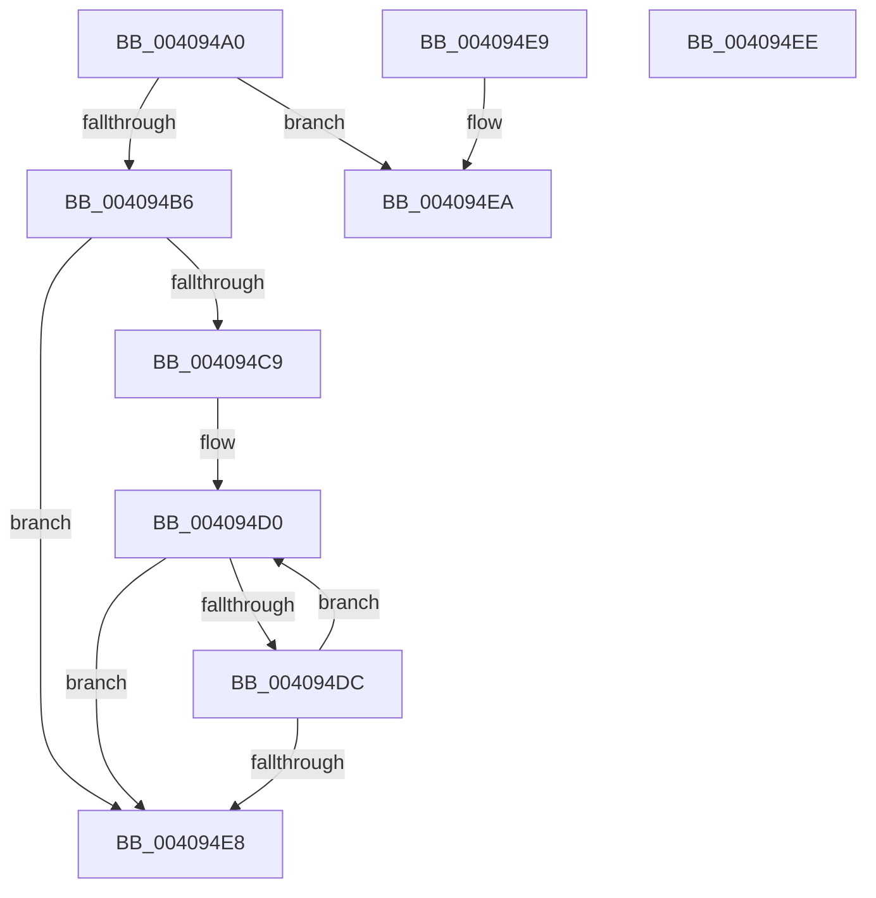

# PsGetCurrentSilo

- RVA: `0x004094A0`–`0x004094EF` (길이 `79` bytes)
- VA: `0x00000001404094A0`
- 실행 섹션: `.text`
- PDB 이름 있음: `예`; PDB Function 태그: `아니요`
- unwind 정보 RVA: `0x000DB714`
- 디코드: `19`개 명령, `79/79` bytes 표시
- 미해석 바이트: `0` (있으면 어셈블리에 `.byte`로 보존)

> 이 문서는 커널 이미지의 기계어와 PDB 기호를 분석해 생성했습니다. 4번과 5번은 함수 원형과 자료형을 바이너리 사용 방식에서 추정한 C 해석이며 원본 소스 복구 결과는 아닙니다.

## 1. Dependencies

- 직접 호출 지점: **0**; 고유 호출 대상: **0**
- 직접 호출자로 확인된 함수: **34**
- RIP 상대 이미지 참조: **0**

### Outgoing calls
- 직접 디코드된 call 명령이 없습니다.

### Direct callers
- [IoRevokeHandlesForProcess](../59/IoRevokeHandlesForProcess_function_005981A8.md) at `0x0059825A`
- [ObpCreateSymbolicLinkName](../../page/74/ObpCreateSymbolicLinkName_function_0074EB80.md) at `0x0074EC31`
- [PsRootSiloInformation](../../page/77/PsRootSiloInformation_function_0077F510.md) at `0x0077F544`
- [PsRegisterSiloMonitor](../../page/78/PsRegisterSiloMonitor_function_007866A0.md) at `0x007866F2`
- [ObGetSiloRootDirectoryPath](../../page/83/ObGetSiloRootDirectoryPath_function_0083CD74.md) at `0x0083CDD9`
- [CmCreateKey](../../page/87/CmCreateKey_function_00875020.md) at `0x008753C9`
- [CmOpenKey](../../page/87/CmOpenKey_function_00876350.md) at `0x00876565`
- [CmpLinkHiveToMaster](../../page/87/CmpLinkHiveToMaster_function_00877D6C.md) at `0x00877ED2`
- [ObOpenObjectByName](../../page/89/ObOpenObjectByName_function_00899F50.md) at `0x00899F71`
- [CmpParseKey](../../page/89/CmpParseKey_function_0089DDC0.md) at `0x0089E1D7`
- [NtQueryFullAttributesFile](../../page/8A/NtQueryFullAttributesFile_function_008A0D10.md) at `0x008A0E75`
- [NtQueryAttributesFile](../../page/8A/NtQueryAttributesFile_function_008A0FA0.md) at `0x008A10FB`
- [ObQueryNameStringMode](../../page/8A/ObQueryNameStringMode_function_008A7ED0.md) at `0x008A802F`
- [IopCreateFile](../../page/8A/IopCreateFile_function_008AB298.md) at `0x008AB708`
- [IoQueryInformationByName](../../page/8A/IoQueryInformationByName_function_008AE840.md) at `0x008AE9E2`
- [ObReferenceObjectByNameEx](../../page/8B/ObReferenceObjectByNameEx_function_008BD524.md) at `0x008BD66F`
- [ObReferenceObjectByName](../../page/8C/ObReferenceObjectByName_function_008C4A00.md) at `0x008C4B3C`
- [PopGetSettingNotificationName](../../page/91/PopGetSettingNotificationName_function_0091346C.md) at `0x00913588`
- [NtOpenJobObject](../../page/91/NtOpenJobObject_function_00917350.md) at `0x009173AB`
- [VRegEnabledInJob](../../page/93/VRegEnabledInJob_function_009350B0.md) at `0x009350C2`
- [IopLoadDriver](../../page/99/IopLoadDriver_function_00997B54.md) at `0x00997DD2`
- [IopReferenceDriverObjectByName](../../page/99/IopReferenceDriverObjectByName_function_0099C178.md) at `0x0099C1C4`
- [ObpInsertOrLocateNamedObject](../../page/99/ObpInsertOrLocateNamedObject_function_0099F2C0.md) at `0x0099F35A`
- [NtOpenSymbolicLinkObject](../../page/9E/NtOpenSymbolicLinkObject_function_009E7A60.md) at `0x009E7AC1`
- [CmLockKeyForWrite](../../page/9E/CmLockKeyForWrite_function_009E7EE8.md) at `0x009E7F04`
- [NtOpenDirectoryObject](../../page/9F/NtOpenDirectoryObject_function_009F4360.md) at `0x009F43B9`
- [NtOpenEvent](../../page/9F/NtOpenEvent_function_009FF270.md) at `0x009FF2C9`
- [NtOpenSection](../../page/9F/NtOpenSection_function_009FF390.md) at `0x009FF3E9`
- [NtOpenMutant](../../page/A1/NtOpenMutant_function_00A16920.md) at `0x00A16979`
- [NtOpenSemaphore](../../page/A2/NtOpenSemaphore_function_00A23AB0.md) at `0x00A23B09`
- [NtOpenSession](../../page/A6/NtOpenSession_function_00A6F790.md) at `0x00A6F7E9`
- [ExCreateCallback](../../page/A7/ExCreateCallback_function_00A7B9D0.md) at `0x00A7BA3D`
- [NtDeleteFile](../../page/A9/NtDeleteFile_function_00A97B20.md) at `0x00A97BD4`
- [IopFastQueryNetworkAttributes](../../page/AB/IopFastQueryNetworkAttributes_function_00ABDDD0.md) at `0x00ABDEA1`

### Static image references
- 디코드된 RIP-relative 메모리 참조가 없습니다.

## 2. Other-region calls and transfers

- 다른 실행 섹션으로 향하는 call: **0**
- 별도 외부 분기/꼬리 이동을 확인하지 못했습니다.

## 3. Assembly (complete function range)

```asm
004094A0  65 48 8B 04 25 88 01 00 00      mov rax, qword ptr gs:[0x188]
004094A9  48 8B 88 98 06 00 00            mov rcx, qword ptr [rax + 0x698]
004094B0  48 83 F9 FD                     cmp rcx, -3
004094B4  75 34                           jne 0x1404094ea
004094B6  48 8B 80 20 02 00 00            mov rax, qword ptr [rax + 0x220]
004094BD  48 8B 80 A0 02 00 00            mov rax, qword ptr [rax + 0x2a0]
004094C4  48 85 C0                        test rax, rax
004094C7  74 1F                           je 0x1404094e8
004094C9  0F 1F 80 00 00 00 00            nop dword ptr [rax]
004094D0  F7 80 10 06 00 00 00 00 00 40   test dword ptr [rax + 0x610], 0x40000000
004094DA  75 0C                           jne 0x1404094e8
004094DC  48 8B 80 18 05 00 00            mov rax, qword ptr [rax + 0x518]
004094E3  48 85 C0                        test rax, rax
004094E6  75 E8                           jne 0x1404094d0
004094E8  C3                              ret
004094E9  CC                              int3
004094EA  48 8B C1                        mov rax, rcx
004094ED  C3                              ret
004094EE  CC                              int3
```

## 4. C-style interpretation (structured pseudocode)

```c
__int64 __fastcall PsGetCurrentSilo(void)
{
    if ((*(unsigned __int64 *)(*(unsigned __int64 *)(gs_base + (0 + 392)) + 1688)) != -3) goto loc_004094EA;
    if (*(unsigned __int64 *)(*(unsigned __int64 *)(*(unsigned __int64 *)(gs_base + (0 + 392)) + 544) + 672) == 0) goto loc_004094E8;
loc_004094D0:
    if (((*(unsigned int *)(*(unsigned __int64 *)(*(unsigned __int64 *)(*(unsigned __int64 *)(gs_base + (0 + 392)) + 544) + 672) + 1552)) & (0x40000000ULL)) != 0) goto loc_004094E8;
    if (*(unsigned __int64 *)(*(unsigned __int64 *)(*(unsigned __int64 *)(*(unsigned __int64 *)(gs_base + (0 + 392)) + 544) + 672) + 1304) != 0) goto loc_004094D0;
loc_004094E8:
    return *(unsigned __int64 *)(*(unsigned __int64 *)(*(unsigned __int64 *)(*(unsigned __int64 *)(gs_base + (0 + 392)) + 544) + 672) + 1304);
loc_004094EA:
    return *(unsigned __int64 *)(*(unsigned __int64 *)(gs_base + (0 + 392)) + 1688);
}
```

## 5. (Beta) C Style

```c
void PsGetCurrentSilo(void)
{
    if ((*(uint64_t *)(*(uint64_t *)(gs_base + (0 + 0x188)) + 0x698)) != -3) goto loc_004094EA;
    if (*(uint64_t *)(*(uint64_t *)(*(uint64_t *)(gs_base + (0 + 0x188)) + 0x220) + 0x2A0) == 0) goto loc_004094E8;
loc_004094D0:
    if (((*(uint32_t *)(*(uint64_t *)(*(uint64_t *)(*(uint64_t *)(gs_base + (0 + 0x188)) + 0x220) + 0x2A0) + 0x610)) & (0x40000000ULL)) != 0) goto loc_004094E8;
    if (*(uint64_t *)(*(uint64_t *)(*(uint64_t *)(*(uint64_t *)(gs_base + (0 + 0x188)) + 0x220) + 0x2A0) + 0x518) != 0) goto loc_004094D0;
loc_004094E8:
    return *(uint64_t *)(*(uint64_t *)(*(uint64_t *)(*(uint64_t *)(gs_base + (0 + 0x188)) + 0x220) + 0x2A0) + 0x518);
loc_004094EA:
    return *(uint64_t *)(*(uint64_t *)(gs_base + (0 + 0x188)) + 0x698);
}
```

## 6. Execution-region graph

[열기: 2D/3D 그래프와 함수 탐색 컨트롤 패널](../../../control-panel.html?section=text&rva=0x004094A0&view=graph)

- 2D 그래프는 위에서 아래로 흐르고, 3D 그래프는 빈 공간을 드래그해 회전합니다. Shift+드래그는 이동, 휠은 확대·축소, 함수 노드 선택은 대상 보고서 이동입니다.

### Static fallback


