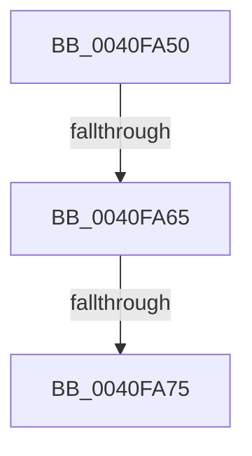

# RtlAppendUnicodeStringToString

- RVA: `0x0040FA50`–`0x0040FA86` (길이 `54` bytes)
- VA: `0x000000014040FA50`
- 실행 섹션: `.text`
- PDB 이름 있음: `예`; PDB Function 태그: `아니요`
- unwind 정보 RVA: `0x0009BB60`
- 디코드: `17`개 명령, `54/54` bytes 표시
- 미해석 바이트: `0` (있으면 어셈블리에 `.byte`로 보존)

> 이 문서는 커널 이미지의 기계어와 PDB 기호를 분석해 생성했습니다. 4번과 5번은 함수 원형과 자료형을 바이너리 사용 방식에서 추정한 C 해석이며 원본 소스 복구 결과는 아닙니다.

## 1. Dependencies

- 직접 호출 지점: **0**; 고유 호출 대상: **0**
- 직접 호출자로 확인된 함수: **66**
- RIP 상대 이미지 참조: **0**

### Outgoing calls
- 직접 디코드된 call 명령이 없습니다.

### Direct callers
- [AdtpFormatPrefix](AdtpFormatPrefix_function_0040F8E0.md) at `0x0040F944`
- [KsepEvntLogShimsApplied](../5C/KsepEvntLogShimsApplied_function_005CBBE4.md) at `0x005CBD2F`
- [OpenGlobalizationUserSettingsKey_ForMua](../65/OpenGlobalizationUserSettingsKey_ForMua_function_0065D0C8.md) at `0x0065D272`
- [AdtpBuildStagingReasonAuditStringInternal](../69/AdtpBuildStagingReasonAuditStringInternal_function_0069DA44.md) at `0x0069DCE3`
- [AdtpBuildStagingReasonAuditStringInternal](../69/AdtpBuildStagingReasonAuditStringInternal_function_0069DA44.md) at `0x0069DCFB`
- [BcpDisplayErrorInformationModernized](../6A/BcpDisplayErrorInformationModernized_function_006A00DC.md) at `0x006A0198`
- [BcpDisplayErrorInformationModernized](../6A/BcpDisplayErrorInformationModernized_function_006A00DC.md) at `0x006A01C7`
- [BcpDisplayErrorInformationModernized](../6A/BcpDisplayErrorInformationModernized_function_006A00DC.md) at `0x006A0254`
- [BcpDisplayErrorInformationModernized](../6A/BcpDisplayErrorInformationModernized_function_006A00DC.md) at `0x006A02CD`
- [BcpDisplayErrorInformationModernized](../6A/BcpDisplayErrorInformationModernized_function_006A00DC.md) at `0x006A02FD`
- [BcpDisplayProgressModernized](../6A/BcpDisplayProgressModernized_function_006A068C.md) at `0x006A0767`
- [BcpDisplayProgressModernized](../6A/BcpDisplayProgressModernized_function_006A068C.md) at `0x006A0790`
- [BcpDisplayProgressModernized](../6A/BcpDisplayProgressModernized_function_006A068C.md) at `0x006A07B4`
- [BgpFwDisplayBugCheckScreenModernized](../6A/BgpFwDisplayBugCheckScreenModernized_function_006A1338.md) at `0x006A14AE`
- [BgpFwDisplayBugCheckScreenModernized](../6A/BgpFwDisplayBugCheckScreenModernized_function_006A1338.md) at `0x006A14DE`
- [BgpFwDisplayBugCheckScreenModernized](../6A/BgpFwDisplayBugCheckScreenModernized_function_006A1338.md) at `0x006A1666`
- [BgpFwDisplayBugCheckScreenModernized](../6A/BgpFwDisplayBugCheckScreenModernized_function_006A1338.md) at `0x006A1692`
- [sub_006ECA3A](../6E/Unknown_function_006ECA3A.md) at `0x006ECC83`
- [sub_006ECA3A](../6E/Unknown_function_006ECA3A.md) at `0x006ECCEE`
- [sub_006ECA3A](../6E/Unknown_function_006ECA3A.md) at `0x006ECD37`
- [sub_006ECA3A](../6E/Unknown_function_006ECA3A.md) at `0x006ECD45`
- [sub_006ECA3A](../6E/Unknown_function_006ECA3A.md) at `0x006ECE40`
- [IopValidateJunctionTarget](../../page/71/IopValidateJunctionTarget_function_0071C808.md) at `0x0071CC41`
- [IopValidateJunctionTarget](../../page/71/IopValidateJunctionTarget_function_0071C808.md) at `0x0071CCBE`
- [IopValidateJunctionTarget](../../page/71/IopValidateJunctionTarget_function_0071C808.md) at `0x0071CCF1`
- [pIoQueryDeviceDescription](../../page/71/pIoQueryDeviceDescription_function_0071F10C.md) at `0x0071F2A6`
- [pIoQueryDeviceDescription](../../page/71/pIoQueryDeviceDescription_function_0071F10C.md) at `0x0071F45C`
- [IopGetRootDeviceId](../../page/72/IopGetRootDeviceId_function_00726BD4.md) at `0x00726C45`
- [PnpQueryRemoveLockedDeviceNode](../../page/72/PnpQueryRemoveLockedDeviceNode_function_0072D210.md) at `0x0072D2DE`
- [IopFileUtilWalkDirectoryTreeHelper](../../page/73/IopFileUtilWalkDirectoryTreeHelper_function_0073FD40.md) at `0x0073FEE2`
- [PiDrvDbQuerySystemPathWin32](../../page/74/PiDrvDbQuerySystemPathWin32_function_007421F4.md) at `0x007424C9`
- [PiDrvDbQuerySystemPathWin32](../../page/74/PiDrvDbQuerySystemPathWin32_function_007421F4.md) at `0x007425B3`
- [PiDrvDbQuerySystemPathWin32](../../page/74/PiDrvDbQuerySystemPathWin32_function_007421F4.md) at `0x007425CE`
- [PiDrvDbResolveSystemFilePath](../../page/74/PiDrvDbResolveSystemFilePath_function_00743514.md) at `0x007437DC`
- [PiDrvDbResolveSystemFilePath](../../page/74/PiDrvDbResolveSystemFilePath_function_00743514.md) at `0x007437ED`
- [PiDrvDbResolveSystemFilePath](../../page/74/PiDrvDbResolveSystemFilePath_function_00743514.md) at `0x0074385B`
- [PiDrvDbSetupNodeHive](../../page/74/PiDrvDbSetupNodeHive_function_00743884.md) at `0x007439C2`
- [PiDrvDbSetupNodeHive](../../page/74/PiDrvDbSetupNodeHive_function_00743884.md) at `0x00743A6E`
- [PiDrvDbSetupNodeHive](../../page/74/PiDrvDbSetupNodeHive_function_00743884.md) at `0x00743AB9`
- [PiDrvDbSetupNodeHive](../../page/74/PiDrvDbSetupNodeHive_function_00743884.md) at `0x00743B01`
- [PiDrvDbSetupNodeHive](../../page/74/PiDrvDbSetupNodeHive_function_00743884.md) at `0x00743BBD`
- [PopCreateHiberFile](../../page/75/PopCreateHiberFile_function_0075CE70.md) at `0x0075CF5B`
- [PopCreateHiberFile](../../page/75/PopCreateHiberFile_function_0075CE70.md) at `0x0075CF68`
- [PopValidateWinresume](../../page/75/PopValidateWinresume_function_0075DFF4.md) at `0x0075E0F7`
- [PopValidateWinresume](../../page/75/PopValidateWinresume_function_0075DFF4.md) at `0x0075E104`
- [PspSiloInitializeSystemRootSymlink](../../page/78/PspSiloInitializeSystemRootSymlink_function_00780558.md) at `0x007805F8`
- [RtlpGetTokenNamedObjectPath](../../page/78/RtlpGetTokenNamedObjectPath_function_0078ED40.md) at `0x0078F294`
- [RtlpGetTokenNamedObjectPath](../../page/78/RtlpGetTokenNamedObjectPath_function_0078ED40.md) at `0x0078F2A6`
- [RtlpGetTokenNamedObjectPath](../../page/78/RtlpGetTokenNamedObjectPath_function_0078ED40.md) at `0x0078F2BF`
- [RtlpGetTokenNamedObjectPath](../../page/78/RtlpGetTokenNamedObjectPath_function_0078ED40.md) at `0x0078F2D2`
- [RtlpGetTokenNamedObjectPath](../../page/78/RtlpGetTokenNamedObjectPath_function_0078ED40.md) at `0x0078F2EF`
- [RtlpGetTokenNamedObjectPath](../../page/78/RtlpGetTokenNamedObjectPath_function_0078ED40.md) at `0x0078F301`
- [RtlpConstructCrossVmObjectPath](../../page/79/RtlpConstructCrossVmObjectPath_function_00790958.md) at `0x007909E3`
- [RtlpConstructCrossVmObjectPath](../../page/79/RtlpConstructCrossVmObjectPath_function_00790958.md) at `0x00790A2A`
- [RtlpConstructCrossVmObjectPath](../../page/79/RtlpConstructCrossVmObjectPath_function_00790958.md) at `0x00790A68`
- [CmpLoadHiveVolatile](../../page/7D/CmpLoadHiveVolatile_function_007DE5F0.md) at `0x007DE96C`
- [CmpAddRemoveContainerToCLFSLog](../../page/7F/CmpAddRemoveContainerToCLFSLog_function_007F69FC.md) at `0x007F6ABD`
- [CmpAddRemoveContainerToCLFSLog](../../page/7F/CmpAddRemoveContainerToCLFSLog_function_007F69FC.md) at `0x007F6ACA`
- [CmpAddRemoveContainerToCLFSLog](../../page/7F/CmpAddRemoveContainerToCLFSLog_function_007F69FC.md) at `0x007F6AD7`
- [CmpAddRemoveContainerToCLFSLog](../../page/7F/CmpAddRemoveContainerToCLFSLog_function_007F69FC.md) at `0x007F6B39`
- [CmpAddRemoveContainerToCLFSLog](../../page/7F/CmpAddRemoveContainerToCLFSLog_function_007F69FC.md) at `0x007F6B46`
- [CmpDeleteCorruptedLogfile](../../page/7F/CmpDeleteCorruptedLogfile_function_007F6C80.md) at `0x007F7086`
- [CmpDeleteCorruptedLogfile](../../page/7F/CmpDeleteCorruptedLogfile_function_007F6C80.md) at `0x007F709E`
- [CmpDeleteCorruptedLogfile](../../page/7F/CmpDeleteCorruptedLogfile_function_007F6C80.md) at `0x007F70B5`
- [CmpDeleteCorruptedLogfile](../../page/7F/CmpDeleteCorruptedLogfile_function_007F6C80.md) at `0x007F70CD`
- [CmpDeleteCorruptedLogfile](../../page/7F/CmpDeleteCorruptedLogfile_function_007F6C80.md) at `0x007F70E5`
- [CmpDeleteCorruptedLogfile](../../page/7F/CmpDeleteCorruptedLogfile_function_007F6C80.md) at `0x007F7116`
- [CmpDeleteCorruptedLogfile](../../page/7F/CmpDeleteCorruptedLogfile_function_007F6C80.md) at `0x007F7182`
- [CmpDeleteCorruptedLogfile](../../page/7F/CmpDeleteCorruptedLogfile_function_007F6C80.md) at `0x007F7197`
- [CmpDeleteCorruptedLogfile](../../page/7F/CmpDeleteCorruptedLogfile_function_007F6C80.md) at `0x007F71C6`
- [CmpStartCLFSLog](../../page/7F/CmpStartCLFSLog_function_007F7228.md) at `0x007F72ED`
- [CmpStartCLFSLog](../../page/7F/CmpStartCLFSLog_function_007F7228.md) at `0x007F72F9`
- [CmpStartCLFSLog](../../page/7F/CmpStartCLFSLog_function_007F7228.md) at `0x007F7305`
- [CmpStartCLFSLog](../../page/7F/CmpStartCLFSLog_function_007F7228.md) at `0x007F7315`
- [MiFormDllRegistryPath](../../page/7F/MiFormDllRegistryPath_function_007F7E3C.md) at `0x007F7F87`
- [SdbResolveDatabaseEx](../../page/81/SdbResolveDatabaseEx_function_00817A54.md) at `0x00817C23`
- [AslRegistryBuildMachinePath](../../page/81/AslRegistryBuildMachinePath_function_00819CCC.md) at `0x00819D66`
- [AslRegistryBuildUserPath](../../page/81/AslRegistryBuildUserPath_function_00819DB0.md) at `0x00819E6D`
- [AdtpBuildSidListString](../../page/82/AdtpBuildSidListString_function_00822440.md) at `0x008225D1`
- [AdtpAppendString](../../page/82/AdtpAppendString_function_00822678.md) at `0x00822728`
- [AdtpBuildReplacementString](../../page/82/AdtpBuildReplacementString_function_00822884.md) at `0x008228F5`
- [AdtpBuildUserAccountControlString](../../page/82/AdtpBuildUserAccountControlString_function_00822920.md) at `0x00822A0D`
- [AdtpBuildUserAccountControlString](../../page/82/AdtpBuildUserAccountControlString_function_00822920.md) at `0x00822A3B`
- [AdtpBuildUserAccountControlString](../../page/82/AdtpBuildUserAccountControlString_function_00822920.md) at `0x00822AF3`
- [ObGetSiloRootDirectoryPath](../../page/83/ObGetSiloRootDirectoryPath_function_0083CD74.md) at `0x0083CE80`
- [ObGetSiloRootDirectoryPath](../../page/83/ObGetSiloRootDirectoryPath_function_0083CD74.md) at `0x0083CE8C`
- [CmpNameFromAttributes](../../page/87/CmpNameFromAttributes_function_00876AC8.md) at `0x00876D4B`
- [CmpNameFromAttributes](../../page/87/CmpNameFromAttributes_function_00876AC8.md) at `0x00876D79`
- [CmpGetCompleteFileName](../../page/87/CmpGetCompleteFileName_function_0087ADDC.md) at `0x0087AE6F`
- [CmpInitCmRM](../../page/87/CmpInitCmRM_function_0087C700.md) at `0x0087CA90`
- [CmpInitCmRM](../../page/87/CmpInitCmRM_function_0087C700.md) at `0x0087CA9D`
- [CmpInitCmRM](../../page/87/CmpInitCmRM_function_0087C700.md) at `0x0087CAAB`
- [CmpInitCmRM](../../page/87/CmpInitCmRM_function_0087C700.md) at `0x0087CABC`
- [RtlpGetRegistryHandle](../../page/8C/RtlpGetRegistryHandle_function_008C955C.md) at `0x008C9739`
- [SysCtxRegOpenCurrentUserKey](../../page/8F/SysCtxRegOpenCurrentUserKey_function_008F455C.md) at `0x008F4751`
- [SysCtxRegOpenCurrentUserKey](../../page/8F/SysCtxRegOpenCurrentUserKey_function_008F455C.md) at `0x008F4764`
- [sub_0093345B](../../page/93/Unknown_function_0093345B.md) at `0x00933584`
- [VrpBuildKeyPath](../../page/93/VrpBuildKeyPath_function_00934650.md) at `0x00934710`
- [CmRealKCBToVirtualPath](../../page/99/CmRealKCBToVirtualPath_function_00990130.md) at `0x00990234`
- [CmRealKCBToVirtualPath](../../page/99/CmRealKCBToVirtualPath_function_00990130.md) at `0x00990285`
- [CmRealKCBToVirtualPath](../../page/99/CmRealKCBToVirtualPath_function_00990130.md) at `0x009902B1`
- [pIoQueryBusDescription](../../page/99/pIoQueryBusDescription_function_00996F58.md) at `0x009970DD`
- [IopGetDriverNameFromKeyNode](../../page/99/IopGetDriverNameFromKeyNode_function_00998808.md) at `0x0099895D`
- [IopBuildFullDriverPath](../../page/99/IopBuildFullDriverPath_function_009998E4.md) at `0x00999AC6`
- [IopBuildFullDriverPath](../../page/99/IopBuildFullDriverPath_function_009998E4.md) at `0x00999AD8`
- [IopBuildFullDriverPath](../../page/99/IopBuildFullDriverPath_function_009998E4.md) at `0x00999AEA`
- [IopBuildFullDriverPath](../../page/99/IopBuildFullDriverPath_function_009998E4.md) at `0x00999AFC`
- [CmpQueryNameString](../../page/9B/CmpQueryNameString_function_009BA2AC.md) at `0x009BA384`
- [RtlpGetPolicyValueForSystemCapability](../../page/A2/RtlpGetPolicyValueForSystemCapability_function_00A207F8.md) at `0x00A2089A`
- [RtlpGetPolicyValueForSystemCapability](../../page/A2/RtlpGetPolicyValueForSystemCapability_function_00A207F8.md) at `0x00A208AC`
- [MiCreateSectionForDriver](../../page/A2/MiCreateSectionForDriver_function_00A2477C.md) at `0x00A2490D`
- [AdtpBuildAccessesString](../../page/A8/AdtpBuildAccessesString_function_00A8898C.md) at `0x00A88C5F`
- [AdtpBuildAccessesString](../../page/A8/AdtpBuildAccessesString_function_00A8898C.md) at `0x00A88CAF`
- [AdtpBuildAccessesString](../../page/A8/AdtpBuildAccessesString_function_00A8898C.md) at `0x00A88DEE`
- [IoQueryDeviceDescription](../../page/A9/IoQueryDeviceDescription_function_00A9D8E0.md) at `0x00A9D971`
- [PnpLogVetoInformation](../../page/AB/PnpLogVetoInformation_function_00AB6BE8.md) at `0x00AB6CDC`
- [IopSafebootDriverLoad](../../page/AD/IopSafebootDriverLoad_function_00AD2880.md) at `0x00AD2953`
- [PiDrvDbMountNode](../../page/AD/PiDrvDbMountNode_function_00AD4ECC.md) at `0x00AD4FDA`
- [AdtpBuildStringListString](../../page/AD/AdtpBuildStringListString_function_00AD5130.md) at `0x00AD5229`
- [MiGenerateSystemImageNames](../../page/AD/MiGenerateSystemImageNames_function_00AD8CFC.md) at `0x00AD8DB7`
- [MiGenerateSystemImageNames](../../page/AD/MiGenerateSystemImageNames_function_00AD8CFC.md) at `0x00AD8DC2`
- [MiGenerateSystemImageNames](../../page/AD/MiGenerateSystemImageNames_function_00AD8CFC.md) at `0x00AD8DCD`
- [SepAddTokenOriginClaim](../../page/AF/SepAddTokenOriginClaim_function_00AF2130.md) at `0x00AF231B`
- [sub_00B2CE30](../../page/B2/Unknown_function_00B2CE30.md) at `0x00B2CE6E`
- [sub_00B37A8C](../../page/B3/Unknown_function_00B37A8C.md) at `0x00B37B2F`
- [sub_00B37A8C](../../page/B3/Unknown_function_00B37A8C.md) at `0x00B37B3C`
- [sub_00B39F44](../../page/B3/Unknown_function_00B39F44.md) at `0x00B39F8D`
- [sub_00B4169E](../../page/B4/Unknown_function_00B4169E.md) at `0x00B416F0`
- [sub_00B4169E](../../page/B4/Unknown_function_00B4169E.md) at `0x00B4171F`
- [sub_00B4588A](../../page/B4/Unknown_function_00B4588A.md) at `0x00B45AC5`
- [sub_00B4588A](../../page/B4/Unknown_function_00B4588A.md) at `0x00B45AEE`
- [sub_00B4588A](../../page/B4/Unknown_function_00B4588A.md) at `0x00B45B12`
- [sub_00B4588A](../../page/B4/Unknown_function_00B4588A.md) at `0x00B45B3B`
- [sub_00B46996](../../page/B4/Unknown_function_00B46996.md) at `0x00B469B6`
- [sub_00B46996](../../page/B4/Unknown_function_00B46996.md) at `0x00B469C3`
- [sub_00B46996](../../page/B4/Unknown_function_00B46996.md) at `0x00B469E3`
- [PiLastGoodRevertLastKnownDirectory](../../init/C3/PiLastGoodRevertLastKnownDirectory_function_00C33980.md) at `0x00C33AE1`
- [CmpInitializeDriverStores](../../init/C5/CmpInitializeDriverStores_function_00C57CF0.md) at `0x00C57F5E`
- [CmpInitializeDriverStores](../../init/C5/CmpInitializeDriverStores_function_00C57CF0.md) at `0x00C57FAE`
- [CmpAddDriverToList](../../init/C5/CmpAddDriverToList_function_00C5B758.md) at `0x00C5B8F9`
- [CmpAddDriverToList](../../init/C5/CmpAddDriverToList_function_00C5B758.md) at `0x00C5BAFD`
- [CmpAddDriverToList](../../init/C5/CmpAddDriverToList_function_00C5B758.md) at `0x00C5BB11`
- [CmpAddDriverToList](../../init/C5/CmpAddDriverToList_function_00C5B758.md) at `0x00C5BB29`
- [CmpAddDriverToList](../../init/C5/CmpAddDriverToList_function_00C5B758.md) at `0x00C5BB3D`
- [CmpOpenSystemDriverHiveContext](../../init/C7/CmpOpenSystemDriverHiveContext_function_00C73D90.md) at `0x00C73E17`
- [CmpOpenSystemDriverHiveContext](../../init/C7/CmpOpenSystemDriverHiveContext_function_00C73D90.md) at `0x00C73E47`

### Static image references
- 디코드된 RIP-relative 메모리 참조가 없습니다.

## 2. Other-region calls and transfers

- 다른 실행 섹션으로 향하는 call: **0**
- call이 아닌 외부 분기/꼬리 이동: **2**
  - `0x0040FA63` → [sub_0040FAC2](Unknown_function_0040FAC2.md) (`tail-transfer`)
  - `0x0040FA73` → [sub_0040FAC2 + 0xE](Unknown_function_0040FAC2.md) (`tail-transfer`)

## 3. Assembly (complete function range)

```asm
0040FA50  48 89 5C 24 18                  mov qword ptr [rsp + 0x18], rbx
0040FA55  56                              push rsi
0040FA56  48 83 EC 20                     sub rsp, 0x20
0040FA5A  0F B7 32                        movzx esi, word ptr [rdx]
0040FA5D  48 8B D9                        mov rbx, rcx
0040FA60  66 85 F6                        test si, si
0040FA63  74 5D                           je 0x14040fac2
0040FA65  44 0F B7 01                     movzx r8d, word ptr [rcx]
0040FA69  0F B7 43 02                     movzx eax, word ptr [rbx + 2]
0040FA6D  41 8D 0C 30                     lea ecx, [r8 + rsi]
0040FA71  3B C8                           cmp ecx, eax
0040FA73  77 5B                           ja 0x14040fad0
0040FA75  48 8B 43 08                     mov rax, qword ptr [rbx + 8]
0040FA79  41 8B C8                        mov ecx, r8d
0040FA7C  48 8B 52 08                     mov rdx, qword ptr [rdx + 8]
0040FA80  44 8B C6                        mov r8d, esi
0040FA83  48 D1 E9                        shr rcx, 1
```

## 4. C-style interpretation (structured pseudocode)

```c
__int64 __fastcall RtlAppendUnicodeStringToString(__int64 a1, __int64 a2)
{
    __int64 v_rsp;
    unsigned __int64 v_stack_p18;

    v_stack_p18 = v_rbx;
    v_rsp = (v_rsp) - (32);
    a1 = ((unsigned int)((unsigned int)(*(unsigned __int16 *)(a1)))) >> (1);
    return *(unsigned __int64 *)(a1 + 8);
}
```

## 5. (Beta) C Style

```c
int64_t RtlAppendUnicodeStringToString(void *Arg1, void *Arg2)
{
    uint8_t *arg1 = (uint8_t *)Arg1;
    uint8_t *arg2 = (uint8_t *)Arg2;

    int64_t local_rsp;
    uint64_t v_stack_p18;

    v_stack_p18 = local_rbx;
    local_rsp = (local_rsp) - (32);
    Arg1 = ((uint32_t)((uint32_t)(*(uint16_t *)(arg1)))) >> (1);
    return *(uint64_t *)(arg1 + 0x8);
}
```

### 관측된 메모리 오프셋

구조체 형식이 확인되지 않은 접근은 인자 기준의 오프셋으로만 기록했습니다.

| 기준 인자 | 오프셋 표현 | 폭 (bit) | 접근 |
|---|---:|---:|---|
| `Arg1` | `+ 0x0` | `16` | `R` |
| `Arg1` | `+ 0x2` | `16` | `R` |
| `Arg1` | `+ 0x8` | `64` | `R` |
| `Arg2` | `+ 0x0` | `16` | `R` |
| `Arg2` | `+ 0x8` | `64` | `R` |

## 6. Execution-region graph

[열기: 2D/3D 그래프와 함수 탐색 컨트롤 패널](../../../control-panel.html?section=text&rva=0x0040FA50&view=graph)

- 2D 그래프는 위에서 아래로 흐르고, 3D 그래프는 빈 공간을 드래그해 회전합니다. Shift+드래그는 이동, 휠은 확대·축소, 함수 노드 선택은 대상 보고서 이동입니다.

### Static fallback


