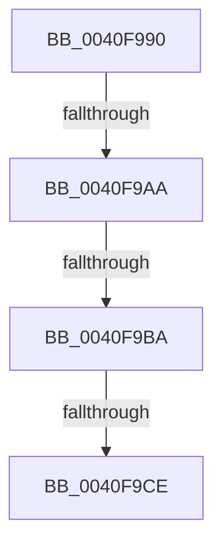

# RtlAppendUnicodeToString

- RVA: `0x0040F990`–`0x0040F9DA` (길이 `74` bytes)
- VA: `0x000000014040F990`
- 실행 섹션: `.text`
- PDB 이름 있음: `예`; PDB Function 태그: `아니요`
- unwind 정보 RVA: `0x0009BB20`
- 디코드: `23`개 명령, `74/74` bytes 표시
- 미해석 바이트: `0` (있으면 어셈블리에 `.byte`로 보존)

> 이 문서는 커널 이미지의 기계어와 PDB 기호를 분석해 생성했습니다. 4번과 5번은 함수 원형과 자료형을 바이너리 사용 방식에서 추정한 C 해석이며 원본 소스 복구 결과는 아닙니다.

## 1. Dependencies

- 직접 호출 지점: **1**; 고유 호출 대상: **1**
- 직접 호출자로 확인된 함수: **62**
- RIP 상대 이미지 참조: **0**

### Outgoing calls
- `0x0040F9AD` → [wcslen](../50/wcslen_function_00501BA0.md) (function, `0x00501BA0`)

### Direct callers
- [AdtpFormatPrefix](AdtpFormatPrefix_function_0040F8E0.md) at `0x0040F922`
- [AdtpFormatPrefix](AdtpFormatPrefix_function_0040F8E0.md) at `0x0040F97C`
- [KsepEvntLogShimsApplied](../5C/KsepEvntLogShimsApplied_function_005CBBE4.md) at `0x005CBD50`
- [LdrpGetResourceFileName](../5E/LdrpGetResourceFileName_function_005E5B28.md) at `0x005E5C1C`
- [LdrpGetResourceFileName](../5E/LdrpGetResourceFileName_function_005E5B28.md) at `0x005E5C36`
- [LdrpGetResourceFileName](../5E/LdrpGetResourceFileName_function_005E5B28.md) at `0x005E5C4A`
- [LdrpGetResourceFileName](../5E/LdrpGetResourceFileName_function_005E5B28.md) at `0x005E5C59`
- [LdrpGetResourceFileName](../5E/LdrpGetResourceFileName_function_005E5B28.md) at `0x005E5C65`
- [LdrpGetResourceFileName](../5E/LdrpGetResourceFileName_function_005E5B28.md) at `0x005E5C79`
- [OpenGlobalizationUserSettingsKey_ForMua](../65/OpenGlobalizationUserSettingsKey_ForMua_function_0065D0C8.md) at `0x0065D23E`
- [OpenGlobalizationUserSettingsKey_ForMua](../65/OpenGlobalizationUserSettingsKey_ForMua_function_0065D0C8.md) at `0x0065D259`
- [AdtpBuildStagingReasonAuditStringInternal](../69/AdtpBuildStagingReasonAuditStringInternal_function_0069DA44.md) at `0x0069DD0C`
- [BcpDisplayErrorInformationModernized](../6A/BcpDisplayErrorInformationModernized_function_006A00DC.md) at `0x006A01B1`
- [BcpDisplayErrorInformationModernized](../6A/BcpDisplayErrorInformationModernized_function_006A00DC.md) at `0x006A023D`
- [BcpDisplayErrorInformationModernized](../6A/BcpDisplayErrorInformationModernized_function_006A00DC.md) at `0x006A026D`
- [BcpDisplayErrorInformationModernized](../6A/BcpDisplayErrorInformationModernized_function_006A00DC.md) at `0x006A02E6`
- [BcpDisplayProgressModernized](../6A/BcpDisplayProgressModernized_function_006A068C.md) at `0x006A077D`
- [BgpFwDisplayBugCheckScreenModernized](../6A/BgpFwDisplayBugCheckScreenModernized_function_006A1338.md) at `0x006A14C6`
- [BgpFwDisplayBugCheckScreenModernized](../6A/BgpFwDisplayBugCheckScreenModernized_function_006A1338.md) at `0x006A167E`
- [sub_006ECA3A](../6E/Unknown_function_006ECA3A.md) at `0x006ECCFB`
- [sub_006ECA3A](../6E/Unknown_function_006ECA3A.md) at `0x006ECE18`
- [sub_006ECA3A](../6E/Unknown_function_006ECA3A.md) at `0x006ECE51`
- [pIoQueryDeviceDescription](../../page/71/pIoQueryDeviceDescription_function_0071F10C.md) at `0x0071F1A6`
- [pIoQueryDeviceDescription](../../page/71/pIoQueryDeviceDescription_function_0071F10C.md) at `0x0071F1CC`
- [pIoQueryDeviceDescription](../../page/71/pIoQueryDeviceDescription_function_0071F10C.md) at `0x0071F28E`
- [pIoQueryDeviceDescription](../../page/71/pIoQueryDeviceDescription_function_0071F10C.md) at `0x0071F361`
- [pIoQueryDeviceDescription](../../page/71/pIoQueryDeviceDescription_function_0071F10C.md) at `0x0071F387`
- [pIoQueryDeviceDescription](../../page/71/pIoQueryDeviceDescription_function_0071F10C.md) at `0x0071F444`
- [IoReportDetectedDevice](../../page/72/IoReportDetectedDevice_function_00725CD0.md) at `0x00725ECC`
- [IoReportRootDevice](../../page/72/IoReportRootDevice_function_00726780.md) at `0x00726890`
- [IopGetRootDeviceId](../../page/72/IopGetRootDeviceId_function_00726BD4.md) at `0x00726BFD`
- [IopFileUtilWalkDirectoryTreeHelper](../../page/73/IopFileUtilWalkDirectoryTreeHelper_function_0073FD40.md) at `0x0073FED6`
- [PiDrvDbCreateNode](../../page/74/PiDrvDbCreateNode_function_00740AFC.md) at `0x00740BFA`
- [PiDrvDbCreateNode](../../page/74/PiDrvDbCreateNode_function_00740AFC.md) at `0x00740C0F`
- [PiDrvDbCreateNode](../../page/74/PiDrvDbCreateNode_function_00740AFC.md) at `0x00740C76`
- [PiDrvDbCreateNode](../../page/74/PiDrvDbCreateNode_function_00740AFC.md) at `0x00740C8B`
- [PiDrvDbSetupNodeHive](../../page/74/PiDrvDbSetupNodeHive_function_00743884.md) at `0x007439AB`
- [PopBcdGetApplicationPathFromResumeObject](../../page/77/PopBcdGetApplicationPathFromResumeObject_function_007702AC.md) at `0x00770437`
- [PopBcdGetApplicationPathFromResumeObject](../../page/77/PopBcdGetApplicationPathFromResumeObject_function_007702AC.md) at `0x00770446`
- [RtlpGetTokenNamedObjectPath](../../page/78/RtlpGetTokenNamedObjectPath_function_0078ED40.md) at `0x0078F273`
- [RtlpConstructCrossVmObjectPath](../../page/79/RtlpConstructCrossVmObjectPath_function_00790958.md) at `0x007909FD`
- [RtlpConstructCrossVmObjectPath](../../page/79/RtlpConstructCrossVmObjectPath_function_00790958.md) at `0x00790A40`
- [IoWMISuggestInstanceName](../../page/7B/IoWMISuggestInstanceName_function_007B2520.md) at `0x007B26EE`
- [IoWMISuggestInstanceName](../../page/7B/IoWMISuggestInstanceName_function_007B2520.md) at `0x007B26FD`
- [IoWMISuggestInstanceName](../../page/7B/IoWMISuggestInstanceName_function_007B2520.md) at `0x007B2708`
- [IoWMISuggestInstanceName](../../page/7B/IoWMISuggestInstanceName_function_007B2520.md) at `0x007B276A`
- [ApiSetpConstructPathToExtension](../../page/7D/ApiSetpConstructPathToExtension_function_007D9950.md) at `0x007D99AB`
- [ApiSetpConstructPathToExtension](../../page/7D/ApiSetpConstructPathToExtension_function_007D9950.md) at `0x007D99BE`
- [CmpBuildMachineHiveMountPoint](../../page/7D/CmpBuildMachineHiveMountPoint_function_007D9F00.md) at `0x007D9F1E`
- [CmpBuildMachineHiveMountPoint](../../page/7D/CmpBuildMachineHiveMountPoint_function_007D9F00.md) at `0x007D9F39`
- [CmpBuildMachineHiveMountPoint](../../page/7D/CmpBuildMachineHiveMountPoint_function_007D9F00.md) at `0x007D9F54`
- [CmpFinishSystemHivesLoad](../../page/7D/CmpFinishSystemHivesLoad_function_007DA210.md) at `0x007DA492`
- [CmpFinishSystemHivesLoad](../../page/7D/CmpFinishSystemHivesLoad_function_007DA210.md) at `0x007DA4A8`
- [CmpMountPreloadedHives](../../page/7D/CmpMountPreloadedHives_function_007DBE18.md) at `0x007DBFD5`
- [CmpMountPreloadedHives](../../page/7D/CmpMountPreloadedHives_function_007DBE18.md) at `0x007DBFE4`
- [CmpMountPreloadedHives](../../page/7D/CmpMountPreloadedHives_function_007DBE18.md) at `0x007DC026`
- [CmpMountPreloadedHives](../../page/7D/CmpMountPreloadedHives_function_007DBE18.md) at `0x007DC037`
- [CmpLoadHiveVolatile](../../page/7D/CmpLoadHiveVolatile_function_007DE5F0.md) at `0x007DE908`
- [CmpFlushBackupHive](../../page/7E/CmpFlushBackupHive_function_007EC1A8.md) at `0x007EC2A2`
- [MiFormDllRegistryPath](../../page/7F/MiFormDllRegistryPath_function_007F7E3C.md) at `0x007F7F43`
- [SdbResolveDatabaseEx](../../page/81/SdbResolveDatabaseEx_function_00817A54.md) at `0x00817C06`
- [SdbResolveDatabaseEx](../../page/81/SdbResolveDatabaseEx_function_00817A54.md) at `0x00817C16`
- [AslRegistryBuildMachinePath](../../page/81/AslRegistryBuildMachinePath_function_00819CCC.md) at `0x00819D80`
- [AslRegistryBuildMachinePath](../../page/81/AslRegistryBuildMachinePath_function_00819CCC.md) at `0x00819D8B`
- [AslRegistryBuildUserPath](../../page/81/AslRegistryBuildUserPath_function_00819DB0.md) at `0x00819E78`
- [AslpProcessMatchRegNode](../../page/81/AslpProcessMatchRegNode_function_0081CB08.md) at `0x0081CC07`
- [AdtpBuildSidListString](../../page/82/AdtpBuildSidListString_function_00822440.md) at `0x008225C2`
- [AdtpBuildSidListString](../../page/82/AdtpBuildSidListString_function_00822440.md) at `0x008225E2`
- [AdtpBuildReplacementString](../../page/82/AdtpBuildReplacementString_function_00822884.md) at `0x008228D9`
- [AdtpBuildReplacementString](../../page/82/AdtpBuildReplacementString_function_00822884.md) at `0x008228E8`
- [AdtpBuildUserAccountControlString](../../page/82/AdtpBuildUserAccountControlString_function_00822920.md) at `0x008229EC`
- [AdtpBuildUserAccountControlString](../../page/82/AdtpBuildUserAccountControlString_function_00822920.md) at `0x00822A1C`
- [AdtpBuildUserAccountControlString](../../page/82/AdtpBuildUserAccountControlString_function_00822920.md) at `0x00822AE7`
- [BiResolveLocateDevice](../../page/82/BiResolveLocateDevice_function_00823AB4.md) at `0x00823C0D`
- [BiResolveLocateDevice](../../page/82/BiResolveLocateDevice_function_00823AB4.md) at `0x00823C19`
- [CmpGetCompleteFileName](../../page/87/CmpGetCompleteFileName_function_0087ADDC.md) at `0x0087AE7A`
- [RtlpGetRegistryHandle](../../page/8C/RtlpGetRegistryHandle_function_008C955C.md) at `0x008C964B`
- [RtlpGetRegistryHandle](../../page/8C/RtlpGetRegistryHandle_function_008C955C.md) at `0x008C96FA`
- [RtlpGetRegistryHandle](../../page/8C/RtlpGetRegistryHandle_function_008C955C.md) at `0x008C9710`
- [RtlFormatCurrentUserKeyPath](../../page/92/RtlFormatCurrentUserKeyPath_function_00927820.md) at `0x009278DE`
- [sub_0093345B](../../page/93/Unknown_function_0093345B.md) at `0x00933576`
- [VrpBuildKeyPath](../../page/93/VrpBuildKeyPath_function_00934650.md) at `0x00934705`
- [IopBuildGlobalSymbolicLinkString](../../page/95/IopBuildGlobalSymbolicLinkString_function_00951530.md) at `0x0095168D`
- [IopBuildGlobalSymbolicLinkString](../../page/95/IopBuildGlobalSymbolicLinkString_function_00951530.md) at `0x0095169E`
- [CmRealKCBToVirtualPath](../../page/99/CmRealKCBToVirtualPath_function_00990130.md) at `0x0099021E`
- [CmRealKCBToVirtualPath](../../page/99/CmRealKCBToVirtualPath_function_00990130.md) at `0x0099024D`
- [CmRealKCBToVirtualPath](../../page/99/CmRealKCBToVirtualPath_function_00990130.md) at `0x0099029F`
- [CmpGetVirtualizationID](../../page/99/CmpGetVirtualizationID_function_00990338.md) at `0x009903EE`
- [pIoQueryBusDescription](../../page/99/pIoQueryBusDescription_function_00996F58.md) at `0x009970D0`
- [IopGetDriverNameFromKeyNode](../../page/99/IopGetDriverNameFromKeyNode_function_00998808.md) at `0x0099893D`
- [MiCreateSectionForDriver](../../page/A2/MiCreateSectionForDriver_function_00A2477C.md) at `0x00A248E0`
- [MiCreateSectionForDriver](../../page/A2/MiCreateSectionForDriver_function_00A2477C.md) at `0x00A248FF`
- [ExpWnfGetPermanentPerUserDataStoreHandle](../../page/A7/ExpWnfGetPermanentPerUserDataStoreHandle_function_00A7A35C.md) at `0x00A7A3F4`
- [ExpWnfGetPermanentPerUserDataStoreHandle](../../page/A7/ExpWnfGetPermanentPerUserDataStoreHandle_function_00A7A35C.md) at `0x00A7A43D`
- [AdtpBuildAccessesString](../../page/A8/AdtpBuildAccessesString_function_00A8898C.md) at `0x00A88C4C`
- [AdtpBuildAccessesString](../../page/A8/AdtpBuildAccessesString_function_00A8898C.md) at `0x00A88C6C`
- [AdtpBuildAccessesString](../../page/A8/AdtpBuildAccessesString_function_00A8898C.md) at `0x00A88CA1`
- [AdtpBuildAccessesString](../../page/A8/AdtpBuildAccessesString_function_00A8898C.md) at `0x00A88CBC`
- [AdtpBuildAccessesString](../../page/A8/AdtpBuildAccessesString_function_00A8898C.md) at `0x00A88DDB`
- [AdtpBuildAccessesString](../../page/A8/AdtpBuildAccessesString_function_00A8898C.md) at `0x00A88DFB`
- [PnpBuildCmResourceList](../../page/AA/PnpBuildCmResourceList_function_00AAB034.md) at `0x00AAB408`
- [PnpBuildCmResourceList](../../page/AA/PnpBuildCmResourceList_function_00AAB034.md) at `0x00AAB44D`
- [PnpLogVetoInformation](../../page/AB/PnpLogVetoInformation_function_00AB6BE8.md) at `0x00AB6CF0`
- [IopSafebootDriverLoad](../../page/AD/IopSafebootDriverLoad_function_00AD2880.md) at `0x00AD2936`
- [CmpMachineHiveListInitialize](../../page/AD/CmpMachineHiveListInitialize_function_00AD4B98.md) at `0x00AD4C90`
- [CmpMachineHiveListInitialize](../../page/AD/CmpMachineHiveListInitialize_function_00AD4B98.md) at `0x00AD4C9B`
- [PiDrvDbMountNode](../../page/AD/PiDrvDbMountNode_function_00AD4ECC.md) at `0x00AD4FC3`
- [AdtpBuildStringListString](../../page/AD/AdtpBuildStringListString_function_00AD5130.md) at `0x00AD521C`
- [sub_00B17EE2](../../page/B1/Unknown_function_00B17EE2.md) at `0x00B17FB0`
- [sub_00B39F44](../../page/B3/Unknown_function_00B39F44.md) at `0x00B39F80`
- [sub_00B4588A](../../page/B4/Unknown_function_00B4588A.md) at `0x00B45AD9`
- [sub_00B4588A](../../page/B4/Unknown_function_00B4588A.md) at `0x00B45B02`
- [sub_00B4588A](../../page/B4/Unknown_function_00B4588A.md) at `0x00B45B26`
- [PiLastGoodRevertLastKnownDirectory](../../init/C3/PiLastGoodRevertLastKnownDirectory_function_00C33980.md) at `0x00C33AD2`
- [CmpInitializeDriverStores](../../init/C5/CmpInitializeDriverStores_function_00C57CF0.md) at `0x00C57E89`
- [CmpInitializeDriverStores](../../init/C5/CmpInitializeDriverStores_function_00C57CF0.md) at `0x00C57F51`
- [CmpInitializePreloadedHive](../../init/C5/CmpInitializePreloadedHive_function_00C58070.md) at `0x00C5811B`
- [CmpInitializePreloadedHive](../../init/C5/CmpInitializePreloadedHive_function_00C58070.md) at `0x00C58128`
- [CmpInitializePreloadedHive](../../init/C5/CmpInitializePreloadedHive_function_00C58070.md) at `0x00C58134`
- [CmpInitializePreloadedHive](../../init/C5/CmpInitializePreloadedHive_function_00C58070.md) at `0x00C5816B`
- [CmpInitializePreloadedHive](../../init/C5/CmpInitializePreloadedHive_function_00C58070.md) at `0x00C5819A`
- [CmpInitializePreloadedHive](../../init/C5/CmpInitializePreloadedHive_function_00C58070.md) at `0x00C581A7`
- [CmpInitializePreloadedHive](../../init/C5/CmpInitializePreloadedHive_function_00C58070.md) at `0x00C583B8`
- [CmpInitializePreloadedHive](../../init/C5/CmpInitializePreloadedHive_function_00C58070.md) at `0x00C583C5`
- [CmpInitializePreloadedHive](../../init/C5/CmpInitializePreloadedHive_function_00C58070.md) at `0x00C583D5`
- [CmpInitializePreloadedHive](../../init/C5/CmpInitializePreloadedHive_function_00C58070.md) at `0x00C583E2`
- [CmpAddDriverToList](../../init/C5/CmpAddDriverToList_function_00C5B758.md) at `0x00C5B8E9`
- [CmpAddDriverToList](../../init/C5/CmpAddDriverToList_function_00C5B758.md) at `0x00C5B90D`
- [CmpOpenSystemDriverHiveContext](../../init/C7/CmpOpenSystemDriverHiveContext_function_00C73D90.md) at `0x00C73E31`

### Static image references
- 디코드된 RIP-relative 메모리 참조가 없습니다.

## 2. Other-region calls and transfers

- 다른 실행 섹션으로 향하는 call: **0**
- call이 아닌 외부 분기/꼬리 이동: **3**
  - `0x0040F9A8` → [sub_0040FA19](Unknown_function_0040FA19.md) (`tail-transfer`)
  - `0x0040F9B8` → [sub_0040FA19 + 0x13](Unknown_function_0040FA19.md) (`tail-transfer`)
  - `0x0040F9CC` → [sub_0040FA19 + 0x13](Unknown_function_0040FA19.md) (`tail-transfer`)

## 3. Assembly (complete function range)

```asm
0040F990  48 89 5C 24 18                  mov qword ptr [rsp + 0x18], rbx
0040F995  48 89 6C 24 20                  mov qword ptr [rsp + 0x20], rbp
0040F99A  57                              push rdi
0040F99B  48 83 EC 20                     sub rsp, 0x20
0040F99F  48 8B DA                        mov rbx, rdx
0040F9A2  48 8B F9                        mov rdi, rcx
0040F9A5  48 85 D2                        test rdx, rdx
0040F9A8  74 6F                           je 0x14040fa19
0040F9AA  48 8B CA                        mov rcx, rdx
0040F9AD  E8 EE 21 0F 00                  call 0x140501ba0
0040F9B2  48 3D FE 7F 00 00               cmp rax, 0x7ffe
0040F9B8  77 72                           ja 0x14040fa2c
0040F9BA  0F B7 17                        movzx edx, word ptr [rdi]
0040F9BD  66 03 C0                        add ax, ax
0040F9C0  0F B7 E8                        movzx ebp, ax
0040F9C3  0F B7 47 02                     movzx eax, word ptr [rdi + 2]
0040F9C7  8D 0C 2A                        lea ecx, [rdx + rbp]
0040F9CA  3B C8                           cmp ecx, eax
0040F9CC  77 5E                           ja 0x14040fa2c
0040F9CE  48 8B 47 08                     mov rax, qword ptr [rdi + 8]
0040F9D2  8B CA                           mov ecx, edx
0040F9D4  48 D1 E9                        shr rcx, 1
0040F9D7  44 8B C5                        mov r8d, ebp
```

## 4. C-style interpretation (structured pseudocode)

```c
__int64 __fastcall RtlAppendUnicodeToString(__int64 a1, __int64 a2)
{
    __int64 result;
    __int64 v_rsp;
    unsigned __int64 v_stack_p18;
    unsigned __int64 v_stack_p20;

    v_stack_p18 = v_rbx;
    v_stack_p20 = v_rbp;
    v_rsp = (v_rsp) - (32);
    result = wcslen(a2, a2, a3, a4);
    result = (unsigned __int16)((result) + ((unsigned __int16)(result)));
    a1 = ((unsigned int)((unsigned int)(*(unsigned __int16 *)(a1)))) >> (1);
    return *(unsigned __int64 *)(a1 + 8);
}
```

## 5. (Beta) C Style

```c
int64_t RtlAppendUnicodeToString(void *Arg1, int64_t Arg2)
{
    uint8_t *arg1 = (uint8_t *)Arg1;

    int64_t result;
    int64_t local_rsp;
    uint64_t v_stack_p18;
    uint64_t v_stack_p20;

    v_stack_p18 = local_rbx;
    v_stack_p20 = local_rbp;
    local_rsp = (local_rsp) - (32);
    result = wcslen(Arg2, Arg2, a3, a4);
    result = (uint16_t)((result) + ((uint16_t)(result)));
    Arg1 = ((uint32_t)((uint32_t)(*(uint16_t *)(arg1)))) >> (1);
    return *(uint64_t *)(arg1 + 0x8);
}
```

### 관측된 메모리 오프셋

구조체 형식이 확인되지 않은 접근은 인자 기준의 오프셋으로만 기록했습니다.

| 기준 인자 | 오프셋 표현 | 폭 (bit) | 접근 |
|---|---:|---:|---|
| `Arg1` | `+ 0x0` | `16` | `R` |
| `Arg1` | `+ 0x2` | `16` | `R` |
| `Arg1` | `+ 0x8` | `64` | `R` |

## 6. Execution-region graph

[열기: 2D/3D 그래프와 함수 탐색 컨트롤 패널](../../../control-panel.html?section=text&rva=0x0040F990&view=graph)

- 2D 그래프는 위에서 아래로 흐르고, 3D 그래프는 빈 공간을 드래그해 회전합니다. Shift+드래그는 이동, 휠은 확대·축소, 함수 노드 선택은 대상 보고서 이동입니다.

### Static fallback


