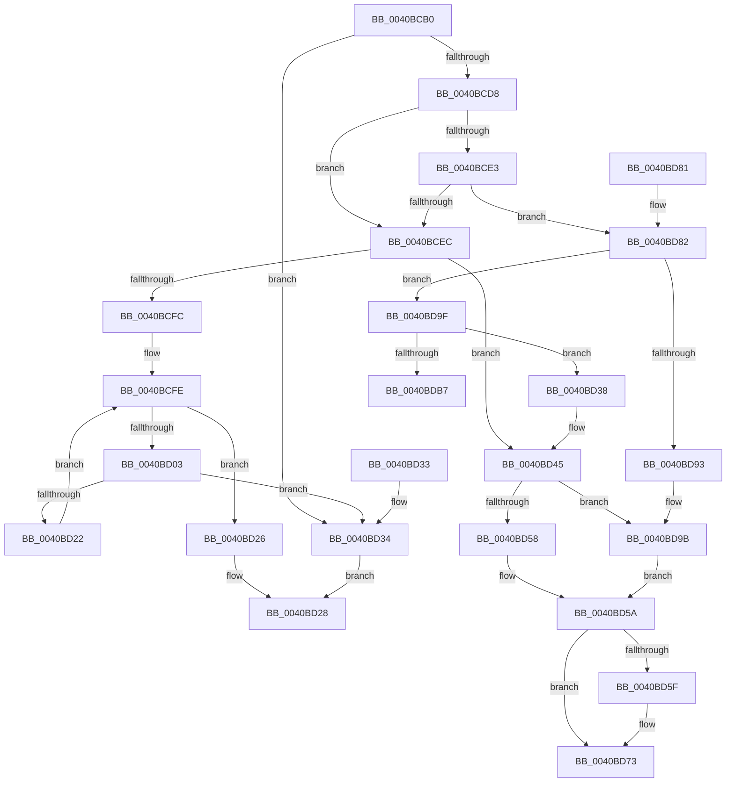

# RtlAreNamesEqual

- RVA: `0x0040BCB0`–`0x0040BDC4` (길이 `276` bytes)
- VA: `0x000000014040BCB0`
- 실행 섹션: `.text`
- PDB 이름 있음: `예`; PDB Function 태그: `아니요`
- unwind 정보 RVA: `0x0009AF38`
- 디코드: `87`개 명령, `276/276` bytes 표시
- 미해석 바이트: `0` (있으면 어셈블리에 `.byte`로 보존)

> 이 문서는 커널 이미지의 기계어와 PDB 기호를 분석해 생성했습니다. 4번과 5번은 함수 원형과 자료형을 바이너리 사용 방식에서 추정한 C 해석이며 원본 소스 복구 결과는 아닙니다.

## 1. Dependencies

- 직접 호출 지점: **8**; 고유 호출 대상: **4**
- 직접 호출자로 확인된 함수: **0**
- RIP 상대 이미지 참조: **0**

### Outgoing calls
- `0x0040BD4F` → [memcmp](../6C/memcmp_function_006C6B10.md) (function, `0x006C6B10`)
- `0x0040BD64` → [RtlFreeAnsiString](../../page/9C/RtlFreeAnsiString_function_009C0800.md) (function, `0x009C0800`)
- `0x0040BD6E` → [RtlFreeAnsiString](../../page/9C/RtlFreeAnsiString_function_009C0800.md) (function, `0x009C0800`)
- `0x0040BD8A` → [RtlpUpcaseUnicodeStringPrivate](../2F/RtlpUpcaseUnicodeStringPrivate_function_002FE0B0.md) (function, `0x002FE0B0`)
- `0x0040BD95` → [RtlRaiseStatus](../2F/RtlRaiseStatus_function_002F6A50.md) (function, `0x002F6A50`)
- `0x0040BDA7` → [RtlpUpcaseUnicodeStringPrivate](../2F/RtlpUpcaseUnicodeStringPrivate_function_002FE0B0.md) (function, `0x002FE0B0`)
- `0x0040BDB7` → [RtlFreeAnsiString](../../page/9C/RtlFreeAnsiString_function_009C0800.md) (function, `0x009C0800`)
- `0x0040BDBE` → [RtlRaiseStatus](../2F/RtlRaiseStatus_function_002F6A50.md) (function, `0x002F6A50`)

### Direct callers
- 이 함수 시작 RVA로 연결되는 직접 call은 확인되지 않았습니다. 간접 호출은 완전히 역산할 수 없습니다.

### Static image references
- 디코드된 RIP-relative 메모리 참조가 없습니다.

## 2. Other-region calls and transfers

- 다른 실행 섹션으로 향하는 call: **3**
  - `0x0040BD64` → [RtlFreeAnsiString](../../page/9C/RtlFreeAnsiString_function_009C0800.md) (`.text` → `PAGE`)
  - `0x0040BD6E` → [RtlFreeAnsiString](../../page/9C/RtlFreeAnsiString_function_009C0800.md) (`.text` → `PAGE`)
  - `0x0040BDB7` → [RtlFreeAnsiString](../../page/9C/RtlFreeAnsiString_function_009C0800.md) (`.text` → `PAGE`)
- 별도 외부 분기/꼬리 이동을 확인하지 못했습니다.

## 3. Assembly (complete function range)

```asm
0040BCB0  48 89 5C 24 08                  mov qword ptr [rsp + 8], rbx
0040BCB5  57                              push rdi
0040BCB6  48 83 EC 40                     sub rsp, 0x40
0040BCBA  0F B7 01                        movzx eax, word ptr [rcx]
0040BCBD  0F 57 C0                        xorps xmm0, xmm0
0040BCC0  0F 57 C9                        xorps xmm1, xmm1
0040BCC3  4D 8B D1                        mov r10, r9
0040BCC6  48 8B DA                        mov rbx, rdx
0040BCC9  0F 11 44 24 20                  movups xmmword ptr [rsp + 0x20], xmm0
0040BCCE  0F 11 4C 24 30                  movups xmmword ptr [rsp + 0x30], xmm1
0040BCD3  66 3B 02                        cmp ax, word ptr [rdx]
0040BCD6  75 5C                           jne 0x14040bd34
0040BCD8  44 8B C8                        mov r9d, eax
0040BCDB  41 D1 E9                        shr r9d, 1
0040BCDE  45 84 C0                        test r8b, r8b
0040BCE1  74 09                           je 0x14040bcec
0040BCE3  4D 85 D2                        test r10, r10
0040BCE6  0F 84 96 00 00 00               je 0x14040bd82
0040BCEC  48 83 C3 08                     add rbx, 8
0040BCF0  4C 8D 59 08                     lea r11, [rcx + 8]
0040BCF4  40 32 FF                        xor dil, dil
0040BCF7  45 84 C0                        test r8b, r8b
0040BCFA  74 49                           je 0x14040bd45
0040BCFC  33 C0                           xor eax, eax
0040BCFE  41 3B C1                        cmp eax, r9d
0040BD01  73 23                           jae 0x14040bd26
0040BD03  49 8B 0B                        mov rcx, qword ptr [r11]
0040BD06  48 8D 14 00                     lea rdx, [rax + rax]
0040BD0A  44 0F B7 04 0A                  movzx r8d, word ptr [rdx + rcx]
0040BD0F  48 8B 0B                        mov rcx, qword ptr [rbx]
0040BD12  0F B7 14 0A                     movzx edx, word ptr [rdx + rcx]
0040BD16  41 0F B7 0C 52                  movzx ecx, word ptr [r10 + rdx*2]
0040BD1B  66 43 39 0C 42                  cmp word ptr [r10 + r8*2], cx
0040BD20  75 12                           jne 0x14040bd34
0040BD22  FF C0                           inc eax
0040BD24  EB D8                           jmp 0x14040bcfe
0040BD26  B0 01                           mov al, 1
0040BD28  48 8B 5C 24 50                  mov rbx, qword ptr [rsp + 0x50]
0040BD2D  48 83 C4 40                     add rsp, 0x40
0040BD31  5F                              pop rdi
0040BD32  C3                              ret
0040BD33  CC                              int3
0040BD34  32 C0                           xor al, al
0040BD36  EB F0                           jmp 0x14040bd28
0040BD38  40 B7 01                        mov dil, 1
0040BD3B  4C 8D 5C 24 28                  lea r11, [rsp + 0x28]
0040BD40  48 8D 5C 24 38                  lea rbx, [rsp + 0x38]
0040BD45  44 0F B7 01                     movzx r8d, word ptr [rcx]
0040BD49  49 8B 0B                        mov rcx, qword ptr [r11]
0040BD4C  48 8B 13                        mov rdx, qword ptr [rbx]
0040BD4F  E8 BC AD 2B 00                  call 0x1406c6b10
0040BD54  85 C0                           test eax, eax
0040BD56  74 43                           je 0x14040bd9b
0040BD58  32 DB                           xor bl, bl
0040BD5A  40 84 FF                        test dil, dil
0040BD5D  74 14                           je 0x14040bd73
0040BD5F  48 8D 4C 24 20                  lea rcx, [rsp + 0x20]
0040BD64  E8 97 4A 5B 00                  call 0x1409c0800
0040BD69  48 8D 4C 24 30                  lea rcx, [rsp + 0x30]
0040BD6E  E8 8D 4A 5B 00                  call 0x1409c0800
0040BD73  0F B6 C3                        movzx eax, bl
0040BD76  48 8B 5C 24 50                  mov rbx, qword ptr [rsp + 0x50]
0040BD7B  48 83 C4 40                     add rsp, 0x40
0040BD7F  5F                              pop rdi
0040BD80  C3                              ret
0040BD81  CC                              int3
0040BD82  48 8B D1                        mov rdx, rcx
0040BD85  48 8D 4C 24 20                  lea rcx, [rsp + 0x20]
0040BD8A  E8 21 23 EF FF                  call 0x1402fe0b0
0040BD8F  85 C0                           test eax, eax
0040BD91  79 0C                           jns 0x14040bd9f
0040BD93  8B C8                           mov ecx, eax
0040BD95  E8 B6 AC EE FF                  call 0x1402f6a50
0040BD9A  CC                              int3
0040BD9B  B3 01                           mov bl, 1
0040BD9D  EB BB                           jmp 0x14040bd5a
0040BD9F  48 8B D3                        mov rdx, rbx
0040BDA2  48 8D 4C 24 30                  lea rcx, [rsp + 0x30]
0040BDA7  E8 04 23 EF FF                  call 0x1402fe0b0
0040BDAC  48 8D 4C 24 20                  lea rcx, [rsp + 0x20]
0040BDB1  8B D8                           mov ebx, eax
0040BDB3  85 C0                           test eax, eax
0040BDB5  79 81                           jns 0x14040bd38
0040BDB7  E8 44 4A 5B 00                  call 0x1409c0800
0040BDBC  8B CB                           mov ecx, ebx
0040BDBE  E8 8D AC EE FF                  call 0x1402f6a50
0040BDC3  CC                              int3
```

## 4. C-style interpretation (structured pseudocode)

```c
__int64 __fastcall RtlAreNamesEqual(__int64 a1, __int64 a2, unsigned __int8 a3, __int64 a4)
{
    __int64 result;
    __int64 v_rbx;
    __int64 v_rdi;
    __int64 v_rsp;
    unsigned __int64 v_stack_m18;
    unsigned __int64 v_stack_m28;
    unsigned __int64 v_stack_p20;
    unsigned __int64 v_stack_p28;
    unsigned __int64 v_stack_p30;
    unsigned __int64 v_stack_p38;
    unsigned __int64 v_stack_p50;
    unsigned __int64 v_stack_p68;
    unsigned __int64 v_stack_p78;
    unsigned __int64 v_stack_p8;

    v_stack_p8 = v_rbx;
    v_rsp = (v_rsp) - (64);
    v_stack_m28 = v_xmm0;
    v_stack_m18 = v_xmm1;
    if (((unsigned __int16)(*(unsigned __int16 *)(a1))) != (*(unsigned __int16 *)(a2))) goto loc_0040BD34;
    a4 = (unsigned int)(((unsigned int)((unsigned int)(*(unsigned __int16 *)(a1)))) >> (1));
    if (a3 == 0) goto loc_0040BCEC;
    if (a4 == 0) goto loc_0040BD82;
loc_0040BCEC:
    v_rbx = (a2) + (8);
    v_rdi = 0;
    if (a3 == 0) goto loc_0040BD45;
    result = 0;
loc_0040BCFE:
    if (0 >= ((unsigned int)(a4))) goto loc_0040BD26;
    if ((*(unsigned __int16 *)(a4 + *(unsigned __int16 *)(result + result * 1 + *(unsigned __int64 *)(a1 + 8) * 1) * 2)) != ((unsigned __int16)(*(unsigned __int16 *)(a4 + *(unsigned __int16 *)(result + result * 1 + *(unsigned __int64 *)(v_rbx) * 1) * 2)))) goto loc_0040BD34;
    result = (unsigned int)((result) + 1);
    goto loc_0040BCFE;
loc_0040BD26:
loc_0040BD28:
    v_rsp = (v_rsp) + (64);
    return 1;
loc_0040BD34:
    result = 0;
    goto loc_0040BD28;
loc_0040BD38:
loc_0040BD45:
    result = memcmp(*(unsigned __int64 *)(v_stack_p28), *(unsigned __int64 *)(v_stack_p38), *(unsigned __int16 *)(*(unsigned __int16 *)(a4 + *(unsigned __int16 *)(result + result * 1 + *(unsigned __int64 *)(v_rbx) * 1) * 2)), a4);
    if ((unsigned int)(result) == 0) goto loc_0040BD9B;
    v_rbx = 0;
loc_0040BD5A:
    if (1 != 0) {
        a1 = v_stack_p20;
        result = RtlFreeAnsiString(a1, *(unsigned __int64 *)(v_stack_p38), *(unsigned __int16 *)(*(unsigned __int16 *)(a4 + *(unsigned __int16 *)(result + result * 1 + *(unsigned __int64 *)(v_rbx) * 1) * 2)), a4);
        a1 = v_stack_p30;
        result = RtlFreeAnsiString(a1, *(unsigned __int64 *)(v_stack_p38), *(unsigned __int16 *)(*(unsigned __int16 *)(a4 + *(unsigned __int16 *)(result + result * 1 + *(unsigned __int64 *)(v_rbx) * 1) * 2)), a4);
    }
    v_rsp = (v_rsp) + (64);
    return 0;
loc_0040BD82:
    result = RtlpUpcaseUnicodeStringPrivate(v_stack_p68, a1, *(unsigned __int16 *)(*(unsigned __int16 *)(a4 + *(unsigned __int16 *)(result + result * 1 + *(unsigned __int64 *)(v_rbx) * 1) * 2)), a4);
    if (!sign_flag) goto loc_0040BD9F;
    result = RtlRaiseStatus((unsigned int)((unsigned int)(result)), a1, *(unsigned __int16 *)(*(unsigned __int16 *)(a4 + *(unsigned __int16 *)(result + result * 1 + *(unsigned __int64 *)(v_rbx) * 1) * 2)), a4);
loc_0040BD9B:
    goto loc_0040BD5A;
loc_0040BD9F:
    result = RtlpUpcaseUnicodeStringPrivate(v_stack_p78, 1, *(unsigned __int16 *)(*(unsigned __int16 *)(a4 + *(unsigned __int16 *)(result + result * 1 + *(unsigned __int64 *)(v_rbx) * 1) * 2)), a4);
    if (!sign_flag) goto loc_0040BD38;
    result = RtlFreeAnsiString(v_stack_p68, 1, *(unsigned __int16 *)(*(unsigned __int16 *)(a4 + *(unsigned __int16 *)(result + result * 1 + *(unsigned __int64 *)(v_rbx) * 1) * 2)), a4);
    result = RtlRaiseStatus((unsigned int)((unsigned int)((unsigned int)((unsigned int)(result)))), 1, *(unsigned __int16 *)(*(unsigned __int16 *)(a4 + *(unsigned __int16 *)(result + result * 1 + *(unsigned __int64 *)(v_rbx) * 1) * 2)), a4);
    return result;
}
```

## 5. (Beta) C Style

```c
int64_t RtlAreNamesEqual(void *Arg1, void *Arg2, uint8_t Arg3, int64_t Arg4)
{
    uint8_t *arg1 = (uint8_t *)Arg1;
    uint8_t *arg2 = (uint8_t *)Arg2;

    int64_t result;
    int64_t local_rbx;
    int64_t local_rdi;
    int64_t local_rsp;
    uint64_t v_stack_m18;
    uint64_t v_stack_m28;
    uint64_t v_stack_p20;
    uint64_t v_stack_p28;
    uint64_t v_stack_p30;
    uint64_t v_stack_p38;
    uint64_t v_stack_p50;
    uint64_t v_stack_p68;
    uint64_t v_stack_p78;
    uint64_t v_stack_p8;

    v_stack_p8 = local_rbx;
    local_rsp = (local_rsp) - (64);
    v_stack_m28 = v_xmm0;
    v_stack_m18 = v_xmm1;
    if (((uint16_t)(*(uint16_t *)(arg1))) != (*(uint16_t *)(arg2))) goto loc_0040BD34;
    Arg4 = (uint32_t)(((uint32_t)((uint32_t)(*(uint16_t *)(arg1)))) >> (1));
    if (Arg3 == 0) goto loc_0040BCEC;
    if (Arg4 == 0) goto loc_0040BD82;
loc_0040BCEC:
    local_rbx = (Arg2) + (8);
    local_rdi = 0;
    if (Arg3 == 0) goto loc_0040BD45;
    result = 0;
loc_0040BCFE:
    if (0 >= ((uint32_t)(Arg4))) goto loc_0040BD26;
    if ((*(uint16_t *)(Arg4 + *(uint16_t *)(result + result * 1 + *(uint64_t *)(arg1 + 0x8) * 1) * 2)) != ((uint16_t)(*(uint16_t *)(Arg4 + *(uint16_t *)(result + result * 1 + *(uint64_t *)(local_rbx) * 1) * 2)))) goto loc_0040BD34;
    result = (uint32_t)((result) + 1);
    goto loc_0040BCFE;
loc_0040BD26:
loc_0040BD28:
    local_rsp = (local_rsp) + (64);
    return 1;
loc_0040BD34:
    result = 0;
    goto loc_0040BD28;
loc_0040BD38:
loc_0040BD45:
    result = memcmp(*(uint64_t *)(v_stack_p28), *(uint64_t *)(v_stack_p38), *(uint16_t *)(*(uint16_t *)(Arg4 + *(uint16_t *)(result + result * 1 + *(uint64_t *)(local_rbx) * 1) * 2)), Arg4);
    if ((uint32_t)(result) == 0) goto loc_0040BD9B;
    local_rbx = 0;
loc_0040BD5A:
    if (1 != 0) {
        Arg1 = v_stack_p20;
        result = RtlFreeAnsiString(Arg1, *(uint64_t *)(v_stack_p38), *(uint16_t *)(*(uint16_t *)(Arg4 + *(uint16_t *)(result + result * 1 + *(uint64_t *)(local_rbx) * 1) * 2)), Arg4);
        Arg1 = v_stack_p30;
        result = RtlFreeAnsiString(Arg1, *(uint64_t *)(v_stack_p38), *(uint16_t *)(*(uint16_t *)(Arg4 + *(uint16_t *)(result + result * 1 + *(uint64_t *)(local_rbx) * 1) * 2)), Arg4);
    }
    local_rsp = (local_rsp) + (64);
    return 0;
loc_0040BD82:
    result = RtlpUpcaseUnicodeStringPrivate(v_stack_p68, Arg1, *(uint16_t *)(*(uint16_t *)(Arg4 + *(uint16_t *)(result + result * 1 + *(uint64_t *)(local_rbx) * 1) * 2)), Arg4);
    if (!sign_flag) goto loc_0040BD9F;
    result = RtlRaiseStatus((uint32_t)((uint32_t)(result)), Arg1, *(uint16_t *)(*(uint16_t *)(Arg4 + *(uint16_t *)(result + result * 1 + *(uint64_t *)(local_rbx) * 1) * 2)), Arg4);
loc_0040BD9B:
    goto loc_0040BD5A;
loc_0040BD9F:
    result = RtlpUpcaseUnicodeStringPrivate(v_stack_p78, 1, *(uint16_t *)(*(uint16_t *)(Arg4 + *(uint16_t *)(result + result * 1 + *(uint64_t *)(local_rbx) * 1) * 2)), Arg4);
    if (!sign_flag) goto loc_0040BD38;
    result = RtlFreeAnsiString(v_stack_p68, 1, *(uint16_t *)(*(uint16_t *)(Arg4 + *(uint16_t *)(result + result * 1 + *(uint64_t *)(local_rbx) * 1) * 2)), Arg4);
    result = RtlRaiseStatus((uint32_t)((uint32_t)((uint32_t)((uint32_t)(result)))), 1, *(uint16_t *)(*(uint16_t *)(Arg4 + *(uint16_t *)(result + result * 1 + *(uint64_t *)(local_rbx) * 1) * 2)), Arg4);
    return result;
}
```

### 관측된 메모리 오프셋

구조체 형식이 확인되지 않은 접근은 인자 기준의 오프셋으로만 기록했습니다.

| 기준 인자 | 오프셋 표현 | 폭 (bit) | 접근 |
|---|---:|---:|---|
| `Arg1` | `+ 0x0` | `16` | `R` |
| `Arg1` | `+ 0x0` | `64` | `R` |
| `Arg1` | `+ 0x8` | `64` | `R` |
| `Arg2` | `+ 0x0` | `16` | `R` |
| `Arg2` | `+ 0x0` | `64` | `R` |

## 6. Execution-region graph

[열기: 2D/3D 그래프와 함수 탐색 컨트롤 패널](../../../control-panel.html?section=text&rva=0x0040BCB0&view=graph)

- 2D 그래프는 위에서 아래로 흐르고, 3D 그래프는 빈 공간을 드래그해 회전합니다. Shift+드래그는 이동, 휠은 확대·축소, 함수 노드 선택은 대상 보고서 이동입니다.

### Static fallback


