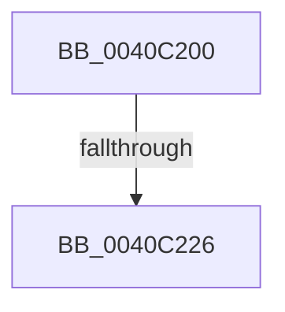

# RtlDissectName

- RVA: `0x0040C200`–`0x0040C22D` (길이 `45` bytes)
- VA: `0x000000014040C200`
- 실행 섹션: `.text`
- PDB 이름 있음: `예`; PDB Function 태그: `아니요`
- unwind 정보 RVA: `0x0009B0B8`
- 디코드: `13`개 명령, `45/45` bytes 표시
- 미해석 바이트: `0` (있으면 어셈블리에 `.byte`로 보존)

> 이 문서는 커널 이미지의 기계어와 PDB 기호를 분석해 생성했습니다. 4번과 5번은 함수 원형과 자료형을 바이너리 사용 방식에서 추정한 C 해석이며 원본 소스 복구 결과는 아닙니다.

## 1. Dependencies

- 직접 호출 지점: **0**; 고유 호출 대상: **0**
- 직접 호출자로 확인된 함수: **0**
- RIP 상대 이미지 참조: **0**

### Outgoing calls
- 직접 디코드된 call 명령이 없습니다.

### Direct callers
- 이 함수 시작 RVA로 연결되는 직접 call은 확인되지 않았습니다. 간접 호출은 완전히 역산할 수 없습니다.

### Static image references
- 디코드된 RIP-relative 메모리 참조가 없습니다.

## 2. Other-region calls and transfers

- 다른 실행 섹션으로 향하는 call: **0**
- call이 아닌 외부 분기/꼬리 이동: **1**
  - `0x0040C220` → [sub_0040C28B + 0x1F](Unknown_function_0040C28B.md) (`tail-transfer`)

## 3. Assembly (complete function range)

```asm
0040C200  40 53                           push rbx
0040C202  45 33 D2                        xor r10d, r10d
0040C205  4D 8B D8                        mov r11, r8
0040C208  44 89 12                        mov dword ptr [rdx], r10d
0040C20B  48 8B DA                        mov rbx, rdx
0040C20E  4C 89 52 08                     mov qword ptr [rdx + 8], r10
0040C212  45 89 10                        mov dword ptr [r8], r10d
0040C215  4D 89 50 08                     mov qword ptr [r8 + 8], r10
0040C219  44 0F B7 01                     movzx r8d, word ptr [rcx]
0040C21D  41 D1 E8                        shr r8d, 1
0040C220  0F 84 84 00 00 00               je 0x14040c2aa
0040C226  4C 8B 49 08                     mov r9, qword ptr [rcx + 8]
0040C22A  41 8B C2                        mov eax, r10d
```

## 4. C-style interpretation (structured pseudocode)

```c
__int64 __fastcall RtlDissectName(__int64 a1, __int64 a2, __int64 a3)
{
    __int64 v_r10;

    v_r10 = 0;
    *(unsigned int *)(a2) = 0;
    *(unsigned __int64 *)(a2 + 8) = 0;
    *(unsigned int *)(a3) = 0;
    *(unsigned __int64 *)(a3 + 8) = 0;
    a3 = (unsigned int)((*(unsigned __int16 *)(a1)) >> (1));
    return 0;
}
```

## 5. (Beta) C Style

```c
int64_t RtlDissectName(void *Arg1, void *Arg2, void *Arg3)
{
    uint8_t *arg1 = (uint8_t *)Arg1;
    uint8_t *arg2 = (uint8_t *)Arg2;
    uint8_t *arg3 = (uint8_t *)Arg3;

    int64_t local_r10;

    local_r10 = 0;
    *(uint32_t *)(arg2) = 0;
    *(uint64_t *)(arg2 + 0x8) = 0;
    *(uint32_t *)(arg3) = 0;
    *(uint64_t *)(arg3 + 0x8) = 0;
    Arg3 = (uint32_t)((*(uint16_t *)(arg1)) >> (1));
    return 0;
}
```

### 관측된 메모리 오프셋

구조체 형식이 확인되지 않은 접근은 인자 기준의 오프셋으로만 기록했습니다.

| 기준 인자 | 오프셋 표현 | 폭 (bit) | 접근 |
|---|---:|---:|---|
| `Arg1` | `+ 0x0` | `16` | `R` |
| `Arg1` | `+ 0x8` | `64` | `R` |
| `Arg2` | `+ 0x0` | `32` | `W` |
| `Arg2` | `+ 0x8` | `64` | `W` |
| `Arg3` | `+ 0x0` | `32` | `W` |
| `Arg3` | `+ 0x8` | `64` | `W` |

## 6. Execution-region graph

[열기: 2D/3D 그래프와 함수 탐색 컨트롤 패널](../../../control-panel.html?section=text&rva=0x0040C200&view=graph)

- 2D 그래프는 위에서 아래로 흐르고, 3D 그래프는 빈 공간을 드래그해 회전합니다. Shift+드래그는 이동, 휠은 확대·축소, 함수 노드 선택은 대상 보고서 이동입니다.

### Static fallback


