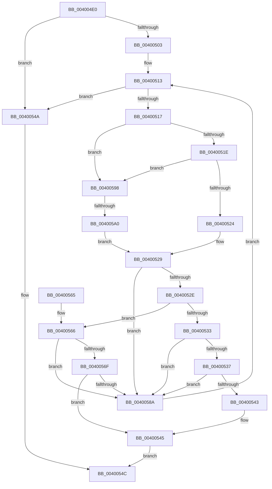

# RtlFindAceBySid

- RVA: `0x004004E0`–`0x004005A7` (길이 `199` bytes)
- VA: `0x00000001404004E0`
- 실행 섹션: `.text`
- PDB 이름 있음: `예`; PDB Function 태그: `예`
- unwind 정보 RVA: `0x0009A224`
- 디코드: `64`개 명령, `199/199` bytes 표시
- 미해석 바이트: `0` (있으면 어셈블리에 `.byte`로 보존)

> 이 문서는 커널 이미지의 기계어와 PDB 기호를 분석해 생성했습니다. 4번과 5번은 함수 원형과 자료형을 바이너리 사용 방식에서 추정한 C 해석이며 원본 소스 복구 결과는 아닙니다.

## 1. Dependencies

- 직접 호출 지점: **2**; 고유 호출 대상: **2**
- 직접 호출자로 확인된 함수: **3**
- RIP 상대 이미지 참조: **0**

### Outgoing calls
- `0x0040053A` → [RtlEqualSid](RtlEqualSid_function_00400AD0.md) (function, `0x00400AD0`)
- `0x00400581` → [memcmp](../6C/memcmp_function_006C6B10.md) (function, `0x006C6B10`)

### Direct callers
- [SepAppendAceToTokenDefaultDacl](SepAppendAceToTokenDefaultDacl_function_004002F8.md) at `0x0040034A`
- [SepAppendAceToTokenObjectAcl](../../page/8B/SepAppendAceToTokenObjectAcl_function_008B6430.md) at `0x008B65E2`
- [sub_008BBC01](../../page/8B/Unknown_function_008BBC01.md) at `0x008BBF3A`

### Static image references
- 디코드된 RIP-relative 메모리 참조가 없습니다.

## 2. Other-region calls and transfers

- 다른 실행 섹션으로 향하는 call: **0**
- call이 아닌 외부 분기/꼬리 이동: **1**
  - `0x0040059A` → [sub_006EC100](../6E/Unknown_function_006EC100.md) (`tail-transfer`)

## 3. Assembly (complete function range)

```asm
004004E0  48 89 5C 24 08                  mov qword ptr [rsp + 8], rbx
004004E5  48 89 6C 24 10                  mov qword ptr [rsp + 0x10], rbp
004004EA  48 89 74 24 18                  mov qword ptr [rsp + 0x18], rsi
004004EF  57                              push rdi
004004F0  41 56                           push r14
004004F2  41 57                           push r15
004004F4  48 83 EC 20                     sub rsp, 0x20
004004F8  49 8B F0                        mov rsi, r8
004004FB  4C 8B F2                        mov r14, rdx
004004FE  48 85 C9                        test rcx, rcx
00400501  74 47                           je 0x14040054a
00400503  0F B7 69 04                     movzx ebp, word ptr [rcx + 4]
00400507  48 8D 59 08                     lea rbx, [rcx + 8]
0040050B  33 FF                           xor edi, edi
0040050D  41 BF 0F 66 3E 00               mov r15d, 0x3e660f
00400513  3B FD                           cmp edi, ebp
00400515  73 33                           jae 0x14040054a
00400517  0F B6 03                        movzx eax, byte ptr [rbx]
0040051A  3C 15                           cmp al, 0x15
0040051C  77 7A                           ja 0x140400598
0040051E  41 0F A3 C7                     bt r15d, eax
00400522  73 74                           jae 0x140400598
00400524  B9 08 00 00 00                  mov ecx, 8
00400529  48 03 CB                        add rcx, rbx
0040052C  74 5C                           je 0x14040058a
0040052E  48 85 F6                        test rsi, rsi
00400531  74 33                           je 0x140400566
00400533  3B 3E                           cmp edi, dword ptr [rsi]
00400535  72 53                           jb 0x14040058a
00400537  49 8B D6                        mov rdx, r14
0040053A  E8 91 05 00 00                  call 0x140400ad0
0040053F  84 C0                           test al, al
00400541  74 47                           je 0x14040058a
00400543  89 3E                           mov dword ptr [rsi], edi
00400545  48 8B C3                        mov rax, rbx
00400548  EB 02                           jmp 0x14040054c
0040054A  33 C0                           xor eax, eax
0040054C  48 8B 5C 24 40                  mov rbx, qword ptr [rsp + 0x40]
00400551  48 8B 6C 24 48                  mov rbp, qword ptr [rsp + 0x48]
00400556  48 8B 74 24 50                  mov rsi, qword ptr [rsp + 0x50]
0040055B  48 83 C4 20                     add rsp, 0x20
0040055F  41 5F                           pop r15
00400561  41 5E                           pop r14
00400563  5F                              pop rdi
00400564  C3                              ret
00400565  CC                              int3
00400566  0F B7 01                        movzx eax, word ptr [rcx]
00400569  66 41 3B 06                     cmp ax, word ptr [r14]
0040056D  75 1B                           jne 0x14040058a
0040056F  44 8B C0                        mov r8d, eax
00400572  49 8B D6                        mov rdx, r14
00400575  49 C1 E8 08                     shr r8, 8
00400579  4E 8D 04 85 08 00 00 00         lea r8, [r8*4 + 8]
00400581  E8 8A 65 2C 00                  call 0x1406c6b10
00400586  85 C0                           test eax, eax
00400588  74 BB                           je 0x140400545
0040058A  0F B7 43 02                     movzx eax, word ptr [rbx + 2]
0040058E  FF C7                           inc edi
00400590  48 03 D8                        add rbx, rax
00400593  E9 7B FF FF FF                  jmp 0x140400513
00400598  3C 04                           cmp al, 4
0040059A  0F 85 60 BB 2E 00               jne 0x1406ec100
004005A0  B9 0C 00 00 00                  mov ecx, 0xc
004005A5  EB 82                           jmp 0x140400529
```

## 4. C-style interpretation (structured pseudocode)

```c
__int64 __fastcall RtlFindAceBySid(__int64 a1, __int64 a2, __int64 a3)
{
    __int64 result;
    __int64 v_rbx;
    __int64 v_rdi;
    __int64 v_rsp;
    unsigned __int64 v_stack_p10;
    unsigned __int64 v_stack_p18;
    unsigned __int64 v_stack_p8;

    v_stack_p8 = v_rbx;
    v_stack_p10 = v_rbp;
    v_stack_p18 = v_rsi;
    v_rsp = (v_rsp) - (32);
    if (a1 == 0) goto loc_0040054A;
    v_rdi = 0;
loc_00400513:
    if (0 >= ((unsigned int)(*(unsigned __int16 *)(a1 + 4)))) goto loc_0040054A;
    if (((unsigned __int8)(*(unsigned __int8 *)(a1 + 8))) > 21) goto loc_00400598;
    if (((unsigned __int8)(*(unsigned __int8 *)(a1 + 8))) >= 21) goto loc_00400598;
loc_00400529:
    a1 = (8) + (a1 + 8);
    if (condition_is_equal) goto loc_0040058A;
    if (a3 == 0) goto loc_00400566;
    if (0 < (*(unsigned int *)(a3))) goto loc_0040058A;
    result = RtlEqualSid(a1, a2, a3, a4);
    if ((unsigned __int8)(result) == 0) goto loc_0040058A;
    *(unsigned int *)(a3) = 0;
loc_00400545:
    goto loc_0040054C;
loc_0040054A:
    result = 0;
loc_0040054C:
    v_rsp = (v_rsp) + (32);
    return result;
loc_00400566:
    if (((unsigned __int16)(*(unsigned __int16 *)(a1))) != (*(unsigned __int16 *)(a2))) goto loc_0040058A;
    a3 = ((unsigned int)((unsigned int)(*(unsigned __int16 *)(a1)))) >> (8);
    result = memcmp(a1, a2, a3 * 4 + 8, a4);
    if ((unsigned int)(result) == 0) goto loc_00400545;
loc_0040058A:
    v_rdi = (unsigned int)((v_rdi) + 1);
    v_rbx = (v_stack_p8) + (*(unsigned __int16 *)(v_stack_p8 + 2));
    goto loc_00400513;
loc_00400598:
    goto loc_00400529;
}
```

## 5. (Beta) C Style

```c
int64_t RtlFindAceBySid(int64_t Arg1, void *Arg2, int64_t Arg3)
{
    uint8_t *arg2 = (uint8_t *)Arg2;

    int64_t result;
    int64_t local_rbx;
    int64_t local_rdi;
    int64_t local_rsp;
    uint64_t v_stack_p10;
    uint64_t v_stack_p18;
    uint64_t v_stack_p8;

    v_stack_p8 = local_rbx;
    v_stack_p10 = local_rbp;
    v_stack_p18 = local_rsi;
    local_rsp = (local_rsp) - (32);
    if (Arg1 == 0) goto loc_0040054A;
    local_rdi = 0;
loc_00400513:
    if (0 >= ((uint32_t)(*(uint16_t *)(Arg1 + 0x4)))) goto loc_0040054A;
    if (((uint8_t)(*(uint8_t *)(Arg1 + 0x8))) > 21) goto loc_00400598;
    if (((uint8_t)(*(uint8_t *)(Arg1 + 0x8))) >= 21) goto loc_00400598;
loc_00400529:
    Arg1 = (8) + (Arg1 + 8);
    if (condition_is_equal) goto loc_0040058A;
    if (Arg3 == 0) goto loc_00400566;
    if (0 < (*(uint32_t *)(Arg3))) goto loc_0040058A;
    result = RtlEqualSid(Arg1, Arg2, Arg3, a4);
    if ((uint8_t)(result) == 0) goto loc_0040058A;
    *(uint32_t *)(Arg3) = 0;
loc_00400545:
    goto loc_0040054C;
loc_0040054A:
    result = 0;
loc_0040054C:
    local_rsp = (local_rsp) + (32);
    return result;
loc_00400566:
    if (((uint16_t)(*(uint16_t *)(Arg1))) != (*(uint16_t *)(arg2))) goto loc_0040058A;
    Arg3 = ((uint32_t)((uint32_t)(*(uint16_t *)(Arg1)))) >> (8);
    result = memcmp(Arg1, Arg2, Arg3 * 4 + 8, a4);
    if ((uint32_t)(result) == 0) goto loc_00400545;
loc_0040058A:
    local_rdi = (uint32_t)((local_rdi) + 1);
    local_rbx = (v_stack_p8) + (*(uint16_t *)(v_stack_p8 + 0x2));
    goto loc_00400513;
loc_00400598:
    goto loc_00400529;
}
```

### 관측된 메모리 오프셋

구조체 형식이 확인되지 않은 접근은 인자 기준의 오프셋으로만 기록했습니다.

| 기준 인자 | 오프셋 표현 | 폭 (bit) | 접근 |
|---|---:|---:|---|
| `Arg2` | `+ 0x0` | `16` | `R` |

## 6. Execution-region graph

[열기: 2D/3D 그래프와 함수 탐색 컨트롤 패널](../../../control-panel.html?section=text&rva=0x004004E0&view=graph)

- 2D 그래프는 위에서 아래로 흐르고, 3D 그래프는 빈 공간을 드래그해 회전합니다. Shift+드래그는 이동, 휠은 확대·축소, 함수 노드 선택은 대상 보고서 이동입니다.

### Static fallback


