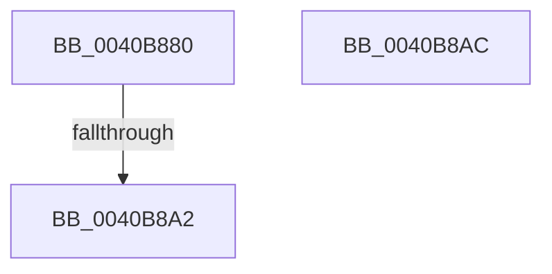

# RtlFindSetBitsEx

- RVA: `0x0040B880`–`0x0040B8AD` (길이 `45` bytes)
- VA: `0x000000014040B880`
- 실행 섹션: `.text`
- PDB 이름 있음: `예`; PDB Function 태그: `아니요`
- unwind 정보 RVA: `0x0009AEB8`
- 디코드: `16`개 명령, `45/45` bytes 표시
- 미해석 바이트: `0` (있으면 어셈블리에 `.byte`로 보존)

> 이 문서는 커널 이미지의 기계어와 PDB 기호를 분석해 생성했습니다. 4번과 5번은 함수 원형과 자료형을 바이너리 사용 방식에서 추정한 C 해석이며 원본 소스 복구 결과는 아닙니다.

## 1. Dependencies

- 직접 호출 지점: **0**; 고유 호출 대상: **0**
- 직접 호출자로 확인된 함수: **3**
- RIP 상대 이미지 참조: **0**

### Outgoing calls
- 직접 디코드된 call 명령이 없습니다.

### Direct callers
- [MmQueryMemoryRanges](../../page/7F/MmQueryMemoryRanges_function_007FC3A0.md) at `0x007FC482`
- [MiDeleteAweInfoPages](../../page/80/MiDeleteAweInfoPages_function_0080AA40.md) at `0x0080AACC`
- [sub_00B3B822](../../page/B3/Unknown_function_00B3B822.md) at `0x00B3B85E`

### Static image references
- 디코드된 RIP-relative 메모리 참조가 없습니다.

## 2. Other-region calls and transfers

- 다른 실행 섹션으로 향하는 call: **0**
- call이 아닌 외부 분기/꼬리 이동: **1**
  - `0x0040B8A0` → [sub_0040B8AD](Unknown_function_0040B8AD.md) (`tail-transfer`)

## 3. Assembly (complete function range)

```asm
0040B880  40 57                           push rdi
0040B882  48 83 EC 20                     sub rsp, 0x20
0040B886  4C 8B 09                        mov r9, qword ptr [rcx]
0040B889  33 C0                           xor eax, eax
0040B88B  48 8B 79 08                     mov rdi, qword ptr [rcx + 8]
0040B88F  4D 3B C1                        cmp r8, r9
0040B892  4C 8B D2                        mov r10, rdx
0040B895  49 0F 42 C0                     cmovb rax, r8
0040B899  49 8D 51 FF                     lea rdx, [r9 - 1]
0040B89D  4D 85 D2                        test r10, r10
0040B8A0  75 0B                           jne 0x14040b8ad
0040B8A2  48 83 E0 F8                     and rax, 0xfffffffffffffff8
0040B8A6  48 83 C4 20                     add rsp, 0x20
0040B8AA  5F                              pop rdi
0040B8AB  C3                              ret
0040B8AC  CC                              int3
```

## 4. C-style interpretation (structured pseudocode)

```c
__int64 __fastcall RtlFindSetBitsEx(__int64 a1, __int64 a2, __int64 a3)
{
    __int64 result;
    __int64 v_rsp;

    v_rsp = (v_rsp) - (32);
    result = 0;
    if (a3 < (*(unsigned __int64 *)(a1))) { result = a3; }
    result = (result) & (-8);
    v_rsp = (v_rsp) + (32);
    return result;
}
```

## 5. (Beta) C Style

```c
int64_t RtlFindSetBitsEx(void *Arg1, int64_t Arg2, int64_t Arg3)
{
    uint8_t *arg1 = (uint8_t *)Arg1;

    int64_t result;
    int64_t local_rsp;

    local_rsp = (local_rsp) - (32);
    result = 0;
    if (Arg3 < (*(uint64_t *)(arg1))) { result = Arg3; }
    result = (result) & (-8);
    local_rsp = (local_rsp) + (32);
    return result;
}
```

### 관측된 메모리 오프셋

구조체 형식이 확인되지 않은 접근은 인자 기준의 오프셋으로만 기록했습니다.

| 기준 인자 | 오프셋 표현 | 폭 (bit) | 접근 |
|---|---:|---:|---|
| `Arg1` | `+ 0x0` | `64` | `R` |
| `Arg1` | `+ 0x8` | `64` | `R` |

## 6. Execution-region graph

[열기: 2D/3D 그래프와 함수 탐색 컨트롤 패널](../../../control-panel.html?section=text&rva=0x0040B880&view=graph)

- 2D 그래프는 위에서 아래로 흐르고, 3D 그래프는 빈 공간을 드래그해 회전합니다. Shift+드래그는 이동, 휠은 확대·축소, 함수 노드 선택은 대상 보고서 이동입니다.

### Static fallback


