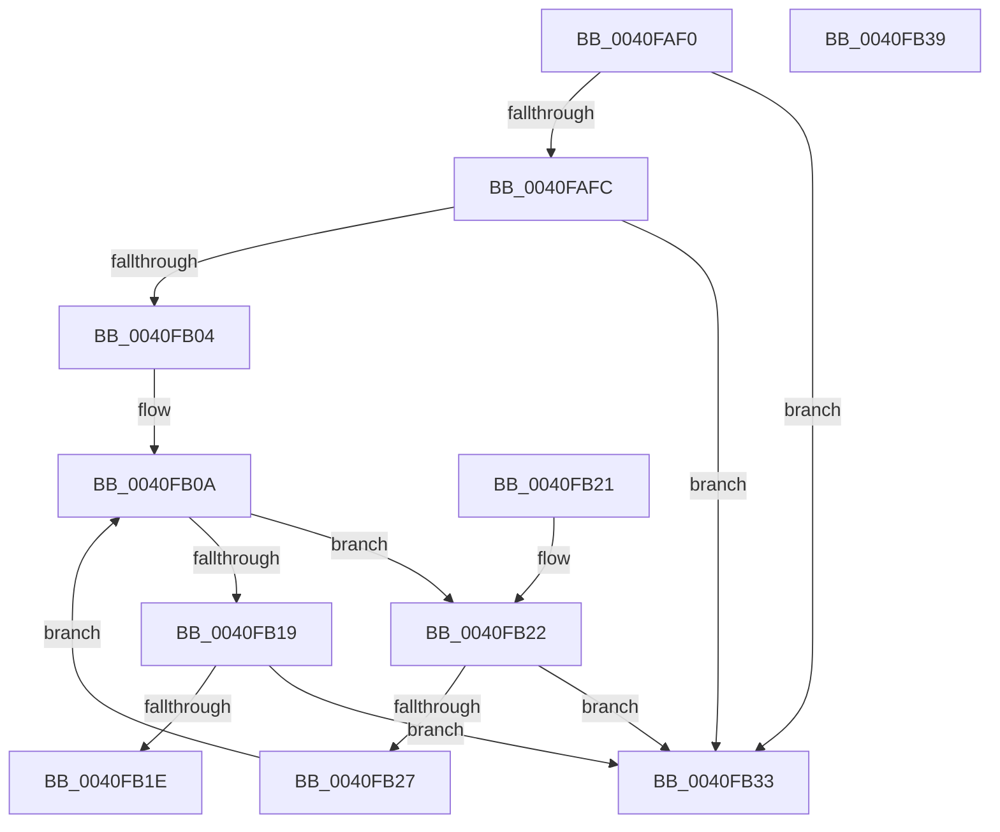

# RtlGetAce

- RVA: `0x0040FAF0`–`0x0040FB3A` (길이 `74` bytes)
- VA: `0x000000014040FAF0`
- 실행 섹션: `.text`
- PDB 이름 있음: `예`; PDB Function 태그: `아니요`
- unwind 정보 RVA: `0x000DB714`
- 디코드: `29`개 명령, `74/74` bytes 표시
- 미해석 바이트: `0` (있으면 어셈블리에 `.byte`로 보존)

> 이 문서는 커널 이미지의 기계어와 PDB 기호를 분석해 생성했습니다. 4번과 5번은 함수 원형과 자료형을 바이너리 사용 방식에서 추정한 C 해석이며 원본 소스 복구 결과는 아닙니다.

## 1. Dependencies

- 직접 호출 지점: **0**; 고유 호출 대상: **0**
- 직접 호출자로 확인된 함수: **9**
- RIP 상대 이미지 참조: **0**

### Outgoing calls
- 직접 디코드된 call 명령이 없습니다.

### Direct callers
- [AdtpBuildAccessReasonAuditStringInternal](AdtpBuildAccessReasonAuditStringInternal_function_0040F344.md) at `0x0040F67B`
- [ObpGetDosDevicesProtection](../../page/74/ObpGetDosDevicesProtection_function_0074E2BC.md) at `0x0074E3D4`
- [ObpGetDosDevicesProtection](../../page/74/ObpGetDosDevicesProtection_function_0074E2BC.md) at `0x0074E40E`
- [ObpGetDosDevicesProtection](../../page/74/ObpGetDosDevicesProtection_function_0074E2BC.md) at `0x0074E448`
- [ObpGetDosDevicesProtection](../../page/74/ObpGetDosDevicesProtection_function_0074E2BC.md) at `0x0074E54A`
- [PopCreateHiberFileSecurityDescriptor](../../page/75/PopCreateHiberFileSecurityDescriptor_function_0075D3DC.md) at `0x0075D4C3`
- [RtlpSysVolCheckOwnerAndSecurity](../../page/79/RtlpSysVolCheckOwnerAndSecurity_function_00791324.md) at `0x00791491`
- [CmpHiveRootSecurityDescriptor](../../page/7E/CmpHiveRootSecurityDescriptor_function_007ED104.md) at `0x007ED49D`
- [CmpHiveRootSecurityDescriptor](../../page/7E/CmpHiveRootSecurityDescriptor_function_007ED104.md) at `0x007ED4B6`
- [CmpHiveRootSecurityDescriptor](../../page/7E/CmpHiveRootSecurityDescriptor_function_007ED104.md) at `0x007ED4CF`
- [CmpHiveRootSecurityDescriptor](../../page/7E/CmpHiveRootSecurityDescriptor_function_007ED104.md) at `0x007ED4E8`
- [CmpHiveRootSecurityDescriptor](../../page/7E/CmpHiveRootSecurityDescriptor_function_007ED104.md) at `0x007ED501`
- [CmpHiveRootSecurityDescriptor](../../page/7E/CmpHiveRootSecurityDescriptor_function_007ED104.md) at `0x007ED51A`
- [SepAppendAceToTokenObjectAcl](../../page/8B/SepAppendAceToTokenObjectAcl_function_008B6430.md) at `0x008B66B8`
- [PiDevCfgGetKeySecurityDescriptor](../../page/99/PiDevCfgGetKeySecurityDescriptor_function_00996240.md) at `0x009963D8`
- [PiDevCfgGetKeySecurityDescriptor](../../page/99/PiDevCfgGetKeySecurityDescriptor_function_00996240.md) at `0x00996485`
- [sub_00B22C34](../../page/B2/Unknown_function_00B22C34.md) at `0x00B22E30`
- [ObInitSystem](../../init/C7/ObInitSystem_function_00C71C7C.md) at `0x00C72120`

### Static image references
- 디코드된 RIP-relative 메모리 참조가 없습니다.

## 2. Other-region calls and transfers

- 다른 실행 섹션으로 향하는 call: **0**
- 별도 외부 분기/꼬리 이동을 확인하지 못했습니다.

## 3. Assembly (complete function range)

```asm
0040FAF0  0F B6 01                        movzx eax, byte ptr [rcx]
0040FAF3  44 8B D2                        mov r10d, edx
0040FAF6  2C 02                           sub al, 2
0040FAF8  3C 02                           cmp al, 2
0040FAFA  77 37                           ja 0x14040fb33
0040FAFC  0F B7 41 04                     movzx eax, word ptr [rcx + 4]
0040FB00  3B D0                           cmp edx, eax
0040FB02  73 2F                           jae 0x14040fb33
0040FB04  4C 8D 49 08                     lea r9, [rcx + 8]
0040FB08  33 D2                           xor edx, edx
0040FB0A  4D 89 08                        mov qword ptr [r8], r9
0040FB0D  0F B7 41 02                     movzx eax, word ptr [rcx + 2]
0040FB11  48 03 C1                        add rax, rcx
0040FB14  41 3B D2                        cmp edx, r10d
0040FB17  72 09                           jb 0x14040fb22
0040FB19  4C 3B C8                        cmp r9, rax
0040FB1C  73 15                           jae 0x14040fb33
0040FB1E  33 C0                           xor eax, eax
0040FB20  C3                              ret
0040FB21  CC                              int3
0040FB22  4C 3B C8                        cmp r9, rax
0040FB25  73 0C                           jae 0x14040fb33
0040FB27  41 0F B7 41 02                  movzx eax, word ptr [r9 + 2]
0040FB2C  4C 03 C8                        add r9, rax
0040FB2F  FF C2                           inc edx
0040FB31  EB D7                           jmp 0x14040fb0a
0040FB33  B8 0D 00 00 C0                  mov eax, 0xc000000d
0040FB38  C3                              ret
0040FB39  CC                              int3
```

## 4. C-style interpretation (structured pseudocode)

```c
__int64 __fastcall RtlGetAce(__int64 a1, int a2, __int64 a3)
{
    __int64 result;

    result = (unsigned __int8)((*(unsigned __int8 *)(a1)) - (2));
    if (((unsigned __int8)(result)) > 2) goto loc_0040FB33;
    if (a2 >= ((unsigned int)(*(unsigned __int16 *)(a1 + 4)))) goto loc_0040FB33;
    a2 = 0;
loc_0040FB0A:
    *(unsigned __int64 *)(a3) = a1 + 8;
    result = (*(unsigned __int16 *)(a1 + 2)) + (a1);
    if (0 < ((unsigned int)((unsigned int)(a2)))) goto loc_0040FB22;
    if ((a1 + 8) >= result) goto loc_0040FB33;
    result = 0;
    return result;
loc_0040FB22:
    if ((a1 + 8) >= 0) goto loc_0040FB33;
    a4 = (a1 + 8) + (*(unsigned __int16 *)(a1 + 8 + 2));
    a2 = (unsigned int)((a2) + 1);
    goto loc_0040FB0A;
loc_0040FB33:
    return (unsigned int)(0xC000000DULL);
}
```

## 5. (Beta) C Style

```c
int64_t RtlGetAce(void *Arg1, int32_t Arg2, void *Arg3)
{
    uint8_t *arg1 = (uint8_t *)Arg1;
    uint8_t *arg3 = (uint8_t *)Arg3;

    int64_t result;

    result = (uint8_t)((*(uint8_t *)(arg1)) - (2));
    if (((uint8_t)(result)) > 2) goto loc_0040FB33;
    if (Arg2 >= ((uint32_t)(*(uint16_t *)(arg1 + 0x4)))) goto loc_0040FB33;
    Arg2 = 0;
loc_0040FB0A:
    *(void **)(arg3) = Arg1 + 8;
    result = (*(uint16_t *)(arg1 + 0x2)) + (Arg1);
    if (0 < ((uint32_t)((uint32_t)(Arg2)))) goto loc_0040FB22;
    if ((Arg1 + 8) >= result) goto loc_0040FB33;
    result = 0;
    return result;
loc_0040FB22:
    if ((Arg1 + 8) >= 0) goto loc_0040FB33;
    a4 = (Arg1 + 8) + (*(uint16_t *)(arg1 + 0x8 + 0x2));
    Arg2 = (uint32_t)((Arg2) + 1);
    goto loc_0040FB0A;
loc_0040FB33:
    return (uint32_t)(0xC000000DULL);
}
```

### 관측된 메모리 오프셋

구조체 형식이 확인되지 않은 접근은 인자 기준의 오프셋으로만 기록했습니다.

| 기준 인자 | 오프셋 표현 | 폭 (bit) | 접근 |
|---|---:|---:|---|
| `Arg1` | `+ 0x0` | `8` | `R` |
| `Arg1` | `+ 0x2` | `16` | `R` |
| `Arg1` | `+ 0x4` | `16` | `R` |
| `Arg1` | `+ 0x8` | `64` | `R` |
| `Arg3` | `+ 0x0` | `64` | `W` |

## 6. Execution-region graph

[열기: 2D/3D 그래프와 함수 탐색 컨트롤 패널](../../../control-panel.html?section=text&rva=0x0040FAF0&view=graph)

- 2D 그래프는 위에서 아래로 흐르고, 3D 그래프는 빈 공간을 드래그해 회전합니다. Shift+드래그는 이동, 휠은 확대·축소, 함수 노드 선택은 대상 보고서 이동입니다.

### Static fallback


