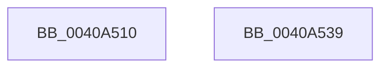

# RtlHpEnvContextCreate

- RVA: `0x0040A510`–`0x0040A53A` (길이 `42` bytes)
- VA: `0x000000014040A510`
- 실행 섹션: `.text`
- PDB 이름 있음: `예`; PDB Function 태그: `아니요`
- unwind 정보 RVA: `0x000DB714`
- 디코드: `15`개 명령, `42/42` bytes 표시
- 미해석 바이트: `0` (있으면 어셈블리에 `.byte`로 보존)

> 이 문서는 커널 이미지의 기계어와 PDB 기호를 분석해 생성했습니다. 4번과 5번은 함수 원형과 자료형을 바이너리 사용 방식에서 추정한 C 해석이며 원본 소스 복구 결과는 아닙니다.

## 1. Dependencies

- 직접 호출 지점: **0**; 고유 호출 대상: **0**
- 직접 호출자로 확인된 함수: **1**
- RIP 상대 이미지 참조: **0**

### Outgoing calls
- 직접 디코드된 call 명령이 없습니다.

### Direct callers
- [ExpPrivatePoolCreate](../../page/7D/ExpPrivatePoolCreate_function_007D5F98.md) at `0x007D6028`
- [ExpPrivatePoolCreate](../../page/7D/ExpPrivatePoolCreate_function_007D5F98.md) at `0x007D60CF`

### Static image references
- 디코드된 RIP-relative 메모리 참조가 없습니다.

## 2. Other-region calls and transfers

- 다른 실행 섹션으로 향하는 call: **0**
- 별도 외부 분기/꼬리 이동을 확인하지 못했습니다.

## 3. Assembly (complete function range)

```asm
0040A510  0F B6 54 24 28                  movzx edx, byte ptr [rsp + 0x28]
0040A515  0F 57 C0                        xorps xmm0, xmm0
0040A518  80 E2 01                        and dl, 1
0040A51B  0F 11 01                        movups xmmword ptr [rcx], xmm0
0040A51E  C0 E2 03                        shl dl, 3
0040A521  45 85 C0                        test r8d, r8d
0040A524  44 88 41 01                     mov byte ptr [rcx + 1], r8b
0040A528  44 88 49 02                     mov byte ptr [rcx + 2], r9b
0040A52C  0F 95 C0                        setne al
0040A52F  04 02                           add al, 2
0040A531  0A D0                           or dl, al
0040A533  48 8B C1                        mov rax, rcx
0040A536  88 11                           mov byte ptr [rcx], dl
0040A538  C3                              ret
0040A539  CC                              int3
```

## 4. C-style interpretation (structured pseudocode)

```c
__int64 __fastcall RtlHpEnvContextCreate(__int64 a1, __int64 a2, int a3, unsigned __int8 a4, unsigned __int8 a5)
{
    __int64 result;

    a2 = (unsigned __int8)((a5) & (1));
    *(unsigned __int64 *)(a1) = v_xmm0;
    a2 = (unsigned __int8)((a2) << (3));
    *(unsigned __int8 *)(a1 + 1) = (unsigned __int8)(a3);
    *(unsigned __int8 *)(a1 + 2) = a4;
    result = (a3 != 0) ? 1 : 0;
    result = (unsigned __int8)((result) + (2));
    a2 = (unsigned __int8)((a2) | ((unsigned __int8)(result)));
    *(unsigned __int8 *)(a1) = (unsigned __int8)(a2);
    return a1;
}
```

## 5. (Beta) C Style

```c
void *RtlHpEnvContextCreate(void *Arg1, int64_t Arg2, int32_t Arg3, uint8_t Arg4, uint8_t Arg5)
{
    uint8_t *arg1 = (uint8_t *)Arg1;

    int64_t result;

    Arg2 = (uint8_t)((Arg5) & (1));
    *(uint64_t *)(arg1) = v_xmm0;
    Arg2 = (uint8_t)((Arg2) << (3));
    *(uint8_t *)(arg1 + 0x1) = (uint8_t)(Arg3);
    *(uint8_t *)(arg1 + 0x2) = Arg4;
    result = (Arg3 != 0) ? 1 : 0;
    result = (uint8_t)((result) + (2));
    Arg2 = (uint8_t)((Arg2) | ((uint8_t)(result)));
    *(uint8_t *)(arg1) = (uint8_t)(Arg2);
    return Arg1;
}
```

### 관측된 메모리 오프셋

구조체 형식이 확인되지 않은 접근은 인자 기준의 오프셋으로만 기록했습니다.

| 기준 인자 | 오프셋 표현 | 폭 (bit) | 접근 |
|---|---:|---:|---|
| `Arg1` | `+ 0x0` | `8` | `W` |
| `Arg1` | `+ 0x0` | `128` | `R` |
| `Arg1` | `+ 0x1` | `8` | `W` |
| `Arg1` | `+ 0x2` | `8` | `W` |

## 6. Execution-region graph

[열기: 2D/3D 그래프와 함수 탐색 컨트롤 패널](../../../control-panel.html?section=text&rva=0x0040A510&view=graph)

- 2D 그래프는 위에서 아래로 흐르고, 3D 그래프는 빈 공간을 드래그해 회전합니다. Shift+드래그는 이동, 휠은 확대·축소, 함수 노드 선택은 대상 보고서 이동입니다.

### Static fallback


