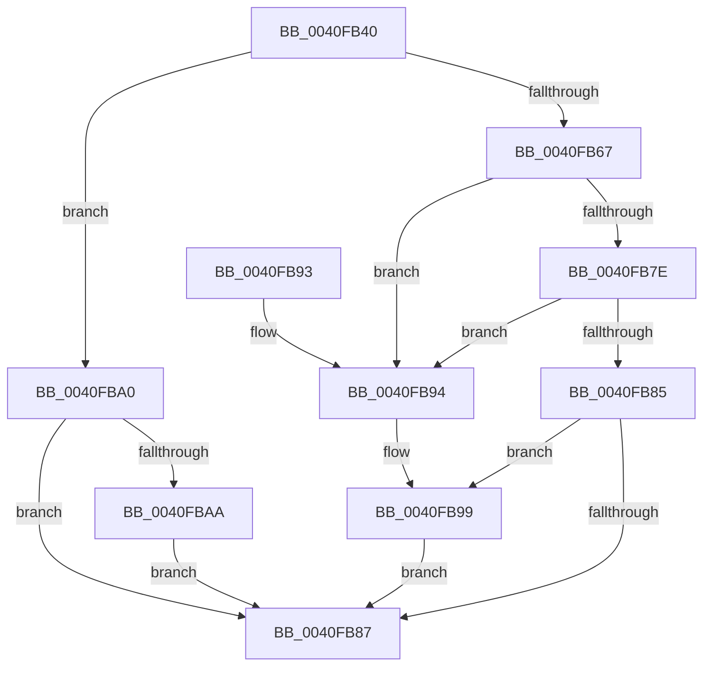

# RtlStringCbPrintfW

- RVA: `0x0040FB40`–`0x0040FBAF` (길이 `111` bytes)
- VA: `0x000000014040FB40`
- 실행 섹션: `.text`
- PDB 이름 있음: `예`; PDB Function 태그: `아니요`
- unwind 정보 RVA: `0x0009BB9C`
- 디코드: `40`개 명령, `111/111` bytes 표시
- 미해석 바이트: `0` (있으면 어셈블리에 `.byte`로 보존)

> 이 문서는 커널 이미지의 기계어와 PDB 기호를 분석해 생성했습니다. 4번과 5번은 함수 원형과 자료형을 바이너리 사용 방식에서 추정한 C 해석이며 원본 소스 복구 결과는 아닙니다.

## 1. Dependencies

- 직접 호출 지점: **1**; 고유 호출 대상: **1**
- 직접 호출자로 확인된 함수: **60**
- RIP 상대 이미지 참조: **0**

### Outgoing calls
- `0x0040FB75` → [vsnwprintf](../4F/vsnwprintf_function_004FEF30.md) (function, `0x004FEF30`)

### Direct callers
- [AdtpBuildAccessReasonAuditStringInternal](AdtpBuildAccessReasonAuditStringInternal_function_0040F344.md) at `0x0040F7A5`
- [PipServiceInstanceToDeviceInstance](../../page/72/PipServiceInstanceToDeviceInstance_function_0072C150.md) at `0x0072C1ED`
- [PpmWmiRegisterInfo](../../page/76/PpmWmiRegisterInfo_function_007686A4.md) at `0x00768759`
- [PopDirectedDripsDiagCreateBlockerEntryBoolean](../../page/77/PopDirectedDripsDiagCreateBlockerEntryBoolean_function_00770EE0.md) at `0x00770F20`
- [PopDirectedDripsDiagCreateBlockerEntryULong](../../page/77/PopDirectedDripsDiagCreateBlockerEntryULong_function_00770F4C.md) at `0x00770F88`
- [SepSetSystemPaths](../../page/79/SepSetSystemPaths_function_0079C040.md) at `0x0079C11E`
- [SepSetSystemPaths](../../page/79/SepSetSystemPaths_function_0079C040.md) at `0x0079C14E`
- [SepSetSystemPaths](../../page/79/SepSetSystemPaths_function_0079C040.md) at `0x0079C1DB`
- [SepReadAndPopulateCapes](../../page/7A/SepReadAndPopulateCapes_function_007A3CB8.md) at `0x007A3E1A`
- [SepReadAndPopulateCapes](../../page/7A/SepReadAndPopulateCapes_function_007A3CB8.md) at `0x007A4094`
- [EtwpAddMicroarchitecturalPmcToPmcGroup](../../page/7B/EtwpAddMicroarchitecturalPmcToPmcGroup_function_007B5228.md) at `0x007B52C9`
- [EtwpAddMicroarchitecturalPmcToRegistry](../../page/7B/EtwpAddMicroarchitecturalPmcToRegistry_function_007B5558.md) at `0x007B5652`
- [EtwpAddMicroarchitecturalPmcToRegistry](../../page/7B/EtwpAddMicroarchitecturalPmcToRegistry_function_007B5558.md) at `0x007B5687`
- [EtwpFindMatchingPmcRegistryGroup](../../page/7B/EtwpFindMatchingPmcRegistryGroup_function_007B644C.md) at `0x007B6590`
- [EtwpLoadMicroarchitecturalPmcs](../../page/7B/EtwpLoadMicroarchitecturalPmcs_function_007B6D48.md) at `0x007B6E9D`
- [EtwpLoadMicroarchitecturalProfileGroup](../../page/7B/EtwpLoadMicroarchitecturalProfileGroup_function_007B6F74.md) at `0x007B71C9`
- [EtwpRemoveMicroarchitecturalPmcFromPmcGroup](../../page/7B/EtwpRemoveMicroarchitecturalPmcFromPmcGroup_function_007B7844.md) at `0x007B79C9`
- [EtwpEnumerateAutologgerPath](../../page/7B/EtwpEnumerateAutologgerPath_function_007BE398.md) at `0x007BE567`
- [EtwpEnumerateAutologgerPath](../../page/7B/EtwpEnumerateAutologgerPath_function_007BE398.md) at `0x007BE58E`
- [CmpCreatePerfKeys](../../page/7D/CmpCreatePerfKeys_function_007D9F70.md) at `0x007DA08E`
- [SiGetEfiSystemDevice](../../page/82/SiGetEfiSystemDevice_function_00827C68.md) at `0x00827E5E`
- [SiGetEfiSystemDevice](../../page/82/SiGetEfiSystemDevice_function_00827C68.md) at `0x0082802F`
- [SiGetEfiSystemDevice](../../page/82/SiGetEfiSystemDevice_function_00827C68.md) at `0x00828042`
- [SiGetEspFromFirmware](../../page/82/SiGetEspFromFirmware_function_008280C0.md) at `0x008283CC`
- [LkmdTelCreateReport](../../page/84/LkmdTelCreateReport_function_008414CC.md) at `0x00841576`
- [PfSnOpenVolumesForPrefetch](../../page/8A/PfSnOpenVolumesForPrefetch_function_008AA4AC.md) at `0x008AA986`
- [PfSnGetPrefetchInstructions](../../page/8A/PfSnGetPrefetchInstructions_function_008AEBE4.md) at `0x008AECC5`
- [EtwpAccessCheckFromState](../../page/8C/EtwpAccessCheckFromState_function_008C0350.md) at `0x008C03FF`
- [EtwpGetSecurityDescriptorByGuid](../../page/8C/EtwpGetSecurityDescriptorByGuid_function_008C04C0.md) at `0x008C0568`
- [IopGetLegacyVetoListDrivers](../../page/91/IopGetLegacyVetoListDrivers_function_00911814.md) at `0x00911967`
- [PfSnOperationProcess](../../page/96/PfSnOperationProcess_function_009615A4.md) at `0x009616C9`
- [PiNormalizeDeviceText](../../page/99/PiNormalizeDeviceText_function_0099A43C.md) at `0x0099A81B`
- [EtwpRealtimeCreateLogfile](../../page/9B/EtwpRealtimeCreateLogfile_function_009BE96C.md) at `0x009BEA2F`
- [EtwpCreateNtFileName](../../page/9C/EtwpCreateNtFileName_function_009C1364.md) at `0x009C1417`
- [EtwpExpandFileName](../../page/9C/EtwpExpandFileName_function_009C147C.md) at `0x009C15FF`
- [WmipIncludeStaticNames](../../page/9D/WmipIncludeStaticNames_function_009DF754.md) at `0x009DF8E8`
- [WmipInsertStaticNames](../../page/9E/WmipInsertStaticNames_function_009E1064.md) at `0x009E11BF`
- [WmipPrepareWnodeSI](../../page/9E/WmipPrepareWnodeSI_function_009E1740.md) at `0x009E19A2`
- [ExProcessorCounterSetCallback](../../page/9E/ExProcessorCounterSetCallback_function_009E4880.md) at `0x009E4BB2`
- [ExProcessorCounterSetCallback](../../page/9E/ExProcessorCounterSetCallback_function_009E4880.md) at `0x009E503F`
- [ExProcessorCounterSetCallback](../../page/9E/ExProcessorCounterSetCallback_function_009E4880.md) at `0x009E51D9`
- [PiBuildDeviceNodeInstancePath](../../page/A0/PiBuildDeviceNodeInstancePath_function_00A08DEC.md) at `0x00A08ED9`
- [MiCreateSectionForDriver](../../page/A2/MiCreateSectionForDriver_function_00A2477C.md) at `0x00A248D2`
- [KiSynchCounterSetCallback](../../page/A5/KiSynchCounterSetCallback_function_00A5F5B0.md) at `0x00A5F633`
- [AdtpBuildSecurityDescriptorUnicodeString](../../page/A6/AdtpBuildSecurityDescriptorUnicodeString_function_00A663C0.md) at `0x00A6648A`
- [PipMakeGloballyUniqueId](../../page/A6/PipMakeGloballyUniqueId_function_00A6F428.md) at `0x00A6F703`
- [KiSynchNumaCounterSetCallback](../../page/A7/KiSynchNumaCounterSetCallback_function_00A77BE0.md) at `0x00A77D3A`
- [KiSynchNumaCounterSetCallback](../../page/A7/KiSynchNumaCounterSetCallback_function_00A77BE0.md) at `0x00A780D5`
- [EtwpEnableAutoLoggerProvider](../../page/A9/EtwpEnableAutoLoggerProvider_function_00A92B00.md) at `0x00A92C38`
- [EtwpEnableAutoLoggerProvider](../../page/A9/EtwpEnableAutoLoggerProvider_function_00A92B00.md) at `0x00A92CF3`
- [EtwpGetAutoLoggerProviderFilter](../../page/A9/EtwpGetAutoLoggerProviderFilter_function_00A93248.md) at `0x00A93381`
- [EtwpGetAutoLoggerProviderFilter](../../page/A9/EtwpGetAutoLoggerProviderFilter_function_00A93248.md) at `0x00A934E3`
- [EtwpGetAutoLoggerLevelKwFilter](../../page/A9/EtwpGetAutoLoggerLevelKwFilter_function_00A93AA8.md) at `0x00A93B55`
- [EtwpGetAutoLoggerLevelKwFilter](../../page/A9/EtwpGetAutoLoggerLevelKwFilter_function_00A93AA8.md) at `0x00A93C02`
- [EtwpGetAutoLoggerEventNameFilter](../../page/A9/EtwpGetAutoLoggerEventNameFilter_function_00A93E78.md) at `0x00A93F5A`
- [EtwpGetAutoLoggerEventNameFilter](../../page/A9/EtwpGetAutoLoggerEventNameFilter_function_00A93E78.md) at `0x00A9401F`
- [EtwpGenerateFileName](../../page/A9/EtwpGenerateFileName_function_00A962C8.md) at `0x00A96399`
- [PnpUnloadAttachedDriver](../../page/AA/PnpUnloadAttachedDriver_function_00AA80E8.md) at `0x00AA8174`
- [MiCacheImageSymbols](../../page/AD/MiCacheImageSymbols_function_00AD9410.md) at `0x00AD951B`
- [MiCacheImageSymbols](../../page/AD/MiCacheImageSymbols_function_00AD9410.md) at `0x00AD9532`
- [sub_00B2D638](../../page/B2/Unknown_function_00B2D638.md) at `0x00B2D6FF`
- [sub_00B2ECF6](../../page/B2/Unknown_function_00B2ECF6.md) at `0x00B2ED21`
- [sub_00B2ECF6](../../page/B2/Unknown_function_00B2ECF6.md) at `0x00B2ED57`
- [sub_00B3FE90](../../page/B3/Unknown_function_00B3FE90.md) at `0x00B3FF1B`
- [sub_00B41970](../../page/B4/Unknown_function_00B41970.md) at `0x00B41983`
- [sub_00B44B48](../../page/B4/Unknown_function_00B44B48.md) at `0x00B44B60`
- [CreateSystemRootLink](../../init/C1/CreateSystemRootLink_function_00C1AA18.md) at `0x00C1ABB5`
- [CreateSystemRootLink](../../init/C1/CreateSystemRootLink_function_00C1AA18.md) at `0x00C1AC7E`
- [CreateSystemRootLink](../../init/C1/CreateSystemRootLink_function_00C1AA18.md) at `0x00C1AD51`
- [MfgInitSystem](../../init/C1/MfgInitSystem_function_00C1C390.md) at `0x00C1C4AE`
- [MfgInitSystem](../../init/C1/MfgInitSystem_function_00C1C390.md) at `0x00C1C68D`
- [PoFxRegisterDebugger](../../init/C4/PoFxRegisterDebugger_function_00C434E0.md) at `0x00C43628`
- [PoFxRegisterDebugger](../../init/C4/PoFxRegisterDebugger_function_00C434E0.md) at `0x00C43672`
- [EtwpEnableBootLoggerRegistryProviders](../../init/C4/EtwpEnableBootLoggerRegistryProviders_function_00C4EF8C.md) at `0x00C4F00E`
- [VhdInitialize](../../init/C6/VhdInitialize_function_00C6DBB4.md) at `0x00C6DD4F`
- [VhdInitialize](../../init/C6/VhdInitialize_function_00C6DBB4.md) at `0x00C6DD81`
- [VhdiGetVolumeNumber](../../init/C6/VhdiGetVolumeNumber_function_00C6E014.md) at `0x00C6E088`
- [VhdiInitializeBootDisk](../../init/C6/VhdiInitializeBootDisk_function_00C6E190.md) at `0x00C6E273`
- [CimfsInitialize](../../init/C6/CimfsInitialize_function_00C6E64C.md) at `0x00C6E8C7`
- [CimfsInitialize](../../init/C6/CimfsInitialize_function_00C6E64C.md) at `0x00C6E91F`
- [CimfsInitializeBootDisk](../../init/C6/CimfsInitializeBootDisk_function_00C6E9D0.md) at `0x00C6EAA2`
- [CimfsInitializeBootDisk](../../init/C6/CimfsInitializeBootDisk_function_00C6E9D0.md) at `0x00C6ECCC`
- [CimfsInitializeBootDisk](../../init/C6/CimfsInitializeBootDisk_function_00C6E9D0.md) at `0x00C6ECEB`
- [RamdiskCreateSymbolicLink](../../init/C6/RamdiskCreateSymbolicLink_function_00C6EDB8.md) at `0x00C6EE84`

### Static image references
- 디코드된 RIP-relative 메모리 참조가 없습니다.

## 2. Other-region calls and transfers

- 다른 실행 섹션으로 향하는 call: **0**
- 별도 외부 분기/꼬리 이동을 확인하지 못했습니다.

## 3. Assembly (complete function range)

```asm
0040FB40  4C 89 44 24 18                  mov qword ptr [rsp + 0x18], r8
0040FB45  4C 89 4C 24 20                  mov qword ptr [rsp + 0x20], r9
0040FB4A  53                              push rbx
0040FB4B  56                              push rsi
0040FB4C  57                              push rdi
0040FB4D  41 56                           push r14
0040FB4F  48 83 EC 38                     sub rsp, 0x38
0040FB53  48 D1 EA                        shr rdx, 1
0040FB56  33 DB                           xor ebx, ebx
0040FB58  4C 8B F1                        mov r14, rcx
0040FB5B  48 8D 42 FF                     lea rax, [rdx - 1]
0040FB5F  48 3D FE FF FF 7F               cmp rax, 0x7ffffffe
0040FB65  77 39                           ja 0x14040fba0
0040FB67  48 8D 72 FF                     lea rsi, [rdx - 1]
0040FB6B  8B FB                           mov edi, ebx
0040FB6D  48 8B D6                        mov rdx, rsi
0040FB70  4C 8D 4C 24 78                  lea r9, [rsp + 0x78]
0040FB75  E8 B6 F3 0E 00                  call 0x1404fef30
0040FB7A  85 C0                           test eax, eax
0040FB7C  78 16                           js 0x14040fb94
0040FB7E  48 98                           cdqe
0040FB80  48 3B C6                        cmp rax, rsi
0040FB83  77 0F                           ja 0x14040fb94
0040FB85  74 12                           je 0x14040fb99
0040FB87  8B C7                           mov eax, edi
0040FB89  48 83 C4 38                     add rsp, 0x38
0040FB8D  41 5E                           pop r14
0040FB8F  5F                              pop rdi
0040FB90  5E                              pop rsi
0040FB91  5B                              pop rbx
0040FB92  C3                              ret
0040FB93  CC                              int3
0040FB94  BF 05 00 00 80                  mov edi, 0x80000005
0040FB99  66 41 89 1C 76                  mov word ptr [r14 + rsi*2], bx
0040FB9E  EB E7                           jmp 0x14040fb87
0040FBA0  BF 0D 00 00 C0                  mov edi, 0xc000000d
0040FBA5  48 85 D2                        test rdx, rdx
0040FBA8  74 DD                           je 0x14040fb87
0040FBAA  66 89 19                        mov word ptr [rcx], bx
0040FBAD  EB D8                           jmp 0x14040fb87
```

## 4. C-style interpretation (structured pseudocode)

```c
__int64 __fastcall RtlStringCbPrintfW(__int64 a1, __int64 a2, __int64 a3, __int64 a4)
{
    __int64 result;
    __int64 v_rbx;
    __int64 v_rsp;
    unsigned __int64 v_stack_p18;
    unsigned __int64 v_stack_p20;

    v_stack_p18 = a3;
    v_stack_p20 = a4;
    v_rsp = (v_rsp) - (56);
    a2 = (a2) >> (1);
    v_rbx = 0;
    if ((a2 - 1) > 0x7FFFFFFEULL) goto loc_0040FBA0;
    result = vsnwprintf(a1, a2 - 1, a3, v_stack_p20);
    if (sign_flag) goto loc_0040FB94;
    if (result > (a2 - 1)) goto loc_0040FB94;
    if (result == (a2 - 1)) goto loc_0040FB99;
loc_0040FB87:
    v_rsp = (v_rsp) + (56);
    return 0;
loc_0040FB94:
loc_0040FB99:
    *(unsigned __int16 *)(a1 + a2 - 1 * 2) = 0;
    goto loc_0040FB87;
loc_0040FBA0:
    if (a2 - 1 == 0) goto loc_0040FB87;
    *(unsigned __int16 *)(a1) = 0;
    goto loc_0040FB87;
}
```

## 5. (Beta) C Style

```c
int64_t RtlStringCbPrintfW(void *Arg1, int64_t Arg2, int64_t Arg3, int64_t Arg4)
{
    uint8_t *arg1 = (uint8_t *)Arg1;

    int64_t result;
    int64_t local_rbx;
    int64_t local_rsp;
    uint64_t v_stack_p18;
    uint64_t v_stack_p20;

    v_stack_p18 = Arg3;
    v_stack_p20 = Arg4;
    local_rsp = (local_rsp) - (56);
    Arg2 = (Arg2) >> (1);
    local_rbx = 0;
    if ((Arg2 - 1) > 0x7FFFFFFEULL) goto loc_0040FBA0;
    result = vsnwprintf(Arg1, Arg2 - 1, Arg3, v_stack_p20);
    if (sign_flag) goto loc_0040FB94;
    if (result > (Arg2 - 1)) goto loc_0040FB94;
    if (result == (Arg2 - 1)) goto loc_0040FB99;
loc_0040FB87:
    local_rsp = (local_rsp) + (56);
    return 0;
loc_0040FB94:
loc_0040FB99:
    *(uint16_t *)(arg1 + Arg2 - 0x1 * 2) = 0;
    goto loc_0040FB87;
loc_0040FBA0:
    if (Arg2 - 1 == 0) goto loc_0040FB87;
    *(uint16_t *)(arg1) = 0;
    goto loc_0040FB87;
}
```

### 관측된 메모리 오프셋

구조체 형식이 확인되지 않은 접근은 인자 기준의 오프셋으로만 기록했습니다.

| 기준 인자 | 오프셋 표현 | 폭 (bit) | 접근 |
|---|---:|---:|---|
| `Arg1` | `+ 0x0` | `16` | `W` |
| `Arg1` | `+ 0x0 + rsi*2` | `16` | `W` |

## 6. Execution-region graph

[열기: 2D/3D 그래프와 함수 탐색 컨트롤 패널](../../../control-panel.html?section=text&rva=0x0040FB40&view=graph)

- 2D 그래프는 위에서 아래로 흐르고, 3D 그래프는 빈 공간을 드래그해 회전합니다. Shift+드래그는 이동, 휠은 확대·축소, 함수 노드 선택은 대상 보고서 이동입니다.

### Static fallback


