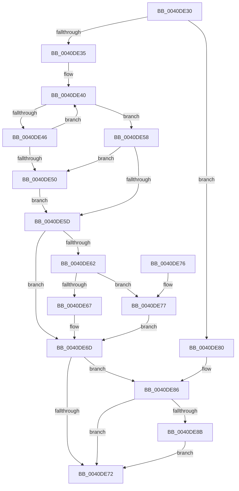

# RtlUnalignedStringCchLengthW

- RVA: `0x0040DE30`–`0x0040DE94` (길이 `100` bytes)
- VA: `0x000000014040DE30`
- 실행 섹션: `.text`
- PDB 이름 있음: `예`; PDB Function 태그: `아니요`
- unwind 정보 RVA: `0x000DB714`
- 디코드: `32`개 명령, `100/100` bytes 표시
- 미해석 바이트: `0` (있으면 어셈블리에 `.byte`로 보존)

> 이 문서는 커널 이미지의 기계어와 PDB 기호를 분석해 생성했습니다. 4번과 5번은 함수 원형과 자료형을 바이너리 사용 방식에서 추정한 C 해석이며 원본 소스 복구 결과는 아닙니다.

## 1. Dependencies

- 직접 호출 지점: **0**; 고유 호출 대상: **0**
- 직접 호출자로 확인된 함수: **2**
- RIP 상대 이미지 참조: **0**

### Outgoing calls
- 직접 디코드된 call 명령이 없습니다.

### Direct callers
- [DrvDbValidateDeviceIdName](../../page/83/DrvDbValidateDeviceIdName_function_00834E60.md) at `0x00834E7F`
- [sub_00B3665A](../../page/B3/Unknown_function_00B3665A.md) at `0x00B366C2`

### Static image references
- 디코드된 RIP-relative 메모리 참조가 없습니다.

## 2. Other-region calls and transfers

- 다른 실행 섹션으로 향하는 call: **0**
- 별도 외부 분기/꼬리 이동을 확인하지 못했습니다.

## 3. Assembly (complete function range)

```asm
0040DE30  48 85 C9                        test rcx, rcx
0040DE33  74 4B                           je 0x14040de80
0040DE35  48 8B C2                        mov rax, rdx
0040DE38  45 33 C9                        xor r9d, r9d
0040DE3B  0F 1F 44 00 00                  nop dword ptr [rax + rax]
0040DE40  66 44 39 09                     cmp word ptr [rcx], r9w
0040DE44  74 12                           je 0x14040de58
0040DE46  48 83 C1 02                     add rcx, 2
0040DE4A  48 83 E8 01                     sub rax, 1
0040DE4E  75 F0                           jne 0x14040de40
0040DE50  41 B9 0D 00 00 C0               mov r9d, 0xc000000d
0040DE56  EB 05                           jmp 0x14040de5d
0040DE58  48 85 C0                        test rax, rax
0040DE5B  74 F3                           je 0x14040de50
0040DE5D  4D 85 C0                        test r8, r8
0040DE60  74 0B                           je 0x14040de6d
0040DE62  45 85 C9                        test r9d, r9d
0040DE65  78 10                           js 0x14040de77
0040DE67  48 2B D0                        sub rdx, rax
0040DE6A  49 89 10                        mov qword ptr [r8], rdx
0040DE6D  45 85 C9                        test r9d, r9d
0040DE70  78 14                           js 0x14040de86
0040DE72  41 8B C1                        mov eax, r9d
0040DE75  C3                              ret
0040DE76  CC                              int3
0040DE77  49 C7 00 00 00 00 00            mov qword ptr [r8], 0
0040DE7E  EB ED                           jmp 0x14040de6d
0040DE80  41 B9 0D 00 00 C0               mov r9d, 0xc000000d
0040DE86  4D 85 C0                        test r8, r8
0040DE89  74 E7                           je 0x14040de72
0040DE8B  49 C7 00 00 00 00 00            mov qword ptr [r8], 0
0040DE92  EB DE                           jmp 0x14040de72
```

## 4. C-style interpretation (structured pseudocode)

```c
__int64 __fastcall RtlUnalignedStringCchLengthW(__int64 a1, __int64 a2, __int64 a3, int a4)
{
    __int64 result;

    if (a1 == 0) goto loc_0040DE80;
    a4 = 0;
loc_0040DE40:
    if ((*(unsigned __int16 *)(a1)) == 0) goto loc_0040DE58;
    a1 = (a1) + (2);
    result = (a2) - (1);
    if (condition_is_not_equal) goto loc_0040DE40;
loc_0040DE50:
    goto loc_0040DE5D;
loc_0040DE58:
    if (result == 0) goto loc_0040DE50;
loc_0040DE5D:
    if (a3 == 0) goto loc_0040DE6D;
    if (sign_flag) goto loc_0040DE77;
    a2 = (a2) - (result);
    *(unsigned __int64 *)(a3) = a2;
loc_0040DE6D:
    if (sign_flag) goto loc_0040DE86;
loc_0040DE72:
    return (unsigned int)((unsigned int)((unsigned int)(0xC000000DULL)));
loc_0040DE77:
    *(unsigned __int64 *)(a3) = 0;
    goto loc_0040DE6D;
loc_0040DE80:
loc_0040DE86:
    if (a3 == 0) goto loc_0040DE72;
    *(unsigned __int64 *)(a3) = 0;
    goto loc_0040DE72;
}
```

## 5. (Beta) C Style

```c
int64_t RtlUnalignedStringCchLengthW(int64_t Arg1, void *Arg2, int64_t Arg3, int32_t Arg4)
{
    uint8_t *arg2 = (uint8_t *)Arg2;

    int64_t result;

    if (Arg1 == 0) goto loc_0040DE80;
    Arg4 = 0;
loc_0040DE40:
    if ((*(uint16_t *)(Arg1)) == 0) goto loc_0040DE58;
    Arg1 = (Arg1) + (2);
    result = (Arg2) - (1);
    if (condition_is_not_equal) goto loc_0040DE40;
loc_0040DE50:
    goto loc_0040DE5D;
loc_0040DE58:
    if (result == 0) goto loc_0040DE50;
loc_0040DE5D:
    if (Arg3 == 0) goto loc_0040DE6D;
    if (sign_flag) goto loc_0040DE77;
    Arg2 = (Arg2) - (result);
    *(void **)(Arg3) = Arg2;
loc_0040DE6D:
    if (sign_flag) goto loc_0040DE86;
loc_0040DE72:
    return (uint32_t)((uint32_t)((uint32_t)(0xC000000DULL)));
loc_0040DE77:
    *(uint64_t *)(Arg3) = 0;
    goto loc_0040DE6D;
loc_0040DE80:
loc_0040DE86:
    if (Arg3 == 0) goto loc_0040DE72;
    *(uint64_t *)(Arg3) = 0;
    goto loc_0040DE72;
}
```

### 관측된 메모리 오프셋

구조체 형식이 확인되지 않은 접근은 인자 기준의 오프셋으로만 기록했습니다.

| 기준 인자 | 오프셋 표현 | 폭 (bit) | 접근 |
|---|---:|---:|---|
| `Arg2` | `+ 0x0 + rax*1` | `32` | `R` |

## 6. Execution-region graph

[열기: 2D/3D 그래프와 함수 탐색 컨트롤 패널](../../../control-panel.html?section=text&rva=0x0040DE30&view=graph)

- 2D 그래프는 위에서 아래로 흐르고, 3D 그래프는 빈 공간을 드래그해 회전합니다. Shift+드래그는 이동, 휠은 확대·축소, 함수 노드 선택은 대상 보고서 이동입니다.

### Static fallback


