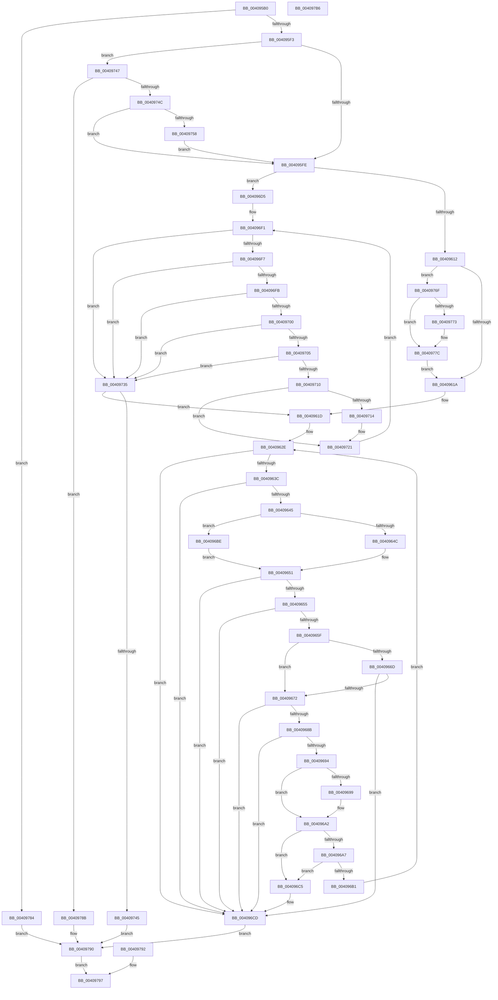

# RtlpWalkWowStack

- RVA: `0x004095B0`–`0x004097B7` (길이 `519` bytes)
- VA: `0x00000001404095B0`
- 실행 섹션: `.text`
- PDB 이름 있음: `예`; PDB Function 태그: `예`
- unwind 정보 RVA: `0x0009ABE0`
- 디코드: `150`개 명령, `519/519` bytes 표시
- 미해석 바이트: `0` (있으면 어셈블리에 `.byte`로 보존)

> 이 문서는 커널 이미지의 기계어와 PDB 기호를 분석해 생성했습니다. 4번과 5번은 함수 원형과 자료형을 바이너리 사용 방식에서 추정한 C 해석이며 원본 소스 복구 결과는 아닙니다.

## 1. Dependencies

- 직접 호출 지점: **1**; 고유 호출 대상: **1**
- 직접 호출자로 확인된 함수: **1**
- RIP 상대 이미지 참조: **0**

### Outgoing calls
- `0x0040978B` → [ExRaiseDatatypeMisalignment](../../page/89/ExRaiseDatatypeMisalignment_function_00899FD0.md) (function, `0x00899FD0`)

### Direct callers
- [RtlpWalkFrameChain](../2F/RtlpWalkFrameChain_function_002F3ED0.md) at `0x002F4958`
- [RtlpWalkFrameChain](../2F/RtlpWalkFrameChain_function_002F3ED0.md) at `0x002F4AC6`

### Static image references
- 디코드된 RIP-relative 메모리 참조가 없습니다.

## 2. Other-region calls and transfers

- 다른 실행 섹션으로 향하는 call: **1**
  - `0x0040978B` → [ExRaiseDatatypeMisalignment](../../page/89/ExRaiseDatatypeMisalignment_function_00899FD0.md) (`.text` → `PAGE`)
- 별도 외부 분기/꼬리 이동을 확인하지 못했습니다.

## 3. Assembly (complete function range)

```asm
004095B0  48 89 5C 24 08                  mov qword ptr [rsp + 8], rbx
004095B5  48 89 74 24 10                  mov qword ptr [rsp + 0x10], rsi
004095BA  48 89 7C 24 20                  mov qword ptr [rsp + 0x20], rdi
004095BF  41 54                           push r12
004095C1  41 56                           push r14
004095C3  41 57                           push r15
004095C5  48 83 EC 30                     sub rsp, 0x30
004095C9  4D 8B F1                        mov r14, r9
004095CC  4C 8B D2                        mov r10, rdx
004095CF  4C 8B E1                        mov r12, rcx
004095D2  8B 9C 24 88 00 00 00            mov ebx, dword ptr [rsp + 0x88]
004095D9  C6 44 24 20 01                  mov byte ptr [rsp + 0x20], 1
004095DE  45 8B 80 04 20 00 00            mov r8d, dword ptr [r8 + 0x2004]
004095E5  44 89 44 24 60                  mov dword ptr [rsp + 0x60], r8d
004095EA  44 3B C3                        cmp r8d, ebx
004095ED  0F 86 91 01 00 00               jbe 0x140409784
004095F3  41 8B C0                        mov eax, r8d
004095F6  2B C3                           sub eax, ebx
004095F8  0F 85 49 01 00 00               jne 0x140409747
004095FE  41 8B 11                        mov edx, dword ptr [r9]
00409601  8B 7C 24 70                     mov edi, dword ptr [rsp + 0x70]
00409605  8B 74 24 78                     mov esi, dword ptr [rsp + 0x78]
00409609  4D 85 D2                        test r10, r10
0040960C  0F 84 C3 00 00 00               je 0x1404096d5
00409612  3B FA                           cmp edi, edx
00409614  0F 87 55 01 00 00               ja 0x14040976f
0040961A  45 33 FF                        xor r15d, r15d
0040961D  8B 84 24 80 00 00 00            mov eax, dword ptr [rsp + 0x80]
00409624  44 89 7C 24 24                  mov dword ptr [rsp + 0x24], r15d
00409629  B1 01                           mov cl, 1
0040962B  45 8B 16                        mov r10d, dword ptr [r14]
0040962E  44 89 54 24 24                  mov dword ptr [rsp + 0x24], r10d
00409633  44 3B D7                        cmp r10d, edi
00409636  0F 83 91 00 00 00               jae 0x1404096cd
0040963C  41 3B C0                        cmp eax, r8d
0040963F  0F 83 88 00 00 00               jae 0x1404096cd
00409645  84 C9                           test cl, cl
00409647  41 8B CF                        mov ecx, r15d
0040964A  75 72                           jne 0x1404096be
0040964C  3B C3                           cmp eax, ebx
0040964E  0F 96 C1                        setbe cl
00409651  85 C9                           test ecx, ecx
00409653  75 78                           jne 0x1404096cd
00409655  41 8B C8                        mov ecx, r8d
00409658  2B C8                           sub ecx, eax
0040965A  83 F9 08                        cmp ecx, 8
0040965D  72 6E                           jb 0x1404096cd
0040965F  8B C8                           mov ecx, eax
00409661  44 8B 19                        mov r11d, dword ptr [rcx]
00409664  44 8B 49 04                     mov r9d, dword ptr [rcx + 4]
00409668  41 3B D9                        cmp ebx, r9d
0040966B  77 05                           ja 0x140409672
0040966D  45 3B C8                        cmp r9d, r8d
00409670  72 5B                           jb 0x1404096cd
00409672  65 48 8B 0C 25 88 01 00 00      mov rcx, qword ptr gs:[0x188]
0040967B  48 8B 89 B8 00 00 00            mov rcx, qword ptr [rcx + 0xb8]
00409682  41 81 F9 00 00 01 00            cmp r9d, 0x10000
00409689  72 42                           jb 0x1404096cd
0040968B  4C 3B 89 68 03 00 00            cmp r9, qword ptr [rcx + 0x368]
00409692  73 39                           jae 0x1404096cd
00409694  44 3B D6                        cmp r10d, esi
00409697  72 09                           jb 0x1404096a2
00409699  41 8B CA                        mov ecx, r10d
0040969C  2B CE                           sub ecx, esi
0040969E  4D 89 0C CC                     mov qword ptr [r12 + rcx*8], r9
004096A2  41 3B C3                        cmp eax, r11d
004096A5  73 1E                           jae 0x1404096c5
004096A7  44 8B 44 24 60                  mov r8d, dword ptr [rsp + 0x60]
004096AC  45 3B D8                        cmp r11d, r8d
004096AF  73 14                           jae 0x1404096c5
004096B1  41 8B C3                        mov eax, r11d
004096B4  32 C9                           xor cl, cl
004096B6  41 FF C2                        inc r10d
004096B9  E9 70 FF FF FF                  jmp 0x14040962e
004096BE  3B C3                           cmp eax, ebx
004096C0  0F 92 C1                        setb cl
004096C3  EB 8C                           jmp 0x140409651
004096C5  41 FF C2                        inc r10d
004096C8  44 89 54 24 24                  mov dword ptr [rsp + 0x24], r10d
004096CD  45 89 16                        mov dword ptr [r14], r10d
004096D0  E9 BB 00 00 00                  jmp 0x140409790
004096D5  44 8B CB                        mov r9d, ebx
004096D8  45 33 FF                        xor r15d, r15d
004096DB  44 89 7C 24 2C                  mov dword ptr [rsp + 0x2c], r15d
004096E0  44 89 7C 24 28                  mov dword ptr [rsp + 0x28], r15d
004096E5  89 54 24 28                     mov dword ptr [rsp + 0x28], edx
004096E9  45 8B D7                        mov r10d, r15d
004096EC  44 89 7C 24 2C                  mov dword ptr [rsp + 0x2c], r15d
004096F1  41 83 FA 02                     cmp r10d, 2
004096F5  73 3E                           jae 0x140409735
004096F7  3B D7                           cmp edx, edi
004096F9  73 3A                           jae 0x140409735
004096FB  45 3B C8                        cmp r9d, r8d
004096FE  73 35                           jae 0x140409735
00409700  44 3B CB                        cmp r9d, ebx
00409703  72 30                           jb 0x140409735
00409705  41 8B C0                        mov eax, r8d
00409708  41 2B C1                        sub eax, r9d
0040970B  83 F8 04                        cmp eax, 4
0040970E  72 25                           jb 0x140409735
00409710  3B D6                           cmp edx, esi
00409712  72 0D                           jb 0x140409721
00409714  41 8B C1                        mov eax, r9d
00409717  8B 08                           mov ecx, dword ptr [rax]
00409719  8B C2                           mov eax, edx
0040971B  2B C6                           sub eax, esi
0040971D  49 89 0C C4                     mov qword ptr [r12 + rax*8], rcx
00409721  41 83 C1 04                     add r9d, 4
00409725  FF C2                           inc edx
00409727  89 54 24 28                     mov dword ptr [rsp + 0x28], edx
0040972B  41 FF C2                        inc r10d
0040972E  44 89 54 24 2C                  mov dword ptr [rsp + 0x2c], r10d
00409733  EB BC                           jmp 0x1404096f1
00409735  41 89 16                        mov dword ptr [r14], edx
00409738  3B D7                           cmp edx, edi
0040973A  0F 92 C0                        setb al
0040973D  84 C0                           test al, al
0040973F  0F 85 D8 FE FF FF               jne 0x14040961d
00409745  EB 49                           jmp 0x140409790
00409747  F6 C3 03                        test bl, 3
0040974A  75 3F                           jne 0x14040978b
0040974C  48 03 C3                        add rax, rbx
0040974F  48 3B C3                        cmp rax, rbx
00409752  0F 83 A6 FE FF FF               jae 0x1404095fe
00409758  48 B8 00 00 FF FF FF 7F 00 00   movabs rax, 0x7fffffff0000
00409762  0F B6 00                        movzx eax, byte ptr [rax]
00409765  44 8B 44 24 60                  mov r8d, dword ptr [rsp + 0x60]
0040976A  E9 8F FE FF FF                  jmp 0x1404095fe
0040976F  3B D6                           cmp edx, esi
00409771  72 09                           jb 0x14040977c
00409773  41 8B 0A                        mov ecx, dword ptr [r10]
00409776  2B D6                           sub edx, esi
00409778  49 89 0C D4                     mov qword ptr [r12 + rdx*8], rcx
0040977C  41 FF 01                        inc dword ptr [r9]
0040977F  E9 96 FE FF FF                  jmp 0x14040961a
00409784  C6 44 24 20 00                  mov byte ptr [rsp + 0x20], 0
00409789  EB 05                           jmp 0x140409790
0040978B  E8 40 08 49 00                  call 0x140899fd0
00409790  EB 05                           jmp 0x140409797
00409792  C6 44 24 20 00                  mov byte ptr [rsp + 0x20], 0
00409797  0F B6 44 24 20                  movzx eax, byte ptr [rsp + 0x20]
0040979C  48 8B 5C 24 50                  mov rbx, qword ptr [rsp + 0x50]
004097A1  48 8B 74 24 58                  mov rsi, qword ptr [rsp + 0x58]
004097A6  48 8B 7C 24 68                  mov rdi, qword ptr [rsp + 0x68]
004097AB  48 83 C4 30                     add rsp, 0x30
004097AF  41 5F                           pop r15
004097B1  41 5E                           pop r14
004097B3  41 5C                           pop r12
004097B5  C3                              ret
004097B6  CC                              int3
```

## 4. C-style interpretation (structured pseudocode)

```c
__int64 __fastcall RtlpWalkWowStack(__int64 a1, __int64 a2, __int64 a3, __int64 a4, unsigned int a5, unsigned int a6, unsigned int a7, unsigned int a8)
{
    __int64 result;
    __int64 v_r10;
    __int64 v_r15;
    __int64 v_rsp;
    unsigned int v_stack_m1C;
    unsigned int v_stack_m20;
    unsigned int v_stack_m24;
    unsigned __int8 v_stack_m28;
    unsigned __int64 v_stack_p10;
    unsigned int v_stack_p18;
    unsigned __int64 v_stack_p20;
    unsigned __int64 v_stack_p8;

    v_stack_p8 = v_rbx;
    v_stack_p10 = v_rsi;
    v_stack_p20 = v_rdi;
    v_rsp = (v_rsp) - (48);
    v_stack_m28 = 1;
    v_stack_p18 = (unsigned int)((unsigned int)(*(unsigned int *)(a3 + 8196)));
    if (((unsigned int)((unsigned int)(*(unsigned int *)(a3 + 8196)))) <= ((unsigned int)((unsigned int)(a8)))) goto loc_00409784;
    result = (unsigned int)(((unsigned int)((unsigned int)((unsigned int)(*(unsigned int *)(a3 + 8196))))) - ((unsigned int)((unsigned int)(a8))));
    if (condition_is_not_equal) goto loc_00409747;
loc_004095FE:
    if (a2 == 0) goto loc_004096D5;
    if (((unsigned int)((unsigned int)(a5))) > ((unsigned int)((unsigned int)(*(unsigned int *)(a4))))) goto loc_0040976F;
loc_0040961A:
    v_r15 = 0;
loc_0040961D:
    v_stack_m24 = 0;
loc_0040962E:
    v_stack_m24 = (unsigned int)((unsigned int)(*(unsigned int *)(a4)));
    if (((unsigned int)((unsigned int)(*(unsigned int *)(a4)))) >= ((unsigned int)((unsigned int)(a5)))) goto loc_004096CD;
    if (((unsigned int)((unsigned int)(a7))) >= ((unsigned int)((unsigned int)(*(unsigned int *)(a3 + 8196))))) goto loc_004096CD;
    if (1 != 0) goto loc_004096BE;
    a1 = (((unsigned int)((unsigned int)(a7))) <= ((unsigned int)((unsigned int)(a8)))) ? 1 : 0;
loc_00409651:
    if ((unsigned int)(a1) != 0) goto loc_004096CD;
    a1 = (unsigned int)(((unsigned int)((unsigned int)((unsigned int)(*(unsigned int *)(a3 + 8196))))) - ((unsigned int)((unsigned int)(a7))));
    if (((unsigned int)(a1)) < 8) goto loc_004096CD;
    if (((unsigned int)((unsigned int)(a8))) > ((unsigned int)((unsigned int)(*(unsigned int *)((unsigned int)((unsigned int)((unsigned int)(a7))) + 4))))) goto loc_00409672;
    if (((unsigned int)((unsigned int)(*(unsigned int *)((unsigned int)((unsigned int)((unsigned int)(a7))) + 4)))) < ((unsigned int)((unsigned int)(*(unsigned int *)(a3 + 8196))))) goto loc_004096CD;
loc_00409672:
    if (((unsigned int)((unsigned int)(*(unsigned int *)((unsigned int)((unsigned int)((unsigned int)(a7))) + 4)))) < 0x10000ULL) goto loc_004096CD;
    if (((unsigned int)(*(unsigned int *)((unsigned int)((unsigned int)((unsigned int)(a7))) + 4))) >= (*(unsigned __int64 *)(*(unsigned __int64 *)(*(unsigned __int64 *)(gs_base + (0 + 392)) + 184) + 872))) goto loc_004096CD;
    if (((unsigned int)((unsigned int)(*(unsigned int *)(a4)))) >= ((unsigned int)((unsigned int)(a6)))) {
        a1 = (unsigned int)((unsigned int)(*(unsigned int *)(a4)));
        a1 = (unsigned int)((a1) - ((unsigned int)((unsigned int)(a6))));
        *(unsigned __int64 *)(a1 + a1 * 8) = (unsigned int)(*(unsigned int *)((unsigned int)((unsigned int)((unsigned int)(a7))) + 4));
    }
    if (((unsigned int)((unsigned int)(a7))) >= ((unsigned int)((unsigned int)(*(unsigned int *)((unsigned int)((unsigned int)((unsigned int)(a7)))))))) goto loc_004096C5;
    if (((unsigned int)((unsigned int)(*(unsigned int *)((unsigned int)((unsigned int)((unsigned int)(a7))))))) >= ((unsigned int)((unsigned int)(v_stack_p18)))) goto loc_004096C5;
    a1 = 0;
    v_r10 = (unsigned int)(((unsigned int)(*(unsigned int *)(a4))) + 1);
    goto loc_0040962E;
loc_004096BE:
    a1 = (((unsigned int)((unsigned int)((unsigned int)((unsigned int)(*(unsigned int *)((unsigned int)((unsigned int)((unsigned int)(a7))))))))) < ((unsigned int)((unsigned int)(a8)))) ? 1 : 0;
    goto loc_00409651;
loc_004096C5:
    v_r10 = (unsigned int)((v_r10) + 1);
    v_stack_m24 = (unsigned int)(v_r10);
loc_004096CD:
    *(unsigned int *)(a4) = (unsigned int)(v_r10);
    goto loc_00409790;
loc_004096D5:
    v_r15 = 0;
    v_stack_m1C = 0;
    v_stack_m20 = 0;
    v_stack_m20 = (unsigned int)((unsigned int)(*(unsigned int *)(a4)));
    v_stack_m1C = 0;
loc_004096F1:
    if (0 >= 2) goto loc_00409735;
    if (((unsigned int)((unsigned int)(*(unsigned int *)(a4)))) >= ((unsigned int)((unsigned int)(a5)))) goto loc_00409735;
    if (((unsigned int)((unsigned int)((unsigned int)((unsigned int)(a8))))) >= ((unsigned int)((unsigned int)(v_stack_p18)))) goto loc_00409735;
    if (((unsigned int)((unsigned int)((unsigned int)((unsigned int)(a8))))) < ((unsigned int)((unsigned int)(a8)))) goto loc_00409735;
    result = (unsigned int)(((unsigned int)((unsigned int)((unsigned int)(v_stack_p18)))) - ((unsigned int)((unsigned int)((unsigned int)((unsigned int)(a8))))));
    if (((unsigned int)(result)) < 4) goto loc_00409735;
    if (((unsigned int)((unsigned int)(*(unsigned int *)(a4)))) >= ((unsigned int)((unsigned int)(a6)))) {
        result = (unsigned int)((unsigned int)((unsigned int)((unsigned int)(a8))));
        a1 = *(unsigned int *)(result);
        result = (unsigned int)((unsigned int)(*(unsigned int *)(a4)));
        result = (unsigned int)((result) - ((unsigned int)((unsigned int)(a6))));
        *(unsigned __int64 *)(a1 + result * 8) = a1;
    }
    a4 = (unsigned int)(((unsigned int)((unsigned int)((unsigned int)(a8)))) + (4));
    a2 = (unsigned int)(((unsigned int)(*(unsigned int *)(a4))) + 1);
    v_stack_m20 = (unsigned int)(a2);
    v_r10 = (unsigned int)((0) + 1);
    v_stack_m1C = (unsigned int)(v_r10);
    goto loc_004096F1;
loc_00409735:
    *(unsigned int *)(a4) = (unsigned int)(a2);
    result = (((unsigned int)(a2)) < ((unsigned int)((unsigned int)(a5)))) ? 1 : 0;
    if ((unsigned __int8)(result) != 0) goto loc_0040961D;
    goto loc_00409790;
loc_00409747:
    if ((((unsigned __int8)((unsigned int)(a8))) & (3)) != 0) goto loc_0040978B;
    result = (result) + ((unsigned int)(a8));
    if (result >= ((unsigned int)(a8))) goto loc_004095FE;
    goto loc_004095FE;
loc_0040976F:
    if (((unsigned int)(a2)) >= ((unsigned int)((unsigned int)(a6)))) {
        a1 = *(unsigned int *)(v_r10);
        a2 = (unsigned int)((a2) - ((unsigned int)((unsigned int)(a6))));
        *(unsigned __int64 *)(a1 + a2 * 8) = a1;
    }
    goto loc_0040961A;
loc_00409784:
    v_stack_m28 = 0;
    goto loc_00409790;
loc_0040978B:
    result = ExRaiseDatatypeMisalignment(a1, a2, (unsigned int)(v_stack_p18), a4);
loc_00409790:
    goto loc_00409797;
loc_00409797:
    v_rsp = (v_rsp) + (48);
    return v_stack_m28;
}
```

## 5. (Beta) C Style

```c
int64_t RtlpWalkWowStack(void *Arg1, int64_t Arg2, void *Arg3, void *Arg4, uint32_t Arg5, uint32_t Arg6, uint32_t Arg7, uint32_t Arg8)
{
    uint8_t *arg1 = (uint8_t *)Arg1;
    uint8_t *arg3 = (uint8_t *)Arg3;
    uint8_t *arg4 = (uint8_t *)Arg4;

    int64_t result;
    int64_t local_r10;
    int64_t local_r15;
    int64_t local_rsp;
    uint32_t v_stack_m1C;
    uint32_t v_stack_m20;
    uint32_t v_stack_m24;
    uint8_t v_stack_m28;
    uint64_t v_stack_p10;
    uint32_t v_stack_p18;
    uint64_t v_stack_p20;
    uint64_t v_stack_p8;

    v_stack_p8 = local_rbx;
    v_stack_p10 = local_rsi;
    v_stack_p20 = local_rdi;
    local_rsp = (local_rsp) - (48);
    v_stack_m28 = 1;
    v_stack_p18 = (uint32_t)((uint32_t)(*(uint32_t *)(arg3 + 0x2004)));
    if (((uint32_t)((uint32_t)(*(uint32_t *)(arg3 + 0x2004)))) <= ((uint32_t)((uint32_t)(Arg8)))) goto loc_00409784;
    result = (uint32_t)(((uint32_t)((uint32_t)((uint32_t)(*(uint32_t *)(arg3 + 0x2004))))) - ((uint32_t)((uint32_t)(Arg8))));
    if (condition_is_not_equal) goto loc_00409747;
loc_004095FE:
    if (Arg2 == 0) goto loc_004096D5;
    if (((uint32_t)((uint32_t)(Arg5))) > ((uint32_t)((uint32_t)(*(uint32_t *)(arg4))))) goto loc_0040976F;
loc_0040961A:
    local_r15 = 0;
loc_0040961D:
    v_stack_m24 = 0;
loc_0040962E:
    v_stack_m24 = (uint32_t)((uint32_t)(*(uint32_t *)(arg4)));
    if (((uint32_t)((uint32_t)(*(uint32_t *)(arg4)))) >= ((uint32_t)((uint32_t)(Arg5)))) goto loc_004096CD;
    if (((uint32_t)((uint32_t)(Arg7))) >= ((uint32_t)((uint32_t)(*(uint32_t *)(arg3 + 0x2004))))) goto loc_004096CD;
    if (1 != 0) goto loc_004096BE;
    Arg1 = (((uint32_t)((uint32_t)(Arg7))) <= ((uint32_t)((uint32_t)(Arg8)))) ? 1 : 0;
loc_00409651:
    if ((uint32_t)(Arg1) != 0) goto loc_004096CD;
    Arg1 = (uint32_t)(((uint32_t)((uint32_t)((uint32_t)(*(uint32_t *)(arg3 + 0x2004))))) - ((uint32_t)((uint32_t)(Arg7))));
    if (((uint32_t)(Arg1)) < 8) goto loc_004096CD;
    if (((uint32_t)((uint32_t)(Arg8))) > ((uint32_t)((uint32_t)(*(uint32_t *)((uint32_t)((uint32_t)((uint32_t)(Arg7))) + 0x4))))) goto loc_00409672;
    if (((uint32_t)((uint32_t)(*(uint32_t *)((uint32_t)((uint32_t)((uint32_t)(Arg7))) + 0x4)))) < ((uint32_t)((uint32_t)(*(uint32_t *)(arg3 + 0x2004))))) goto loc_004096CD;
loc_00409672:
    if (((uint32_t)((uint32_t)(*(uint32_t *)((uint32_t)((uint32_t)((uint32_t)(Arg7))) + 0x4)))) < 0x10000ULL) goto loc_004096CD;
    if (((uint32_t)(*(uint32_t *)((uint32_t)((uint32_t)((uint32_t)(Arg7))) + 0x4))) >= (*(uint64_t *)(*(uint64_t *)(*(uint64_t *)(gs_base + (0 + 0x188)) + 0xB8) + 0x368))) goto loc_004096CD;
    if (((uint32_t)((uint32_t)(*(uint32_t *)(arg4)))) >= ((uint32_t)((uint32_t)(Arg6)))) {
        Arg1 = (uint32_t)((uint32_t)(*(uint32_t *)(arg4)));
        Arg1 = (uint32_t)((Arg1) - ((uint32_t)((uint32_t)(Arg6))));
        *(uint64_t *)(arg1 + arg1 * 8) = (uint32_t)(*(uint32_t *)((uint32_t)((uint32_t)((uint32_t)(Arg7))) + 0x4));
    }
    if (((uint32_t)((uint32_t)(Arg7))) >= ((uint32_t)((uint32_t)(*(uint32_t *)((uint32_t)((uint32_t)((uint32_t)(Arg7)))))))) goto loc_004096C5;
    if (((uint32_t)((uint32_t)(*(uint32_t *)((uint32_t)((uint32_t)((uint32_t)(Arg7))))))) >= ((uint32_t)((uint32_t)(v_stack_p18)))) goto loc_004096C5;
    Arg1 = 0;
    local_r10 = (uint32_t)(((uint32_t)(*(uint32_t *)(arg4))) + 1);
    goto loc_0040962E;
loc_004096BE:
    Arg1 = (((uint32_t)((uint32_t)((uint32_t)((uint32_t)(*(uint32_t *)((uint32_t)((uint32_t)((uint32_t)(Arg7))))))))) < ((uint32_t)((uint32_t)(Arg8)))) ? 1 : 0;
    goto loc_00409651;
loc_004096C5:
    local_r10 = (uint32_t)((local_r10) + 1);
    v_stack_m24 = (uint32_t)(local_r10);
loc_004096CD:
    *(uint32_t *)(arg4) = (uint32_t)(local_r10);
    goto loc_00409790;
loc_004096D5:
    local_r15 = 0;
    v_stack_m1C = 0;
    v_stack_m20 = 0;
    v_stack_m20 = (uint32_t)((uint32_t)(*(uint32_t *)(arg4)));
    v_stack_m1C = 0;
loc_004096F1:
    if (0 >= 2) goto loc_00409735;
    if (((uint32_t)((uint32_t)(*(uint32_t *)(arg4)))) >= ((uint32_t)((uint32_t)(Arg5)))) goto loc_00409735;
    if (((uint32_t)((uint32_t)((uint32_t)((uint32_t)(Arg8))))) >= ((uint32_t)((uint32_t)(v_stack_p18)))) goto loc_00409735;
    if (((uint32_t)((uint32_t)((uint32_t)((uint32_t)(Arg8))))) < ((uint32_t)((uint32_t)(Arg8)))) goto loc_00409735;
    result = (uint32_t)(((uint32_t)((uint32_t)((uint32_t)(v_stack_p18)))) - ((uint32_t)((uint32_t)((uint32_t)((uint32_t)(Arg8))))));
    if (((uint32_t)(result)) < 4) goto loc_00409735;
    if (((uint32_t)((uint32_t)(*(uint32_t *)(arg4)))) >= ((uint32_t)((uint32_t)(Arg6)))) {
        result = (uint32_t)((uint32_t)((uint32_t)((uint32_t)(Arg8))));
        Arg1 = *(uint32_t *)(result);
        result = (uint32_t)((uint32_t)(*(uint32_t *)(arg4)));
        result = (uint32_t)((result) - ((uint32_t)((uint32_t)(Arg6))));
        *(void **)(arg1 + result * 8) = Arg1;
    }
    Arg4 = (uint32_t)(((uint32_t)((uint32_t)((uint32_t)(Arg8)))) + (4));
    Arg2 = (uint32_t)(((uint32_t)(*(uint32_t *)(arg4))) + 1);
    v_stack_m20 = (uint32_t)(Arg2);
    local_r10 = (uint32_t)((0) + 1);
    v_stack_m1C = (uint32_t)(local_r10);
    goto loc_004096F1;
loc_00409735:
    *(uint32_t *)(arg4) = (uint32_t)(Arg2);
    result = (((uint32_t)(Arg2)) < ((uint32_t)((uint32_t)(Arg5)))) ? 1 : 0;
    if ((uint8_t)(result) != 0) goto loc_0040961D;
    goto loc_00409790;
loc_00409747:
    if ((((uint8_t)((uint32_t)(Arg8))) & (3)) != 0) goto loc_0040978B;
    result = (result) + ((uint32_t)(Arg8));
    if (result >= ((uint32_t)(Arg8))) goto loc_004095FE;
    goto loc_004095FE;
loc_0040976F:
    if (((uint32_t)(Arg2)) >= ((uint32_t)((uint32_t)(Arg6)))) {
        Arg1 = *(uint32_t *)(local_r10);
        Arg2 = (uint32_t)((Arg2) - ((uint32_t)((uint32_t)(Arg6))));
        *(void **)(arg1 + Arg2 * 8) = Arg1;
    }
    goto loc_0040961A;
loc_00409784:
    v_stack_m28 = 0;
    goto loc_00409790;
loc_0040978B:
    result = ExRaiseDatatypeMisalignment(Arg1, Arg2, (uint32_t)(v_stack_p18), Arg4);
loc_00409790:
    goto loc_00409797;
loc_00409797:
    local_rsp = (local_rsp) + (48);
    return v_stack_m28;
}
```

### 관측된 메모리 오프셋

구조체 형식이 확인되지 않은 접근은 인자 기준의 오프셋으로만 기록했습니다.

| 기준 인자 | 오프셋 표현 | 폭 (bit) | 접근 |
|---|---:|---:|---|
| `Arg1` | `+ 0x0 + rax*8` | `64` | `W` |
| `Arg1` | `+ 0x0 + rcx*8` | `64` | `W` |
| `Arg1` | `+ 0x0 + rdx*8` | `64` | `W` |
| `Arg3` | `+ 0x2004` | `32` | `R` |
| `Arg4` | `+ 0x0` | `32` | `R` |
| `Arg4` | `+ 0x0` | `32` | `R/W` |
| `Arg4` | `+ 0x0` | `32` | `W` |

## 6. Execution-region graph

[열기: 2D/3D 그래프와 함수 탐색 컨트롤 패널](../../../control-panel.html?section=text&rva=0x004095B0&view=graph)

- 2D 그래프는 위에서 아래로 흐르고, 3D 그래프는 빈 공간을 드래그해 회전합니다. Shift+드래그는 이동, 휠은 확대·축소, 함수 노드 선택은 대상 보고서 이동입니다.

### Static fallback


