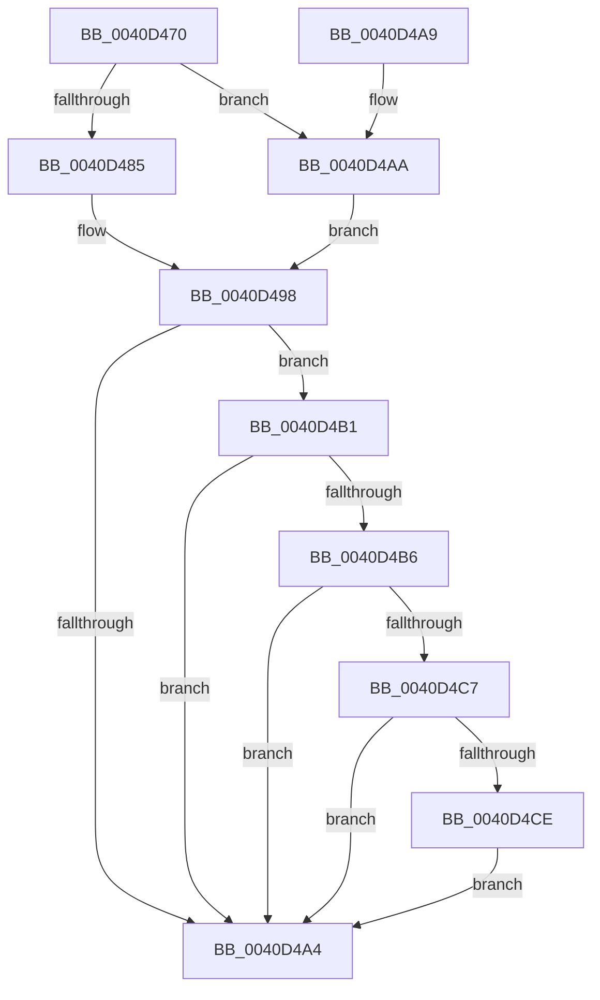

# SeClearLearningModeObjectInformation

- RVA: `0x0040D470`–`0x0040D4D9` (길이 `105` bytes)
- VA: `0x000000014040D470`
- 실행 섹션: `.text`
- PDB 이름 있음: `예`; PDB Function 태그: `아니요`
- unwind 정보 RVA: `0x00078414`
- 디코드: `27`개 명령, `105/105` bytes 표시
- 미해석 바이트: `0` (있으면 어셈블리에 `.byte`로 보존)

> 이 문서는 커널 이미지의 기계어와 PDB 기호를 분석해 생성했습니다. 4번과 5번은 함수 원형과 자료형을 바이너리 사용 방식에서 추정한 C 해석이며 원본 소스 복구 결과는 아닙니다.

## 1. Dependencies

- 직접 호출 지점: **1**; 고유 호출 대상: **1**
- 직접 호출자로 확인된 함수: **5**
- RIP 상대 이미지 참조: **0**

### Outgoing calls
- `0x0040D4D2` → [RtlFreeAnsiString](../../page/9C/RtlFreeAnsiString_function_009C0800.md) (function, `0x009C0800`)

### Direct callers
- [sub_006EF3AA](../6E/Unknown_function_006EF3AA.md) at `0x006EF4CB`
- [sub_0089A903](../../page/89/Unknown_function_0089A903.md) at `0x0089AE02`
- [ObpLookupObjectName](../../page/89/ObpLookupObjectName_function_0089BE90.md) at `0x0089CCBB`
- [ObReferenceObjectByNameEx](../../page/8B/ObReferenceObjectByNameEx_function_008BD524.md) at `0x008BD73A`
- [ObReferenceObjectByName](../../page/8C/ObReferenceObjectByName_function_008C4A00.md) at `0x008C4BD2`

### Static image references
- 디코드된 RIP-relative 메모리 참조가 없습니다.

## 2. Other-region calls and transfers

- 다른 실행 섹션으로 향하는 call: **1**
  - `0x0040D4D2` → [RtlFreeAnsiString](../../page/9C/RtlFreeAnsiString_function_009C0800.md) (`.text` → `PAGE`)
- 별도 외부 분기/꼬리 이동을 확인하지 못했습니다.

## 3. Assembly (complete function range)

```asm
0040D470  48 83 EC 28                     sub rsp, 0x28
0040D474  65 48 8B 0C 25 88 01 00 00      mov rcx, qword ptr gs:[0x188]
0040D47D  44 0F 20 C0                     mov rax, cr8
0040D481  84 C0                           test al, al
0040D483  75 25                           jne 0x14040d4aa
0040D485  65 48 8B 04 25 88 01 00 00      mov rax, qword ptr gs:[0x188]
0040D48E  0F B6 80 C0 00 00 00            movzx eax, byte ptr [rax + 0xc0]
0040D495  83 E0 01                        and eax, 1
0040D498  48 8B 91 38 06 00 00            mov rdx, qword ptr [rcx + 0x638]
0040D49F  48 85 D2                        test rdx, rdx
0040D4A2  75 0D                           jne 0x14040d4b1
0040D4A4  48 83 C4 28                     add rsp, 0x28
0040D4A8  C3                              ret
0040D4A9  CC                              int3
0040D4AA  B8 02 00 00 00                  mov eax, 2
0040D4AF  EB E7                           jmp 0x14040d498
0040D4B1  39 42 08                        cmp dword ptr [rdx + 8], eax
0040D4B4  75 EE                           jne 0x14040d4a4
0040D4B6  48 8B 02                        mov rax, qword ptr [rdx]
0040D4B9  48 89 81 38 06 00 00            mov qword ptr [rcx + 0x638], rax
0040D4C0  48 83 7A 20 00                  cmp qword ptr [rdx + 0x20], 0
0040D4C5  74 DD                           je 0x14040d4a4
0040D4C7  48 83 7A 30 00                  cmp qword ptr [rdx + 0x30], 0
0040D4CC  74 D6                           je 0x14040d4a4
0040D4CE  48 8D 4A 28                     lea rcx, [rdx + 0x28]
0040D4D2  E8 29 33 5B 00                  call 0x1409c0800
0040D4D7  EB CB                           jmp 0x14040d4a4
```

## 4. C-style interpretation (structured pseudocode)

```c
__int64 __fastcall SeClearLearningModeObjectInformation(void)
{
    __int64 result;
    __int64 v_rsp;

    v_rsp = (v_rsp) - (40);
    if ((unsigned __int8)(v_cr8) != 0) goto loc_0040D4AA;
    result = (unsigned int)((*(unsigned __int8 *)(*(unsigned __int64 *)(gs_base + (0 + 392)) + 192)) & (1));
loc_0040D498:
    if (*(unsigned __int64 *)(*(unsigned __int64 *)(gs_base + (0 + 392)) + 1592) != 0) goto loc_0040D4B1;
loc_0040D4A4:
    v_rsp = (v_rsp) + (40);
    return result;
loc_0040D4AA:
    goto loc_0040D498;
loc_0040D4B1:
    if ((*(unsigned int *)(*(unsigned __int64 *)(*(unsigned __int64 *)(gs_base + (0 + 392)) + 1592) + 8)) != 2) goto loc_0040D4A4;
    *(unsigned __int64 *)(*(unsigned __int64 *)(gs_base + (0 + 392)) + 1592) = *(unsigned __int64 *)(*(unsigned __int64 *)(*(unsigned __int64 *)(gs_base + (0 + 392)) + 1592));
    if ((*(unsigned __int64 *)(*(unsigned __int64 *)(*(unsigned __int64 *)(gs_base + (0 + 392)) + 1592) + 32)) == 0) goto loc_0040D4A4;
    if ((*(unsigned __int64 *)(*(unsigned __int64 *)(*(unsigned __int64 *)(gs_base + (0 + 392)) + 1592) + 48)) == 0) goto loc_0040D4A4;
    result = RtlFreeAnsiString(*(unsigned __int64 *)(*(unsigned __int64 *)(gs_base + (0 + 392)) + 1592) + 40, *(unsigned __int64 *)(*(unsigned __int64 *)(gs_base + (0 + 392)) + 1592), a3, a4);
    goto loc_0040D4A4;
}
```

## 5. (Beta) C Style

```c
void SeClearLearningModeObjectInformation(void)
{
    int64_t result;
    int64_t local_rsp;

    local_rsp = (local_rsp) - (40);
    if ((uint8_t)(v_cr8) != 0) goto loc_0040D4AA;
    result = (uint32_t)((*(uint8_t *)(*(uint64_t *)(gs_base + (0 + 0x188)) + 0xC0)) & (1));
loc_0040D498:
    if (*(uint64_t *)(*(uint64_t *)(gs_base + (0 + 0x188)) + 0x638) != 0) goto loc_0040D4B1;
loc_0040D4A4:
    local_rsp = (local_rsp) + (40);
    return result;
loc_0040D4AA:
    goto loc_0040D498;
loc_0040D4B1:
    if ((*(uint32_t *)(*(uint64_t *)(*(uint64_t *)(gs_base + (0 + 0x188)) + 0x638) + 0x8)) != 2) goto loc_0040D4A4;
    *(uint64_t *)(*(uint64_t *)(gs_base + (0 + 0x188)) + 0x638) = *(uint64_t *)(*(uint64_t *)(*(uint64_t *)(gs_base + (0 + 0x188)) + 0x638));
    if ((*(uint64_t *)(*(uint64_t *)(*(uint64_t *)(gs_base + (0 + 0x188)) + 0x638) + 0x20)) == 0) goto loc_0040D4A4;
    if ((*(uint64_t *)(*(uint64_t *)(*(uint64_t *)(gs_base + (0 + 0x188)) + 0x638) + 0x30)) == 0) goto loc_0040D4A4;
    result = RtlFreeAnsiString(*(uint64_t *)(*(uint64_t *)(gs_base + (0 + 0x188)) + 0x638) + 40, *(uint64_t *)(*(uint64_t *)(gs_base + (0 + 0x188)) + 0x638), a3, a4);
    goto loc_0040D4A4;
}
```

## 6. Execution-region graph

[열기: 2D/3D 그래프와 함수 탐색 컨트롤 패널](../../../control-panel.html?section=text&rva=0x0040D470&view=graph)

- 2D 그래프는 위에서 아래로 흐르고, 3D 그래프는 빈 공간을 드래그해 회전합니다. Shift+드래그는 이동, 휠은 확대·축소, 함수 노드 선택은 대상 보고서 이동입니다.

### Static fallback


