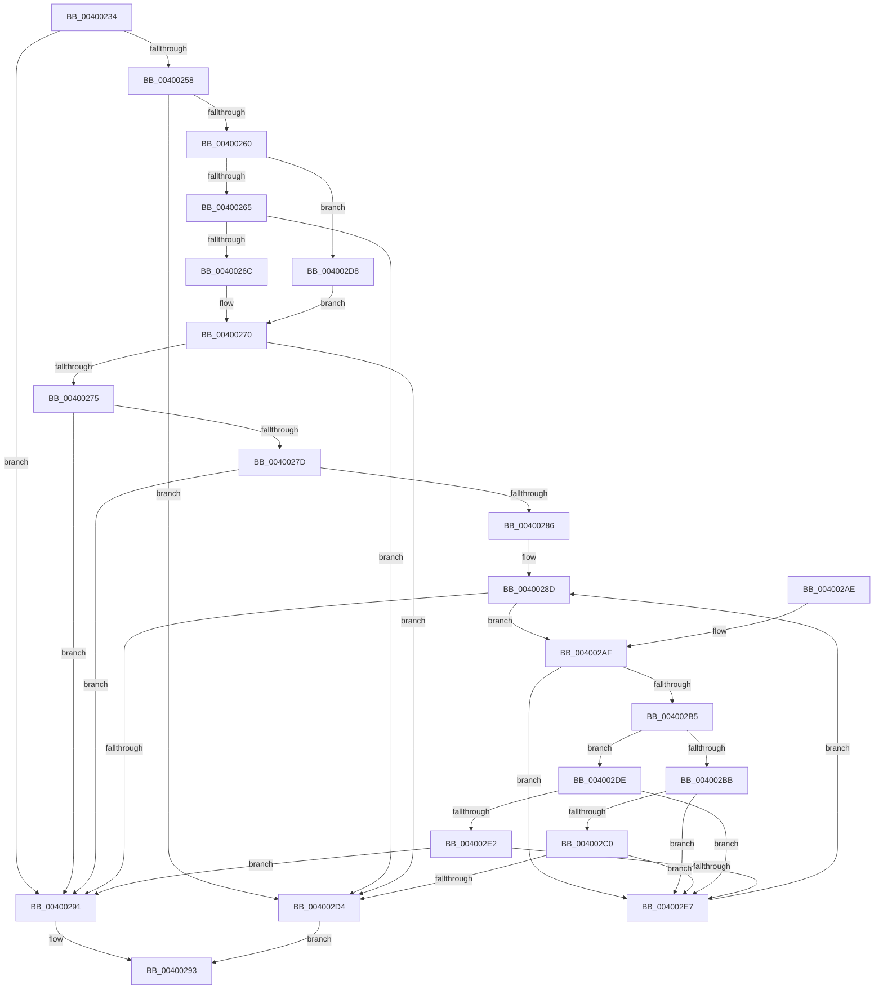

# SeFastTraverseCheck

- RVA: `0x00400234`–`0x004002F2` (길이 `190` bytes)
- VA: `0x0000000140400234`
- 실행 섹션: `.text`
- PDB 이름 있음: `예`; PDB Function 태그: `아니요`
- unwind 정보 RVA: `0x0009A1E4`
- 디코드: `64`개 명령, `190/190` bytes 표시
- 미해석 바이트: `0` (있으면 어셈블리에 `.byte`로 보존)

> 이 문서는 커널 이미지의 기계어와 PDB 기호를 분석해 생성했습니다. 4번과 5번은 함수 원형과 자료형을 바이너리 사용 방식에서 추정한 C 해석이며 원본 소스 복구 결과는 아닙니다.

## 1. Dependencies

- 직접 호출 지점: **1**; 고유 호출 대상: **1**
- 직접 호출자로 확인된 함수: **2**
- RIP 상대 이미지 참조: **1**

### Outgoing calls
- `0x004002CB` → [RtlEqualSid](RtlEqualSid_function_00400AD0.md) (function, `0x00400AD0`)

### Direct callers
- [IopParseDevice](../../page/89/IopParseDevice_function_0089E510.md) at `0x008A035F`
- [ObpCheckTraverseAccess](../../page/8C/ObpCheckTraverseAccess_function_008C6CE4.md) at `0x008C6D6A`

### Static image references
- `0x004002C0` → RVA `0x00E67D48` (`.data`; read)

## 2. Other-region calls and transfers

- 다른 실행 섹션으로 향하는 call: **0**
- 별도 외부 분기/꼬리 이동을 확인하지 못했습니다.

## 3. Assembly (complete function range)

```asm
00400234  48 8B C4                        mov rax, rsp
00400237  48 89 58 08                     mov qword ptr [rax + 8], rbx
0040023B  48 89 68 10                     mov qword ptr [rax + 0x10], rbp
0040023F  48 89 70 18                     mov qword ptr [rax + 0x18], rsi
00400243  48 89 78 20                     mov qword ptr [rax + 0x20], rdi
00400247  41 56                           push r14
00400249  48 83 EC 20                     sub rsp, 0x20
0040024D  45 33 F6                        xor r14d, r14d
00400250  41 8B E8                        mov ebp, r8d
00400253  48 85 C9                        test rcx, rcx
00400256  74 39                           je 0x140400291
00400258  0F B7 41 02                     movzx eax, word ptr [rcx + 2]
0040025C  A8 04                           test al, 4
0040025E  74 74                           je 0x1404002d4
00400260  66 85 C0                        test ax, ax
00400263  79 73                           jns 0x1404002d8
00400265  8B 41 10                        mov eax, dword ptr [rcx + 0x10]
00400268  85 C0                           test eax, eax
0040026A  74 68                           je 0x1404002d4
0040026C  48 8D 1C 01                     lea rbx, [rcx + rax]
00400270  48 85 DB                        test rbx, rbx
00400273  74 5F                           je 0x1404002d4
00400275  0F B7 73 04                     movzx esi, word ptr [rbx + 4]
00400279  85 F6                           test esi, esi
0040027B  74 14                           je 0x140400291
0040027D  F7 42 0C 10 08 00 00            test dword ptr [rdx + 0xc], 0x810
00400284  75 0B                           jne 0x140400291
00400286  41 8B FE                        mov edi, r14d
00400289  48 83 C3 08                     add rbx, 8
0040028D  3B FE                           cmp edi, esi
0040028F  72 1E                           jb 0x1404002af
00400291  32 C0                           xor al, al
00400293  48 8B 5C 24 30                  mov rbx, qword ptr [rsp + 0x30]
00400298  48 8B 6C 24 38                  mov rbp, qword ptr [rsp + 0x38]
0040029D  48 8B 74 24 40                  mov rsi, qword ptr [rsp + 0x40]
004002A2  48 8B 7C 24 48                  mov rdi, qword ptr [rsp + 0x48]
004002A7  48 83 C4 20                     add rsp, 0x20
004002AB  41 5E                           pop r14
004002AD  C3                              ret
004002AE  CC                              int3
004002AF  F6 43 01 08                     test byte ptr [rbx + 1], 8
004002B3  75 32                           jne 0x1404002e7
004002B5  8A 03                           mov al, byte ptr [rbx]
004002B7  84 C0                           test al, al
004002B9  75 23                           jne 0x1404002de
004002BB  85 6B 04                        test dword ptr [rbx + 4], ebp
004002BE  74 27                           je 0x1404002e7
004002C0  48 8B 0D 81 7A A6 00            mov rcx, qword ptr [rip + 0xa67a81]
004002C7  48 8D 53 08                     lea rdx, [rbx + 8]
004002CB  E8 00 08 00 00                  call 0x140400ad0
004002D0  84 C0                           test al, al
004002D2  74 13                           je 0x1404002e7
004002D4  B0 01                           mov al, 1
004002D6  EB BB                           jmp 0x140400293
004002D8  48 8B 59 20                     mov rbx, qword ptr [rcx + 0x20]
004002DC  EB 92                           jmp 0x140400270
004002DE  3C 01                           cmp al, 1
004002E0  75 05                           jne 0x1404002e7
004002E2  85 6B 04                        test dword ptr [rbx + 4], ebp
004002E5  75 AA                           jne 0x140400291
004002E7  0F B7 43 02                     movzx eax, word ptr [rbx + 2]
004002EB  FF C7                           inc edi
004002ED  48 03 D8                        add rbx, rax
004002F0  EB 9B                           jmp 0x14040028d
```

## 4. C-style interpretation (structured pseudocode)

```c
__int64 __fastcall SeFastTraverseCheck(__int64 a1, __int64 a2, int a3)
{
    __int64 result;
    __int64 v_r14;
    __int64 v_rbx;
    __int64 v_rdi;
    __int64 v_rsp;
    unsigned __int64 v_stack_p10;
    unsigned __int64 v_stack_p18;
    unsigned __int64 v_stack_p20;
    unsigned __int64 v_stack_p8;

    *(unsigned __int64 *)(v_rsp + 8) = v_rbx;
    *(unsigned __int64 *)(v_rsp + 16) = v_rbp;
    *(unsigned __int64 *)(v_rsp + 24) = v_rsi;
    *(unsigned __int64 *)(v_rsp + 32) = v_rdi;
    v_rsp = (v_rsp) - (32);
    v_r14 = 0;
    if (a1 == 0) goto loc_00400291;
    if ((((unsigned __int8)(*(unsigned __int16 *)(a1 + 2))) & (4)) == 0) goto loc_004002D4;
    if (!sign_flag) goto loc_004002D8;
    if ((unsigned int)((unsigned int)(*(unsigned int *)(a1 + 16))) == 0) goto loc_004002D4;
loc_00400270:
    if (a1 + (unsigned int)(*(unsigned int *)(a1 + 16)) * 1 == 0) goto loc_004002D4;
    if ((unsigned int)(*(unsigned __int16 *)(a1 + (unsigned int)(*(unsigned int *)(a1 + 16)) * 1 + 4)) == 0) goto loc_00400291;
    if (((*(unsigned int *)(a2 + 12)) & (0x810ULL)) != 0) goto loc_00400291;
    v_rbx = (a1 + (unsigned int)(*(unsigned int *)(a1 + 16)) * 1) + (8);
loc_0040028D:
    if (0 < ((unsigned int)(*(unsigned __int16 *)(a1 + (unsigned int)(*(unsigned int *)(a1 + 16)) * 1 + 4)))) goto loc_004002AF;
loc_00400291:
    result = 0;
loc_00400293:
    v_rsp = (v_rsp) + (32);
    return result;
loc_004002AF:
    if (((*(unsigned __int8 *)(v_stack_p8 + 1)) & (8)) != 0) goto loc_004002E7;
    if ((unsigned __int8)(*(unsigned __int8 *)(v_stack_p8)) != 0) goto loc_004002DE;
    if (((*(unsigned int *)(v_stack_p8 + 4)) & ((unsigned int)(v_stack_p10))) == 0) goto loc_004002E7;
    result = RtlEqualSid(*(unsigned __int64 *)(v_rip + 10910337), v_stack_p8 + 8, a3, a4);
    if ((unsigned __int8)(result) == 0) goto loc_004002E7;
loc_004002D4:
    goto loc_00400293;
loc_004002D8:
    goto loc_00400270;
loc_004002DE:
    if (1 != 1) goto loc_004002E7;
    if (((*(unsigned int *)(*(unsigned __int64 *)(*(unsigned __int64 *)(v_rip + 10910337) + 32) + 4)) & ((unsigned int)(v_stack_p10))) != 0) goto loc_00400291;
loc_004002E7:
    v_rdi = (unsigned int)((v_stack_p20) + 1);
    v_rbx = (*(unsigned __int64 *)(*(unsigned __int64 *)(v_rip + 10910337) + 32)) + (*(unsigned __int16 *)(*(unsigned __int64 *)(*(unsigned __int64 *)(v_rip + 10910337) + 32) + 2));
    goto loc_0040028D;
}
```

## 5. (Beta) C Style

```c
int64_t SeFastTraverseCheck(int64_t Arg1, void *Arg2, int32_t Arg3)
{
    uint8_t *arg2 = (uint8_t *)Arg2;

    int64_t result;
    int64_t local_r14;
    int64_t local_rbx;
    int64_t local_rdi;
    int64_t local_rsp;
    uint64_t v_stack_p10;
    uint64_t v_stack_p18;
    uint64_t v_stack_p20;
    uint64_t v_stack_p8;

    *(uint64_t *)(local_rsp + 0x8) = local_rbx;
    *(uint64_t *)(local_rsp + 0x10) = local_rbp;
    *(uint64_t *)(local_rsp + 0x18) = local_rsi;
    *(uint64_t *)(local_rsp + 0x20) = local_rdi;
    local_rsp = (local_rsp) - (32);
    local_r14 = 0;
    if (Arg1 == 0) goto loc_00400291;
    if ((((uint8_t)(*(uint16_t *)(Arg1 + 0x2))) & (4)) == 0) goto loc_004002D4;
    if (!sign_flag) goto loc_004002D8;
    if ((uint32_t)((uint32_t)(*(uint32_t *)(Arg1 + 0x10))) == 0) goto loc_004002D4;
loc_00400270:
    if (Arg1 + (uint32_t)(*(uint32_t *)(Arg1 + 0x10)) * 1 == 0) goto loc_004002D4;
    if ((uint32_t)(*(uint16_t *)(Arg1 + (uint32_t)(*(uint32_t *)(Arg1 + 0x10)) * 1 + 0x4)) == 0) goto loc_00400291;
    if (((*(uint32_t *)(arg2 + 0xC)) & (0x810ULL)) != 0) goto loc_00400291;
    local_rbx = (Arg1 + (uint32_t)(*(uint32_t *)(Arg1 + 0x10)) * 1) + (8);
loc_0040028D:
    if (0 < ((uint32_t)(*(uint16_t *)(Arg1 + (uint32_t)(*(uint32_t *)(Arg1 + 0x10)) * 1 + 0x4)))) goto loc_004002AF;
loc_00400291:
    result = 0;
loc_00400293:
    local_rsp = (local_rsp) + (32);
    return result;
loc_004002AF:
    if (((*(uint8_t *)(v_stack_p8 + 0x1)) & (8)) != 0) goto loc_004002E7;
    if ((uint8_t)(*(uint8_t *)(v_stack_p8)) != 0) goto loc_004002DE;
    if (((*(uint32_t *)(v_stack_p8 + 0x4)) & ((uint32_t)(v_stack_p10))) == 0) goto loc_004002E7;
    result = RtlEqualSid(*(uint64_t *)(v_rip + 0xA67A81), v_stack_p8 + 8, Arg3, a4);
    if ((uint8_t)(result) == 0) goto loc_004002E7;
loc_004002D4:
    goto loc_00400293;
loc_004002D8:
    goto loc_00400270;
loc_004002DE:
    if (1 != 1) goto loc_004002E7;
    if (((*(uint32_t *)(*(uint64_t *)(*(uint64_t *)(v_rip + 0xA67A81) + 0x20) + 0x4)) & ((uint32_t)(v_stack_p10))) != 0) goto loc_00400291;
loc_004002E7:
    local_rdi = (uint32_t)((v_stack_p20) + 1);
    local_rbx = (*(uint64_t *)(*(uint64_t *)(v_rip + 0xA67A81) + 0x20)) + (*(uint16_t *)(*(uint64_t *)(*(uint64_t *)(v_rip + 0xA67A81) + 0x20) + 0x2));
    goto loc_0040028D;
}
```

### 관측된 메모리 오프셋

구조체 형식이 확인되지 않은 접근은 인자 기준의 오프셋으로만 기록했습니다.

| 기준 인자 | 오프셋 표현 | 폭 (bit) | 접근 |
|---|---:|---:|---|
| `Arg2` | `+ 0xC` | `32` | `R` |

## 6. Execution-region graph

[열기: 2D/3D 그래프와 함수 탐색 컨트롤 패널](../../../control-panel.html?section=text&rva=0x00400234&view=graph)

- 2D 그래프는 위에서 아래로 흐르고, 3D 그래프는 빈 공간을 드래그해 회전합니다. Shift+드래그는 이동, 휠은 확대·축소, 함수 노드 선택은 대상 보고서 이동입니다.

### Static fallback


