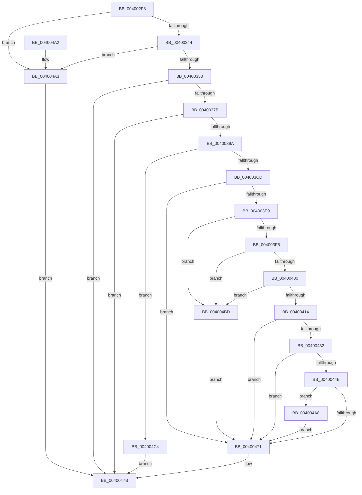

# SepAppendAceToTokenDefaultDacl

- RVA: `0x004002F8`–`0x004004CB` (길이 `467` bytes)
- VA: `0x00000001404002F8`
- 실행 섹션: `.text`
- PDB 이름 있음: `예`; PDB Function 태그: `아니요`
- unwind 정보 RVA: `0x0009A200`
- 디코드: `132`개 명령, `467/467` bytes 표시
- 미해석 바이트: `0` (있으면 어셈블리에 `.byte`로 보존)

> 이 문서는 커널 이미지의 기계어와 PDB 기호를 분석해 생성했습니다. 4번과 5번은 함수 원형과 자료형을 바이너리 사용 방식에서 추정한 C 해석이며 원본 소스 복구 결과는 아닙니다.

## 1. Dependencies

- 직접 호출 지점: **12**; 고유 호출 대상: **11**
- 직접 호출자로 확인된 함수: **2**
- RIP 상대 이미지 참조: **1**

### Outgoing calls
- `0x0040034A` → [RtlFindAceBySid](RtlFindAceBySid_function_004004E0.md) (function, `0x004004E0`)
- `0x0040036C` → [RtlQueryInformationAcl](../../page/9E/RtlQueryInformationAcl_function_009EC2C0.md) (function, `0x009EC2C0`)
- `0x0040038B` → [RtlQueryInformationAcl](../../page/9E/RtlQueryInformationAcl_function_009EC2C0.md) (function, `0x009EC2C0`)
- `0x004003BC` → [ExAllocatePool2](../../poolcode/B8/ExAllocatePool2_function_00B820F0.md) (function, `0x00B820F0`)
- `0x004003DA` → [RtlCreateAcl](../../page/91/RtlCreateAcl_function_00916F00.md) (function, `0x00916F00`)
- `0x00400427` → [RtlAddAce](../../page/92/RtlAddAce_function_00929D70.md) (function, `0x00929D70`)
- `0x00400440` → [RtlAddAccessAllowedAce](../../page/92/RtlAddAccessAllowedAce_function_009298C0.md) (function, `0x009298C0`)
- `0x00400466` → [SepExpandDynamic](../../page/A6/SepExpandDynamic_function_00A665F0.md) (function, `0x00A665F0`)
- `0x00400476` → [ExFreePoolWithTag](../../poolcode/B8/ExFreePoolWithTag_function_00B82870.md) (function, `0x00B82870`)
- `0x00400485` → [_security_check_cookie](../6A/_security_check_cookie_function_006AC640.md) (function, `0x006AC640`)
- `0x004004AB` → [SepFreeDefaultDacl](../../page/A7/SepFreeDefaultDacl_function_00A772D8.md) (function, `0x00A772D8`)
- `0x004004B6` → [SepAppendDefaultDacl](../../page/A7/SepAppendDefaultDacl_function_00A745F0.md) (function, `0x00A745F0`)

### Direct callers
- [SepCreateAppContainerToken](../4F/SepCreateAppContainerToken_function_004F43AC.md) at `0x004F4B45`
- [NtCreateLowBoxToken](../../page/AB/NtCreateLowBoxToken_function_00AB9880.md) at `0x00ABA1D6`

### Static image references
- `0x0040030C` → RVA `0x00E0A740` (`.data`; read)

## 2. Other-region calls and transfers

- 다른 실행 섹션으로 향하는 call: **10**
  - `0x0040036C` → [RtlQueryInformationAcl](../../page/9E/RtlQueryInformationAcl_function_009EC2C0.md) (`.text` → `PAGE`)
  - `0x0040038B` → [RtlQueryInformationAcl](../../page/9E/RtlQueryInformationAcl_function_009EC2C0.md) (`.text` → `PAGE`)
  - `0x004003BC` → [ExAllocatePool2](../../poolcode/B8/ExAllocatePool2_function_00B820F0.md) (`.text` → `POOLCODE`)
  - `0x004003DA` → [RtlCreateAcl](../../page/91/RtlCreateAcl_function_00916F00.md) (`.text` → `PAGE`)
  - `0x00400427` → [RtlAddAce](../../page/92/RtlAddAce_function_00929D70.md) (`.text` → `PAGE`)
  - `0x00400440` → [RtlAddAccessAllowedAce](../../page/92/RtlAddAccessAllowedAce_function_009298C0.md) (`.text` → `PAGE`)
  - `0x00400466` → [SepExpandDynamic](../../page/A6/SepExpandDynamic_function_00A665F0.md) (`.text` → `PAGE`)
  - `0x00400476` → [ExFreePoolWithTag](../../poolcode/B8/ExFreePoolWithTag_function_00B82870.md) (`.text` → `POOLCODE`)
  - `0x004004AB` → [SepFreeDefaultDacl](../../page/A7/SepFreeDefaultDacl_function_00A772D8.md) (`.text` → `PAGE`)
  - `0x004004B6` → [SepAppendDefaultDacl](../../page/A7/SepAppendDefaultDacl_function_00A745F0.md) (`.text` → `PAGE`)
- 별도 외부 분기/꼬리 이동을 확인하지 못했습니다.

## 3. Assembly (complete function range)

```asm
004002F8  48 89 5C 24 18                  mov qword ptr [rsp + 0x18], rbx
004002FD  55                              push rbp
004002FE  56                              push rsi
004002FF  57                              push rdi
00400300  41 54                           push r12
00400302  41 55                           push r13
00400304  41 56                           push r14
00400306  41 57                           push r15
00400308  48 83 EC 50                     sub rsp, 0x50
0040030C  48 8B 05 2D A4 A0 00            mov rax, qword ptr [rip + 0xa0a42d]
00400313  48 33 C4                        xor rax, rsp
00400316  48 89 44 24 48                  mov qword ptr [rsp + 0x48], rax
0040031B  48 8B B1 B8 00 00 00            mov rsi, qword ptr [rcx + 0xb8]
00400322  33 C0                           xor eax, eax
00400324  45 33 ED                        xor r13d, r13d
00400327  48 89 44 24 38                  mov qword ptr [rsp + 0x38], rax
0040032C  89 44 24 40                     mov dword ptr [rsp + 0x40], eax
00400330  4C 8B FA                        mov r15, rdx
00400333  44 89 6C 24 30                  mov dword ptr [rsp + 0x30], r13d
00400338  48 8B E9                        mov rbp, rcx
0040033B  48 85 F6                        test rsi, rsi
0040033E  0F 84 5F 01 00 00               je 0x1404004a3
00400344  45 33 C0                        xor r8d, r8d
00400347  48 8B CE                        mov rcx, rsi
0040034A  E8 91 01 00 00                  call 0x1404004e0
0040034F  48 85 C0                        test rax, rax
00400352  0F 85 4B 01 00 00               jne 0x1404004a3
00400358  0F B7 5E 02                     movzx ebx, word ptr [rsi + 2]
0040035C  45 8D 4D 01                     lea r9d, [r13 + 1]
00400360  45 8D 45 04                     lea r8d, [r13 + 4]
00400364  48 8B CE                        mov rcx, rsi
00400367  48 8D 54 24 30                  lea rdx, [rsp + 0x30]
0040036C  E8 4F BF 5E 00                  call 0x1409ec2c0
00400371  8B F8                           mov edi, eax
00400373  85 C0                           test eax, eax
00400375  0F 88 00 01 00 00               js 0x14040047b
0040037B  45 8D 4D 02                     lea r9d, [r13 + 2]
0040037F  48 8B CE                        mov rcx, rsi
00400382  45 8D 45 0C                     lea r8d, [r13 + 0xc]
00400386  48 8D 54 24 38                  lea rdx, [rsp + 0x38]
0040038B  E8 30 BF 5E 00                  call 0x1409ec2c0
00400390  8B F8                           mov edi, eax
00400392  85 C0                           test eax, eax
00400394  0F 88 E1 00 00 00               js 0x14040047b
0040039A  41 0F B6 47 01                  movzx eax, byte ptr [r15 + 1]
0040039F  B9 00 01 00 00                  mov ecx, 0x100
004003A4  41 B8 53 65 41 63               mov r8d, 0x63416553
004003AA  44 8D 24 85 13 00 00 00         lea r12d, [rax*4 + 0x13]
004003B2  44 03 E3                        add r12d, ebx
004003B5  41 83 E4 FC                     and r12d, 0xfffffffc
004003B9  41 8B D4                        mov edx, r12d
004003BC  E8 2F 1D 78 00                  call 0x140b820f0
004003C1  4C 8B F0                        mov r14, rax
004003C4  48 85 C0                        test rax, rax
004003C7  0F 84 F7 00 00 00               je 0x1404004c4
004003CD  8B 5C 24 30                     mov ebx, dword ptr [rsp + 0x30]
004003D1  41 8B D4                        mov edx, r12d
004003D4  44 8B C3                        mov r8d, ebx
004003D7  48 8B C8                        mov rcx, rax
004003DA  E8 21 6B 51 00                  call 0x140916f00
004003DF  8B F8                           mov edi, eax
004003E1  85 C0                           test eax, eax
004003E3  0F 88 88 00 00 00               js 0x140400471
004003E9  8A 06                           mov al, byte ptr [rsi]
004003EB  2C 02                           sub al, 2
004003ED  3C 02                           cmp al, 2
004003EF  0F 87 C8 00 00 00               ja 0x1404004bd
004003F5  66 44 3B 6E 04                  cmp r13w, word ptr [rsi + 4]
004003FA  0F 83 BD 00 00 00               jae 0x1404004bd
00400400  0F B7 46 02                     movzx eax, word ptr [rsi + 2]
00400404  4C 8D 4E 08                     lea r9, [rsi + 8]
00400408  48 03 C6                        add rax, rsi
0040040B  4C 3B C8                        cmp r9, rax
0040040E  0F 83 A9 00 00 00               jae 0x1404004bd
00400414  8B 44 24 3C                     mov eax, dword ptr [rsp + 0x3c]
00400418  45 33 C0                        xor r8d, r8d
0040041B  83 C0 F8                        add eax, -8
0040041E  8B D3                           mov edx, ebx
00400420  49 8B CE                        mov rcx, r14
00400423  89 44 24 20                     mov dword ptr [rsp + 0x20], eax
00400427  E8 44 99 52 00                  call 0x140929d70
0040042C  8B F8                           mov edi, eax
0040042E  85 C0                           test eax, eax
00400430  78 3F                           js 0x140400471
00400432  4D 8B CF                        mov r9, r15
00400435  41 B8 00 00 00 10               mov r8d, 0x10000000
0040043B  8B D3                           mov edx, ebx
0040043D  49 8B CE                        mov rcx, r14
00400440  E8 7B 94 52 00                  call 0x1409298c0
00400445  8B F8                           mov edi, eax
00400447  85 C0                           test eax, eax
00400449  78 26                           js 0x140400471
0040044B  48 8B 85 A8 00 00 00            mov rax, qword ptr [rbp + 0xa8]
00400452  48 8B CD                        mov rcx, rbp
00400455  0F B6 50 01                     movzx edx, byte ptr [rax + 1]
00400459  8D 14 95 0B 00 00 00            lea edx, [rdx*4 + 0xb]
00400460  41 03 D4                        add edx, r12d
00400463  83 E2 FC                        and edx, 0xfffffffc
00400466  E8 85 61 66 00                  call 0x140a665f0
0040046B  8B F8                           mov edi, eax
0040046D  85 C0                           test eax, eax
0040046F  79 37                           jns 0x1404004a8
00400471  33 D2                           xor edx, edx
00400473  49 8B CE                        mov rcx, r14
00400476  E8 F5 23 78 00                  call 0x140b82870
0040047B  8B C7                           mov eax, edi
0040047D  48 8B 4C 24 48                  mov rcx, qword ptr [rsp + 0x48]
00400482  48 33 CC                        xor rcx, rsp
00400485  E8 B6 C1 2A 00                  call 0x1406ac640
0040048A  48 8B 9C 24 A0 00 00 00         mov rbx, qword ptr [rsp + 0xa0]
00400492  48 83 C4 50                     add rsp, 0x50
00400496  41 5F                           pop r15
00400498  41 5E                           pop r14
0040049A  41 5D                           pop r13
0040049C  41 5C                           pop r12
0040049E  5F                              pop rdi
0040049F  5E                              pop rsi
004004A0  5D                              pop rbp
004004A1  C3                              ret
004004A2  CC                              int3
004004A3  41 8B FD                        mov edi, r13d
004004A6  EB D3                           jmp 0x14040047b
004004A8  48 8B CD                        mov rcx, rbp
004004AB  E8 28 6E 67 00                  call 0x140a772d8
004004B0  49 8B D6                        mov rdx, r14
004004B3  48 8B CD                        mov rcx, rbp
004004B6  E8 35 41 67 00                  call 0x140a745f0
004004BB  EB B4                           jmp 0x140400471
004004BD  BF 0D 00 00 C0                  mov edi, 0xc000000d
004004C2  EB AD                           jmp 0x140400471
004004C4  BF 9A 00 00 C0                  mov edi, 0xc000009a
004004C9  EB B0                           jmp 0x14040047b
```

## 4. C-style interpretation (structured pseudocode)

```c
__int64 __fastcall SepAppendAceToTokenDefaultDacl(__int64 a1, __int64 a2, int a3)
{
    __int64 result;
    __int64 v_r12;
    __int64 v_r13;
    __int64 v_rsp;
    unsigned __int64 v_stack_m40;
    unsigned int v_stack_m48;
    unsigned int v_stack_m4C;
    unsigned __int64 v_stack_m50;
    unsigned int v_stack_m58;
    unsigned int v_stack_m68;
    unsigned __int64 v_stack_p18;

    v_stack_p18 = v_rbx;
    v_rsp = (v_rsp) - (80);
    result = (*(unsigned __int64 *)(v_rip + 10527789)) ^ (v_rsp);
    v_stack_m40 = result;
    result = 0;
    v_r13 = 0;
    v_stack_m50 = 0;
    v_stack_m48 = 0;
    v_stack_m58 = 0;
    if (*(unsigned __int64 *)(a1 + 184) == 0) goto loc_004004A3;
    a3 = 0;
    result = RtlFindAceBySid(*(unsigned __int64 *)(a1 + 184), a2, a3, a4);
    if (result != 0) goto loc_004004A3;
    result = RtlQueryInformationAcl(*(unsigned __int64 *)(a1 + 184), v_stack_m58, v_r13 + 4, v_r13 + 1);
    if (sign_flag) goto loc_0040047B;
    result = RtlQueryInformationAcl(*(unsigned __int64 *)(a1 + 184), v_stack_m50, v_r13 + 12, v_r13 + 2);
    if (sign_flag) goto loc_0040047B;
    v_r12 = (unsigned int)((*(unsigned __int8 *)(a2 + 1) * 4 + 19) + ((unsigned int)(*(unsigned __int16 *)(*(unsigned __int64 *)(a1 + 184) + 2))));
    v_r12 = (unsigned int)((v_r12) & (0xFFFFFFFCULL));
    result = ExAllocatePool2(256, (unsigned int)((unsigned int)(v_r12)), (unsigned int)(0x63416553ULL), v_r13 + 2);
    if (result == 0) goto loc_004004C4;
    result = RtlCreateAcl(result, (unsigned int)((unsigned int)(v_r12)), (unsigned int)((unsigned int)((unsigned int)(v_stack_m58))), v_r13 + 2);
    if (sign_flag) goto loc_00400471;
    result = (unsigned __int8)((*(unsigned __int8 *)(*(unsigned __int64 *)(a1 + 184))) - (2));
    if (((unsigned __int8)(result)) > 2) goto loc_004004BD;
    if (0 >= (*(unsigned __int16 *)(*(unsigned __int64 *)(a1 + 184) + 4))) goto loc_004004BD;
    result = (*(unsigned __int16 *)(*(unsigned __int64 *)(a1 + 184) + 2)) + (*(unsigned __int64 *)(a1 + 184));
    if ((*(unsigned __int64 *)(a1 + 184) + 8) >= result) goto loc_004004BD;
    a3 = 0;
    result = (unsigned int)(((unsigned int)(v_stack_m4C)) + (-8));
    v_stack_m68 = (unsigned int)(result);
    result = RtlAddAce(result, (unsigned int)((unsigned int)((unsigned int)(v_stack_m58))), a3, *(unsigned __int64 *)(a1 + 184) + 8);
    if (sign_flag) goto loc_00400471;
    result = RtlAddAccessAllowedAce(result, (unsigned int)((unsigned int)((unsigned int)(v_stack_m58))), (unsigned int)(0x10000000ULL), a2);
    if (sign_flag) goto loc_00400471;
    a2 = (unsigned int)((*(unsigned __int8 *)(*(unsigned __int64 *)(a1 + 168) + 1) * 4 + 11) + ((unsigned int)(v_r12)));
    a2 = (unsigned int)((a2) & (0xFFFFFFFCULL));
    result = SepExpandDynamic(a1, a2, (unsigned int)(0x10000000ULL), a2);
    if (!sign_flag) goto loc_004004A8;
loc_00400471:
    a2 = 0;
    result = ExFreePoolWithTag(result, a2, (unsigned int)(0x10000000ULL), a2);
loc_0040047B:
    a1 = (v_stack_m40) ^ (v_rsp);
    result = _security_check_cookie(a1, a2, (unsigned int)(0x10000000ULL), a2);
    v_rsp = (v_rsp) + (80);
    return result;
loc_004004A3:
    goto loc_0040047B;
loc_004004A8:
    result = SepFreeDefaultDacl(a1, a2, (unsigned int)(0x10000000ULL), a2);
    result = SepAppendDefaultDacl(a1, result, (unsigned int)(0x10000000ULL), a2);
    goto loc_00400471;
loc_004004BD:
    goto loc_00400471;
loc_004004C4:
    goto loc_0040047B;
}
```

## 5. (Beta) C Style

```c
int64_t SepAppendAceToTokenDefaultDacl(void *Arg1, void *Arg2, int32_t Arg3)
{
    uint8_t *arg1 = (uint8_t *)Arg1;
    uint8_t *arg2 = (uint8_t *)Arg2;

    int64_t result;
    int64_t local_r12;
    int64_t local_r13;
    int64_t local_rsp;
    uint64_t v_stack_m40;
    uint32_t v_stack_m48;
    uint32_t v_stack_m4C;
    uint64_t v_stack_m50;
    uint32_t v_stack_m58;
    uint32_t v_stack_m68;
    uint64_t v_stack_p18;

    v_stack_p18 = local_rbx;
    local_rsp = (local_rsp) - (80);
    result = (*(uint64_t *)(v_rip + 0xA0A42D)) ^ (local_rsp);
    v_stack_m40 = result;
    result = 0;
    local_r13 = 0;
    v_stack_m50 = 0;
    v_stack_m48 = 0;
    v_stack_m58 = 0;
    if (*(uint64_t *)(arg1 + 0xB8) == 0) goto loc_004004A3;
    Arg3 = 0;
    result = RtlFindAceBySid(*(uint64_t *)(arg1 + 0xB8), Arg2, Arg3, a4);
    if (result != 0) goto loc_004004A3;
    result = RtlQueryInformationAcl(*(uint64_t *)(arg1 + 0xB8), v_stack_m58, local_r13 + 4, local_r13 + 1);
    if (sign_flag) goto loc_0040047B;
    result = RtlQueryInformationAcl(*(uint64_t *)(arg1 + 0xB8), v_stack_m50, local_r13 + 12, local_r13 + 2);
    if (sign_flag) goto loc_0040047B;
    local_r12 = (uint32_t)((*(uint8_t *)(arg2 + 0x1) * 4 + 19) + ((uint32_t)(*(uint16_t *)(*(uint64_t *)(arg1 + 0xB8) + 0x2))));
    local_r12 = (uint32_t)((local_r12) & (0xFFFFFFFCULL));
    result = ExAllocatePool2(256, (uint32_t)((uint32_t)(local_r12)), (uint32_t)(0x63416553ULL), local_r13 + 2);
    if (result == 0) goto loc_004004C4;
    result = RtlCreateAcl(result, (uint32_t)((uint32_t)(local_r12)), (uint32_t)((uint32_t)((uint32_t)(v_stack_m58))), local_r13 + 2);
    if (sign_flag) goto loc_00400471;
    result = (uint8_t)((*(uint8_t *)(*(uint64_t *)(arg1 + 0xB8))) - (2));
    if (((uint8_t)(result)) > 2) goto loc_004004BD;
    if (0 >= (*(uint16_t *)(*(uint64_t *)(arg1 + 0xB8) + 0x4))) goto loc_004004BD;
    result = (*(uint16_t *)(*(uint64_t *)(arg1 + 0xB8) + 0x2)) + (*(uint64_t *)(arg1 + 0xB8));
    if ((*(uint64_t *)(arg1 + 0xB8) + 8) >= result) goto loc_004004BD;
    Arg3 = 0;
    result = (uint32_t)(((uint32_t)(v_stack_m4C)) + (-8));
    v_stack_m68 = (uint32_t)(result);
    result = RtlAddAce(result, (uint32_t)((uint32_t)((uint32_t)(v_stack_m58))), Arg3, *(uint64_t *)(arg1 + 0xB8) + 8);
    if (sign_flag) goto loc_00400471;
    result = RtlAddAccessAllowedAce(result, (uint32_t)((uint32_t)((uint32_t)(v_stack_m58))), (uint32_t)(0x10000000ULL), Arg2);
    if (sign_flag) goto loc_00400471;
    Arg2 = (uint32_t)((*(uint8_t *)(*(uint64_t *)(arg1 + 0xA8) + 0x1) * 4 + 11) + ((uint32_t)(local_r12)));
    Arg2 = (uint32_t)((Arg2) & (0xFFFFFFFCULL));
    result = SepExpandDynamic(Arg1, Arg2, (uint32_t)(0x10000000ULL), Arg2);
    if (!sign_flag) goto loc_004004A8;
loc_00400471:
    Arg2 = 0;
    result = ExFreePoolWithTag(result, Arg2, (uint32_t)(0x10000000ULL), Arg2);
loc_0040047B:
    Arg1 = (v_stack_m40) ^ (local_rsp);
    result = _security_check_cookie(Arg1, Arg2, (uint32_t)(0x10000000ULL), Arg2);
    local_rsp = (local_rsp) + (80);
    return result;
loc_004004A3:
    goto loc_0040047B;
loc_004004A8:
    result = SepFreeDefaultDacl(Arg1, Arg2, (uint32_t)(0x10000000ULL), Arg2);
    result = SepAppendDefaultDacl(Arg1, result, (uint32_t)(0x10000000ULL), Arg2);
    goto loc_00400471;
loc_004004BD:
    goto loc_00400471;
loc_004004C4:
    goto loc_0040047B;
}
```

### 관측된 메모리 오프셋

구조체 형식이 확인되지 않은 접근은 인자 기준의 오프셋으로만 기록했습니다.

| 기준 인자 | 오프셋 표현 | 폭 (bit) | 접근 |
|---|---:|---:|---|
| `Arg1` | `+ 0xA8` | `64` | `R` |
| `Arg1` | `+ 0xB8` | `64` | `R` |
| `Arg2` | `+ 0x1` | `8` | `R` |

## 6. Execution-region graph

[열기: 2D/3D 그래프와 함수 탐색 컨트롤 패널](../../../control-panel.html?section=text&rva=0x004002F8&view=graph)

- 2D 그래프는 위에서 아래로 흐르고, 3D 그래프는 빈 공간을 드래그해 회전합니다. Shift+드래그는 이동, 휠은 확대·축소, 함수 노드 선택은 대상 보고서 이동입니다.

### Static fallback


