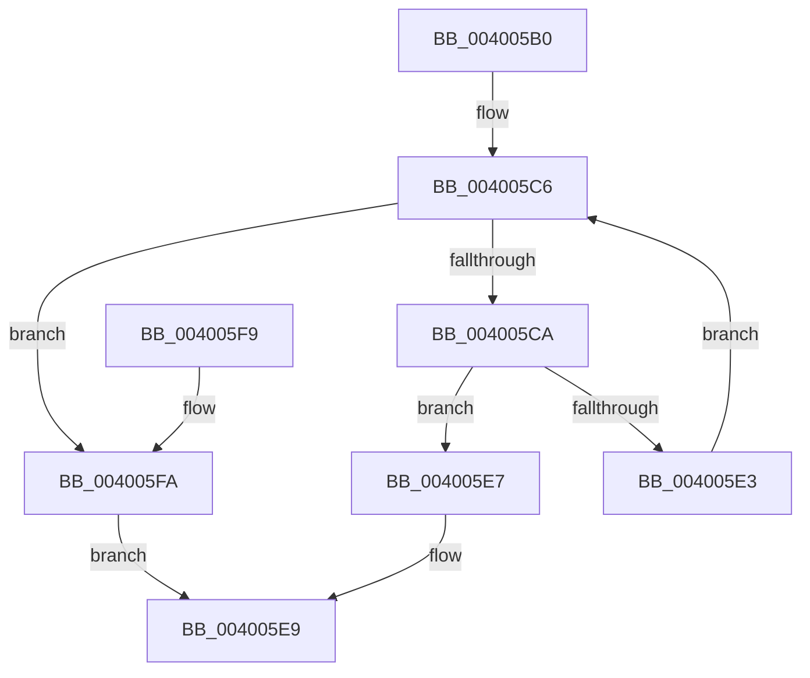

# SepCapabilitiesHasAppSiloBaseSID

- RVA: `0x004005B0`–`0x004005FE` (길이 `78` bytes)
- VA: `0x00000001404005B0`
- 실행 섹션: `.text`
- PDB 이름 있음: `예`; PDB Function 태그: `아니요`
- unwind 정보 RVA: `0x00088864`
- 디코드: `27`개 명령, `78/78` bytes 표시
- 미해석 바이트: `0` (있으면 어셈블리에 `.byte`로 보존)

> 이 문서는 커널 이미지의 기계어와 PDB 기호를 분석해 생성했습니다. 4번과 5번은 함수 원형과 자료형을 바이너리 사용 방식에서 추정한 C 해석이며 원본 소스 복구 결과는 아닙니다.

## 1. Dependencies

- 직접 호출 지점: **1**; 고유 호출 대상: **1**
- 직접 호출자로 확인된 함수: **2**
- RIP 상대 이미지 참조: **1**

### Outgoing calls
- `0x004005DA` → [RtlEqualSid](RtlEqualSid_function_00400AD0.md) (function, `0x00400AD0`)

### Direct callers
- [SepCreateAppContainerToken](../4F/SepCreateAppContainerToken_function_004F43AC.md) at `0x004F4645`
- [NtCreateLowBoxToken](../../page/AB/NtCreateLowBoxToken_function_00AB9880.md) at `0x00AB9E62`

### Static image references
- `0x004005CA` → RVA `0x00E67BD8` (`.data`; read)

## 2. Other-region calls and transfers

- 다른 실행 섹션으로 향하는 call: **0**
- 별도 외부 분기/꼬리 이동을 확인하지 못했습니다.

## 3. Assembly (complete function range)

```asm
004005B0  48 89 5C 24 08                  mov qword ptr [rsp + 8], rbx
004005B5  48 89 74 24 10                  mov qword ptr [rsp + 0x10], rsi
004005BA  57                              push rdi
004005BB  48 83 EC 20                     sub rsp, 0x20
004005BF  48 8B F2                        mov rsi, rdx
004005C2  8B F9                           mov edi, ecx
004005C4  33 DB                           xor ebx, ebx
004005C6  3B DF                           cmp ebx, edi
004005C8  73 30                           jae 0x1404005fa
004005CA  48 8B 0D 07 76 A6 00            mov rcx, qword ptr [rip + 0xa67607]
004005D1  8B D3                           mov edx, ebx
004005D3  48 03 D2                        add rdx, rdx
004005D6  48 8B 14 D6                     mov rdx, qword ptr [rsi + rdx*8]
004005DA  E8 F1 04 00 00                  call 0x140400ad0
004005DF  84 C0                           test al, al
004005E1  75 04                           jne 0x1404005e7
004005E3  FF C3                           inc ebx
004005E5  EB DF                           jmp 0x1404005c6
004005E7  B0 01                           mov al, 1
004005E9  48 8B 5C 24 30                  mov rbx, qword ptr [rsp + 0x30]
004005EE  48 8B 74 24 38                  mov rsi, qword ptr [rsp + 0x38]
004005F3  48 83 C4 20                     add rsp, 0x20
004005F7  5F                              pop rdi
004005F8  C3                              ret
004005F9  CC                              int3
004005FA  32 C0                           xor al, al
004005FC  EB EB                           jmp 0x1404005e9
```

## 4. C-style interpretation (structured pseudocode)

```c
__int64 __fastcall SepCapabilitiesHasAppSiloBaseSID(int a1, __int64 a2)
{
    __int64 result;
    __int64 v_rbx;
    __int64 v_rsp;
    unsigned __int64 v_stack_p10;
    unsigned __int64 v_stack_p8;

    v_stack_p8 = v_rbx;
    v_stack_p10 = v_rsi;
    v_rsp = (v_rsp) - (32);
    v_rbx = 0;
loc_004005C6:
    if (0 >= ((unsigned int)((unsigned int)(a1)))) goto loc_004005FA;
    a2 = (0) + (0);
    result = RtlEqualSid(*(unsigned __int64 *)(v_rip + 10909191), *(unsigned __int64 *)(a2 + a2 * 8), a3, a4);
    if ((unsigned __int8)(result) != 0) goto loc_004005E7;
    v_rbx = (unsigned int)((v_rbx) + 1);
    goto loc_004005C6;
loc_004005E7:
loc_004005E9:
    v_rsp = (v_rsp) + (32);
    return 1;
loc_004005FA:
    result = 0;
    goto loc_004005E9;
}
```

## 5. (Beta) C Style

```c
int64_t SepCapabilitiesHasAppSiloBaseSID(int32_t Arg1, void *Arg2)
{
    uint8_t *arg2 = (uint8_t *)Arg2;

    int64_t result;
    int64_t local_rbx;
    int64_t local_rsp;
    uint64_t v_stack_p10;
    uint64_t v_stack_p8;

    v_stack_p8 = local_rbx;
    v_stack_p10 = local_rsi;
    local_rsp = (local_rsp) - (32);
    local_rbx = 0;
loc_004005C6:
    if (0 >= ((uint32_t)((uint32_t)(Arg1)))) goto loc_004005FA;
    Arg2 = (0) + (0);
    result = RtlEqualSid(*(uint64_t *)(v_rip + 0xA67607), *(uint64_t *)(arg2 + arg2 * 8), a3, a4);
    if ((uint8_t)(result) != 0) goto loc_004005E7;
    local_rbx = (uint32_t)((local_rbx) + 1);
    goto loc_004005C6;
loc_004005E7:
loc_004005E9:
    local_rsp = (local_rsp) + (32);
    return 1;
loc_004005FA:
    result = 0;
    goto loc_004005E9;
}
```

### 관측된 메모리 오프셋

구조체 형식이 확인되지 않은 접근은 인자 기준의 오프셋으로만 기록했습니다.

| 기준 인자 | 오프셋 표현 | 폭 (bit) | 접근 |
|---|---:|---:|---|
| `Arg2` | `+ 0x0 + rdx*8` | `64` | `R` |

## 6. Execution-region graph

[열기: 2D/3D 그래프와 함수 탐색 컨트롤 패널](../../../control-panel.html?section=text&rva=0x004005B0&view=graph)

- 2D 그래프는 위에서 아래로 흐르고, 3D 그래프는 빈 공간을 드래그해 회전합니다. Shift+드래그는 이동, 휠은 확대·축소, 함수 노드 선택은 대상 보고서 이동입니다.

### Static fallback


