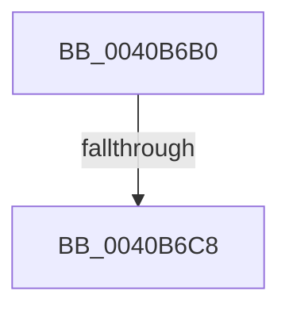

# SepPrivilegeCheck

- RVA: `0x0040B6B0`–`0x0040B6EB` (길이 `59` bytes)
- VA: `0x000000014040B6B0`
- 실행 섹션: `.text`
- PDB 이름 있음: `예`; PDB Function 태그: `아니요`
- unwind 정보 RVA: `0x0009AE78`
- 디코드: `16`개 명령, `59/59` bytes 표시
- 미해석 바이트: `0` (있으면 어셈블리에 `.byte`로 보존)

> 이 문서는 커널 이미지의 기계어와 PDB 기호를 분석해 생성했습니다. 4번과 5번은 함수 원형과 자료형을 바이너리 사용 방식에서 추정한 C 해석이며 원본 소스 복구 결과는 아닙니다.

## 1. Dependencies

- 직접 호출 지점: **0**; 고유 호출 대상: **0**
- 직접 호출자로 확인된 함수: **16**
- RIP 상대 이미지 참조: **0**

### Outgoing calls
- 직접 디코드된 call 명령이 없습니다.

### Direct callers
- [ObpCreateHandle](../../page/86/ObpCreateHandle_function_0086B950.md) at `0x0086CD95`
- [ObpGrantAccess](../../page/86/ObpGrantAccess_function_0086F250.md) at `0x0086F7DF`
- [sub_00871B01](../../page/87/Unknown_function_00871B01.md) at `0x00871B26`
- [sub_00871E5A](../../page/87/Unknown_function_00871E5A.md) at `0x00871EFA`
- [ObCreateObject](../../page/87/ObCreateObject_function_00872CB0.md) at `0x00872F15`
- [ObpAdjustCreatorAccessState](../../page/87/ObpAdjustCreatorAccessState_function_00874650.md) at `0x008747CF`
- [ObCreateObjectEx](../../page/89/ObCreateObjectEx_function_0089B1E0.md) at `0x0089B493`
- [sub_008A095D](../../page/8A/Unknown_function_008A095D.md) at `0x008A09B3`
- [sub_008A0A82](../../page/8A/Unknown_function_008A0A82.md) at `0x008A0AC3`
- [NtCreateEvent](../../page/8B/NtCreateEvent_function_008B9140.md) at `0x008B946C`
- [PiAuDoesClientHavePrivilege](../../page/96/PiAuDoesClientHavePrivilege_function_00964ADC.md) at `0x00964B6C`
- [SeCheckAuditPrivilege](../../page/97/SeCheckAuditPrivilege_function_00974E48.md) at `0x00974EA4`
- [SePrivilegeCheck](../../page/9B/SePrivilegeCheck_function_009BAE70.md) at `0x009BAE9A`
- [NtPrivilegeCheck](../../page/9C/NtPrivilegeCheck_function_009C8AE0.md) at `0x009C8C92`
- [SeCheckPrivilegedObject](../../page/9F/SeCheckPrivilegedObject_function_009F62CC.md) at `0x009F6342`
- [MiIsUserQueryVmCallerTrusted](../../page/9F/MiIsUserQueryVmCallerTrusted_function_009FE378.md) at `0x009FE447`

### Static image references
- 디코드된 RIP-relative 메모리 참조가 없습니다.

## 2. Other-region calls and transfers

- 다른 실행 섹션으로 향하는 call: **0**
- call이 아닌 외부 분기/꼬리 이동: **2**
  - `0x0040B6C6` → [sub_0040B724 + 0x13](Unknown_function_0040B724.md) (`tail-transfer`)
  - `0x0040B6E9` → [sub_0040B724](Unknown_function_0040B724.md) (`tail-transfer`)

## 3. Assembly (complete function range)

```asm
0040B6B0  48 83 EC 18                     sub rsp, 0x18
0040B6B4  33 C0                           xor eax, eax
0040B6B6  45 8B D9                        mov r11d, r9d
0040B6B9  48 89 44 24 08                  mov qword ptr [rsp + 8], rax
0040B6BE  48 89 04 24                     mov qword ptr [rsp], rax
0040B6C2  38 44 24 40                     cmp byte ptr [rsp + 0x40], al
0040B6C6  74 6F                           je 0x14040b737
0040B6C8  4C 8B 51 48                     mov r10, qword ptr [rcx + 0x48]
0040B6CC  4C 87 54 24 08                  xchg qword ptr [rsp + 8], r10
0040B6D1  48 8B 49 40                     mov rcx, qword ptr [rcx + 0x40]
0040B6D5  48 87 0C 24                     xchg qword ptr [rsp], rcx
0040B6D9  4C 8B 0C 24                     mov r9, qword ptr [rsp]
0040B6DD  4C 23 4C 24 08                  and r9, qword ptr [rsp + 8]
0040B6E2  F0 09 04 24                     lock or dword ptr [rsp], eax
0040B6E6  45 85 C0                        test r8d, r8d
0040B6E9  74 39                           je 0x14040b724
```

## 4. C-style interpretation (structured pseudocode)

```c
__int64 __fastcall SepPrivilegeCheck(__int64 a1, __int64 a2, int a3, int a4, unsigned __int8 a5)
{
    __int64 result;
    __int64 v_rsp;
    unsigned __int64 v_stack_m10;
    unsigned __int64 v_stack_m18;

    v_rsp = (v_rsp) - (24);
    result = 0;
    v_stack_m10 = 0;
    v_stack_m18 = 0;
    a4 = (v_stack_m18) & (v_stack_m10);
}
```

## 5. (Beta) C Style

```c
int64_t SepPrivilegeCheck(void *Arg1, int64_t Arg2, int32_t Arg3, int32_t Arg4, uint8_t Arg5)
{
    uint8_t *arg1 = (uint8_t *)Arg1;

    int64_t result;
    int64_t local_rsp;
    uint64_t v_stack_m10;
    uint64_t v_stack_m18;

    local_rsp = (local_rsp) - (24);
    result = 0;
    v_stack_m10 = 0;
    v_stack_m18 = 0;
    Arg4 = (v_stack_m18) & (v_stack_m10);
}
```

### 관측된 메모리 오프셋

구조체 형식이 확인되지 않은 접근은 인자 기준의 오프셋으로만 기록했습니다.

| 기준 인자 | 오프셋 표현 | 폭 (bit) | 접근 |
|---|---:|---:|---|
| `Arg1` | `+ 0x40` | `64` | `R` |
| `Arg1` | `+ 0x48` | `64` | `R` |

## 6. Execution-region graph

[열기: 2D/3D 그래프와 함수 탐색 컨트롤 패널](../../../control-panel.html?section=text&rva=0x0040B6B0&view=graph)

- 2D 그래프는 위에서 아래로 흐르고, 3D 그래프는 빈 공간을 드래그해 회전합니다. Shift+드래그는 이동, 휠은 확대·축소, 함수 노드 선택은 대상 보고서 이동입니다.

### Static fallback


