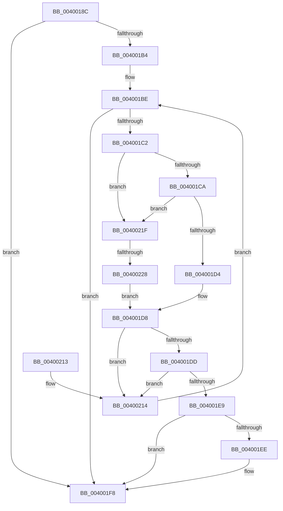

# SepRemoveAceFromTokenDefaultDacl

- RVA: `0x0040018C`–`0x0040022E` (길이 `162` bytes)
- VA: `0x000000014040018C`
- 실행 섹션: `.text`
- PDB 이름 있음: `예`; PDB Function 태그: `예`
- unwind 정보 RVA: `0x000903A0`
- 디코드: `50`개 명령, `162/162` bytes 표시
- 미해석 바이트: `0` (있으면 어셈블리에 `.byte`로 보존)

> 이 문서는 커널 이미지의 기계어와 PDB 기호를 분석해 생성했습니다. 4번과 5번은 함수 원형과 자료형을 바이너리 사용 방식에서 추정한 C 해석이며 원본 소스 복구 결과는 아닙니다.

## 1. Dependencies

- 직접 호출 지점: **2**; 고유 호출 대상: **2**
- 직접 호출자로 확인된 함수: **1**
- RIP 상대 이미지 참조: **0**

### Outgoing calls
- `0x004001E0` → [RtlEqualSid](RtlEqualSid_function_00400AD0.md) (function, `0x00400AD0`)
- `0x004001F3` → [RtlDeleteAce](../../page/A7/RtlDeleteAce_function_00A76040.md) (function, `0x00A76040`)

### Direct callers
- [NtSetInformationToken](../../page/AF/NtSetInformationToken_function_00AF0530.md) at `0x00AF16FC`
- [NtSetInformationToken](../../page/AF/NtSetInformationToken_function_00AF0530.md) at `0x00AF1CD2`
- [NtSetInformationToken](../../page/AF/NtSetInformationToken_function_00AF0530.md) at `0x00AF1DBE`

### Static image references
- 디코드된 RIP-relative 메모리 참조가 없습니다.

## 2. Other-region calls and transfers

- 다른 실행 섹션으로 향하는 call: **1**
  - `0x004001F3` → [RtlDeleteAce](../../page/A7/RtlDeleteAce_function_00A76040.md) (`.text` → `PAGE`)
- call이 아닌 외부 분기/꼬리 이동: **1**
  - `0x00400222` → [sub_006EC0C4](../6E/Unknown_function_006EC0C4.md) (`tail-transfer`)

## 3. Assembly (complete function range)

```asm
0040018C  48 8B C4                        mov rax, rsp
0040018F  48 89 58 08                     mov qword ptr [rax + 8], rbx
00400193  48 89 68 10                     mov qword ptr [rax + 0x10], rbp
00400197  48 89 70 18                     mov qword ptr [rax + 0x18], rsi
0040019B  48 89 78 20                     mov qword ptr [rax + 0x20], rdi
0040019F  41 56                           push r14
004001A1  48 83 EC 20                     sub rsp, 0x20
004001A5  48 8B B9 B8 00 00 00            mov rdi, qword ptr [rcx + 0xb8]
004001AC  4C 8B F2                        mov r14, rdx
004001AF  48 85 FF                        test rdi, rdi
004001B2  74 44                           je 0x1404001f8
004001B4  0F B7 6F 04                     movzx ebp, word ptr [rdi + 4]
004001B8  48 8D 5F 08                     lea rbx, [rdi + 8]
004001BC  33 F6                           xor esi, esi
004001BE  3B F5                           cmp esi, ebp
004001C0  73 36                           jae 0x1404001f8
004001C2  0F B6 0B                        movzx ecx, byte ptr [rbx]
004001C5  80 F9 15                        cmp cl, 0x15
004001C8  77 55                           ja 0x14040021f
004001CA  BA 0F 66 3E 00                  mov edx, 0x3e660f
004001CF  0F A3 CA                        bt edx, ecx
004001D2  73 4B                           jae 0x14040021f
004001D4  48 8D 4B 08                     lea rcx, [rbx + 8]
004001D8  48 85 C9                        test rcx, rcx
004001DB  74 37                           je 0x140400214
004001DD  49 8B D6                        mov rdx, r14
004001E0  E8 EB 08 00 00                  call 0x140400ad0
004001E5  84 C0                           test al, al
004001E7  74 2B                           je 0x140400214
004001E9  48 85 DB                        test rbx, rbx
004001EC  74 0A                           je 0x1404001f8
004001EE  8B D6                           mov edx, esi
004001F0  48 8B CF                        mov rcx, rdi
004001F3  E8 48 5E 67 00                  call 0x140a76040
004001F8  48 8B 5C 24 30                  mov rbx, qword ptr [rsp + 0x30]
004001FD  48 8B 6C 24 38                  mov rbp, qword ptr [rsp + 0x38]
00400202  48 8B 74 24 40                  mov rsi, qword ptr [rsp + 0x40]
00400207  48 8B 7C 24 48                  mov rdi, qword ptr [rsp + 0x48]
0040020C  48 83 C4 20                     add rsp, 0x20
00400210  41 5E                           pop r14
00400212  C3                              ret
00400213  CC                              int3
00400214  0F B7 43 02                     movzx eax, word ptr [rbx + 2]
00400218  FF C6                           inc esi
0040021A  48 03 D8                        add rbx, rax
0040021D  EB 9F                           jmp 0x1404001be
0040021F  80 F9 04                        cmp cl, 4
00400222  0F 85 9C BE 2E 00               jne 0x1406ec0c4
00400228  48 8D 4B 0C                     lea rcx, [rbx + 0xc]
0040022C  EB AA                           jmp 0x1404001d8
```

## 4. C-style interpretation (structured pseudocode)

```c
__int64 __fastcall SepRemoveAceFromTokenDefaultDacl(__int64 a1, __int64 a2)
{
    __int64 result;
    __int64 v_rbx;
    __int64 v_rsi;
    __int64 v_rsp;
    unsigned __int64 v_stack_p10;
    unsigned __int64 v_stack_p18;
    unsigned __int64 v_stack_p20;
    unsigned __int64 v_stack_p8;

    *(unsigned __int64 *)(v_rsp + 8) = v_rbx;
    *(unsigned __int64 *)(v_rsp + 16) = v_rbp;
    *(unsigned __int64 *)(v_rsp + 24) = v_rsi;
    *(unsigned __int64 *)(v_rsp + 32) = v_rdi;
    v_rsp = (v_rsp) - (32);
    if (*(unsigned __int64 *)(a1 + 184) == 0) goto loc_004001F8;
    v_rsi = 0;
loc_004001BE:
    if (0 >= ((unsigned int)(*(unsigned __int16 *)(*(unsigned __int64 *)(a1 + 184) + 4)))) goto loc_004001F8;
    if (((unsigned __int8)(*(unsigned __int8 *)(*(unsigned __int64 *)(a1 + 184) + 8))) > 21) goto loc_0040021F;
    if (((unsigned __int8)(*(unsigned __int8 *)(*(unsigned __int64 *)(a1 + 184) + 8))) >= 21) goto loc_0040021F;
loc_004001D8:
    if (*(unsigned __int64 *)(a1 + 184) + 8 + 8 == 0) goto loc_00400214;
    result = RtlEqualSid(*(unsigned __int64 *)(a1 + 184) + 8 + 8, a2, a3, a4);
    if ((unsigned __int8)(result) == 0) goto loc_00400214;
    if (*(unsigned __int64 *)(a1 + 184) + 8 != 0) {
        a2 = 0;
        a1 = *(unsigned __int64 *)(a1 + 184);
        result = RtlDeleteAce(a1, a2, a3, a4);
    }
    v_rsp = (v_rsp) + (32);
    return result;
loc_00400214:
    v_rsi = (unsigned int)((v_stack_p18) + 1);
    v_rbx = (v_stack_p8) + (*(unsigned __int16 *)(v_stack_p8 + 2));
    goto loc_004001BE;
loc_0040021F:
    goto loc_004001D8;
}
```

## 5. (Beta) C Style

```c
int64_t SepRemoveAceFromTokenDefaultDacl(void *Arg1, int64_t Arg2)
{
    uint8_t *arg1 = (uint8_t *)Arg1;

    int64_t result;
    int64_t local_rbx;
    int64_t local_rsi;
    int64_t local_rsp;
    uint64_t v_stack_p10;
    uint64_t v_stack_p18;
    uint64_t v_stack_p20;
    uint64_t v_stack_p8;

    *(uint64_t *)(local_rsp + 0x8) = local_rbx;
    *(uint64_t *)(local_rsp + 0x10) = local_rbp;
    *(uint64_t *)(local_rsp + 0x18) = local_rsi;
    *(uint64_t *)(local_rsp + 0x20) = local_rdi;
    local_rsp = (local_rsp) - (32);
    if (*(uint64_t *)(arg1 + 0xB8) == 0) goto loc_004001F8;
    local_rsi = 0;
loc_004001BE:
    if (0 >= ((uint32_t)(*(uint16_t *)(*(uint64_t *)(arg1 + 0xB8) + 0x4)))) goto loc_004001F8;
    if (((uint8_t)(*(uint8_t *)(*(uint64_t *)(arg1 + 0xB8) + 0x8))) > 21) goto loc_0040021F;
    if (((uint8_t)(*(uint8_t *)(*(uint64_t *)(arg1 + 0xB8) + 0x8))) >= 21) goto loc_0040021F;
loc_004001D8:
    if (*(uint64_t *)(arg1 + 0xB8) + 8 + 8 == 0) goto loc_00400214;
    result = RtlEqualSid(*(uint64_t *)(arg1 + 0xB8) + 8 + 8, Arg2, a3, a4);
    if ((uint8_t)(result) == 0) goto loc_00400214;
    if (*(uint64_t *)(arg1 + 0xB8) + 8 != 0) {
        Arg2 = 0;
        Arg1 = *(uint64_t *)(arg1 + 0xB8);
        result = RtlDeleteAce(Arg1, Arg2, a3, a4);
    }
    local_rsp = (local_rsp) + (32);
    return result;
loc_00400214:
    local_rsi = (uint32_t)((v_stack_p18) + 1);
    local_rbx = (v_stack_p8) + (*(uint16_t *)(v_stack_p8 + 0x2));
    goto loc_004001BE;
loc_0040021F:
    goto loc_004001D8;
}
```

### 관측된 메모리 오프셋

구조체 형식이 확인되지 않은 접근은 인자 기준의 오프셋으로만 기록했습니다.

| 기준 인자 | 오프셋 표현 | 폭 (bit) | 접근 |
|---|---:|---:|---|
| `Arg1` | `+ 0xB8` | `64` | `R` |

## 6. Execution-region graph

[열기: 2D/3D 그래프와 함수 탐색 컨트롤 패널](../../../control-panel.html?section=text&rva=0x0040018C&view=graph)

- 2D 그래프는 위에서 아래로 흐르고, 3D 그래프는 빈 공간을 드래그해 회전합니다. Shift+드래그는 이동, 휠은 확대·축소, 함수 노드 선택은 대상 보고서 이동입니다.

### Static fallback


