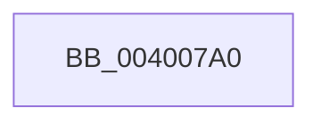

# SepSetProcessTrustLabelAceForToken

- RVA: `0x004007A0`–`0x004007F5` (길이 `85` bytes)
- VA: `0x00000001404007A0`
- 실행 섹션: `.text`
- PDB 이름 있음: `예`; PDB Function 태그: `아니요`
- unwind 정보 RVA: `0x0009A250`
- 디코드: `23`개 명령, `85/85` bytes 표시
- 미해석 바이트: `0` (있으면 어셈블리에 `.byte`로 보존)

> 이 문서는 커널 이미지의 기계어와 PDB 기호를 분석해 생성했습니다. 4번과 5번은 함수 원형과 자료형을 바이너리 사용 방식에서 추정한 C 해석이며 원본 소스 복구 결과는 아닙니다.

## 1. Dependencies

- 직접 호출 지점: **0**; 고유 호출 대상: **0**
- 직접 호출자로 확인된 함수: **4**
- RIP 상대 이미지 참조: **1**

### Outgoing calls
- 직접 디코드된 call 명령이 없습니다.

### Direct callers
- [SepFinalizeTokenAcls](../../page/8B/SepFinalizeTokenAcls_function_008B63F4.md) at `0x008B641C`
- [NtDuplicateToken](../../page/8B/NtDuplicateToken_function_008B6DF0.md) at `0x008B7128`
- [PsImpersonateClient](../../page/8C/PsImpersonateClient_function_008CBE10.md) at `0x008CC279`
- [SeCopyClientToken](../../page/9E/SeCopyClientToken_function_009EC5A8.md) at `0x009EC6D4`

### Static image references
- `0x004007AE` → RVA `0x00E0A740` (`.data`; read)

## 2. Other-region calls and transfers

- 다른 실행 섹션으로 향하는 call: **0**
- call이 아닌 외부 분기/꼬리 이동: **1**
  - `0x004007EF` → [sub_00400A7A + 0x1A](Unknown_function_00400A7A.md) (`tail-transfer`)

## 3. Assembly (complete function range)

```asm
004007A0  4C 8B DC                        mov r11, rsp
004007A3  53                              push rbx
004007A4  55                              push rbp
004007A5  41 56                           push r14
004007A7  48 81 EC 90 00 00 00            sub rsp, 0x90
004007AE  48 8B 05 8B 9F A0 00            mov rax, qword ptr [rip + 0xa09f8b]
004007B5  48 33 C4                        xor rax, rsp
004007B8  48 89 44 24 78                  mov qword ptr [rsp + 0x78], rax
004007BD  33 C0                           xor eax, eax
004007BF  48 8B E9                        mov rbp, rcx
004007C2  33 C9                           xor ecx, ecx
004007C4  49 89 43 C0                     mov qword ptr [r11 - 0x40], rax
004007C8  49 89 4B 90                     mov qword ptr [r11 - 0x70], rcx
004007CC  0F 57 C0                        xorps xmm0, xmm0
004007CF  88 4C 24 30                     mov byte ptr [rsp + 0x30], cl
004007D3  44 8B F1                        mov r14d, ecx
004007D6  89 44 24 70                     mov dword ptr [rsp + 0x70], eax
004007DA  89 4C 24 34                     mov dword ptr [rsp + 0x34], ecx
004007DE  0F 11 44 24 40                  movups xmmword ptr [rsp + 0x40], xmm0
004007E3  0F 11 44 24 50                  movups xmmword ptr [rsp + 0x50], xmm0
004007E8  49 89 43 B8                     mov qword ptr [r11 - 0x48], rax
004007EC  48 85 ED                        test rbp, rbp
004007EF  0F 84 9F 02 00 00               je 0x140400a94
```

## 4. C-style interpretation (structured pseudocode)

```c
__int64 __fastcall SepSetProcessTrustLabelAceForToken(__int64 a1)
{
    __int64 result;
    __int64 v_rsp;
    unsigned __int64 v_stack_m30;
    unsigned int v_stack_m38;
    unsigned __int64 v_stack_m58;
    unsigned __int64 v_stack_m68;
    unsigned int v_stack_m74;
    unsigned __int8 v_stack_m78;

    v_rsp = (v_rsp) - (144);
    result = (*(unsigned __int64 *)(v_rip + 10526603)) ^ (v_rsp);
    v_stack_m30 = result;
    result = 0;
    a1 = 0;
    *(unsigned __int64 *)(v_rsp - 64) = 0;
    *(unsigned __int64 *)(v_rsp - 112) = 0;
    v_stack_m78 = 0;
    v_stack_m38 = 0;
    v_stack_m74 = 0;
    v_stack_m68 = v_xmm0;
    v_stack_m58 = v_xmm0;
    *(unsigned __int64 *)(v_rsp - 72) = 0;
}
```

## 5. (Beta) C Style

```c
int64_t SepSetProcessTrustLabelAceForToken(int64_t Arg1)
{
    int64_t result;
    int64_t local_rsp;
    uint64_t v_stack_m30;
    uint32_t v_stack_m38;
    uint64_t v_stack_m58;
    uint64_t v_stack_m68;
    uint32_t v_stack_m74;
    uint8_t v_stack_m78;

    local_rsp = (local_rsp) - (144);
    result = (*(uint64_t *)(v_rip + 0xA09F8B)) ^ (local_rsp);
    v_stack_m30 = result;
    result = 0;
    Arg1 = 0;
    *(uint64_t *)(local_rsp - 0x40) = 0;
    *(uint64_t *)(local_rsp - 0x70) = 0;
    v_stack_m78 = 0;
    v_stack_m38 = 0;
    v_stack_m74 = 0;
    v_stack_m68 = v_xmm0;
    v_stack_m58 = v_xmm0;
    *(uint64_t *)(local_rsp - 0x48) = 0;
}
```

## 6. Execution-region graph

[열기: 2D/3D 그래프와 함수 탐색 컨트롤 패널](../../../control-panel.html?section=text&rva=0x004007A0&view=graph)

- 2D 그래프는 위에서 아래로 흐르고, 3D 그래프는 빈 공간을 드래그해 회전합니다. Shift+드래그는 이동, 휠은 확대·축소, 함수 노드 선택은 대상 보고서 이동입니다.

### Static fallback


