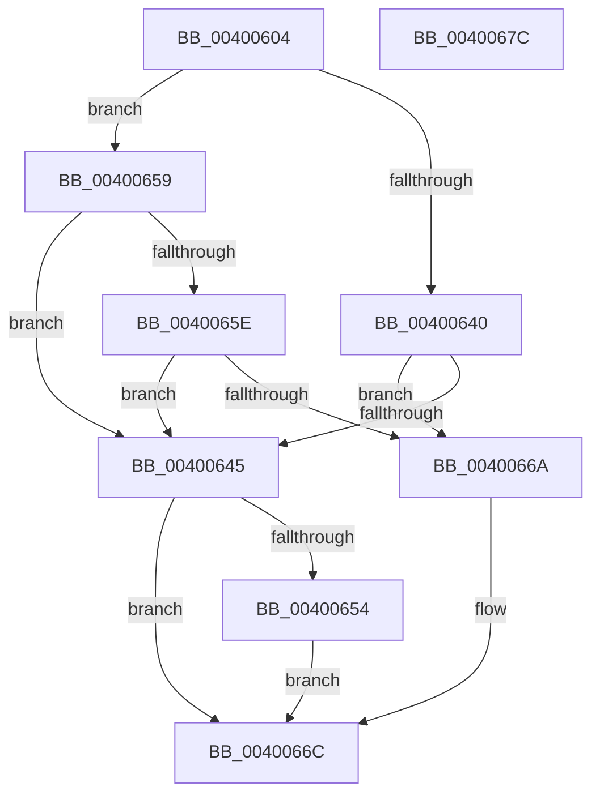

# SepSetTrustLevelForProcessToken

- RVA: `0x00400604`–`0x0040067D` (길이 `121` bytes)
- VA: `0x0000000140400604`
- 실행 섹션: `.text`
- PDB 이름 있음: `예`; PDB Function 태그: `아니요`
- unwind 정보 RVA: `0x0005FD94`
- 디코드: `37`개 명령, `121/121` bytes 표시
- 미해석 바이트: `0` (있으면 어셈블리에 `.byte`로 보존)

> 이 문서는 커널 이미지의 기계어와 PDB 기호를 분석해 생성했습니다. 4번과 5번은 함수 원형과 자료형을 바이너리 사용 방식에서 추정한 C 해석이며 원본 소스 복구 결과는 아닙니다.

## 1. Dependencies

- 직접 호출 지점: **3**; 고유 호출 대상: **3**
- 직접 호출자로 확인된 함수: **2**
- RIP 상대 이미지 참조: **0**

### Outgoing calls
- `0x0040062C` → [SepSidFromProcessProtection](SepSidFromProcessProtection_function_00400690.md) (function, `0x00400690`)
- `0x0040064B` → [SepSetTokenTrust](../../page/9E/SepSetTokenTrust_function_009E79B0.md) (function, `0x009E79B0`)
- `0x00400661` → [RtlEqualSid](RtlEqualSid_function_00400AD0.md) (function, `0x00400AD0`)

### Direct callers
- [SeExchangePrimaryToken](../../page/7A/SeExchangePrimaryToken_function_007A07BC.md) at `0x007A0890`
- [SeSubProcessToken](../../page/AA/SeSubProcessToken_function_00AAD570.md) at `0x00AADBC6`

### Static image references
- 디코드된 RIP-relative 메모리 참조가 없습니다.

## 2. Other-region calls and transfers

- 다른 실행 섹션으로 향하는 call: **1**
  - `0x0040064B` → [SepSetTokenTrust](../../page/9E/SepSetTokenTrust_function_009E79B0.md) (`.text` → `PAGE`)
- 별도 외부 분기/꼬리 이동을 확인하지 못했습니다.

## 3. Assembly (complete function range)

```asm
00400604  48 89 5C 24 10                  mov qword ptr [rsp + 0x10], rbx
00400609  48 89 74 24 18                  mov qword ptr [rsp + 0x18], rsi
0040060E  57                              push rdi
0040060F  48 83 EC 20                     sub rsp, 0x20
00400613  8A 82 FA 05 00 00               mov al, byte ptr [rdx + 0x5fa]
00400619  48 8B F1                        mov rsi, rcx
0040061C  48 8D 4C 24 30                  lea rcx, [rsp + 0x30]
00400621  88 44 24 30                     mov byte ptr [rsp + 0x30], al
00400625  49 8B F8                        mov rdi, r8
00400628  41 C6 00 00                     mov byte ptr [r8], 0
0040062C  E8 5F 00 00 00                  call 0x140400690
00400631  48 8B 8E 50 04 00 00            mov rcx, qword ptr [rsi + 0x450]
00400638  48 8B D8                        mov rbx, rax
0040063B  48 85 C9                        test rcx, rcx
0040063E  75 19                           jne 0x140400659
00400640  48 85 C0                        test rax, rax
00400643  74 25                           je 0x14040066a
00400645  48 8B D3                        mov rdx, rbx
00400648  48 8B CE                        mov rcx, rsi
0040064B  E8 60 73 5E 00                  call 0x1409e79b0
00400650  85 C0                           test eax, eax
00400652  78 18                           js 0x14040066c
00400654  C6 07 01                        mov byte ptr [rdi], 1
00400657  EB 13                           jmp 0x14040066c
00400659  48 85 DB                        test rbx, rbx
0040065C  74 E7                           je 0x140400645
0040065E  48 8B D3                        mov rdx, rbx
00400661  E8 6A 04 00 00                  call 0x140400ad0
00400666  84 C0                           test al, al
00400668  74 DB                           je 0x140400645
0040066A  33 C0                           xor eax, eax
0040066C  48 8B 5C 24 38                  mov rbx, qword ptr [rsp + 0x38]
00400671  48 8B 74 24 40                  mov rsi, qword ptr [rsp + 0x40]
00400676  48 83 C4 20                     add rsp, 0x20
0040067A  5F                              pop rdi
0040067B  C3                              ret
0040067C  CC                              int3
```

## 4. C-style interpretation (structured pseudocode)

```c
__int64 __fastcall SepSetTrustLevelForProcessToken(__int64 a1, __int64 a2, __int64 a3)
{
    __int64 result;
    __int64 v_rsp;
    unsigned __int64 v_stack_p10;
    unsigned __int64 v_stack_p18;
    unsigned __int64 v_stack_p8;

    v_stack_p10 = v_rbx;
    v_stack_p18 = v_rsi;
    v_rsp = (v_rsp) - (32);
    v_stack_p8 = (unsigned __int8)(*(unsigned __int8 *)(a2 + 1530));
    *(unsigned __int8 *)(a3) = 0;
    result = SepSidFromProcessProtection(v_stack_p8, a2, a3, a4);
    if (*(unsigned __int64 *)(a1 + 1104) != 0) goto loc_00400659;
    if (result == 0) goto loc_0040066A;
loc_00400645:
    result = SepSetTokenTrust(a1, result, a3, a4);
    if (sign_flag) goto loc_0040066C;
    *(unsigned __int8 *)(a3) = 1;
    goto loc_0040066C;
loc_00400659:
    if (result == 0) goto loc_00400645;
    result = RtlEqualSid(a1, result, a3, a4);
    if ((unsigned __int8)(result) == 0) goto loc_00400645;
loc_0040066A:
    result = 0;
loc_0040066C:
    v_rsp = (v_rsp) + (32);
    return result;
}
```

## 5. (Beta) C Style

```c
int64_t SepSetTrustLevelForProcessToken(void *Arg1, void *Arg2, void *Arg3)
{
    uint8_t *arg1 = (uint8_t *)Arg1;
    uint8_t *arg2 = (uint8_t *)Arg2;
    uint8_t *arg3 = (uint8_t *)Arg3;

    int64_t result;
    int64_t local_rsp;
    uint64_t v_stack_p10;
    uint64_t v_stack_p18;
    uint64_t v_stack_p8;

    v_stack_p10 = local_rbx;
    v_stack_p18 = local_rsi;
    local_rsp = (local_rsp) - (32);
    v_stack_p8 = (uint8_t)(*(uint8_t *)(arg2 + 0x5FA));
    *(uint8_t *)(arg3) = 0;
    result = SepSidFromProcessProtection(v_stack_p8, Arg2, Arg3, a4);
    if (*(uint64_t *)(arg1 + 0x450) != 0) goto loc_00400659;
    if (result == 0) goto loc_0040066A;
loc_00400645:
    result = SepSetTokenTrust(Arg1, result, Arg3, a4);
    if (sign_flag) goto loc_0040066C;
    *(uint8_t *)(arg3) = 1;
    goto loc_0040066C;
loc_00400659:
    if (result == 0) goto loc_00400645;
    result = RtlEqualSid(Arg1, result, Arg3, a4);
    if ((uint8_t)(result) == 0) goto loc_00400645;
loc_0040066A:
    result = 0;
loc_0040066C:
    local_rsp = (local_rsp) + (32);
    return result;
}
```

### 관측된 메모리 오프셋

구조체 형식이 확인되지 않은 접근은 인자 기준의 오프셋으로만 기록했습니다.

| 기준 인자 | 오프셋 표현 | 폭 (bit) | 접근 |
|---|---:|---:|---|
| `Arg1` | `+ 0x450` | `64` | `R` |
| `Arg2` | `+ 0x5FA` | `8` | `R` |
| `Arg3` | `+ 0x0` | `8` | `W` |

## 6. Execution-region graph

[열기: 2D/3D 그래프와 함수 탐색 컨트롤 패널](../../../control-panel.html?section=text&rva=0x00400604&view=graph)

- 2D 그래프는 위에서 아래로 흐르고, 3D 그래프는 빈 공간을 드래그해 회전합니다. Shift+드래그는 이동, 휠은 확대·축소, 함수 노드 선택은 대상 보고서 이동입니다.

### Static fallback


