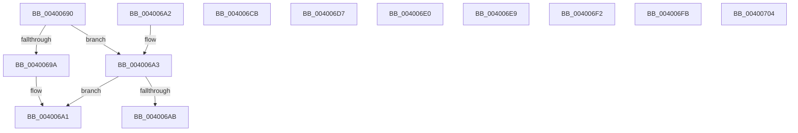

# SepSidFromProcessProtection

- RVA: `0x00400690`–`0x00400798` (길이 `264` bytes)
- VA: `0x0000000140400690`
- 실행 섹션: `.text`
- PDB 이름 있음: `예`; PDB Function 태그: `아니요`
- unwind 정보 RVA: `0x000DB714`
- 디코드: `156`개 명령, `264/264` bytes 표시
- 미해석 바이트: `107` (있으면 어셈블리에 `.byte`로 보존)

> 이 문서는 커널 이미지의 기계어와 PDB 기호를 분석해 생성했습니다. 4번과 5번은 함수 원형과 자료형을 바이너리 사용 방식에서 추정한 C 해석이며 원본 소스 복구 결과는 아닙니다.

## 1. Dependencies

- 직접 호출 지점: **0**; 고유 호출 대상: **0**
- 직접 호출자로 확인된 함수: **1**
- RIP 상대 이미지 참조: **8**

### Outgoing calls
- 직접 디코드된 call 명령이 없습니다.

### Direct callers
- [SepSetTrustLevelForProcessToken](SepSetTrustLevelForProcessToken_function_00400604.md) at `0x0040062C`

### Static image references
- `0x0040069A` → RVA `0x00F05828` (`.data`; read)
- `0x004006AE` → RVA `0x00000000` (`image boundary/outside`; read)
- `0x004006CF` → RVA `0x00F04F50` (`.data`; read)
- `0x004006D8` → RVA `0x00F04F58` (`.data`; read)
- `0x004006E1` → RVA `0x00F05860` (`.data`; read)
- `0x004006EA` → RVA `0x00F05830` (`.data`; read)
- `0x004006F3` → RVA `0x00F05858` (`.data`; read)
- `0x004006FC` → RVA `0x00F05848` (`.data`; read)

## 2. Other-region calls and transfers

- 다른 실행 섹션으로 향하는 call: **0**
- 별도 외부 분기/꼬리 이동을 확인하지 못했습니다.

## 3. Assembly (complete function range)

```asm
00400690  0F B6 11                        movzx edx, byte ptr [rcx]
00400693  33 C0                           xor eax, eax
00400695  83 FA 62                        cmp edx, 0x62
00400698  75 09                           jne 0x1404006a3
0040069A  48 8B 05 87 51 B0 00            mov rax, qword ptr [rip + 0xb05187]
004006A1  C3                              ret
004006A2  CC                              int3
004006A3  83 C2 EE                        add edx, -0x12
004006A6  83 FA 6F                        cmp edx, 0x6f
004006A9  77 F6                           ja 0x1404006a1
004006AB  48 63 CA                        movsxd rcx, edx
004006AE  4C 8D 05 4B F9 BF FF            lea r8, [rip - 0x4006b5]
004006B5  41 0F B6 8C 08 28 07 40 00      movzx ecx, byte ptr [r8 + rcx + 0x400728]
004006BE  41 8B 94 88 08 07 40 00         mov edx, dword ptr [r8 + rcx*4 + 0x400708]
004006C6  49 03 D0                        add rdx, r8
004006C9  FF E2                           jmp rdx
004006CB  CC                              int3
004006CC  CC                              int3
004006CD  CC                              int3
004006CE  CC                              int3
004006CF  48 8B 05 7A 48 B0 00            mov rax, qword ptr [rip + 0xb0487a]
004006D6  C3                              ret
004006D7  CC                              int3
004006D8  48 8B 05 79 48 B0 00            mov rax, qword ptr [rip + 0xb04879]
004006DF  C3                              ret
004006E0  CC                              int3
004006E1  48 8B 05 78 51 B0 00            mov rax, qword ptr [rip + 0xb05178]
004006E8  C3                              ret
004006E9  CC                              int3
004006EA  48 8B 05 3F 51 B0 00            mov rax, qword ptr [rip + 0xb0513f]
004006F1  C3                              ret
004006F2  CC                              int3
004006F3  48 8B 05 5E 51 B0 00            mov rax, qword ptr [rip + 0xb0515e]
004006FA  C3                              ret
004006FB  CC                              int3
004006FC  48 8B 05 45 51 B0 00            mov rax, qword ptr [rip + 0xb05145]
00400703  C3                              ret
00400704  CC                              int3
00400705  0F 1F 00                        nop dword ptr [rax]
00400708  F3                              .byte 0xf3
00400709  06                              .byte 0x06
0040070A  40 00 CF                        add dil, cl
0040070D  06                              .byte 0x06
0040070E  40 00 E1                        add cl, spl
00400711  06                              .byte 0x06
00400712  40 00 EA                        add dl, bpl
00400715  06                              .byte 0x06
00400716  40 00 D8                        add al, bl
00400719  06                              .byte 0x06
0040071A  40 00 9A 06 40 00 FC            add byte ptr [rdx - 0x3ffbffa], bl
00400721  06                              .byte 0x06
00400722  40 00 A1 06 40 00 00            add byte ptr [rcx + 0x4006], spl
00400729  07                              .byte 0x07
0040072A  07                              .byte 0x07
0040072B  07                              .byte 0x07
0040072C  07                              .byte 0x07
0040072D  07                              .byte 0x07
0040072E  07                              .byte 0x07
0040072F  07                              .byte 0x07
00400730  07                              .byte 0x07
00400731  07                              .byte 0x07
00400732  07                              .byte 0x07
00400733  07                              .byte 0x07
00400734  07                              .byte 0x07
00400735  07                              .byte 0x07
00400736  07                              .byte 0x07
00400737  07                              .byte 0x07
00400738  07                              .byte 0x07
00400739  07                              .byte 0x07
0040073A  07                              .byte 0x07
0040073B  07                              .byte 0x07
0040073C  07                              .byte 0x07
0040073D  07                              .byte 0x07
0040073E  07                              .byte 0x07
0040073F  07                              .byte 0x07
00400740  07                              .byte 0x07
00400741  07                              .byte 0x07
00400742  07                              .byte 0x07
00400743  07                              .byte 0x07
00400744  07                              .byte 0x07
00400745  07                              .byte 0x07
00400746  07                              .byte 0x07
00400747  01 07                           add dword ptr [rdi], eax
00400749  07                              .byte 0x07
0040074A  07                              .byte 0x07
0040074B  07                              .byte 0x07
0040074C  07                              .byte 0x07
0040074D  07                              .byte 0x07
0040074E  07                              .byte 0x07
0040074F  07                              .byte 0x07
00400750  07                              .byte 0x07
00400751  07                              .byte 0x07
00400752  07                              .byte 0x07
00400753  07                              .byte 0x07
00400754  07                              .byte 0x07
00400755  07                              .byte 0x07
00400756  07                              .byte 0x07
00400757  07                              .byte 0x07
00400758  07                              .byte 0x07
00400759  07                              .byte 0x07
0040075A  07                              .byte 0x07
0040075B  07                              .byte 0x07
0040075C  07                              .byte 0x07
0040075D  07                              .byte 0x07
0040075E  07                              .byte 0x07
0040075F  07                              .byte 0x07
00400760  07                              .byte 0x07
00400761  07                              .byte 0x07
00400762  07                              .byte 0x07
00400763  07                              .byte 0x07
00400764  07                              .byte 0x07
00400765  07                              .byte 0x07
00400766  07                              .byte 0x07
00400767  02 03                           add al, byte ptr [rbx]
00400769  07                              .byte 0x07
0040076A  07                              .byte 0x07
0040076B  07                              .byte 0x07
0040076C  07                              .byte 0x07
0040076D  07                              .byte 0x07
0040076E  07                              .byte 0x07
0040076F  07                              .byte 0x07
00400770  07                              .byte 0x07
00400771  07                              .byte 0x07
00400772  07                              .byte 0x07
00400773  07                              .byte 0x07
00400774  07                              .byte 0x07
00400775  07                              .byte 0x07
00400776  07                              .byte 0x07
00400777  04 07                           add al, 7
00400779  07                              .byte 0x07
0040077A  07                              .byte 0x07
0040077B  07                              .byte 0x07
0040077C  07                              .byte 0x07
0040077D  07                              .byte 0x07
0040077E  07                              .byte 0x07
0040077F  07                              .byte 0x07
00400780  07                              .byte 0x07
00400781  07                              .byte 0x07
00400782  07                              .byte 0x07
00400783  07                              .byte 0x07
00400784  07                              .byte 0x07
00400785  07                              .byte 0x07
00400786  07                              .byte 0x07
00400787  07                              .byte 0x07
00400788  05 07 07 07 07                  add eax, 0x7070707
0040078D  07                              .byte 0x07
0040078E  07                              .byte 0x07
0040078F  07                              .byte 0x07
00400790  07                              .byte 0x07
00400791  07                              .byte 0x07
00400792  07                              .byte 0x07
00400793  07                              .byte 0x07
00400794  07                              .byte 0x07
00400795  07                              .byte 0x07
00400796  07                              .byte 0x07
00400797  06                              .byte 0x06
```

## 4. C-style interpretation (structured pseudocode)

```c
__int64 __fastcall SepSidFromProcessProtection(__int64 a1)
{
    __int64 result;

    result = 0;
    if (((unsigned int)(*(unsigned __int8 *)(a1))) != 98) goto loc_004006A3;
loc_004006A1:
    return *(unsigned __int64 *)(v_rip + 11555207);
loc_004006A3:
    a2 = (unsigned int)((*(unsigned __int8 *)(a1)) + (-18));
    if (((unsigned int)(a2)) > 111) goto loc_004006A1;
    a2 = ((unsigned int)(*(unsigned int *)(v_rip - 4196021 + *(unsigned __int8 *)(v_rip - 4196021 + (int)((unsigned int)(a2)) * 1 + 4196136) * 4 + 4196104))) + (v_rip - 4196021);
}
```

## 5. (Beta) C Style

```c
int64_t SepSidFromProcessProtection(void *Arg1)
{
    uint8_t *arg1 = (uint8_t *)Arg1;

    int64_t result;

    result = 0;
    if (((uint32_t)(*(uint8_t *)(arg1))) != 98) goto loc_004006A3;
loc_004006A1:
    return *(uint64_t *)(v_rip + 0xB05187);
loc_004006A3:
    a2 = (uint32_t)((*(uint8_t *)(arg1)) + (-18));
    if (((uint32_t)(a2)) > 111) goto loc_004006A1;
    a2 = ((uint32_t)(*(uint32_t *)(v_rip - 0x4006B5 + *(uint8_t *)(v_rip - 0x4006B5 + (int32_t)((uint32_t)(a2)) * 1 + 0x400728) * 4 + 0x400708))) + (v_rip - 4196021);
}
```

### 관측된 메모리 오프셋

구조체 형식이 확인되지 않은 접근은 인자 기준의 오프셋으로만 기록했습니다.

| 기준 인자 | 오프셋 표현 | 폭 (bit) | 접근 |
|---|---:|---:|---|
| `Arg1` | `+ 0x0` | `8` | `R` |

## 6. Execution-region graph

[열기: 2D/3D 그래프와 함수 탐색 컨트롤 패널](../../../control-panel.html?section=text&rva=0x00400690&view=graph)

- 2D 그래프는 위에서 아래로 흐르고, 3D 그래프는 빈 공간을 드래그해 회전합니다. Shift+드래그는 이동, 휠은 확대·축소, 함수 노드 선택은 대상 보고서 이동입니다.

### Static fallback


