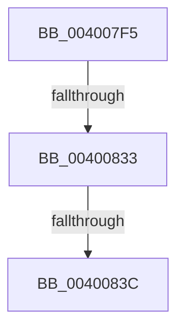

# sub_004007F5

- RVA: `0x004007F5`–`0x00400840` (길이 `75` bytes)
- VA: `0x00000001404007F5`
- 실행 섹션: `.text`
- PDB 이름 있음: `아니요`; PDB Function 태그: `아니요`
- unwind 정보 RVA: `0x0009A268`
- 디코드: `18`개 명령, `75/75` bytes 표시
- 미해석 바이트: `0` (있으면 어셈블리에 `.byte`로 보존)

> 이 문서는 커널 이미지의 기계어와 PDB 기호를 분석해 생성했습니다. 4번과 5번은 함수 원형과 자료형을 바이너리 사용 방식에서 추정한 C 해석이며 원본 소스 복구 결과는 아닙니다.

## 1. Dependencies

- 직접 호출 지점: **1**; 고유 호출 대상: **1**
- 직접 호출자로 확인된 함수: **0**
- RIP 상대 이미지 참조: **0**

### Outgoing calls
- `0x0040081F` → [ObGetObjectSecurity](../../page/9D/ObGetObjectSecurity_function_009D45F0.md) (function, `0x009D45F0`)

### Direct callers
- 이 함수 시작 RVA로 연결되는 직접 call은 확인되지 않았습니다. 간접 호출은 완전히 역산할 수 없습니다.

### Static image references
- 디코드된 RIP-relative 메모리 참조가 없습니다.

## 2. Other-region calls and transfers

- 다른 실행 섹션으로 향하는 call: **1**
  - `0x0040081F` → [ObGetObjectSecurity](../../page/9D/ObGetObjectSecurity_function_009D45F0.md) (`.text` → `PAGE`)
- call이 아닌 외부 분기/꼬리 이동: **2**
  - `0x0040082D` → [sub_00400A46](Unknown_function_00400A46.md) (`tail-transfer`)
  - `0x00400836` → [sub_00400A46 + 0x14](Unknown_function_00400A46.md) (`tail-transfer`)

## 3. Assembly (complete function range)

```asm
004007F5  49 89 7B 18                     mov qword ptr [r11 + 0x18], rdi
004007F9  4D 8D 43 88                     lea r8, [r11 - 0x78]
004007FD  4D 89 63 20                     mov qword ptr [r11 + 0x20], r12
00400801  49 8D 53 90                     lea rdx, [r11 - 0x70]
00400805  4D 89 6B E0                     mov qword ptr [r11 - 0x20], r13
00400809  44 8D 61 02                     lea r12d, [rcx + 2]
0040080D  44 8D 69 08                     lea r13d, [rcx + 8]
00400811  4D 89 7B D8                     mov qword ptr [r11 - 0x28], r15
00400815  4C 8B BD 50 04 00 00            mov r15, qword ptr [rbp + 0x450]
0040081C  48 8B CD                        mov rcx, rbp
0040081F  E8 CC 3D 5D 00                  call 0x1409d45f0
00400824  48 8B 7C 24 38                  mov rdi, qword ptr [rsp + 0x38]
00400829  8B D8                           mov ebx, eax
0040082B  85 C0                           test eax, eax
0040082D  0F 88 13 02 00 00               js 0x140400a46
00400833  48 85 FF                        test rdi, rdi
00400836  0F 84 1E 02 00 00               je 0x140400a5a
0040083C  0F B7 47 02                     movzx eax, word ptr [rdi + 2]
```

## 4. C-style interpretation (structured pseudocode)

```c
__int64 __fastcall sub_004007F5(__int64 a1, __int64 a2, __int64 a3, __int64 a4, __int64 a5, __int64 a6, __int64 a7)
{
    __int64 result;

    *(unsigned __int64 *)(v_r11 + 24) = v_rdi;
    *(unsigned __int64 *)(v_r11 + 32) = v_r12;
    *(unsigned __int64 *)(v_r11 - 32) = v_r13;
    *(unsigned __int64 *)(v_r11 - 40) = v_r15;
    result = ObGetObjectSecurity(v_rbp, v_r11 - 112, v_r11 - 120, a4);
    return *(unsigned __int16 *)(a7 + 2);
}
```

## 5. (Beta) C Style

```c
int64_t sub_004007F5(void *Arg1, int64_t Arg2, int64_t Arg3, int64_t Arg4, uint64_t Arg5, uint64_t Arg6, int64_t Arg7)
{
    uint8_t *arg1 = (uint8_t *)Arg1;

    int64_t result;

    *(uint64_t *)(local_r11 + 0x18) = local_rdi;
    *(uint64_t *)(local_r11 + 0x20) = local_r12;
    *(uint64_t *)(local_r11 - 0x20) = local_r13;
    *(uint64_t *)(local_r11 - 0x28) = local_r15;
    result = ObGetObjectSecurity(local_rbp, local_r11 - 112, local_r11 - 120, Arg4);
    return *(uint16_t *)(Arg7 + 0x2);
}
```

### 관측된 메모리 오프셋

구조체 형식이 확인되지 않은 접근은 인자 기준의 오프셋으로만 기록했습니다.

| 기준 인자 | 오프셋 표현 | 폭 (bit) | 접근 |
|---|---:|---:|---|
| `Arg1` | `+ 0x2` | `32` | `R` |
| `Arg1` | `+ 0x8` | `32` | `R` |

## 6. Execution-region graph

[열기: 2D/3D 그래프와 함수 탐색 컨트롤 패널](../../../control-panel.html?section=text&rva=0x004007F5&view=graph)

- 2D 그래프는 위에서 아래로 흐르고, 3D 그래프는 빈 공간을 드래그해 회전합니다. Shift+드래그는 이동, 휠은 확대·축소, 함수 노드 선택은 대상 보고서 이동입니다.

### Static fallback


