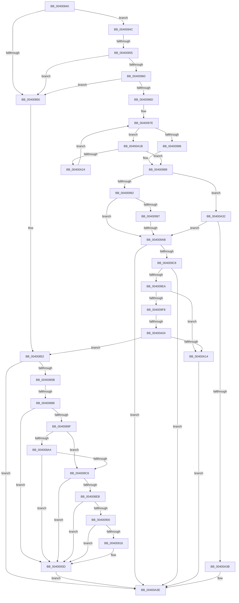

# sub_00400840

- RVA: `0x00400840`–`0x00400A46` (길이 `518` bytes)
- VA: `0x0000000140400840`
- 실행 섹션: `.text`
- PDB 이름 있음: `아니요`; PDB Function 태그: `아니요`
- unwind 정보 RVA: `0x0009A288`
- 디코드: `139`개 명령, `518/518` bytes 표시
- 미해석 바이트: `0` (있으면 어셈블리에 `.byte`로 보존)

> 이 문서는 커널 이미지의 기계어와 PDB 기호를 분석해 생성했습니다. 4번과 5번은 함수 원형과 자료형을 바이너리 사용 방식에서 추정한 C 해석이며 원본 소스 복구 결과는 아닙니다.

## 1. Dependencies

- 직접 호출 지점: **11**; 고유 호출 대상: **10**
- 직접 호출자로 확인된 함수: **0**
- RIP 상대 이미지 참조: **0**

### Outgoing calls
- `0x00400877` → [ExAllocatePool2](../../poolcode/B8/ExAllocatePool2_function_00B820F0.md) (function, `0x00B820F0`)
- `0x00400890` → [RtlCreateAcl](../../page/91/RtlCreateAcl_function_00916F00.md) (function, `0x00916F00`)
- `0x004008BB` → [RtlAddAce](../../page/92/RtlAddAce_function_00929D70.md) (function, `0x00929D70`)
- `0x004008E0` → [RtlAddProcessTrustLabelAce](../../page/92/RtlAddProcessTrustLabelAce_function_00929740.md) (function, `0x00929740`)
- `0x004008F5` → [RtlCreateSecurityDescriptor](../../page/9F/RtlCreateSecurityDescriptor_function_009F1DF0.md) (function, `0x009F1DF0`)
- `0x0040090D` → [RtlSetSaclSecurityDescriptor](../../page/A1/RtlSetSaclSecurityDescriptor_function_00A18B80.md) (function, `0x00A18B80`)
- `0x00400936` → [ObSetSecurityObjectByPointer](../../page/8B/ObSetSecurityObjectByPointer_function_008BAD20.md) (function, `0x008BAD20`)
- `0x00400942` → [ExFreePoolWithTag](../../poolcode/B8/ExFreePoolWithTag_function_00B82870.md) (function, `0x00B82870`)
- `0x0040099E` → [RtlEqualSid](RtlEqualSid_function_00400AD0.md) (function, `0x00400AD0`)
- `0x004009BD` → [RtlQueryInformationAcl](../../page/9E/RtlQueryInformationAcl_function_009EC2C0.md) (function, `0x009EC2C0`)
- `0x004009DF` → [RtlQueryInformationAcl](../../page/9E/RtlQueryInformationAcl_function_009EC2C0.md) (function, `0x009EC2C0`)

### Direct callers
- 이 함수 시작 RVA로 연결되는 직접 call은 확인되지 않았습니다. 간접 호출은 완전히 역산할 수 없습니다.

### Static image references
- 디코드된 RIP-relative 메모리 참조가 없습니다.

## 2. Other-region calls and transfers

- 다른 실행 섹션으로 향하는 call: **10**
  - `0x00400877` → [ExAllocatePool2](../../poolcode/B8/ExAllocatePool2_function_00B820F0.md) (`.text` → `POOLCODE`)
  - `0x00400890` → [RtlCreateAcl](../../page/91/RtlCreateAcl_function_00916F00.md) (`.text` → `PAGE`)
  - `0x004008BB` → [RtlAddAce](../../page/92/RtlAddAce_function_00929D70.md) (`.text` → `PAGE`)
  - `0x004008E0` → [RtlAddProcessTrustLabelAce](../../page/92/RtlAddProcessTrustLabelAce_function_00929740.md) (`.text` → `PAGE`)
  - `0x004008F5` → [RtlCreateSecurityDescriptor](../../page/9F/RtlCreateSecurityDescriptor_function_009F1DF0.md) (`.text` → `PAGE`)
  - `0x0040090D` → [RtlSetSaclSecurityDescriptor](../../page/A1/RtlSetSaclSecurityDescriptor_function_00A18B80.md) (`.text` → `PAGE`)
  - `0x00400936` → [ObSetSecurityObjectByPointer](../../page/8B/ObSetSecurityObjectByPointer_function_008BAD20.md) (`.text` → `PAGE`)
  - `0x00400942` → [ExFreePoolWithTag](../../poolcode/B8/ExFreePoolWithTag_function_00B82870.md) (`.text` → `POOLCODE`)
  - `0x004009BD` → [RtlQueryInformationAcl](../../page/9E/RtlQueryInformationAcl_function_009EC2C0.md) (`.text` → `PAGE`)
  - `0x004009DF` → [RtlQueryInformationAcl](../../page/9E/RtlQueryInformationAcl_function_009EC2C0.md) (`.text` → `PAGE`)
- call이 아닌 외부 분기/꼬리 이동: **4**
  - `0x00400882` → [sub_00400A9B + 0x19](Unknown_function_00400A9B.md) (`tail-transfer`)
  - `0x0040094F` → [sub_00400A9B](Unknown_function_00400A9B.md) (`tail-transfer`)
  - `0x004009A5` → [sub_00400A9B + 0x9](Unknown_function_00400A9B.md) (`tail-transfer`)
  - `0x004009FE` → [sub_00400A9B + 0x12](Unknown_function_00400A9B.md) (`tail-transfer`)

## 3. Assembly (complete function range)

```asm
00400840  48 89 B4 24 B8 00 00 00         mov qword ptr [rsp + 0xb8], rsi
00400848  A8 10                           test al, 0x10
0040084A  0F 85 FC 00 00 00               jne 0x14040094c
00400850  33 DB                           xor ebx, ebx
00400852  4D 85 FF                        test r15, r15
00400855  0F 84 E3 01 00 00               je 0x140400a3e
0040085B  41 0F B6 47 01                  movzx eax, byte ptr [r15 + 1]
00400860  B9 00 01 00 00                  mov ecx, 0x100
00400865  41 B8 53 65 41 63               mov r8d, 0x63416553
0040086B  8D 1C 85 10 00 00 00            lea ebx, [rax*4 + 0x10]
00400872  41 03 DD                        add ebx, r13d
00400875  8B D3                           mov edx, ebx
00400877  E8 74 18 78 00                  call 0x140b820f0
0040087C  48 8B F0                        mov rsi, rax
0040087F  48 85 C0                        test rax, rax
00400882  0F 84 2C 02 00 00               je 0x140400ab4
00400888  45 8B C4                        mov r8d, r12d
0040088B  8B D3                           mov edx, ebx
0040088D  48 8B C8                        mov rcx, rax
00400890  E8 6B 66 51 00                  call 0x140916f00
00400895  8B D8                           mov ebx, eax
00400897  85 C0                           test eax, eax
00400899  0F 88 9E 00 00 00               js 0x14040093d
0040089F  4D 85 F6                        test r14, r14
004008A2  74 22                           je 0x1404008c6
004008A4  8B 44 24 6C                     mov eax, dword ptr [rsp + 0x6c]
004008A8  4D 8B CE                        mov r9, r14
004008AB  83 C0 F8                        add eax, -8
004008AE  45 33 C0                        xor r8d, r8d
004008B1  41 8B D4                        mov edx, r12d
004008B4  89 44 24 20                     mov dword ptr [rsp + 0x20], eax
004008B8  48 8B CE                        mov rcx, rsi
004008BB  E8 B0 94 52 00                  call 0x140929d70
004008C0  8B D8                           mov ebx, eax
004008C2  85 C0                           test eax, eax
004008C4  78 77                           js 0x14040093d
004008C6  45 33 C0                        xor r8d, r8d
004008C9  C7 44 24 28 1E 00 02 00         mov dword ptr [rsp + 0x28], 0x2001e
004008D1  4D 8B CF                        mov r9, r15
004008D4  C6 44 24 20 14                  mov byte ptr [rsp + 0x20], 0x14
004008D9  48 8B CE                        mov rcx, rsi
004008DC  41 8D 50 02                     lea edx, [r8 + 2]
004008E0  E8 5B 8E 52 00                  call 0x140929740
004008E5  8B D8                           mov ebx, eax
004008E7  85 C0                           test eax, eax
004008E9  78 52                           js 0x14040093d
004008EB  BA 01 00 00 00                  mov edx, 1
004008F0  48 8D 4C 24 40                  lea rcx, [rsp + 0x40]
004008F5  E8 F6 14 5F 00                  call 0x1409f1df0
004008FA  8B D8                           mov ebx, eax
004008FC  85 C0                           test eax, eax
004008FE  78 3D                           js 0x14040093d
00400900  45 33 C9                        xor r9d, r9d
00400903  48 8D 4C 24 40                  lea rcx, [rsp + 0x40]
00400908  4C 8B C6                        mov r8, rsi
0040090B  B2 01                           mov dl, 1
0040090D  E8 6E 82 61 00                  call 0x140a18b80
00400912  8B D8                           mov ebx, eax
00400914  85 C0                           test eax, eax
00400916  78 25                           js 0x14040093d
00400918  0F B7 47 02                     movzx eax, word ptr [rdi + 2]
0040091C  4C 8D 44 24 40                  lea r8, [rsp + 0x40]
00400921  B9 30 28 00 00                  mov ecx, 0x2830
00400926  BA F8 01 00 00                  mov edx, 0x1f8
0040092B  66 23 C1                        and ax, cx
0040092E  48 8B CD                        mov rcx, rbp
00400931  66 09 44 24 42                  or word ptr [rsp + 0x42], ax
00400936  E8 E5 A3 4B 00                  call 0x1408bad20
0040093B  8B D8                           mov ebx, eax
0040093D  33 D2                           xor edx, edx
0040093F  48 8B CE                        mov rcx, rsi
00400942  E8 29 1F 78 00                  call 0x140b82870
00400947  E9 F2 00 00 00                  jmp 0x140400a3e
0040094C  66 85 C0                        test ax, ax
0040094F  0F 89 46 01 00 00               jns 0x140400a9b
00400955  8B 47 0C                        mov eax, dword ptr [rdi + 0xc]
00400958  85 C0                           test eax, eax
0040095A  0F 84 F0 FE FF FF               je 0x140400850
00400960  48 8D 34 07                     lea rsi, [rdi + rax]
00400964  48 85 F6                        test rsi, rsi
00400967  0F 84 E3 FE FF FF               je 0x140400850
0040096D  0F B7 56 04                     movzx edx, word ptr [rsi + 4]
00400971  4C 8D 76 08                     lea r14, [rsi + 8]
00400975  45 33 E4                        xor r12d, r12d
00400978  49 8B DE                        mov rbx, r14
0040097B  41 8B CC                        mov ecx, r12d
0040097E  3B CA                           cmp ecx, edx
00400980  0F 82 95 00 00 00               jb 0x140400a1b
00400986  49 8B DC                        mov rbx, r12
00400989  4D 85 FF                        test r15, r15
0040098C  0F 84 A0 00 00 00               je 0x140400a32
00400992  48 85 DB                        test rbx, rbx
00400995  74 14                           je 0x1404009ab
00400997  48 8D 4B 08                     lea rcx, [rbx + 8]
0040099B  49 8B D7                        mov rdx, r15
0040099E  E8 2D 01 00 00                  call 0x140400ad0
004009A3  84 C0                           test al, al
004009A5  0F 85 F9 00 00 00               jne 0x140400aa4
004009AB  41 B9 02 00 00 00               mov r9d, 2
004009B1  48 8D 54 24 68                  lea rdx, [rsp + 0x68]
004009B6  48 8B CE                        mov rcx, rsi
004009B9  45 8D 41 0A                     lea r8d, [r9 + 0xa]
004009BD  E8 FE B8 5E 00                  call 0x1409ec2c0
004009C2  8B D8                           mov ebx, eax
004009C4  85 C0                           test eax, eax
004009C6  78 76                           js 0x140400a3e
004009C8  44 8B 6C 24 6C                  mov r13d, dword ptr [rsp + 0x6c]
004009CD  48 8D 54 24 34                  lea rdx, [rsp + 0x34]
004009D2  41 B9 01 00 00 00               mov r9d, 1
004009D8  48 8B CE                        mov rcx, rsi
004009DB  45 8D 41 03                     lea r8d, [r9 + 3]
004009DF  E8 DC B8 5E 00                  call 0x1409ec2c0
004009E4  8B D8                           mov ebx, eax
004009E6  85 C0                           test eax, eax
004009E8  78 54                           js 0x140400a3e
004009EA  0F B6 06                        movzx eax, byte ptr [rsi]
004009ED  44 8B 64 24 34                  mov r12d, dword ptr [rsp + 0x34]
004009F2  2C 02                           sub al, 2
004009F4  3C 02                           cmp al, 2
004009F6  77 1C                           ja 0x140400a14
004009F8  33 DB                           xor ebx, ebx
004009FA  66 3B 5E 04                     cmp bx, word ptr [rsi + 4]
004009FE  0F 83 A9 00 00 00               jae 0x140400aad
00400A04  0F B7 46 02                     movzx eax, word ptr [rsi + 2]
00400A08  48 03 C6                        add rax, rsi
00400A0B  4C 3B F0                        cmp r14, rax
00400A0E  0F 82 3E FE FF FF               jb 0x140400852
00400A14  BB 0D 00 00 C0                  mov ebx, 0xc000000d
00400A19  EB 23                           jmp 0x140400a3e
00400A1B  80 3B 14                        cmp byte ptr [rbx], 0x14
00400A1E  0F 84 65 FF FF FF               je 0x140400989
00400A24  0F B7 43 02                     movzx eax, word ptr [rbx + 2]
00400A28  FF C1                           inc ecx
00400A2A  48 03 D8                        add rbx, rax
00400A2D  E9 4C FF FF FF                  jmp 0x14040097e
00400A32  48 85 DB                        test rbx, rbx
00400A35  0F 85 70 FF FF FF               jne 0x1404009ab
00400A3B  41 8B DC                        mov ebx, r12d
00400A3E  48 8B B4 24 B8 00 00 00         mov rsi, qword ptr [rsp + 0xb8]
```

## 4. C-style interpretation (structured pseudocode)

```c
__int64 __fastcall sub_00400840(__int64 a1, __int64 a2, __int64 a3, __int64 a4, __int64 a5, __int64 a6, __int64 a7, __int64 a8, __int64 a9, __int64 a10, __int64 a11, __int64 a12, __int64 a13, __int64 a14, __int64 a15, __int64 a16, __int64 a17, __int64 a18, __int64 a19, __int64 a20, __int64 a21, __int64 a22, __int64 a23)
{
    __int64 result;
    __int64 v_r12;
    __int64 v_rbx;
    unsigned int v_stack_p20;
    unsigned int v_stack_p28;
    unsigned __int64 v_stack_p34;
    unsigned __int16 v_stack_p42;
    unsigned int v_stack_p6C;
    unsigned __int64 v_stack_pB8;

    v_stack_pB8 = v_rsi;
    if ((((unsigned __int8)(result)) & (16)) != 0) goto loc_0040094C;
loc_00400850:
    v_rbx = 0;
loc_00400852:
    if (v_r15 == 0) goto loc_00400A3E;
    v_rbx = (unsigned int)((*(unsigned __int8 *)(v_r15 + 1) * 4 + 16) + ((unsigned int)(v_r13)));
    result = ExAllocatePool2(256, (unsigned int)((unsigned int)(v_rbx)), (unsigned int)(0x63416553ULL), a4);
    result = RtlCreateAcl(result, (unsigned int)((unsigned int)(v_rbx)), (unsigned int)((unsigned int)(v_r12)), a4);
    if (sign_flag) goto loc_0040093D;
    if (v_r14 == 0) goto loc_004008C6;
    result = (unsigned int)(((unsigned int)(v_stack_p6C)) + (-8));
    a3 = 0;
    v_stack_p20 = (unsigned int)(result);
    result = RtlAddAce(result, (unsigned int)((unsigned int)(v_r12)), a3, v_r14);
    if (sign_flag) goto loc_0040093D;
loc_004008C6:
    a3 = 0;
    v_stack_p28 = 0x2001EULL;
    v_stack_p20 = 20;
    result = RtlAddProcessTrustLabelAce(result, a3 + 2, a3, v_r15);
    if (sign_flag) goto loc_0040093D;
    result = RtlCreateSecurityDescriptor(a8, 1, a3, v_r15);
    if (sign_flag) goto loc_0040093D;
    a4 = 0;
    result = RtlSetSaclSecurityDescriptor(a8, 1, result, a4);
    v_rbx = (unsigned int)((unsigned int)(result));
    if (!(sign_flag)) {
        result = *(unsigned __int16 *)(v_rdi + 2);
        a3 = a8;
        a1 = 0x2830ULL;
        a2 = 504;
        result = (unsigned __int16)((result) & ((unsigned __int16)(a1)));
        a1 = v_rbp;
        result = ObSetSecurityObjectByPointer(a1, a2, a3, a4);
        v_rbx = (unsigned int)(result);
    }
    a2 = 0;
    result = ExFreePoolWithTag(result, a2, a3, a4);
    goto loc_00400A3E;
loc_0040094C:
    if ((unsigned int)((unsigned int)(*(unsigned int *)(v_rdi + 12))) == 0) goto loc_00400850;
    if (v_rdi + (unsigned int)(*(unsigned int *)(v_rdi + 12)) * 1 == 0) goto loc_00400850;
    v_r12 = 0;
loc_0040097E:
    if (0 < ((unsigned int)(*(unsigned __int16 *)(v_rdi + (unsigned int)(*(unsigned int *)(v_rdi + 12)) * 1 + 4)))) goto loc_00400A1B;
loc_00400989:
    if (v_r15 == 0) goto loc_00400A32;
    if (0 == 0) goto loc_004009AB;
    result = RtlEqualSid(0 + 8, v_r15, a3, a4);
loc_004009AB:
    result = RtlQueryInformationAcl(v_rdi + (unsigned int)(*(unsigned int *)(v_rdi + 12)) * 1, a13, 2 + 10, 2);
    if (sign_flag) goto loc_00400A3E;
    result = RtlQueryInformationAcl(v_rdi + (unsigned int)(*(unsigned int *)(v_rdi + 12)) * 1, v_stack_p34, 1 + 3, 1);
    if (sign_flag) goto loc_00400A3E;
    result = (unsigned __int8)((*(unsigned __int8 *)(v_rdi + (unsigned int)(*(unsigned int *)(v_rdi + 12)) * 1)) - (2));
    if (((unsigned __int8)(result)) > 2) goto loc_00400A14;
    v_rbx = 0;
    result = (*(unsigned __int16 *)(v_rdi + (unsigned int)(*(unsigned int *)(v_rdi + 12)) * 1 + 2)) + (v_rdi + (unsigned int)(*(unsigned int *)(v_rdi + 12)) * 1);
    if ((v_rdi + (unsigned int)(*(unsigned int *)(v_rdi + 12)) * 1 + 8) < result) goto loc_00400852;
loc_00400A14:
    goto loc_00400A3E;
loc_00400A1B:
    if ((*(unsigned __int8 *)((unsigned int)(0xC000000DULL))) == 20) goto loc_00400989;
    a1 = (unsigned int)((v_rdi + (unsigned int)(*(unsigned int *)(v_rdi + 12)) * 1) + 1);
    v_rbx = ((unsigned int)(0xC000000DULL)) + (*(unsigned __int16 *)((unsigned int)(0xC000000DULL) + 2));
    goto loc_0040097E;
loc_00400A32:
    if (v_rbx != 0) goto loc_004009AB;
loc_00400A3E:
    return *(unsigned __int16 *)((unsigned int)(0xC000000DULL) + 2);
}
```

## 5. (Beta) C Style

```c
int64_t sub_00400840(int64_t Arg1, int64_t Arg2, int64_t Arg3, int64_t Arg4, uint64_t Arg5, uint64_t Arg6, uint64_t Arg7, int64_t Arg8, uint64_t Arg9, uint64_t Arg10, uint64_t Arg11, uint64_t Arg12, int64_t Arg13, uint64_t Arg14, uint64_t Arg15, uint64_t Arg16, uint64_t Arg17, uint64_t Arg18, uint64_t Arg19, uint64_t Arg20, uint64_t Arg21, uint64_t Arg22, int64_t Arg23)
{
    int64_t result;
    int64_t local_r12;
    int64_t local_rbx;
    uint32_t v_stack_p20;
    uint32_t v_stack_p28;
    uint64_t v_stack_p34;
    uint16_t v_stack_p42;
    uint32_t v_stack_p6C;
    uint64_t v_stack_pB8;

    v_stack_pB8 = local_rsi;
    if ((((uint8_t)(result)) & (16)) != 0) goto loc_0040094C;
loc_00400850:
    local_rbx = 0;
loc_00400852:
    if (local_r15 == 0) goto loc_00400A3E;
    local_rbx = (uint32_t)((*(uint8_t *)(local_r15 + 0x1) * 4 + 16) + ((uint32_t)(local_r13)));
    result = ExAllocatePool2(256, (uint32_t)((uint32_t)(local_rbx)), (uint32_t)(0x63416553ULL), Arg4);
    result = RtlCreateAcl(result, (uint32_t)((uint32_t)(local_rbx)), (uint32_t)((uint32_t)(local_r12)), Arg4);
    if (sign_flag) goto loc_0040093D;
    if (local_r14 == 0) goto loc_004008C6;
    result = (uint32_t)(((uint32_t)(v_stack_p6C)) + (-8));
    Arg3 = 0;
    v_stack_p20 = (uint32_t)(result);
    result = RtlAddAce(result, (uint32_t)((uint32_t)(local_r12)), Arg3, local_r14);
    if (sign_flag) goto loc_0040093D;
loc_004008C6:
    Arg3 = 0;
    v_stack_p28 = 0x2001EULL;
    v_stack_p20 = 20;
    result = RtlAddProcessTrustLabelAce(result, Arg3 + 2, Arg3, local_r15);
    if (sign_flag) goto loc_0040093D;
    result = RtlCreateSecurityDescriptor(Arg8, 1, Arg3, local_r15);
    if (sign_flag) goto loc_0040093D;
    Arg4 = 0;
    result = RtlSetSaclSecurityDescriptor(Arg8, 1, result, Arg4);
    local_rbx = (uint32_t)((uint32_t)(result));
    if (!(sign_flag)) {
        result = *(uint16_t *)(local_rdi + 0x2);
        Arg3 = Arg8;
        Arg1 = 0x2830ULL;
        Arg2 = 504;
        result = (uint16_t)((result) & ((uint16_t)(Arg1)));
        Arg1 = local_rbp;
        result = ObSetSecurityObjectByPointer(Arg1, Arg2, Arg3, Arg4);
        local_rbx = (uint32_t)(result);
    }
    Arg2 = 0;
    result = ExFreePoolWithTag(result, Arg2, Arg3, Arg4);
    goto loc_00400A3E;
loc_0040094C:
    if ((uint32_t)((uint32_t)(*(uint32_t *)(local_rdi + 0xC))) == 0) goto loc_00400850;
    if (local_rdi + (uint32_t)(*(uint32_t *)(local_rdi + 0xC)) * 1 == 0) goto loc_00400850;
    local_r12 = 0;
loc_0040097E:
    if (0 < ((uint32_t)(*(uint16_t *)(local_rdi + (uint32_t)(*(uint32_t *)(local_rdi + 0xC)) * 1 + 0x4)))) goto loc_00400A1B;
loc_00400989:
    if (local_r15 == 0) goto loc_00400A32;
    if (0 == 0) goto loc_004009AB;
    result = RtlEqualSid(0 + 8, local_r15, Arg3, Arg4);
loc_004009AB:
    result = RtlQueryInformationAcl(local_rdi + (uint32_t)(*(uint32_t *)(local_rdi + 0xC)) * 1, Arg13, 2 + 10, 2);
    if (sign_flag) goto loc_00400A3E;
    result = RtlQueryInformationAcl(local_rdi + (uint32_t)(*(uint32_t *)(local_rdi + 0xC)) * 1, v_stack_p34, 1 + 3, 1);
    if (sign_flag) goto loc_00400A3E;
    result = (uint8_t)((*(uint8_t *)(local_rdi + (uint32_t)(*(uint32_t *)(local_rdi + 0xC)) * 1)) - (2));
    if (((uint8_t)(result)) > 2) goto loc_00400A14;
    local_rbx = 0;
    result = (*(uint16_t *)(local_rdi + (uint32_t)(*(uint32_t *)(local_rdi + 0xC)) * 1 + 0x2)) + (local_rdi + (uint32_t)(*(uint32_t *)(local_rdi + 0xC)) * 1);
    if ((local_rdi + (uint32_t)(*(uint32_t *)(local_rdi + 0xC)) * 1 + 8) < result) goto loc_00400852;
loc_00400A14:
    goto loc_00400A3E;
loc_00400A1B:
    if ((*(uint8_t *)((uint32_t)(0xC000000DULL))) == 20) goto loc_00400989;
    Arg1 = (uint32_t)((local_rdi + (uint32_t)(*(uint32_t *)(local_rdi + 0xC)) * 1) + 1);
    local_rbx = ((uint32_t)(0xC000000DULL)) + (*(uint16_t *)((uint32_t)(0xC000000DULL) + 0x2));
    goto loc_0040097E;
loc_00400A32:
    if (local_rbx != 0) goto loc_004009AB;
loc_00400A3E:
    return *(uint16_t *)((uint32_t)(0xC000000DULL) + 0x2);
}
```

## 6. Execution-region graph

[열기: 2D/3D 그래프와 함수 탐색 컨트롤 패널](../../../control-panel.html?section=text&rva=0x00400840&view=graph)

- 2D 그래프는 위에서 아래로 흐르고, 3D 그래프는 빈 공간을 드래그해 회전합니다. Shift+드래그는 이동, 휠은 확대·축소, 함수 노드 선택은 대상 보고서 이동입니다.

### Static fallback


