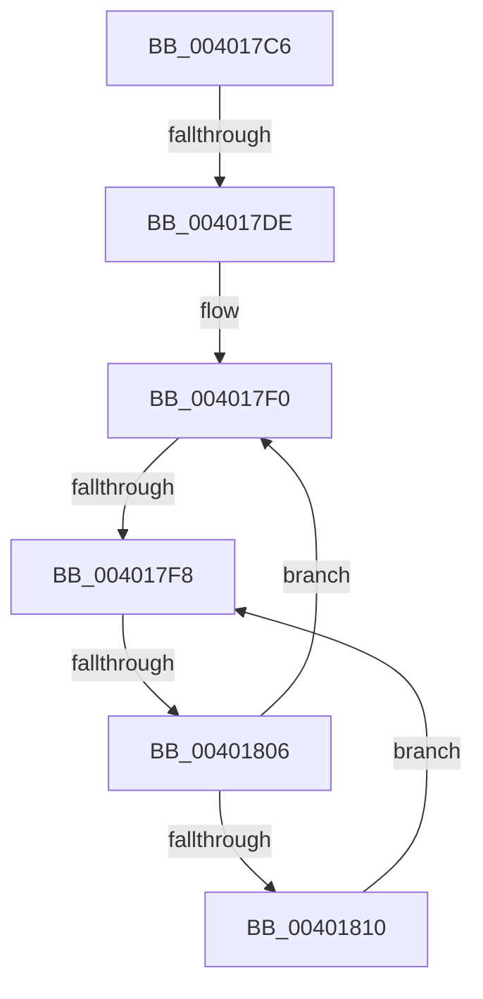

# sub_004017C6

- RVA: `0x004017C6`–`0x00401812` (길이 `76` bytes)
- VA: `0x00000001404017C6`
- 실행 섹션: `.text`
- PDB 이름 있음: `아니요`; PDB Function 태그: `아니요`
- unwind 정보 RVA: `0x0009A46C`
- 디코드: `19`개 명령, `76/76` bytes 표시
- 미해석 바이트: `0` (있으면 어셈블리에 `.byte`로 보존)

> 이 문서는 커널 이미지의 기계어와 PDB 기호를 분석해 생성했습니다. 4번과 5번은 함수 원형과 자료형을 바이너리 사용 방식에서 추정한 C 해석이며 원본 소스 복구 결과는 아닙니다.

## 1. Dependencies

- 직접 호출 지점: **0**; 고유 호출 대상: **0**
- 직접 호출자로 확인된 함수: **0**
- RIP 상대 이미지 참조: **1**

### Outgoing calls
- 직접 디코드된 call 명령이 없습니다.

### Direct callers
- 이 함수 시작 RVA로 연결되는 직접 call은 확인되지 않았습니다. 간접 호출은 완전히 역산할 수 없습니다.

### Static image references
- `0x004017FA` → RVA `0x00FC52AC` (`ALMOSTRO`; reference)

## 2. Other-region calls and transfers

- 다른 실행 섹션으로 향하는 call: **0**
- call이 아닌 외부 분기/꼬리 이동: **3**
  - `0x004017D8` → [sub_00401885](Unknown_function_00401885.md) (`tail-transfer`)
  - `0x004017F6` → [sub_0040181B](Unknown_function_0040181B.md) (`tail-transfer`)
  - `0x00401800` → [sub_00401923](Unknown_function_00401923.md) (`tail-transfer`)

## 3. Assembly (complete function range)

```asm
004017C6  48 89 7C 24 68                  mov qword ptr [rsp + 0x68], rdi
004017CB  43 C7 44 3E 1C FF FF FF FF      mov dword ptr [r14 + r15 + 0x1c], 0xffffffff
004017D4  66 45 85 D2                     test r10w, r10w
004017D8  0F 85 A7 00 00 00               jne 0x140401885
004017DE  48 8D 9D 10 01 00 00            lea rbx, [rbp + 0x110]
004017E5  48 C1 E3 05                     shl rbx, 5
004017E9  49 03 DF                        add rbx, r15
004017EC  33 FF                           xor edi, edi
004017EE  66 90                           nop
004017F0  F0 48 0F BA 2B 00               lock bts qword ptr [rbx], 0
004017F6  73 23                           jae 0x14040181b
004017F8  FF C7                           inc edi
004017FA  85 3D AC 3A BC 00               test dword ptr [rip + 0xbc3aac], edi
00401800  0F 84 1D 01 00 00               je 0x140401923
00401806  F3 90                           pause
00401808  48 8B 03                        mov rax, qword ptr [rbx]
0040180B  48 85 C0                        test rax, rax
0040180E  74 E0                           je 0x1404017f0
00401810  EB E6                           jmp 0x1404017f8
```

## 4. C-style interpretation (structured pseudocode)

```c
__int64 __fastcall sub_004017C6(void)
{
    __int64 v_rbx;
    __int64 v_rdi;
    unsigned __int64 v_stack_p68;

    v_stack_p68 = v_rdi;
    *(unsigned int *)(v_r14 + v_r15 * 1 + 28) = 0xFFFFFFFFULL;
    v_rbx = (v_rbp + 272) << (5);
    v_rbx = (v_rbx) + (v_r15);
    v_rdi = 0;
loc_004017F0:
loc_004017F8:
    v_rdi = (unsigned int)((v_rdi) + 1);
    if (*(unsigned __int64 *)(v_rbx) == 0) goto loc_004017F0;
    goto loc_004017F8;
}
```

## 5. (Beta) C Style

```c
void sub_004017C6(void)
{
    int64_t local_rbx;
    int64_t local_rdi;
    uint64_t v_stack_p68;

    v_stack_p68 = local_rdi;
    *(uint32_t *)(local_r14 + local_r15 * 1 + 0x1C) = 0xFFFFFFFFULL;
    local_rbx = (local_rbp + 272) << (5);
    local_rbx = (local_rbx) + (local_r15);
    local_rdi = 0;
loc_004017F0:
loc_004017F8:
    local_rdi = (uint32_t)((local_rdi) + 1);
    if (*(uint64_t *)(local_rbx) == 0) goto loc_004017F0;
    goto loc_004017F8;
}
```

## 6. Execution-region graph

[열기: 2D/3D 그래프와 함수 탐색 컨트롤 패널](../../../control-panel.html?section=text&rva=0x004017C6&view=graph)

- 2D 그래프는 위에서 아래로 흐르고, 3D 그래프는 빈 공간을 드래그해 회전합니다. Shift+드래그는 이동, 휠은 확대·축소, 함수 노드 선택은 대상 보고서 이동입니다.

### Static fallback


